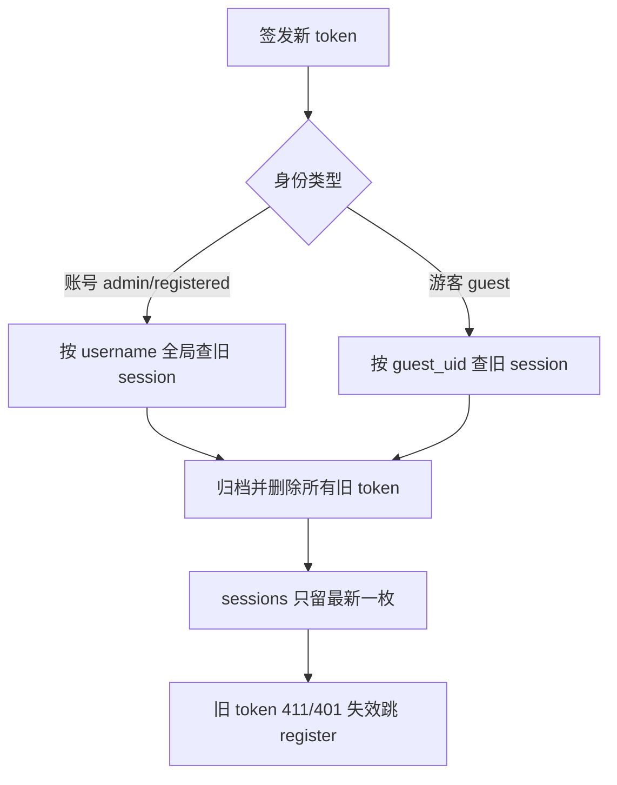

# 2026-11-25 修复同一身份多 token 并存（单端登录唯一性）

- **日期与时间**：2026-11-25 18:37
- **任务等级**：L2（后端会话去重口径变更 + 单测）
- **本次版本**：V3.7.13（并入本版本批次）

## 问题分析

**核心症状**：截图中 `sessions` 表出现两条 admin token（`GBZj...`、`wlk_...`）——
同一身份可开多个页面、签发多枚 token 并存，用户要求一个身份同一时间只有一枚有效 token。

**根本原因**：`supersede_sessions_locked`（`session_archive.py:139-173`）的账号分支匹配口径是
`username = ? AND ip = ? AND user_agent = ?`（同一设备），不同 IP/UA 的同一账号登录各留一枚 token。
游客分支已按 `guest_uid` 全局唯一，无需修复，但按用户要求统一表述。

**用户确认 scope**：三类身份全部显式统一（账号分支改为全局按 username 去重；guest 分支口径不变、
代码表述统一）。接受"新设备登录把旧设备同一账号强制下线"的单端登录语义。

## 修改内容

1. `backend/api/auth/session_archive.py::supersede_sessions_locked`：
   - 账号分支去掉 IP/UA 条件，改为 `WHERE role IN ('admin','registered') AND username = ?`，
     同身份全局唯一；
   - `ip` / `user_agent` 参数保留兼容旧调用方但不再参与匹配（文档说明）；
   - 游客分支表述统一为 `role='guest' AND (guest_uid=? OR username=?)`（口径不变）。
2. 单测：账号跨 IP/UA 重复签发 → 旧 token 被归档删除、仅留最新；guest 口径不变。

## 修改原因

用户明确要求"一个身份统一时间只能得到一个 token，签发新 token 则将旧 token 作废"，
并确认接受单端登录（新登录踢旧登录）。

## 影响范围

- 会话签发路径：`_create_session_sync`（login/register/OAuth/bind-email 等所有账号签发出口）。
- 游客签发路径：`register_guest_session`（口径不变）。
- **行为变更**：同一账号在新设备/浏览器/网络登录 → 旧 session 被归档删除并强制下线（单端登录）。
- 后端鉴权逻辑、token 签名机制、配额/统计均不变。

## 解决方案

在会话归档模块统一去重口径（单一事实来源），不动各业务签发调用方：
账号按 username 全局去重、游客按 guest_uid 去重，两类都是"同一身份仅留最新 token"。
旧 token 归档到 `expired_sessions`（`archive_reason=superseded`）保留排查依据。

## 性能指标

未实测：一次按 username 索引的 SELECT + 批量归档删除，微秒级。

## 测试方案

### Agent 已执行

- `tests/test_session_expiry.py`：8/8 通过（新增跨 IP/UA 重复签发测试，三条旧 admin token 全归档、其它身份保留）。
- 真实库验证：对 admin 新签发模拟归档 1 条旧 token（rollback 未落库，不破坏现有数据）。
- 全量 pytest 见本批次收尾。

### 待用户实机验证

1. 同一 admin 在浏览器 A 登录，再在浏览器 B 登录 → A 的 session 被作废，
   A 下次请求收到 401 跳 register。
2. registered 账号同理。
3. 游客多标签（同 guest_uid）仍只有一个 token。
4. `expired_sessions` 表可见 `archive_reason='superseded'` 的历史行。

## 变更文件清单

- `backend/api/auth/session_archive.py`：`supersede_sessions_locked` 账号分支改为按 username 全局去重（去 IP/UA 条件），更新模块与函数文档。
- `backend/tests/test_session_expiry.py`：新增 `test_account_token_superseded_globally_across_devices`。
- 本日志：根因分析、scope 确认（三类统一）、单端登录影响与验证。

## 遗留与风险

- **单端登录是行为变更**：同一账号无法多设备同时在线；如用户后续需要"白名单多端"，
  需另起方案（如按 device_id 允许的并发槽位）。
- 历史已存在的多 token：本次修复只在**新签发时**去重，历史并存 token 不会主动清理；
  各身份下次登录时自动收敛为一枚。如需立即清理需管理员手动删行（谨慎，涉及在线用户）。
- 前端同一浏览器多标签共享 localStorage token，不受影响（同一 token）。

## Mermaid 图

