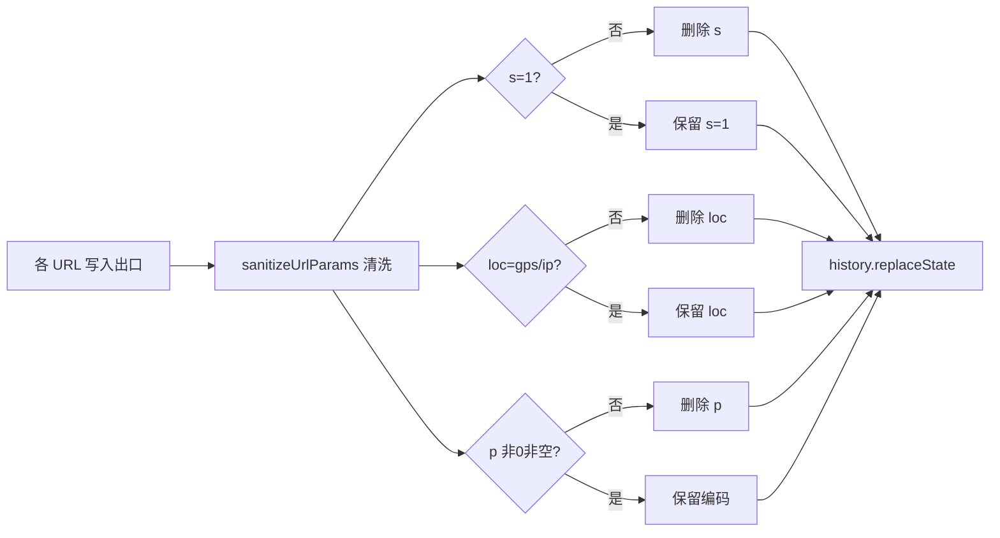

# 2026-11-25 URL 占位参数清理（s / loc / p 及同类）

- **日期与时间**：2026-11-25 15:16
- **任务等级**：L2（跨多文件的 URL 参数语义变更）
- **本次版本**：V3.7.14  （按用户「暂存区版本为 3.7.13，给我合并」指令归并至 V3.7.13；保留原始表述不改写）

## 问题分析

**核心症状**：URL hash 中常出现 `s=0&loc=0&p=0` 等占位值，地址栏噪声大，
且 `loc=0`（定位失败）、`p=0`（无编码）、`s=0`（非分享）本就不该出现在 URL。

**根本原因**：多个 URL 写入点无条件写入这些参数的"空状态"：
- `useMapState.ts:190-201` 构造 `nextQuery` 时 `s`/`loc`/`p` 恒有值（resolvePositionCode 在无 GPS 时返回 `'0'`）；
- `useMapState.ts:204-214` 还要求这些字段非空才执行同步，形成"必须写占位值"的反向约束；
- `useHomeTocAndAttributeActions.ts:547-553` 定位失败分支显式写 `p=0&loc=0`；
- `userLocationMath.ts:141-143` 定位成功时仍写 `s=0`；
- `auth.ts::injectPositionCodeToPath` 会写 `p=0`。

**受影响模块**：地图状态同步、定位上下文、首页 TOC 动作、游客身份注入、分享链接、罗盘 URL。

## 候选方案对比

| 方案 | 做法 | 优点 | 缺点 |
|---|---|---|---|
| A 逐点 if 判断 | 每个写入点加 `if (v !== '0')` | 改动局部 | 7 处散点、易遗漏、语义不统一 |
| **B 集中式清洗函数** | 新增纯函数按参数语义剔除占位值，各出口统一调用 | 单一事实来源、可单测、覆盖所有出口 | 需改造多个出口（但都是一行调用） |

**选定方案 B**。

## 修改内容

1. 新增 `sanitizeUrlParams`（纯函数，接受 `URLSearchParams`，原地删除占位项）：
   - `s`：仅 `'1'` 保留；`'0'`/空/其它删除（非分享不写）
   - `loc`：仅 `'gps'`/`'ip'` 保留；`'0'`/`'1'`/其它删除（读取端 `'1'`→gps 兼容不变）
   - `p`：仅非空且非 `'0'` 保留（未编码不写）
   - `cs`：仅非空且非 `'0'` 保留（与罗盘"cs=0 表示关闭"一致）
   - 通用：空串/null/undefined 值删除；数值参数 `lng`/`lat`/`z`/`l` 的合法 `0` **保留**
2. 各写入出口在 `toString()` 前调用清洗：
   - `useMapState.ts`（移除 `s`/`loc`/`p` 必填守卫，改由清洗函数决定）
   - `useHomeTocAndAttributeActions.ts`（定位失败分支改为删除而非写 0）
   - `userLocationMath.ts`（不再写 `s=0`）
   - `auth.ts::injectPositionCodeToPath`（不再写 `p=0`）
   - `TopBar.ts`（分享链接本来写 `s=1`，清洗不影响；顺带统一）
3. 文档口径与版本号同步。

## 修改原因

用户明确要求：只有"有意义的值"才注入 URL，`=0` 系列占位值代表"未启用/未授权/未编码"，属噪声。

## 影响范围

仅前端 URL 参数写入；读取端 `normalizeBinaryFlag` / `normalizeLocationFlag` 的兼容映射保持不变，
历史带 `s=0`/`loc=0`/`p=0` 的旧链接仍可正常解析（读取端视为默认值），只是新写入不再产生。

## 解决方案

清洗函数放在 `@common/url-state/`（与 `urlQueryReader.ts` 同域），导出给各写入点调用。
不新增配置项（无 `.env` / `catalog.py` 变更），符合 §3 配置登记豁免。

## 性能指标

未实测：纯字符串处理，参数数量 < 20。

## 测试方案

### Agent 已执行

- 清洗函数规则 8/8（全占位、有效值、混合、loc=1、数值 0 保留、其它参数保持、cs=0、空值）。
- `vue-tsc --noEmit`：0 错误。
- 门禁：`CheckConfigRegistry` ✅、`CheckDomainDeps` TOTAL 0、`CheckStructureTree` 753/753（新增文件已登记）、`CheckVueParadigm` ✅。
- `vite build --outDir <临时目录>`：成功。

### 待用户实机验证

1. 未分享、未GPS授权浏览：地址栏不再出现 `s=0&loc=0&p=0`。
2. GPS 授权定位成功：出现 `loc=gps&p=<编码>`，`s` 不出现（除非点分享）。
3. IP 定位：出现 `loc=ip`，`p` 不出现。
4. 点击分享：出现 `s=1`，且 `ut`/`loc`/`p` 仍被排除。
5. 历史旧链接（含 `s=0` 等）仍可正常打开。

## 变更文件清单

- `frontend/src/domains/common/url-state/urlParamSanitizer.ts`（新增）：`sanitizeUrlParams` 集中清洗函数。
- `frontend/src/domains/ol/composables/useMapState.ts`：移除 s/loc/p 必填门槛，写入前清洗。
- `frontend/src/app/composables/useHomeTocAndAttributeActions.ts`：定位失败改删占位值，接入清洗。
- `frontend/src/domains/common/map-view/userLocationMath.ts`：不再写 `s=0`，接入清洗。
- `frontend/src/domains/common/user/services/auth.ts`：`injectPositionCodeToPath` 不再写 `p=0`/`loc=1`。
- `frontend/src/domains/common/shell/TopBar.ts`：分享链接生成接入清洗。
- `Docs/Guide/frontend-structure.md`：结构树登记新文件。
- `README.md` / `Docs/Guide/CHANGELOG.md`：版本号 V3.7.14 与条目。
- 本日志：分析、方案对比、Mermaid 图与验证结论。

## 遗留与风险

- 读取端仍接受旧占位值（向后兼容），不做破坏性清理。
- 数值参数 0（如 `l=0`、`z=0`、`lng=0`）属合法值，不在本次清理范围。

## Mermaid 图

