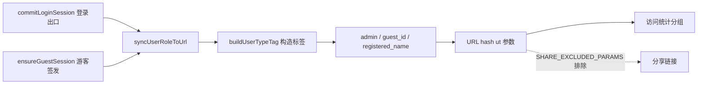

# 2026-11-25 URL `ut` 参数身份标签优化

- **日期与时间**：2026-11-25 14:50
- **任务等级**：L2（常规：URL 参数语义优化 + 身份展示统一）
- **本次版本**：V3.7.12（过程日志曾拟 V3.7.13，按用户「归并为 3.7.12」指令归并；保留原始表述不改写）

## 问题分析

**核心症状**：URL hash 中的 `ut` 参数目前只写三类角色名（`admin` / `guest` / `registered`），
同一身份下所有游客或注册用户无法区分，访问统计分组只能看到粗粒度角色。

**根本原因**：`syncUserRoleToUrl` 仅取 `user.role` 直接写入，未结合身份唯一标识。

**受影响模块**：
- 写入端：`frontend/src/domains/common/user/services/auth.ts::syncUserRoleToUrl`
- 登录出口：`sessionCommit.ts`（唯一调用点）
- 游客签发：`guestIdentity.ts`（当前**未**同步 `ut`，需补）
- 文档声明：`useUrlParamStore.ts` 的 `ut` 注释、`TopBar.ts` 的分享排除名单（名单本身无需改）

## 候选方案对比

| 方案 | 做法 | 优点 | 缺点 |
|---|---|---|---|
| A 保留角色 + 序号 | `admin` / `guest_<id>` / `registered_<username>` | 可读性强、按用户可区分、统计分组细化 | 需处理游客无 `guest_no` 的兜底 |
| B 仅加随机后缀 | 各类加随机串 | 实现简单 | 不可读、无法回溯身份 |
| C 改用 guest_uid | `guest_<hex16>` | 与身份主键一致 | 回到「乱码不可区分」老问题，与上一轮工作冲突 |

**选定方案 A**：符合用户明确指令，且与上一轮 `guest_<id>` 数据库展示口径一致。
`admin` 保持唯一性不附加标识（管理员账号全局唯一）。

## 修改内容（阶段一分析结论）

1. `syncUserRoleToUrl` 生成规则：
   - `admin` → `ut=admin`（唯一，不附加）
   - `guest` → `ut=guest_<guest_no>`，缺失时回退 `guest_<id-from-username>`
   - `registered` → `ut=registered_<username>`
2. 游客签发路径 `ensureGuestSession` 补调 URL 同步，使游客浏览也有可区分的 `ut`。
3. 同步注释与版本号。

## 修改原因

用户明确要求三类身份标签细化，便于访问统计按具体用户分组与人工排查。
`ut` 位于 URL hash，不上送服务器、不参与鉴权，改变其取值无权限风险。

## 影响范围

仅前端 URL hash 展示与统计分组；后端不读取该参数，鉴权链路零影响。

## 解决方案

在 `auth.ts` 内新增纯函数 `buildUserTypeTag(user)` 统一构造标签（单一职责），
`syncUserRoleToUrl` 调用它写入 URL；游客签发成功后调用 `syncUserRoleToUrl(user)`。
`registered_<username>` 的 username 来自后端规范化字段，字符集受注册校验约束
（`[A-Za-z0-9_]{3,24}`），URLSearchParams 会自动编码，无需额外转义。

## 性能指标

未实测（纯字符串拼接与一次 `history.replaceState`，无网络请求）。

## 测试方案

### Agent 已执行

- `vue-tsc --noEmit`：0 错误。
- 三类标签构造纯函数 7 组用例（admin / guest 有序号 / guest 无序号回退 / guest 旧 hex / registered 有用户名 / registered 无用户名 / visitor 兜底）：7/7 通过。
- 门禁：`CheckConfigRegistry` ✅、`CheckDomainDeps` TOTAL 0、`CheckStructureTree` 751/751、`CheckVueParadigm` ✅。
- `vite build --outDir <系统临时目录>`：`✓ built in 11.28s`；末尾 `safe-delete` 清理临时目录被沙箱拒绝（环境限制，构建产物本身成功）。

### 待用户实机验证

1. 游客进入首页后地址栏 hash 中出现 `ut=guest_<序号>`。
2. 注册用户登录后 `ut=registered_<用户名>`；管理员登录后仍为 `ut=admin`。
3. 点击分享链接时 `ut` 不进入分享 URL（沿用 `SHARE_EXCLUDED_PARAMS`）。

## 变更文件清单

- `frontend/src/domains/common/user/services/auth.ts`：新增 `buildUserTypeTag` 纯函数；`syncUserRoleToUrl` 改用其返回值写入 `ut`。
- `frontend/src/domains/common/user/services/guestIdentity.ts`：游客签发成功后补调 `syncUserRoleToUrl`。
- `frontend/src/domains/common/url-state/stores/useUrlParamStore.ts`：`ut` 注释更新为新格式。
- `frontend/src/domains/common/shell/TopBar.ts`：分享排除清单注释更新（清单本身不变）。
- `README.md`：三处版本号 V3.7.13 + 版本演进表首行。
- `Docs/Guide/CHANGELOG.md`：新增 V3.7.13 条目。
- 本日志：本次改动全貌与 Mermaid 图。

## 遗留与风险

- `ut` 可被手工伪造，仅用于统计分组，不可作为鉴权依据（设计前提不变）。
- 历史 `ut=guest` / `ut=registered` 链接仍可正常打开，只是统计分组归为旧桶。

## Mermaid 图（跨 3 文件协同）

