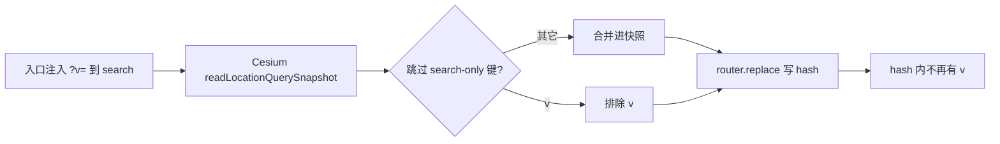

# 2026-11-25 修复版本参数 v 被复制进 hash query

- **日期与时间**：2026-11-25 15:25
- **任务等级**：L2（URL 参数写回路径缺陷修复）
- **本次版本**：V3.7.14  （按用户「暂存区版本为 3.7.13，给我合并」指令归并至 V3.7.13；保留原始表述不改写）（并入本版本批次，不单独升号；用户明确要求"根路径注入一次即可"）

## 问题分析

**核心症状**：切换到 Cesium 后，地址栏出现 `?v=3.7.18#/home?v=3.7.18&...`——
版本参数 `v` 同时存在于 search 与 hash query 中。

**根本原因**：`useCesiumUrlTracking.ts:51-62` 的 `readLocationQuerySnapshot()` 以
"hash 优先、search 补缺"合并参数时，把 `location.search` 的全部键（含 `v`）并入快照；
随后 `replaceUrlQuery()` 用 `router.replace({ query: mergedQuery })` 把整个快照写回
**hash query**，于是 search 专属的 `v` 被复制进 hash。

同类写回路径还有 `compass/services/urlState.ts::readMergedQuery()`（同样把 search 参数
补进 hash query），虽本次未触发，但存在相同缺陷，一并修复。

**只读路径**（`userLocationMath`、`sharedEntryResolver`、`router/index.ts`）仅按键取值、
不写回 hash，无副作用，不改。

**受影响模块**：Cesium 相机/视图 URL 同步、罗盘 URL 状态。

## 修改内容

1. 在 `@common/url-state/urlParamSanitizer` 新增 `SEARCH_ONLY_QUERY_KEYS = ['v']`
   与 `isSearchOnlyQueryKey(key)`，作为"仅属于根路径 search、不得写入 hash"的单一事实来源。
2. 两处写回型快照合并在补 search 参数时跳过 `SEARCH_ONLY_QUERY_KEYS`：
   - `useCesiumUrlTracking.ts::readLocationQuerySnapshot`
   - `compass/services/urlState.ts::readMergedQuery`

## 修改原因

`v` 是版本标识，设计上只应出现在根 search 一次（由 `appVersionQuery.ts` 在入口注入）；
被复制进 hash 会导致地址栏冗余，且分享链接清洗逻辑需重复处理同一参数。

## 影响范围

仅前端 URL 参数写回；`v` 本身不上送业务、不参与鉴权。修复后 hash 内不再新增 `v`，
已有的历史 URL 中 hash 里的 `v` 会在下次地图 URL 同步时被自然剔除。

## 解决方案

选择"在快照合并源头排除"而非"写回后删除"：前者保证所有下游（router.replace / 快照比较）
看到的都是干净数据，避免 `isSameQuerySnapshot` 因多出 `v` 误判为需要写入。

## 性能指标

未实测：纯字符串处理，参数数量 < 20。

## 测试方案

### Agent 已执行

- `vue-tsc --noEmit`：0 错误。
- 清洗规则 + search 合并过滤 5/5 通过（hash 旧 v 剔除、仅 v 变空 hash、占位值仍剔除、数值 0 保留、其它参数保持）。
- 门禁与生产构建结果见本批次 V3.7.14 汇总日志。

### 待用户实机验证

1. 访问首页 → 地址栏 `?v=<版本>#/home`，hash 内无 `v`。
2. 切换 Cesium → 仍只有根 search 一个 `v`，hash query 不再出现 `v`。
3. 调整罗盘参数 → hash 内不产生 `v`。

## 变更文件清单

- `frontend/src/domains/common/url-state/urlParamSanitizer.ts`：新增 `SEARCH_ONLY_QUERY_KEYS` / `isSearchOnlyQueryKey`，清洗时剔除 hash 内残留的 v。
- `frontend/src/domains/cesium/composables/layers/useCesiumUrlTracking.ts`：search 补缺时跳过仅 search 参数。
- `frontend/src/domains/common/compass/services/urlState.ts`：同上，防止罗盘写回产生重复 v。
- `frontend/src/domains/common/url-state/appVersionQuery.ts`：入口注入时顺带清理 hash 内残留的旧 v（修复早退导致的不清理）。
- 本日志：根因分析、方案与验证。

## 遗留与风险

- 历史链接若已在 hash 内带 `v`，本次修复后需一次地图 URL 同步才会剔除（不会自动立即清除）。
- 若未来新增其它"仅 search"参数，登记到 `SEARCH_ONLY_QUERY_KEYS` 即可。

## Mermaid 图

