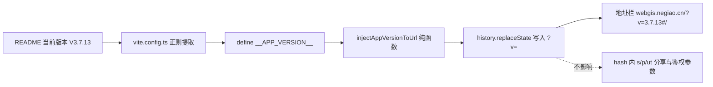

# 2026-11-25 首页 URL 自动注入版本参数 `?v=`

- **日期与时间**：2026-11-25 15:06
- **任务等级**：L2（新增 .ts 工具 + 入口调用 + 版本号 + 文档）
- **本次版本**：V3.7.13

## 问题分析

**核心症状**：用户希望访问 `webgis.negiao.cn` 时，加载完毕后地址栏自动变为
`webgis.negiao.cn/?v=3.7.12#/`，使版本信息在 URL 中可见，用于缓存标识与人工排查。

**根本原因**：项目此前只在构建期把版本号注入全局变量 `__APP_VERSION__`（`vite.config.ts:105`
从 README 提取），URL 本身不带任何版本标识。

**受影响模块**：应用入口 `main.ts`、前端 URL 参数读取链路、分享链接生成、版本号文档。

## 候选方案对比

| 方案 | 格式 | 结论 |
|---|---|---|
| A 日期 | `?v=20261125` | 弃用：同日多次发版无法区分；需额外注入构建日期；与 CHANGELOG 无法对应 |
| B 版本号（下划线） | `?v=3_7_12` | 弃用：可读性差，下划线仅为文件名场景规避点号冲突，URL query 无此约束 |
| **C 版本号（点号）** | `?v=3.7.12` | **选定**：复用 `__APP_VERSION__`（README → vite define）零维护；每次 L2/L3 发版必变，缓存刷新有效；与 CHANGELOG 一一对应 |

## 修改内容

1. 新增纯函数工具（独立 `.ts`）：从 `__APP_VERSION__` 提取纯数字版本（`V3.7.13` → `3.7.13`），
   以 `history.replaceState` 写入 URL search 的 `v` 参数。
2. 幂等与保留：已存在且值相同则不动；值不同则更新；保留其余 search 参数、hash 路径与 hash 查询参数。
3. 应用入口尽早调用（mount 前），确保首屏加载完毕即可见。

## 修改原因

用户明确要求首页自动注入版本标识；版本号方案在可追溯性、维护成本与缓存破坏有效性上均优于日期。

## 影响范围

仅前端 URL search 参数与展示。后端不读取 `v`；鉴权、路由、分享链接逻辑不受影响
（`v` 在 search 中，与 hash 内的 s/p/loc/ut 完全隔离）。

## 解决方案

**为何用 `replaceState` 而非 `router.replace`**：版本参数是展示元数据，不应产生新的历史记录条目
（否则浏览器后退会在同一页面反复停留），也不应触发路由守卫与视图重建。

**为何放 search 而非 hash**：用户示例 `?v=...#/` 即 search 位置；hash 内的参数由 URL 参数 store
与分享逻辑管理，混入 `v` 会污染分享链接语义（虽然 `SHARE_EXCLUDED_PARAMS` 已排除 ut，但不新增风险点）。

**版本源复用**：`__APP_VERSION__` 由 `vite.config.ts` 从 README「当前版本」正则提取并注入，
无需新增环境变量或配置 key，符合 §3「配置 key 登记前置」的豁免（非新配置项）。

## 性能指标

未实测：纯字符串处理 + 一次 `history.replaceState`，无网络请求。

## 测试方案

### Agent 已执行

- 版本提取纯函数 6/6 用例通过（`V3.7.12` / `3.7.12` / `V0.0.0` / 空 / null / 不完整版本）。
- `vue-tsc --noEmit`：0 错误。
- 门禁：`CheckConfigRegistry` ✅、`CheckDomainDeps` TOTAL 0、`CheckStructureTree` 752/752（新增文件已登记）、`CheckVueParadigm` ✅。
- `vite build --outDir <系统临时目录>`：`✓ built in 12.18s`，退出码 0。
- 平台红线：排除 `.venv` 后仅命中已知 `maxRayDistance` 假阳性；生产基线通过。

### 待用户实机验证

1. 访问 `webgis.negiao.cn` → 加载完毕后地址栏显示 `webgis.negiao.cn/?v=<当前版本>#/`。
2. 带已有参数访问（如 `?foo=bar#/home?ut=...`）→ `v` 注入后其它参数原样保留。
3. 分享链接生成的 URL 不含 hash 内的 `v`（`v` 在 search，不影响 hash 参数剥离逻辑）。

## 变更文件清单

- `frontend/src/domains/common/url-state/appVersionQuery.ts`（新增）：`extractNumericAppVersion` / `injectAppVersionToUrl` 纯函数。
- `frontend/src/main.ts`：应用入口 mount 前调用注入函数。
- `Docs/Guide/frontend-structure.md`：结构树登记新文件（752/752）。
- `README.md`：三处版本号 V3.7.13 + 版本演进表首行。
- `Docs/Guide/CHANGELOG.md`：新增 V3.7.13 条目。
- 本日志：分析、方案对比、Mermaid 图与验证结论。

## 遗留与风险

- `?v=` 会随每个静态资源请求上送（GitHub Pages 忽略，但 CDN 缓存 key 可能包含），这正是缓存标识的预期用途。
- L1 微改（typo 等）不升版本号，`v` 不变，缓存不刷新——版本号方案的固有取舍。

## Mermaid 图

