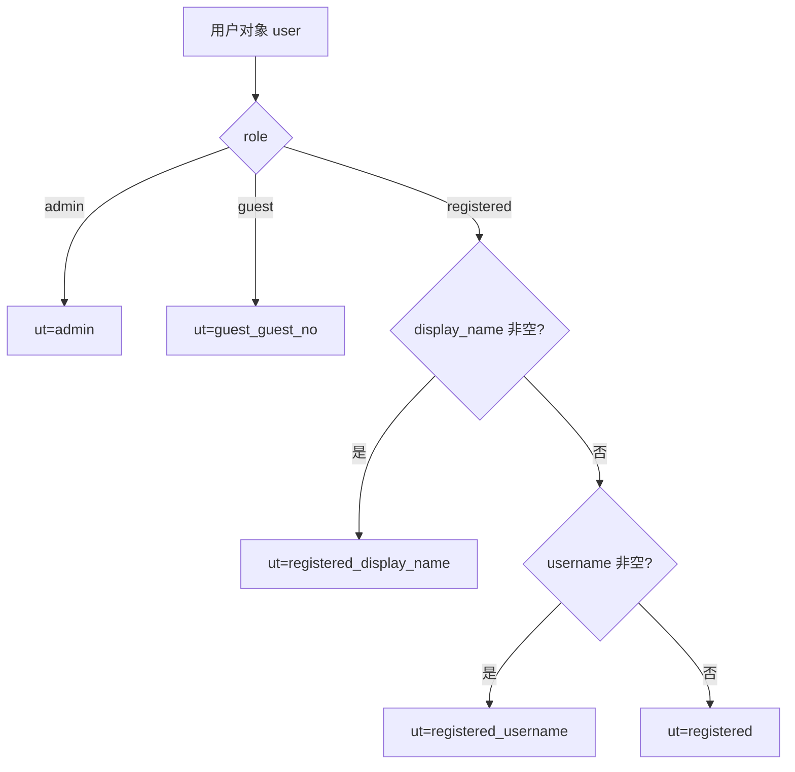

# 2026-11-25 修复 URL ut 身份标签使用带 hash 的 username

- **日期与时间**：2026-11-25 18:02
- **任务等级**：L2（前端纯函数改造 + 单测）
- **本次版本**：V3.7.13（并入本版本批次）

## 问题分析

**核心症状**：URL 出现 `ut=registered_negiao_033f72`——注册用户标签带 OAuth 生成的随机 hash 后缀，不适合展示。

**根本原因**：`buildUserTypeTag`（`auth.ts:387-403`）对 registered 取 `username`，
而 OAuth 用户的 username 由 `_generate_account_username_sync`（`user.py:64-66`）生成：
`base_<token_hex(3)>`（如 `negiao_033f72`）——hash 用于**保证全局唯一**（避免撞名），是数据库主键语义，不是展示语义。
用户对象里已有干净的展示字段 `display_name`（如 `（NEGIAO）`），但 ut 生成没用它。

**受影响模块**：仅前端 `buildUserTypeTag` 纯函数与 `syncUserRoleToUrl`。

## 关键事实（决定修复安全性）

- `ut` **无任何消费方**：全仓 grep 确认后端不读、前端只有写入（`auth.ts:427`）与分享排除（`TopBar.ts:83`）。
  `auth.ts:408-410` 注释明确它"仅用于访问统计与人工排查，不参与权限判断"。
- 因此改用 `display_name` 完全不影响鉴权、配额、统计分组逻辑；旧链接的旧格式也无需兼容处理。

## 用户诉求

`ut` 应为 `registered_{display_name}`，而非带 hash 的 username。

## 修改内容

`buildUserTypeTag` 的 registered 分支：
- 优先取 `display_name`，但先做**温和清洗**（用户 18:10 选定方案）：
  trim 首尾 → 去除控制字符（U+0000–001F、U+007F，避免污染 URL）→
  压缩连续空白 → 限长 32 字符（ut 是标签，不需要昵称全长 40）；
- 清洗后非空才用；否则回退 `username`（兼容旧会话/无 display_name 的调用方）；
- 仍无则输出 `registered`（现有兜底不变）。
- admin/guest 分支不变。

**为何不复用 `normalizeDisplayName`**：它定义在 `useAuthIdentity.ts`（composable），
而 `buildUserTypeTag` 在 `services/auth.ts`；按分层约定 service 不依赖 composable，
且该函数不限长 32、不去控制字符（仅用于校验），故在 service 内联 ut 专用清洗。

## 修改原因

用户明确要求 ut 用展示名；hash 是主键唯一性手段，不应出现在给用户看的 URL 标签里。

## 影响范围

仅 URL 中 `ut` 参数的取值；无功能逻辑影响。中文 display_name 经 URLSearchParams 会自动 percent-encode，
地址栏显示可能是编码串，但语义正确且无消费方依赖——如实记录此权衡（见遗留）。

## 解决方案

选择"display_name 优先 + username 回退"，保持纯函数无副作用与既有单测结构；
不引入新的配置项（ut 是展示标签，不需要 SSOT 登记）。

## 性能指标

未实测：纯字符串处理。

## 测试方案

### Agent 已执行

- 纯函数 7/7 验证（18:10 清洗增强后）：真实 OAuth 数据 → `registered_（NEGIAO）`；压缩连续空白；去除控制字符（U+0001/U+007F）；限长 32；空/全空白 display_name 回退 username；admin 不变。
- `vue-tsc --noEmit`：0 错误。
- 门禁与构建见本批次收尾。

### 待用户实机验证

1. 用 OAuth 账号登录 → URL 中 `ut=registered_（NEGIAO）`（或 percent-encoded 等价形式），不再含 hash 后缀。
2. 无 display_name 的旧会话 → 回退 username，不出现空 `ut`。
3. 分享链接仍排除 ut（TopBar 逻辑不变）。

## 变更文件清单

- `frontend/src/domains/common/user/services/auth.ts`：`buildUserTypeTag` registered 分支改用 display_name 优先、username 回退，并更新函数注释。
- 本日志：根因（hash 用于主键唯一性）、ut 无消费方的事实核查、方案与验证。

## 遗留与风险

- 中文/特殊字符 display_name 会被 URLSearchParams 编码，地址栏不如纯 ASCII 简洁——
  这是用户选定的"温和清洗后仍用 display_name"方案的必然结果，且 ut 无消费方，可接受。
- 清洗限长 32（后端昵称上限 40），超长昵称在 ut 中被截断——ut 是标签而非权威显示，可接受。
- display_name 可重名（不像 username 唯一），但 ut 仅作展示标签，无需唯一。
- 旧链接里已存在的 `registered_negiao_033f72` 不会被主动改写（ut 只在身份提交时同步），
  下次登录/签发时自然更新为新格式。

## Mermaid 图

