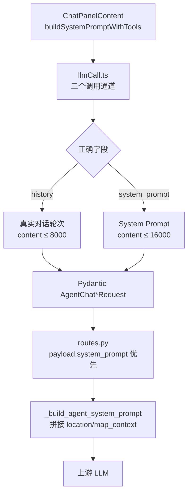

# 2026-11-26 Agent history 8000 字符超限修复

> **日期**：2026-11-26 21:17  
> **任务等级**：L2 常规开发  
> **状态**：✅ 已完成（验证结果见第七节）  
> **关联版本**：V3.7.16（已写入 README / CHANGELOG）

---

## 一、问题分析

### 核心症状

Agent 请求返回 422：

```text
history.0.content: String should have at most 8000 characters
```

报错内容是整段 `[系统指令] ...`，即 `buildSystemPromptWithTools()` 生成的 System Prompt。

### 根本原因

`frontend/src/domains/common/chat/composables/agentConfig/llmCall.ts` 在创建 `enhancedHistory` 时，把 System Prompt 伪装成第一条 `user` 历史消息：

```ts
role: 'user',
content: `[系统指令] ...\n\n${systemPrompt}`
```

在瓦片语义预设扩展前，System Prompt 约 6k 字符，低于后端 `AgentChatHistoryItem.content` 的 8000 上限；新增 18 条瓦片规则后，实测为 **9,779 字符 / 17,767 UTF-8 字节**，直接触发校验失败。

这不是「提示词太长」本身的问题，而是**提示词放错了字段**：后端已有专用 `system_prompt` 字段，history 只应放真实对话轮次。

### 受影响模块

| 模块 | 影响 |
|---|---|
| `frontend/.../agentConfig/llmCall.ts` | 三个 LLM 通道都把 System Prompt 注入 history |
| `backend/api/agent_chat/schemas.py` | `system_prompt` 专用字段上限仍是 8000，容不下新提示词 |
| `backend/api/agent_chat/routes.py` | 部分通道忽略 `payload.system_prompt`，只取运行时配置 |
| Agent 对话链路 | 所有带完整工具提示词的请求都会 422，无法使用 |

---

## 二、候选方案对比

| 方案 | 做法 | 优点 | 缺点 | 结论 |
|---|---|---|---|---|
| A. 压缩提示词到 8000 以下 | 删除规则/精简文案 | 不改结构 | 牺牲能力；下次扩展还会复发 | 拒绝 |
| B. 提高 `history.content` 上限 | history 放宽到 16000 | 一行改动 | 继续把系统指令伪装成用户消息，语义错误；污染对话历史 | 拒绝 |
| C. 回到专用字段（选定） | history 只保留真实轮次；System Prompt 走 `system_prompt`；字段上限 16000 | 语义正确；支持后续扩展；不污染历史 | 需同步前端三通道与后端部分路由 | 采用 |

---

## 三、数据流与文件交互



---

## 四、实施计划

1. `llmCall.ts`：删除 `enhancedHistory` 注入；三个通道都把原生 `history` 放进请求体。
2. `llmCall.ts`：默认 AI 通道与个人 Key 通道显式传 `system_prompt`；用户配置通道也传 `system_prompt`。
3. `schemas.py`：将 `AgentChatRequest.system_prompt` 与 `AgentChatProxyRequest.system_prompt` 上限从 8000 提到 16000；`history.content` 保持 8000。
4. `routes.py`：让 `/chat/completions` 与 `/chat/completions/stream` 优先使用 `payload.system_prompt`，与 default-proxy / proxy 路由对齐。
5. 更新版本号、CHANGELOG、日志验证结果，运行 typecheck 与两个门禁。

---

## 五、验证方案

### Agent 已执行

- 计算生成提示词长度。
- `npm run typecheck`。
- `python Scripts/CheckStructureTree.py`。
- `python Scripts/CheckConfigRegistry.py`。
- 平台红线自查。

### 待用户实机验证

1. 打开 Agent 聊天框，发送任意地图操作请求。
2. 确认不再出现 `history.0.content` 8000 字符错误。
3. 输入「切换成 Google 只显示水系」，确认按瓦片规则调用 `switch_basemap`。
4. 多轮工具调用后再次发消息，确认 history 不含 `[系统指令]` 伪消息。

---

## 六、风险与遗留

- 仅放宽专用 `system_prompt` 字段，不放宽 history；避免把真实对话消息撑到 16k。
- 个人 Key 模式下用户自定义 System Prompt 与内置提示词合并后可能继续增长；上限 16000 对当前 9779 字符 + 2000 用户配置留有余量。
- 历史会话若已持久化旧伪消息，已从源头停止新增；旧数据不影响新请求结构。

---

## 七、验证结果

### Agent 已执行

- 生成提示词实测：9,779 字符 / 17,767 UTF-8 字节。
- `npm run typecheck`（frontend）：✅ 通过，`vue-tsc --noEmit` 无报错。
- `python -m py_compile api/agent_chat/schemas.py api/agent_chat/routes.py`：✅ 通过。
- Pydantic schema 冒烟：✅ `AgentChatRequest` / `AgentChatProxyRequest` 均接受 9,779 字符 `system_prompt`；8001 字符 history 仍被拒绝。
- 前端静态检查：✅ `enhancedHistory` 残留引用为 0；三个调用通道均提交 `system_prompt`。
- `python Scripts/CheckStructureTree.py`：✅ 755 / 755，漏登记 0、幽灵条目 0。
- `python Scripts/CheckConfigRegistry.py`：✅ B1–B4 / F1–F3 全部通过。
- 平台红线扫描（排除 `.venv`）：✅ `REDLINE-CLEAN`；生产基线 `BASELINE-CLEAN`。
