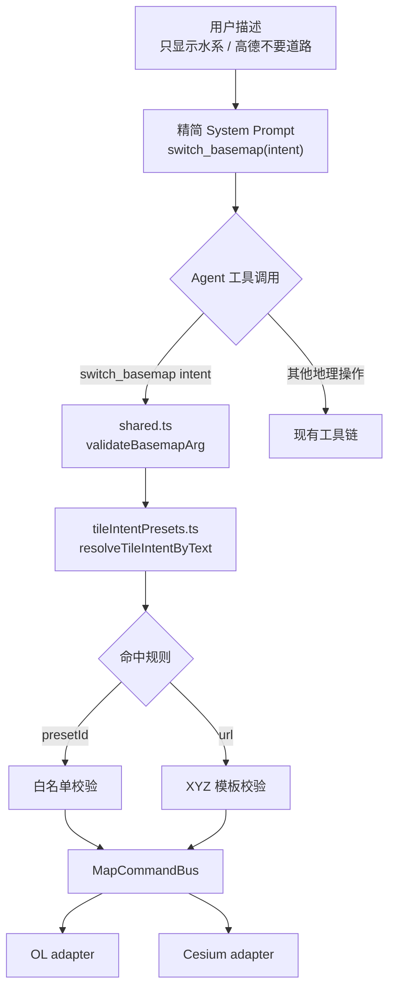

# 2026-11-26 Agent 提示词瘦身与按需规则调用

> **日期**：2026-11-26 21:23  
> **任务等级**：L2 常规开发  
> **状态**：✅ 已完成（验证结果见第八节）  
> **关联版本**：V3.7.17

---

## 一、问题分析

### 核心症状

V3.7.15 将 18 条瓦片语义规则全文注入 System Prompt，叠加原有工具清单、风水规则与约束后，完整提示词达到 **9,779 字符 / 17,767 UTF-8 字节**。用户反馈首轮响应明显变慢。

### 根本原因

当前设计把「可能性说明」全部前置：

1. `AGENT_TOOLS` 已包含每个工具的 JSON Schema 描述；
2. System Prompt 又重复列出 20 个工具签名；
3. 再补充长篇风水规则和 18 条瓦片规则，首轮输入 token 膨胀；
4. 规则虽然有用，但大部分任务用不到，却每轮都发送。

问题不是单条规则错误，而是**上下文分发策略错误**：静态系统提示词应只保留身份、边界、工具调用纪律；领域细节应在命中时按需可用。

### 受影响模块

| 模块 | 影响 |
|---|---|
| `agentToolsSchema.ts` | System Prompt 过长，首轮延迟增加 |
| `tileIntentPresets.ts` | 规则表目前只用于生成 Prompt，未参与运行时解析 |
| `switch_basemap` 工具链 | 只允许 `presetId` / `url`，没有 `intent` 通道 |
| `shared.ts` | `validateBasemapArg` 只校验两种参数 |

---

## 二、候选方案对比

| 方案 | 做法 | 优点 | 缺点 | 结论 |
|---|---|---|---|---|
| A. 直接删规则 | 移除瓦片/风水规则 | 最短 prompt | 模型不知道如何选工具与参数，能力退化 | 拒绝 |
| B. 工具描述里塞规则 | 把长规则移到 tool description | System Prompt 变短 | tools JSON 仍每轮发送，token 未降 | 拒绝 |
| C. 新增规则检索工具 | 新增 `get_agent_guide(topic)` | 彻底按需 | 需要新工具注册、执行器、command bus/结果格式化，跨多文件 | 暂缓 |
| D. intent 本地解析（选定） | `switch_basemap(intent=用户原话)`，本地把 intent 解析成 presetId/url | 不改工具数量；首轮 prompt 大幅缩短；规则只在命中时生效 | 只覆盖瓦片语义；其他复杂规则仍需压缩保留 | 采用 |

---

## 三、数据流与文件交互

---

## 四、实施计划

1. `tileIntentPresets.ts`：新增 `resolveTileIntentByText(text)`，用关键词打分匹配本地规则；不再生成长 Prompt 段落。
2. `agentToolsSchema.ts`：
   - `switch_basemap` 增加 `intent` 参数；
   - System Prompt 删除「## 工具」长列表、「## 瓦片语义预设」长规则、「## 内置功能问答（风水罗盘）」长规则；
   - 保留简短身份、上下文、硬约束、风水三步与换底图一句规则。
3. `shared.ts`：`validateBasemapArg` 支持 `intent`，命中后解析为 `presetId` 或 `url`，失败时返回结构化错误。
4. 不改后端、不改工具数量、不改 command bus。
5. 更新版本号、CHANGELOG、结构树与日志验证结果。

---

## 五、目标

| 指标 | 优化前 | 目标 |
|---|---:|---:|
| System Prompt 字符数 | 9,779 | ≤ 3,500 |
| System Prompt UTF-8 字节 | 17,767 | ≤ 7,000 |
| 工具数量 | 20 | 20 |
| 瓦片规则发送方式 | 全量前置 | intent 命中时本地解析 |

---

## 六、验证方案

### Agent 已执行

- 优化前后分别测量 System Prompt 字符数与字节数。
- `npm run typecheck`。
- 规则解析冒烟：水系、道路、高德简洁、无规则短语。
- `CheckStructureTree.py` / `CheckConfigRegistry.py`。
- 平台红线自查。

### 待用户实机验证

1. 输入「切换成 Google 只显示水系」，确认首轮响应更快且调用 `switch_basemap(intent=...)`。
2. 输入「高德地图不要道路和文字」，确认命中 `vector_amap_clean_hd_preset`。
3. 输入「分析峰下村的风水」，确认仍能 `search_and_zoom` → `enable_compass`。
4. 复杂多轮工具任务不因提示词压缩而中断。

---

## 七、风险与遗留

- intent 解析依赖规则表关键词；用户表述非常隐晦时可能不命中，此时应返回结构化错误而不是猜测 URL。
- 其他领域长规则仍可能在后续扩展中再次撑大 prompt；未来若规则继续增长，应升级为 `get_agent_guide(topic)` 按需工具（L3）。

---

## 八、实施与验证结果

### 修改内容

1. `tileIntentPresets.ts`：新增 `resolveTileIntentByText` / `resolveTileBasemapArg`；规则只在工具调用时本地解析；不再注入 System Prompt。
2. `agentToolsSchema.ts`：System Prompt 从 20 条工具列表 + 长风水规则 + 18 条瓦片规则，压缩为核心身份、上下文、关键规则与降级格式；`switch_basemap` 增加 `intent` 参数。
3. `shared.ts`：`validateBasemapArg` 支持 `intent`，复用本地规则表解析为 `presetId` 或精确 URL。
4. `olAdapter.ts` / `cesiumAdapter.ts`：透传 `intent`，两个引擎共用同一校验路径。

### 实测对比

| 指标 | 优化前 | 优化后 |
|---|---:|---:|
| System Prompt 字符数 | 9,779 | **962** |
| UTF-8 字节 | 17,767 | **1,840** |
| 字符降幅 | — | **90.16%** |
| 工具数量 | 20 | 20 |
| 长规则是否前置 | 是 | 否 |

### 规则解析冒烟

- `只显示水系` → `imagery_google_water_preset`
- `切换成 Google 只显示水系` → `imagery_google_water_preset`
- `高德地图不要道路和文字` → `vector_amap_clean_hd_preset`
- `高德只显示湖泊` → 明确返回「高德无法单拆水系/湖泊或土地利用」
- `Google 土地利用` → 精确代理 URL
- `随便聊聊` → 未识别，不猜测 URL

### Agent 已执行

- `npm run typecheck`：✅ 通过
- `CheckStructureTree.py`：✅ 755 / 755
- `CheckConfigRegistry.py`：✅ 全部通过
- 平台红线：✅ `REDLINE-CLEAN` / `BASELINE-CLEAN`

### 待用户实机验证

- 首轮响应延迟是否明显下降。
- 三条瓦片语义请求是否仍正确触发工具。
- 复杂多轮任务是否因提示词压缩而漏规则。

