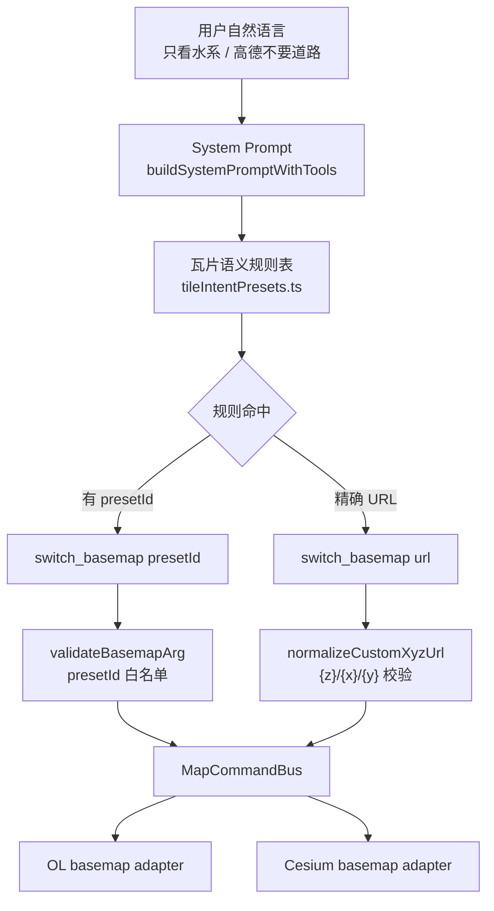

# 2026-11-26 Agent 瓦片语义预设扩展

> **日期**：2026-11-26 21:10  
> **任务等级**：L2 常规开发  
> **状态**：✅ 已完成（类型检查与门禁结果见第九节）  
> **关联版本**：V3.7.15（已写入 README / CHANGELOG）

---

## 一、问题分析

### 核心症状

用户希望通过自然语言告诉 WebGIS Agent「只看水系」「换成没有道路的高德底图」「显示 Google 纯路网」等需求，由 Agent 自动构造正确的 XYZ 瓦片 URL 并切换到底图槽位。当前 Agent 只知道通用 `switch_basemap(presetId|url)`，不知道两篇瓦片文档中的参数语义。

### 根本原因

1. `buildSystemPromptWithTools()` 只列出「换底图用 presetId 或标准 XYZ 模板」的通用规则，没有可查询的语义映射表。
2. 高德 `style/ltype/scl` 与 Google `lyrs/apistyle` 都是非直觉参数：
   - 高德 `ltype` 是 4-bit 位掩码，且必须 `lang=zh_cn` 才生效；
   - Google `apistyle` 使用 `s.t` 数字 ID 与 `p.v` 可见性组合，且属于非稳定服务参数。
3. 如果只把两篇 Markdown 全文塞进提示词，会产生大量无关前端集成内容，模型容易把「叠加层」误当作「底图切换」，也可能臆造参数值。

### 受影响模块

| 模块 | 影响 |
|---|---|
| `frontend/src/domains/common/chat/constants/agentToolsSchema.ts` | System prompt 缺少瓦片语义规则 |
| `frontend/src/domains/common/chat/constants/` | 缺少独立、可维护的规则表文件 |
| Agent `switch_basemap` 工具链 | 执行端已具备 `presetId` / `url` 两种通道，无需新增工具 |

---

## 二、候选方案对比

| 方案 | 做法 | 优点 | 缺点 | 结论 |
|---|---|---|---|---|
| A. 全文塞入 prompt | 把两篇 Markdown 原文拼进 system prompt | 信息最全 | token 成本高、噪声大、模型易误用叠加层/代理/纠偏规则 | 拒绝 |
| B. 规则表 + 现有工具（选定） | 新增 `.ts` 语义规则表，生成精简 prompt 段落，复用 `switch_basemap` | 低风险、无 command bus 改动、规则可维护、不允许臆造 | 只能替换底图槽位，不能新增叠加图层 | 采用 |
| C. 新增专用工具 `apply_tile_style` | 贯穿 schema / executor / commander / command bus / OL / Cesium | 可未来支持叠加层 | 跨 8 个文件，属 L3；需先提交方案并批准；当前需求不需要 | 暂缓 |

---

## 三、规则边界

### 可支持

- 已有稳定预设优先：`vector_amap_preset`、`imagery_amap_preset`、`imagery_amap_wgs_preset`、`imagery_google_water_preset`、`vector_Google_clean_preset` 等。
- 用户明确要求且文档给出精确模板的 Google 单要素图层：纯路网、土地利用、行政区、POI、卫星、混合影像。
- 高德已登记的组合预设：简洁无道路、简洁有路无注记、WGS 纠偏底图、纯道路叠加组合。

### 明确不支持 / 必须澄清

- **高德不能单独显示水系、湖泊或土地利用**：`ltype` 的 Bit0 把地貌、绿地、水系、底色打包在一起，无法拆出水系单体。用户提出该需求时，Agent 必须说明不支持，并推荐 Google 水系预设。
- **不允许模型自由拼参数**：只能输出规则表中登记的 `presetId` 或精确 `url`。
- **底图槽位语义**：本轮是「切换底图」，不是「新增叠加图层」。用户要求「把水系叠在当前影像上」时，本轮规则不覆盖，应如实说明。
- **Google `apistyle` 非稳定**：服务端规则可能漂移，最终效果以实际瓦片为准。

---

## 四、数据流与文件交互

---

## 五、实施计划

1. 新增 `frontend/src/domains/common/chat/constants/tileIntentPresets.ts`：导出规则表与 prompt 片段生成函数。
2. 修改 `agentToolsSchema.ts`：在 system prompt 的「选型/常用底图」之间插入规则段落；强调「只允许规则表中的 presetId / URL」。
3. 不修改 `AGENT_TOOLS` 声明、不新增工具、不触碰 command bus。
4. 更新前端结构树、README 三处版本号、CHANGELOG。
5. 运行 `npm run typecheck`、`CheckStructureTree.py`、`CheckConfigRegistry.py`。

---

## 六、验证方案

### Agent 已执行

- 静态审查现有 Agent 工具链与两篇文档。
- 新增规则表后运行 TypeScript 类型检查。
- 运行结构树与配置登记门禁。
- 构建/静态校验规则表中的 presetId 是否存在于 `BASEMAP_PRESETS`。

### 待用户实机验证

1. 在 Agent 聊天框输入「切换成 Google 只显示水系」，预期调用 `switch_basemap` 并显示水系。
2. 输入「高德地图不要道路和文字」，预期切换到简洁无道路预设。
3. 输入「高德只显示湖泊」，预期 Agent 明确说明高德不支持单拆水系，并建议 Google 水系。
4. 2D / 3D 各验证一次。

---

## 七、风险与遗留

- 当前工作区已有并行会话暂存的 4 个高德简洁预设与 Google 地形参数修正；本任务不覆盖这些文件，仅在规则表中引用其中已存在的预设 ID。
- Google `apistyle` 非稳定服务参数，规则表只能保证「构造符合文档的 URL」，不能保证服务端永不改版。
- 本轮不支持新增叠加图层，仅支持切换底图槽位。

---

## 八、修改内容

1. 新增 `frontend/src/domains/common/chat/constants/tileIntentPresets.ts`：18 条语义规则、4 条不支持规则、Prompt 片段生成器。
2. 修改 `agentToolsSchema.ts`：导入规则表生成器，在「选型」与「常用底图」段落加入强制约束，并注入规则片段。
3. 更新 `Docs/Guide/frontend-structure.md`、根 `README.md` 三处版本号、`Docs/Guide/CHANGELOG.md`。

### 规则表关键行为

- 已登记预设优先：高德标准/简洁/无道路/纯道路 WGS/卫星、Google 水系/简洁地形/标准底图等使用 `presetId`。
- 无现成预设的单要素 Google 图层：使用经过 URL 编码的精确模板，并通过 `TILE_PROXY_BASE_URL` 运行时拼接代理前缀。
- 明确禁用：模型自行拼接 `ltype`、`apistyle`、`scl`；高德单独水系/湖泊/土地利用；带 key/token 的第三方 URL；把底图切换当作叠加图层。

---

## 九、验证结果

### Agent 已执行

- `npm run typecheck`（frontend）：✅ 通过（`vue-tsc --noEmit`，无输出）
- `python Scripts/CheckStructureTree.py`：✅ 文档条目 755 · 磁盘文件 755 · 漏登记 0 · 幽灵条目 0
- `python Scripts/CheckConfigRegistry.py`：✅ B1–B4 / F1–F3 全部通过（catalog 139 key，前端 VITE_ 11 个）
- 规则表 `presetId` 与 `BASEMAP_PRESETS` 静态比对：✅ 10 个 presetId 全部存在；98 个预设定义已扫描
- System Prompt 生成片段静态检查：✅ 18 条规则 / 4 条不支持规则；8 条 URL 模板均含 `{z}/{x}/{y}`；代理占位符已替换；片段 3585 字符
- 平台红线扫描：源码路径仅命中 `maxRayDistance` 等已知假阳性；生产基线 `BASELINE-CLEAN`

### 待用户实机验证

1. 聊天框输入「切换成 Google 只显示水系」→ 预期 `imagery_google_water_preset`。
2. 输入「高德地图不要道路和文字」→ 预期 `vector_amap_clean_hd_preset`。
3. 输入「高德只显示湖泊」→ 预期 Agent 明确说明不支持并推荐 Google 水系。
4. 2D / 3D 各验证一次底图切换。
