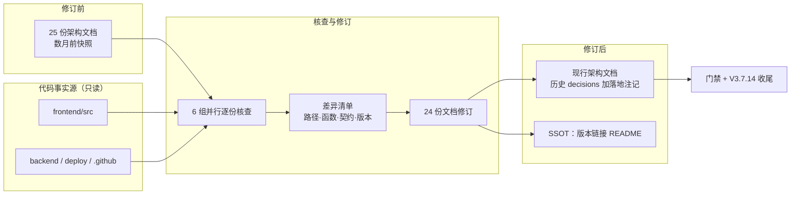

# 2026-11-26 架构文档全量核查与更新（以代码为准）

- **日期与时间**：2026-11-26 12:20
- **任务等级**：L2（25 份架构文档核查 + 24 份修订；无业务代码、无配置、无目录结构调整）
- **本次版本**：V3.7.14（按用户在当前会话的明确指令并入本批次，不单独升号；§0 优先级 1 覆盖 §5 的 +1 规则）

## 问题分析

**用户诉求**：`Docs/Architecture/` 中的文档多为数月前所写，需以**实际代码为依据**逐份核实并更新。

**核心症状**：文档与代码存在系统性漂移——逻辑代码全面迁移 TypeScript 后文档仍写 `.js`；多个核心模块已重构（视角对齐链路、底图门面拆分、身份签发口径、路径规划面板合并），文档仍描述旧实现；部分文档硬编码了过期版本号（V3.5.5）。

**根本原因**：架构文档缺少与代码同步的门禁；历史决策文档被当作现行设计使用；SSOT 规则（版本号只在 README）未在所有文档中落实。

**受影响模块**：全部 25 份架构文档（含 3 份 decisions 历史决策）；其中 24 份需修订，`ios-safari-rendering-pitfalls.md` 经核实准确、未改动。

## 修改内容

按 6 组并行核查结果逐份修订，重点如下：

| 组 | 文档 | 关键修订 |
|---|---|---|
| 核心 | `system-architecture.md` | 工作流 1→5、流水线 3 阶段→5 job、Node 24 运行时、域名 7→8、版本 SSOT |
| 核心 | `ol-cesium-dual-engine.md`（大修） | 职责迁至 `useHomeEngineSwitch.ts`；视角同步改为 canonical resolution + 射线实测 + Precision 校正；删除不存在的函数与条件 |
| 坐标 | `ol-cesium-coordinate-transform-spec.md`（大修） | §28–30 模块树改为 10 个 `.ts`；5 个函数改名；任务书改为实现现状；自动测试标待建 |
| 底图配置 | `basemap-source-system.md`、`configuration-three-tier.md`、`runtime-map-token-pool.md`（均大修） | 门面/定义拆分；`l` 1-based；预设 94 项；删除 FallbackManager 自动降级；配置权威 `deploy/.env.example`（146 key）；token 4 池与批量拉取 |
| 底图配置 | 3 份 `decisions/` | 历史方案正文保留，文首加「当前落地状态」注记 |
| Cesium | `cesium-3d-effects.md`（大修）、`cesium-unified-layer-management.md`（大修） | vendored WindLayer + GFS 风场；云三档与 sampler3D；图层数据模型/能力矩阵/端口注册/清档策略 |
| Cesium | 其余 3 份 | 文件拆分与函数归属、`.ts` 后缀、外部仓事实标 ⚠️ |
| 数据 | `route-planning.md`（大修） | 双面板合并为单一 `RoutePlannerPanel.vue/.ts`（按 mode 分派） |
| 数据 | 其余 4 份 | KMZ 统一手动解压、Voronoi bounds 外扩、blob 错误体已解决、路径与分享黑名单 5 项 |
| 身份部署 | `account-system-ai-quota.md`、`identity-auth-security.md`（均大修） | sessionStorage、fail-closed `LOGIN_REQUIRED`、游客桶 XFF 末跳 + 签名 token、4h 上限、18 个接口、端点更正 |
| 身份部署 | 其余 3 份 | shaders:check 门禁、代理前缀 `/api/proxy/*`、域名图补 `webgis.negiao.cn` |
| 位置 | `user-location-statistics.md` | `visit_tracking` 口径统一为「已删除」、`p` 写入引用改 `syncVisitPosCodeToUrl`、行号校正 |

**Mermaid 图（变更前后关系）**：

## 修改原因

文档过时会导致按图索骥时走错路径、误判实现能力（如仍按旧双面板或旧视角公式排查）、以及重复维护过期版本号。用户明确要求以代码为依据全量核实更新。

## 影响范围

仅文档面：24 份架构文档 + 本日志 + README 版本号三处 + CHANGELOG 顶部条目。无业务代码、无配置 key、无数据库、无目录结构改动；未执行任何 Git 写操作。

## 解决方案

1. 分组只读核查：逐份读取文档，对可验证主张（路径、类名/函数名、API、配置、流程、Mermaid 数据流、状态表述）到代码查证，无法确认的标 ⚠️，不臆造。
2. 并行修订：每组只改分配到的文件；历史 `decisions/` 保留原叙述 + 落地状态注记，不篡改历史决策。
3. SSOT 落实：文档中的基线版本号一律改为链接根 README，不硬编码新号。
4. 二轮补漏：全库扫描 `.js` 后缀、已合并面板名、域名数量、`bundledShaders` 路径，补修 `runtime-map-token-pool.md`、`cicd-pipeline.md`、`system-architecture.md`。
5. 校验：全部 25 份文档 Markdown 围栏配对通过。

## 性能指标

不适用（文档任务，无运行时变更）。

## 测试方案

### Agent 已执行

- 6 组只读核查 + 3 轮残留扫描（`.js`、旧面板名、域名数量、版本号、过时函数）。
- 关键重写章节抽查（视角对齐 canonical 链路、viewScale 模块树、图层数据模型）。
- Markdown 围栏配对检查：25/25 通过。
- 门禁：`python Scripts/CheckStructureTree.py` → 文档条目 754 / 磁盘文件 754 / 漏登记 0 / 幽灵 0；`python Scripts/CheckConfigRegistry.py` → B1–B4、F1–F3 全通过（catalog 139 key、前端 VITE_ 11 个）。
- 平台红线：本机 `rg` 不可用（命令缺失导致的 "REDLINE-CLEAN" 为假阳性，未采信），改用内容检索工具执行 §11.2 等效扫描——`backend/`、`deploy/`、`.github/` 零命中；`frontend/src/` 仅命中体积云 `maxRayDistance`（规范已列明的已知假阳性，非代理/浏览器自动化）；生产基线 `ALLOW_PRIVATE_HOSTS=true|ALLOWED_HOSTS=*|RATE_LIMIT=0` 零命中。

### 待用户实机验证

纯文档任务无需功能验证。请重点审阅 5 份大修文档：`ol-cesium-dual-engine.md`、`ol-cesium-coordinate-transform-spec.md`、`cesium-unified-layer-management.md`、`route-planning.md`、`cesium-3d-effects.md`，以及身份类两份。Git 提交由用户自行决定与执行。

## 变更文件清单

- `Docs/Architecture/system-architecture.md`
- `Docs/Architecture/ol-cesium-dual-engine.md`
- `Docs/Architecture/ol-cesium-coordinate-transform-spec.md`
- `Docs/Architecture/basemap-source-system.md`
- `Docs/Architecture/configuration-three-tier.md`
- `Docs/Architecture/runtime-map-token-pool.md`
- `Docs/Architecture/decisions/2026-08-02-basemap-ssot-refactor.md`
- `Docs/Architecture/decisions/2026-08-20-unified-basemap-selection.md`
- `Docs/Architecture/decisions/2026-08-22-clamp-to-ground-strategy.md`
- `Docs/Architecture/cesium-3d-effects.md`
- `Docs/Architecture/cesium-fluid-flood-simulation.md`
- `Docs/Architecture/cesium-planar-route.md`
- `Docs/Architecture/cesium-unified-layer-management.md`
- `Docs/Architecture/tile-rectify-system.md`
- `Docs/Architecture/multi-format-data-import.md`
- `Docs/Architecture/spatial-analysis-backend.md`
- `Docs/Architecture/route-planning.md`
- `Docs/Architecture/download-service.md`
- `Docs/Architecture/utility-tools.md`
- `Docs/Architecture/account-system-ai-quota.md`
- `Docs/Architecture/identity-auth-security.md`
- `Docs/Architecture/cicd-pipeline.md`
- `Docs/Architecture/deployment-relationship.md`
- `Docs/Architecture/user-location-statistics.md`
- `README.md`（版本号三处）
- `Docs/Guide/CHANGELOG.md`（顶部条目）
- 本日志

## Code Review 结果（2026-11-26 12:37，版本并入前复核）

按用户「code review 并合并文档」指令，对本次 24 份文档的新增/修改行做第二轮代码对照审查，发现并修正 6 处事实性偏差：

| 文件 | 原表述（问题） | 修正后 | 代码证据 |
|---|---|---|---|
| `cesium-3d-effects.md:101,103` | 臆造 `CloudManager.init()` / 1×1 fallback 纹理 / `buildStageUniforms` | 改为 `createCloudAtmosphere` → `ThreeGeospatialPipeline._createCloudStage()`（单 stage 或 composite），uniforms 由 pipeline 每帧注入 | `ThreeGeospatialPipeline.ts:1183-1214` |
| `cesium-3d-effects.md:160` | 臆造 `CloudUniformValues` 映射与 `atmosphereParams` 夜间光照同步；`init`/`updateUniforms` 不存在 | 改为 `setupCloudIntegration.ensurePipeline()` + `applyCloudPanelParams` 写入 `pipeline.params` / layers，rAF 合并；`atmosphereParams` 仅兼容保留 | `setupCloudIntegration.ts:54,90,150`；`cloudParamsApply.ts:13` |
| `ol-cesium-coordinate-transform-spec.md:942` | 球面弦长「一次」比例迭代 | 改为「两次」（`c0→h1`、`c1→h2`） | `cesiumScale.ts:114-119` |
| `account-system-ai-quota.md:52,362` | 「仅游客设备 ID 存 `localStorage`」 | 改为设备 ID 与签名 guest token 均存 `localStorage`，登录 token 存 `sessionStorage` | `guestTokenStore.ts:5,12,25` |
| `configuration-three-tier.md:99` | 「系统环境变量永不覆盖仓库文件值」（主客体颠倒） | 改为「仓库文件值永不覆盖系统环境变量」（命中 `system_keys` 跳过） | `load.py:131,142-144` |
| `basemap-source-system.md:215` | 杜撰的提示引文 | 按实际两条文案分列 | `useBasemapResilience.ts:170-171` |

其余 18 份审查无问题；修正后复扫臆造符号零残留。Code Review 后按用户指令把原拟 V3.7.15 条目并入 V3.7.14（README 三处 + CHANGELOG 归并注与条目 12–14），版本表恢复恒定 3 行。

## 遗留与风险

- 外部仓事实（CF Worker `negiao-api`、VPS nginx/tile-proxy、下载服务实际 URL）本仓无法核验，已标 ⚠️，未臆造。
- `decisions/` 三份为历史快照，正文保留当时方案口径；当前落地形态以文首注记为准。
- `backend/api/location.py:354-355` 代码注释仍称 `visit_tracking`「保留不删」，与已删除事实不一致；文档已标注，代码未改（越出本次范围）。
- viewScale 无自动化往返测试，文档已标「待建」。
- 核查期间工作区存在同日并行改动（用户新增日志/代码文件、部分改动已暂存）；本任务未触碰这些文件，版本号按用户明确指令并入 V3.7.14，未单独升号。
