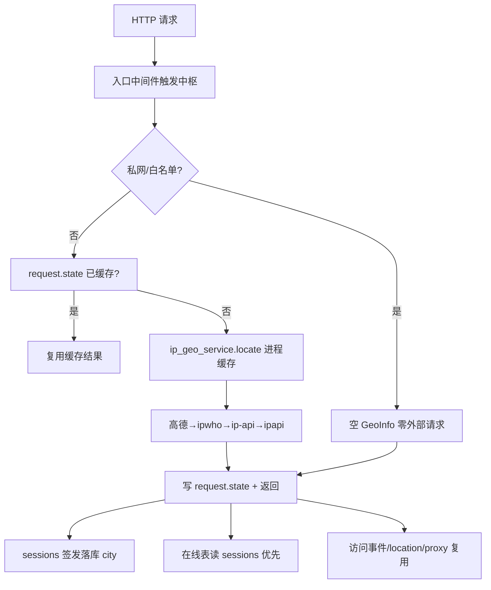

# 2026-11-26 统一 IP 地理中枢与会话持久化城市（L3）

- **日期与时间**：2026-11-26 10:42
- **任务等级**：L3（数据库结构变更 + 跨模块重构，方案已获用户批准）
- **本次版本**：V3.7.14
- **批准依据**：`Docs/TODO/2026-11-26-ip-city-persistence-plan.md`（含 Mermaid 图与三项裁决）

## 问题分析

**用户诉求**：含 IP 的表（sessions、admin_online_presence 等）为何不加 city 字段；IP 解析用什么服务；要求修复。
用户进一步明确架构方向：**统一 IP 解析中枢，入口解析一次，一个 IP 只解析一次，其它表从中枢取用**。

**现状核查**（实际代码与本地库）：
- `admin_online_presence` **已有** `ip_city/region/country`，但值来自反查 `visit_tracking_events`，
  没有访问事件的会话城市为空；
- `sessions` / `expired_sessions` 完全无地理字段；
- 解析逻辑分散在 `statistics.py:fetch_geolocation`、`location.py:238/345`、`external_proxy.py:714` 三处，
  各自调用 `ip_geo_service.locate`。

**IP 解析服务（回答用户问题）**：`backend/services/ip_geo.py` 四级降级 + TTL 内存缓存 + 自动跳过私网 IP：
高德 AMAP（需 key，仅中国 IP）→ ipwho.is（免费 HTTPS）→ ip-api.com（免费但仅 HTTP）→ ipapi.co（30 次/分钟限流）。

## 修改内容

1. **新中枢** `backend/services/request_geo.py`：
   - `RequestGeo` 不可变 dataclass + `as_dict()` 兼容旧调用方；
   - `resolve_ip_geo(ip)`：中枢层自行判断私网（零外部请求，不依赖下游实现），调用 `ip_geo_service.locate`，异常静默；
   - `get_request_geo(request)`：结果挂 `request.state._unified_geo_result`，**同一请求只解析一次**；
   - `resolve_request_geo_middleware()` 供入口调用。
2. **入口统一解析** `backend/app.py`：在 `check_startup_state` 中间件内、白名单与 OPTIONS 之后触发中枢，
   不新增中间件（避免破坏 CORS 最外层注册顺序），解析失败 debug 不阻断。
3. **DB 结构** `backend/api/auth/schema.py`：`sessions` / `expired_sessions` 幂等增加
   `ip_city/ip_region/ip_country TEXT NOT NULL DEFAULT ''`。
4. **签发落库**：
   - `_create_session_sync` 增加可选 `geo` 参数并写入三列；`_build_login_response` 从中枢取 geo 传入；
   - `register_guest_session` 增加 `geo` 参数并写入三列；`/auth/guest/session` 用 `resolve_ip_geo(identity_ip)`
     （XFF 末跳口径，与身份派生一致）。
5. **归档同步** `backend/api/auth/session_archive.py`：`_SESSION_COLUMNS` 与 payload 同步三列。
6. **多处复用**：
   - `admin_online_presence` 刷新优先读 sessions 城市，回退 `visit_tracking_events`（经纬度仍取访问事件）；
   - `fetch_geolocation` 改为经中枢 `resolve_ip_geo(ip, prefer_amap=False)`，保持访问事件既有口径。
7. **测试**：新增 `tests/test_request_geo.py` 4 用例；更新 `test_session_expiry.py` / `test_guest_identity.py`
   内存表结构以匹配新列。

## 修改原因

用户明确指出"一个 IP 只解析一次、别的地方从中枢取"是正确架构，并要求表内持久化城市；
本地核查证实会话表缺字段、在线表城市靠反查的缺陷。

## 影响范围

- DB：`sessions` / `expired_sessions` 各加 3 列（幂等 ALTER，旧库自动升级）。
- 签发：账号/游客签发各多一次中枢调用（命中缓存近零；私网零外部请求；失败静默）。
- 在线表：城市读取源从"仅反查访问事件"改为"sessions 优先 + 回退"，历史数据不丢。
- 鉴权/限流/配额/token 签名零改动。

## 解决方案

采用"双层缓存 + 单一中枢"：请求级（request.state）避免同请求重复查缓存，进程级（ip_geo_service TTL cache）
避免同 IP 跨请求重复外部请求；入口中间件主动触发实现真正的"入口统一解析"；
DB 只在真正缺字段的两张表加列，其余表复用已有字段，不重复造字段。

## 性能指标

未实测：私网 IP 零外部请求；公网 IP 首次解析有网络延迟（高德/ipwho.is），缓存命中微秒级。
中枢单测验证了"同一请求只解析一次"（locate 调用次数 = 1）。

## 测试方案

### Agent 已执行

- `tests/test_request_geo.py`：4/4（私网跳过且 locate 零调用、请求级缓存、失败静默、dict 兼容）。
- 全量 pytest：174 passed / 1 既有失败（`test_webhook_helpers`，基线，与本次无关）。
- 真实库 schema 迁移验证：`sessions` / `expired_sessions` 均已含 ip_city/ip_region/ip_country。
- 中枢私网跳过实测：10.16.x / 172.19.x / 127.0.0.1 均返回空结果。
- 门禁 4 项与构建见收尾。

### 待用户实机验证

1. 登录后查看 `sessions` 表：公网 IP 的会话 ip_city 有值；HF 容器私网 IP 留空（预期）。
2. 管理端在线表：城市优先显示会话中解析的城市；无会话城市时回退访问事件表。
3. 观察日志：同一公网 IP 在缓存期内不重复请求外部定位服务。

## 变更文件清单

- `backend/services/request_geo.py`（新增）：统一 IP 地理中枢。
- `backend/app.py`：入口中间件触发中枢解析。
- `backend/api/auth/schema.py`：两张表幂等加 3 列。
- `backend/api/auth/session.py` / `guest_token.py` / `routes.py`：签发落库 geo。
- `backend/api/auth/session_archive.py`：归档同步新列。
- `backend/api/statistics.py`：在线表优先 sessions 城市；fetch_geolocation 走中枢。
- `backend/tests/test_request_geo.py`（新增）+ `test_session_expiry.py` / `test_guest_identity.py`：测试。
- `README.md` / `Docs/Guide/CHANGELOG.md`：版本 V3.7.14。
- 本日志 + L3 方案文档。

## 遗留与风险

- 高德 key 需配置才启用最高精度；未配置时走 ipwho.is 等免费服务，城市级精度可接受。
- 私网 IP（HF 容器网关）无法解析城市——这是环境限制，展示层已过滤为 unknown。
- `request.state` 缓存仅在单次请求生命周期内；跨请求复用依赖进程级 TTL 缓存。
- 用户 clone 项目连线上库时，其公网 IP 会由中枢正常解析并落库，不影响身份判定。

## Mermaid 图

