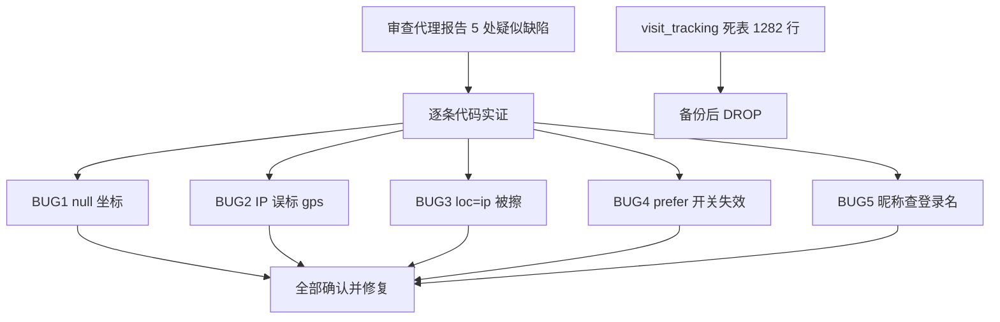

# 2026-11-26 删除无效表 + 修复位置/会话链路 5 个 bug

- **日期与时间**：2026-11-26 11:03
- **任务等级**：L2（删表 + 多文件 bug 修复）
- **本次版本**：V3.7.14（并入本版本批次）

## 问题分析

用户要求：删除无用表，并排查其它 bug。
独立 code review 代理报告 5 处疑似缺陷，逐条经代码实证后**全部确认成立**。

### 删除无效表

`visit_tracking` 表（1282 行）——全仓 grep 确认**无任何读取方**，V3.7.14 已停写。
属于只写不读的死表。

### 确认的 5 个 bug

| # | 严重度 | 问题 | 触发条件与后果 |
|---|---|---|---|
| 1 | 高 | `autoLocationMark.ts` 的 `Number(null)=0` | 高德返回无经纬度时，`(0,0)` 被判为有效 IP 坐标 → 地图定位到几内亚湾、`loc=ip` 误标 |
| 2 | 高 | IP 坐标被写成 `p` + `loc=gps` | 权限 granted 但 GPS 超时/失败 → 后端回退 IP，前端仅看 `geo_permission` 写 GPS 标记 → 违背"p 仅来自 GPS" |
| 3 | 中 | visit log 擦掉 `loc=ip` | 非 GPS 访问的 `syncVisitPosCodeToUrl` 无条件 `delete('loc')`，与入口自动定位竞态 → IP 标记丢失 |
| 4 | 中 | `prefer_free_service` 被忽略 | 前端调用均不带显式 ip，走 `get_request_geo` 默认 prefer_amap=True → 禁用高德调试开关失效 |
| 5 | 中 | 用 `display_name` 查 username | 上一轮引入：在线表 geo 查询用昵称查 sessions/事件表 → 用户改昵称后城市为空 |

## 修改内容

1. **删表**：备份 `data/webgis_auth.db.bak-20261126-110614`（3.9MB）后 `DROP TABLE visit_tracking`；
   `db.py` 注释补记现状。旧数据保留在备份中。
2. **BUG1**：`autoLocationMark.ts` 在 `Number()` 前校验原始值是有限数，null/undefined 直接返回 null。
3. **BUG2+3**：`syncVisitPosCodeToUrl` 增加 `coordSource` 参数，严格按后端 `coord_source === 'gps'`
   决定写 `p`/`loc=gps`；否则保留已有 `loc=ip`（避免竞态擦除）。调用处传响应中的 coord_source。
4. **BUG4**：`get_request_geo` 增加 `prefer_amap` 参数，False 时绕过 request.state 缓存直接解析；
   `ip_locate` 透传该参数。
5. **BUG5**：`_mirror_identity_from_db_sync` 用局部变量 `username`（presence_id 解析）查 sessions
   与 visit_tracking_events，不再用 `display_name`。

## 修改原因

用户明确要求删除死表并修复潜在 bug；5 处缺陷均有明确触发条件与错误后果。

## 影响范围

- DB：`visit_tracking` 表删除（备份保留），其余表不变。
- 前端：IP 定位候选校验、GPS 标记写入条件。
- 后端：中枢 prefer_amap 参数、在线表 geo 查询键。
- API 契约不变（前端继续上报 gps_timestamp/geo_permission，后端按 coord_source 回传）。

## 解决方案

删表前先备份（破坏性操作可逆）；bug 修复均以"单一事实来源"为原则：
坐标来源以后端 `coord_source` 为准、登录身份以 `username` 为准、IP 解析以中枢为准。

## 性能指标

不适用（缺陷修复）。

## 测试方案

### Agent 已执行

- 删表前后核对：`visit_tracking_events` 2354 行未受影响；数据库剩余 30 张表。
- 5 处 bug 均经 grep/Read 定位到具体行号后修复。
- 全量 pytest 与门禁见收尾。

### 待用户实机验证

1. 高德返回无经纬度的公网 IP → 地图不应跳到 (0,0)。
2. GPS 权限 granted 但实际失败 → URL 不写 `p`、`loc` 不应变成 gps。
3. 仅 IP 定位进入 → `loc=ip` 不被后续 visit log 擦除。
4. 用户改昵称后 → 管理端在线表城市仍正常显示。

## 变更文件清单

- `backend/data/webgis_auth.db`：DROP TABLE visit_tracking（备份 `.bak-20261126-110614`）。
- `backend/api/auth/db.py`：注释补记。
- `frontend/src/domains/common/map-view/services/autoLocationMark.ts`：BUG1。
- `frontend/src/app/composables/useHomeTocAndAttributeActions.ts`：BUG2/3。
- `backend/services/request_geo.py` / `backend/api/location.py`：BUG4。
- `backend/api/statistics.py`：BUG5。
- 本日志。

## 遗留与风险

- 删表不可逆（除非恢复备份）；备份已在 `backend/data/`，用户可自行决定是否长期保留。
- BUG2 修复后，前端不再依赖 `geo_permission` 判定 GPS 标记——旧版本前端若仍用旧逻辑，
  需升级部署后才生效。

## Mermaid 图

