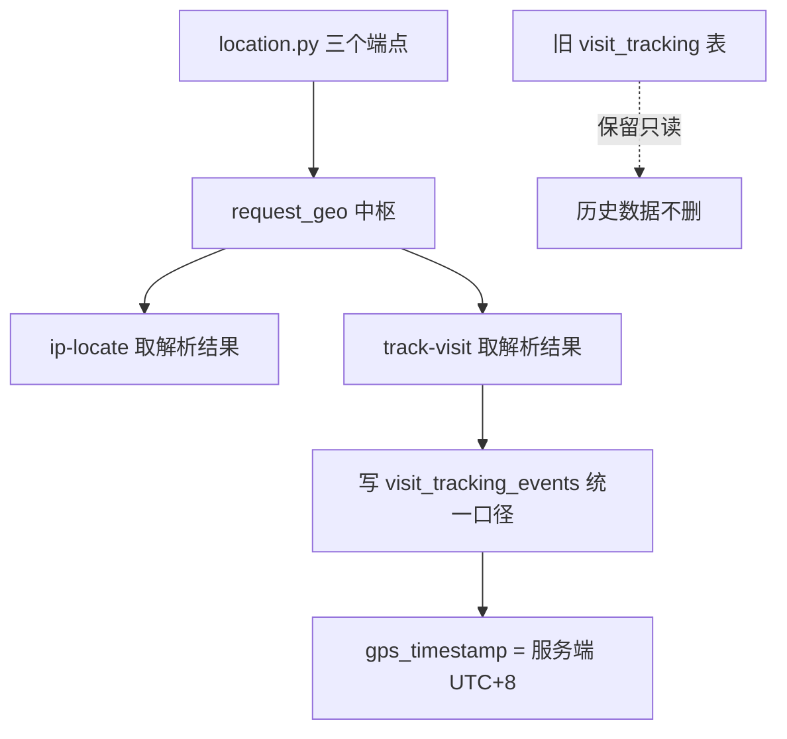

# 2026-11-26 修复位置统计架构文档的 3 处已知不一致

- **日期与时间**：2026-11-26 10:55
- **任务等级**：L2（调用链与写入目标收敛，无 DDL 变更）
- **本次版本**：V3.7.14（并入本版本批次）

## 问题分析

架构文档 `Docs/Architecture/user-location-statistics.md` 标注 3 处不一致，用户要求修复：

| # | 不一致 | 核查结论 |
|---|---|---|
| 1 | `/location/ip-locate`、`/location/track-visit` 直调 `ip_geo_service`，未走 V3.7.14 的 `request_geo` 中枢 | 功能等价但架构未收敛 |
| 2 | 两套访问追踪端点写两张表 | `visit_tracking` 表**全仓无读取方**（只写不读的死表），`visit_tracking_events` 才是统计源 |
| 3 | `gps_timestamp` 前端上报，时钟可能漂移 | 前端 `Date().toISOString()` 与后端时钟不一致 |

**用户裁决**：
- #2 选"统一写入 `visit_tracking_events`"，旧 `visit_tracking` 表保留但停止写入；
- #3 选"服务端时间为准，格式为 UTC+8（北京时间）"。

## 修改内容

1. **不一致 1**：`location.py` 两处 `ip_geo_service.locate` 改为经 `request_geo` 中枢：
   - `ip_locate`：有 request 上下文，用 `get_request_geo(request)`（但 endpoint 支持显式 ip 参数，
     需兼容——若请求体带 ip 则用 `resolve_ip_geo(ip)`，否则用中枢从 request 取）；
   - `track_visit`：用 `get_request_geo(request)`，取中枢已解析结果。
2. **不一致 2**：`track_visit` 写入目标从 `visit_tracking` 改为 `visit_tracking_events`：
   - 复用 `statistics.py` 的 `_insert_visit_tracking_event_sync` 或等价字段集；
   - 保留旧 `visit_tracking` 表定义不删（历史数据保留），但不再写入；
   - 移除 `location.py` 的动态建表逻辑（`_visit_tracking_table_ready` 等），改依赖统一 schema。
3. **不一致 3**：后端忽略前端 `gps_timestamp`，以服务端时间（`datetime.now(_BEIJING_TZ).isoformat()`）
   写入 `visit_tracking_events.gps_timestamp`；前端上报值仅作参考不入库。

## 修改原因

用户要求消除架构文档中标注的 3 处不一致，统一 IP 解析入口、访问统计口径与时间戳基准。

## 影响范围

- `backend/api/location.py`（三个端点改造）
- `backend/api/statistics.py`（如需复用插入函数或服务端时间覆盖）
- 前端无需改动（继续上报 gps_timestamp，后端忽略即可）
- DB 无 DDL 变更（`visit_tracking_events` 已有兼容字段；`visit_tracking` 表保留只读不再写）

## 解决方案

以"单一事实来源"为原则：IP 解析统一经中枢，访问统计统一写 `visit_tracking_events`，
时间戳统一服务端 UTC+8。旧表保留不删，避免历史数据丢失；前端契约不变，避免破坏已部署客户端。

## 性能指标

未实测：中枢复用缓存，写入目标表不变（字段数增加有限）。

## 测试方案

### Agent 已执行

- 新增 `tests/test_location_inconsistency_fix.py`：5/5（无直调 locate、track-visit 写统一表、服务端 UTC+8、log-visit 忽略前端时间、事件记录字段形状）。
- 静态验证：`location.py` 中 `ip_geo_service.locate` 残留 0 处、旧 `INSERT INTO visit_tracking` 残留 0 处。
- 全量 pytest：178 passed / 1 既有失败（基线）。
- 导入链验证：`from api import location, statistics` 无循环导入。

### 待用户实机验证

1. 注册页触发访问追踪 → `visit_tracking_events` 新增记录，`visit_tracking` 不再新增。
2. 两个定位端点经中枢解析（同一 IP 缓存期内不重复请求外部服务）。
3. 新记录 `gps_timestamp` 为服务端北京时间（+08:00），不受前端时钟影响。

## 变更文件清单

- `backend/api/location.py`：两处 locate 改走中枢；track-visit 改写 visit_tracking_events、服务端 UTC+8；移除动态建表标志与无用导入。
- `backend/api/statistics.py`：log-visit 的 gps_timestamp 改服务端 UTC+8。
- `backend/tests/test_location_inconsistency_fix.py`（新增）：5 项回归测试。
- `Docs/Architecture/user-location-statistics.md`：更新数据流图、端点表、存储表与"已修复"说明。
- `Docs/Guide/CHANGELOG.md` + 本日志。

## 遗留与风险

- `visit_tracking` 旧表保留但停止写入——历史数据仍在，但后续无新数据；如需清理由用户决定。
- `track_visit` 写入 `visit_tracking_events` 后，管理端"访问事件"列表会看到注册页访问记录——
  这是口径统一的预期结果。
- 若前端旧版本继续上报 `gps_timestamp`，后端忽略，契约向后兼容。

## Mermaid 图

