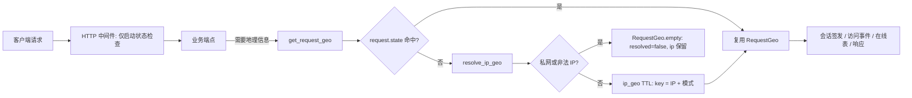

# 2026-11-26 暂存区代码审查后修复

## 日期与时间
2026-11-26 11:25

## 任务等级
L2 常规（Bug 修复，跨后端多文件）。不新增配置 key、不改数据库结构、非跨模块重构。
背景：V3.7.14（L3，统一 IP 地理中枢）已暂存，本次仅修复暂存区代码审查发现的代码层缺陷；按用户「版本号统一为 3.7.14 合并」指令（§0 优先级 1 覆盖 §5 顺延规则），本批修复并入 V3.7.14 单一版本入口，日志原文保留不改写。

## 问题分析

### 核心症状
1. 任意非白名单请求都会在 HTTP 中间件同步 `await` IP 地理解析；新公网 IP 最坏串行走 4 个外部服务。
2. `ip-locate`、`fetch_geolocation` 对私网/解析失败返回成功：空结果 `RequestGeo.empty(clean_ip)` 的 `ip` 非空，而调用方以 `if geo.ip` 判成功。
3. `track-visit` 落库 IP 用 `get_client_ip`（XFF 首跳，未校验），地理信息用 `_extract_client_ip`（优先 `X-Client-IP`，已校验），可产生「A 的 IP + B 的城市」。
4. `prefer_amap=False` 只绕过 request.state，未绕过 `ip_geo` 的进程缓存；缓存键只有 IP，导致调试开关拿到的仍是高德预热结果。
5. 在线表在线表镜像在 session 有城市时强制 `coord_source="ip"`，但经纬度取自最新访问事件（可能是 GPS），来源标注与坐标实际来源不一致。
6. `test_location_inconsistency_fix.py` 的 5 个用例中 4 个只断言源码字符串，不能发现运行时回归。
7. debug 日志打印完整客户端 IP。

### 根本原因
- 中枢设计把「解析」放在全局入口，导致所有请求承担外部服务延迟；且客户端可控的 `X-Client-IP` 可任意放大该成本。
- `RequestGeo` 只有数据字段，没有「是否成功解析」的显式状态，调用方被迫用 `ip` 非空近似判断成功。
- 同一请求里存在两套 IP 提取函数（`get_client_ip` / `_extract_client_ip`），取值口径未收敛。
- `ip_geo` 的 TTL 缓存以 IP 为唯一键，未把 `prefer_amap` 纳入维度。
- 镜像逻辑把「城市来源」与「坐标来源」混为同一个 `coord_source`。
- 回归测试以源码文本代替行为断言。

### 受影响模块
`backend/app.py`（HTTP 中间件）、`backend/services/request_geo.py`（中枢）、`backend/services/ip_geo.py`（缓存键）、`backend/api/location.py`（ip-locate / track-visit）、`backend/api/statistics.py`（fetch_geolocation / 在线表镜像）、`backend/api/auth/routes.py`（游客签发注释）、`backend/tests/`（行为测试）、`README.md` / `Docs/Guide/CHANGELOG.md`（版本 SSOT）。

### 候选方案对比
| 问题 | 方案 A | 方案 B | 选定 |
|---|---|---|---|
| 中间件全量解析 | 保留但加路径白名单 + 限流 | 移除中间件调用，业务端点惰性 `get_request_geo` | **B**：根除全站同步等待，进程缓存仍保证跨请求去重 |
| 空结果语义 | `empty()` 的 `ip` 置空 | 增加 `resolved` 显式标志，保留 `ip` 供审计 | **B**：不丢访问审计 IP，调用方语义明确 |
| prefer_amap 缓存 | `use_cache=False` | 缓存键加入 `amap/free` 维度 | **B**：避免访问事件每次打外部服务 |
| 落库 IP | 统一改 `get_client_ip` | 统一用 `geo.ip`（已校验） | **B**：与地理信息同源 |
| coord_source | 一律 IP | 跟随访问事件的坐标来源；无事件时回退 IP | **B**：字段语义与坐标一致 |

### 选定方案与理由
以「惰性解析 + 显式 resolved + 同源 IP + 带维度的缓存 + 来源跟随坐标」为修复主线；全部为局部行为修正，不改变对外 API 契约、不新增配置 key、不改数据库结构。

## Mermaid 图（提交用户审查）

## 修改内容
1. `backend/app.py`：移除 HTTP 中间件中的 IP 地理同步 `await`，仅保留启动状态检查。
2. `backend/services/request_geo.py`：`RequestGeo` 新增 `resolved` 显式标志；空结果保留 `ip` 但标记未解析；debug 日志 IP 脱敏；更新模块与函数文档；保留可选预热函数但不再默认挂载。
3. `backend/services/ip_geo.py`：TTL 缓存键加入 `amap/free` 模式维度。
4. `backend/api/location.py`：`ip-locate` 改用 `geo.resolved` 判成功；`track-visit` 落库 IP 改用中枢校验后的 `geo.ip`。
5. `backend/api/statistics.py`：`fetch_geolocation` 改用 `geo.resolved`；在线表 `coord_source` 跟随访问事件实际坐标来源，无事件时回退 IP。
6. `backend/api/auth/routes.py`：修正游客签发注释，明确按身份 IP 单独解析、不复用展示 IP 的 request.state 缓存。
7. `backend/tests/test_location_inconsistency_fix.py`：5 个源码字符串断言替换为行为回归测试（事件记录、空结果、私网 ip-locate、fetch_geolocation、在线表来源）。
8. `backend/tests/test_request_geo.py`：补充 `resolved` 断言与 amap/free 缓存分维测试。
9. `README.md`：三处版本号（按版本归并指令）统一为 V3.7.14，版本演进表恢复恒定 3 行。
10. `Docs/Guide/CHANGELOG.md`：审查修复 6 项并入 V3.7.14 条目，不单独升号。

## 修改原因
修复暂存区审查发现的代码层 High/Medium 问题，避免全站延迟放大、定位成功误判、IP 与城市错配、来源标注错误及无效回归测试。

## 影响范围
IP 地理解析链路、会话签发、访问事件落库、管理员在线表、相关后端测试；不涉及前端 UI、不新增配置 key、不改数据库 schema。

## 解决方案
| 根因 | 实施 | 验证点 |
|---|---|---|
| 全局中间件同步等待外部服务 | 删除中间件调用，业务端惰性 `get_request_geo`；进程缓存跨请求去重 | app.py 中间件无地理 await；请求级缓存仍复用 |
| 用 `ip` 非空近似成功 | `resolved` 显式标志；三个调用点改判 | 私网 ip-locate 返回 400；fetch_geolocation 返回 None |
| 两套 IP 提取口径混用 | `track-visit` 落库用 `geo.ip` | 事件记录 IP 与城市同源 |
| 缓存键只有 IP | key = `ip + amap/free` | free 模式不被 amap 预热结果污染 |
| 城市来源冒充坐标来源 | `coord_source` 跟随事件坐标；无事件回退 IP | sessions 城市 + GPS 事件 → `gps` |
| 源码字符串断言无效 | 行为回归测试 + 缓存分维测试 | 10/10 通过 |

## 性能指标
未实测（外部 IP 服务延迟需实机/生产流量验证）。改动方向与依据：移除全局同步 await 后，非定位请求不再承担第三方网络延迟。

## 测试方案

### Agent 已执行
- `uv run --frozen python -m pytest tests/test_request_geo.py tests/test_location_inconsistency_fix.py -q` → **10 passed**。
- `uv run --frozen python -m pytest -q` → **184 passed / 1 failed**；失败项 `tests/test_webhook_helpers.py::test_shutdown_webhook_watches_noop_when_idle` 为 async 插件配置问题，修改前已存在（V3.7.14 日志记为「1 既有失败」），与本次改动无关。
- `python Scripts/CheckStructureTree.py` → 文档 754 / 磁盘 754，漏登记 0、幽灵 0（exit 0）。
- `python Scripts/CheckConfigRegistry.py` → B1–B4、F1–F3 全绿（exit 0）。
- 未执行 `tsc --noEmit` / ESLint：本次未改前端文件。
- 未执行生产构建与真机验证。

### 待用户实机验证
1. 部署后用公网 IP 首次访问：确认非定位接口不再等待 IP 服务（观察响应耗时），且定位接口仍能拿到城市。
2. 用 `X-Client-IP: 10.0.0.1` 调 `/api/v1/location/ip-locate`：预期 400 / `ok=false`，不再返回「成功但城市为空」。
3. 触发 `track-visit` 后查看 `visit_tracking_events`：确认 `ip` 与 `ip_city` 对应同一个 IP。
4. 管理员在线表：构造 sessions 城市 + GPS 访问事件，确认 `coord_source=gps` 而非 `ip`。
5. 提交前自行执行 `git add` / `git commit`（Agent 未执行任何 Git 写操作）。

## 变更文件清单
| 路径 | 说明 |
|---|---|
| `backend/app.py` | 移除中间件同步 IP 解析 |
| `backend/services/request_geo.py` | `resolved` 标志、IP 脱敏、文档更新 |
| `backend/services/ip_geo.py` | 缓存键按解析模式分维 |
| `backend/api/location.py` | ip-locate 成功判定、track-visit IP 同源 |
| `backend/api/statistics.py` | fetch_geolocation 成功判定、在线表坐标来源 |
| `backend/api/auth/routes.py` | 游客签发注释纠正 |
| `backend/tests/test_location_inconsistency_fix.py` | 行为回归测试替换字符串断言 |
| `backend/tests/test_request_geo.py` | `resolved` 与缓存分维测试 |
| `README.md` | V3.7.14 三处统一 + 版本表恢复 3 行 |
| `Docs/Guide/CHANGELOG.md` | 审查修复并入 V3.7.14 条目 |
| `Docs/LLM_record/26-11/2026-11-26/2026-11-26-staged-code-review-fixes.md` | 本次维护日志 |

## 遗留与风险
- 全量 pytest 仍有 1 项既有失败（async 插件配置），本次未修，属测试框架债务。
- `resolve_request_geo_middleware` 函数保留但不再被调用，供未来需要入口预热的场景显式使用。
- V3.7.14 的 L3 批准依据仍只能从日志自述确认，仓库内无独立审批记录（⚠️ 未验证）。
- CHANGELOG V3.7.14 条目中「门禁 4 项全绿 / 生产构建成功」为上一会话声明，本次仅复跑 2 项强制门禁与测试，未复跑构建。
- `G_XGBOOST` 仓库的两项 High（图 13(b) 坐标轴裁剪、HTML 异常吞掉）不在本日志范围，另见后续处理。
