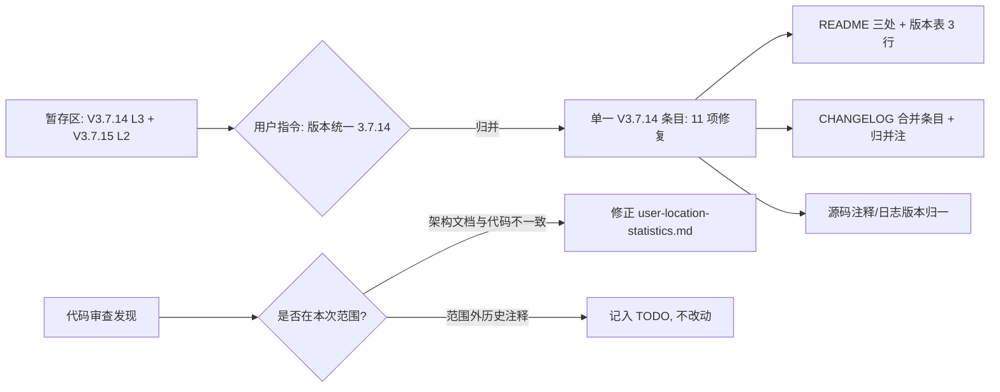

# 2026-11-26 暂存区代码审查与版本归并至 V3.7.14

## 日期与时间
2026-11-26 11:55

## 任务等级
L2 常规（代码审查 + 文档/版本号一致性修复；无新增功能、无数据库结构变更、无配置 key 变更）。
按 §0 优先级 1，用户明确指令「code review 暂存区的代码，版本号统一为 3.7.14 合并」覆盖 §5「L2 +1 修订号」规则：本次**不升号**，V3.7.15 撤销，同一批次只保留 V3.7.14 单一版本入口。

## 问题分析

### 核心症状
1. 同一批暂存区工作同时存在 V3.7.14（L3 统一 IP 地理中枢）与 V3.7.15（L2 代码审查修复）两个版本号，README「版本演进」表一度出现 4 行，违反 §4 SSOT 与 §5「版本表恒定 3 行」。
2. `Docs/Architecture/user-location-statistics.md` 与 CHANGELOG V3.7.14 条目仍写「入口中间件触发中枢」，但暂存区代码已移除该调用（`app.py` 中间件只有启动状态检查），文档与代码不一致。
3. `ip_geo_service` 的 TTL 缓存键曾用纯 IP 作为键，在 `prefer_amap=False` 时会读到高德预热结果（已在 V3.7.15 修复批次中修正，本条归并记录）。

### 根本原因
- 并行会话/连续会话各自按 §5 顺延版本号，未在同一批次收尾时统一版本。
- 架构文档描述的是修复前的中间件方案，代码审查修复后未同步回写文档。
- `get_request_geo` / `ip-locate` 对「解析失败」缺少显式成功标志，调用方曾以 `ip` 非空近似判断成功。

### 受影响模块
README.md、Docs/Guide/CHANGELOG.md、Docs/Architecture/user-location-statistics.md、1 份审查日志、5 个后端源码注释、Docs/TODO/bugfix-optimization-plan.md。业务逻辑代码本身未在本次改动。

### 候选方案对比
| 问题 | 方案 A | 方案 B | 选定 |
|---|---|---|---|
| 版本号重复 | 保留 V3.7.14/V3.7.15 两条 | 合并为单一 V3.7.14，过程日志保留 | **B**：遵循 11-25 / 11-14 版本归并先例，批量工作单一入口 |
| 版本表 4 行 | 删最旧 2 行 | 合并两行 V3.7.14/V3.7.15 后保持 3 行 | **B**：满足恒定 3 行规则 |
| 架构文档漂移 | 仅改日志自述 | 同步修正架构文档与 CHANGELOG V3.7.14 条目 | **B**：SSOT 要求架构文档与代码现状一致 |
| 范围外旧注释残留 | 本次顺手改 | 记入 TODO，另起 L1 | **B**：§2.5 禁止越权扩大范围 |

### 选定方案与理由
按用户指令以 V3.7.14 为唯一版本入口，保留全部过程日志原文，仅归一「本次版本」相关表述；代码审查结论按严重度分级记录，涉及范围外的问题依 §2.5 记 TODO。业务逻辑不做非必要改动，降低提交风险。

## Mermaid 图（提交用户审查）



## 代码审查结论

| # | 检查项 | 结果 | 说明 |
|---|---|---|---|
| 1 | `request_geo.py` 私网跳过 / `resolved` 语义 / `as_dict` 兼容 | 通过 | 已实跑 `test_request_geo.py` 5/5 |
| 2 | `ip_geo.py` 缓存键 `amap/free` 分维 | 通过 | 已实跑 free 模式不复用 amap 缓存用例 |
| 3 | `location.py` ip-locate 成功判定 / track-visit IP 同源 | 通过 | 行为回归测试覆盖 |
| 4 | `statistics.py` fetch_geolocation / 在线表 coord_source | 通过 | 行为回归测试覆盖 GPS 点不被标成 IP |
| 5 | `auth/schema.py` 两表幂等 ALTER / 归档三列同步 | 通过 | 列数、默认值与 INSERT 占位符一致（14 列） |
| 6 | `autoLocationMark.ts` null 坐标守卫 | 通过 | `Number.isFinite` 在 `Number()` 前校验原始值 |
| 7 | `useHomeTocAndAttributeActions.ts` GPS 标记写回 | 通过 | `coordSource` 来自后端响应，与 `sanitizeUrlParams` 的 `loc` keeper 兼容 |
| 8 | 架构文档「入口中间件触发中枢」 | **不一致 → 已修正** | 代码为业务端点惰性调用，文档已同步 |
| 9 | CHANGELOG V3.7.14 条目第 2 项「入口一次解析」 | **不一致 → 已修正** | 合并条目中改为惰性取用描述 |
| 10 | `agent_chat/db.py:649` V3.7.15 曾用号注释 | 范围外 | 依 §2.5 记入 TODO，本次不改 |

-review 未发现新的功能性缺陷；暂存区业务代码无需再改动。_

## 修改内容
1. `README.md`：项目简介 / 版本演进表首行 / 页脚三处统一 V3.7.14；版本表由 4 行合并回恒定 3 行（V3.7.14 / V3.7.13 / V3.7.12），摘要合并审查修复要点。
2. `Docs/Guide/CHANGELOG.md`：V3.7.15 条目并入 V3.7.14，新增版本归并注；修正第 2 项为「业务端点惰性取用」，合并验证数据。
3. `Docs/Architecture/user-location-statistics.md`:3 处修正——`ip-locate` 后端链路描述、4.2 节触发方式与 `resolved` 语义、Mermaid 节点与不一致表第 1 项。
4. 5 个源码注释 + 1 份测试文件 docstring：`app.py` / `request_geo.py` / `location.py` ×3 / `statistics.py` ×2 / `auth/routes.py` / `test_location_inconsistency_fix.py` 中 V3.7.15 → V3.7.14。
5. `Docs/LLM_record/.../2026-11-26-staged-code-review-fixes.md`：背景与变更清单的版本表述改为「并入 V3.7.14」，日志主体原文保留。
6. `Docs/TODO/bugfix-optimization-plan.md`：新增范围外发现（V3.7.15 历史注释残留）。

## 修改原因
用户要求按规范审查暂存区代码并将版本号统一为 3.7.14 合并；审查中发现文档与代码现状不一致，需同步修正以保证 SSOT。

## 影响范围
仅文档与注释层；无业务逻辑、无数据库、无配置、无前端 UI 改动。版本展示面（README / CHANGELOG / `__APP_VERSION__` 的机器读取源）从 V3.7.15 回退合并为 V3.7.14。

## 解决方案
采用 11-25 先例的「版本归并」模式：过程日志不迁移、不改写，仅归一版本号表述；CHANGELOG 单一条目承载全部修复项；架构文档按实际代码回写。

## 性能指标
不适用（文档与注释改动）。

## 测试方案

### Agent 已执行
- `backend/`：`uv run --frozen python -m pytest tests/test_request_geo.py tests/test_location_inconsistency_fix.py -q` → **10 passed**（修改前后各一次）。
- `python Scripts/CheckStructureTree.py` → 754 / 754（修改前后各一次，exit 0）。
- `python Scripts/CheckConfigRegistry.py` → B1–B4、F1–F3 全绿（修改前后各一次，exit 0）。
- 冲突标记扫描：README / CHANGELOG / 日志无 `<<<<<<<` 等标记。
- 版本一致性扫描：README 三处、CHANGELOG 顶部、源码注释均无 V3.7.15（历史日志与 TODO 中的曾用号说明除外）。
- 平台红线自查（§11.2）：后端 / 部署面 / `.github/` 无命中；前端命中 20 条均为 `maxRayDistance`（体积云 raymarch 参数，规范已载明的假阳性）；`deploy/.env` 生产基线三项无命中。全绿。

### 待用户实机验证
1. 提交前自行 `git add` 纳入本次工作区改动（Agent 未执行任何 Git 写操作）。
2. 下次 `npm run dev` / `npm run build` 后页面 `?v=` 应显示 3.7.14。
3. 前序批次的实机验证项（IP 定位、在线表城市显示）仍待用户在部署环境确认。

## 变更文件清单
| 路径 | 说明 |
|---|---|
| `README.md` | 三处版本统一 V3.7.14、版本表 3 行 |
| `Docs/Guide/CHANGELOG.md` | V3.7.15 并入 V3.7.14 + 归并注 + 修正惰性解析描述 |
| `Docs/Architecture/user-location-statistics.md` | 3 处过时描述同步实际代码 |
| `Docs/LLM_record/26-11/2026-11-26/2026-11-26-staged-code-review-fixes.md` | 版本表述并入 V3.7.14 |
| `backend/app.py` / `backend/services/request_geo.py` / `backend/api/location.py` / `backend/api/statistics.py` / `backend/api/auth/routes.py` | 注释版本号归一 |
| `backend/tests/test_location_inconsistency_fix.py` | docstring 版本号归一 |
| `Docs/TODO/bugfix-optimization-plan.md` | 记录范围外历史注释残留 |
| 本日志 | 审查结论、版本归并记录 |

## 遗留与风险
- 全量 pytest 仍有 1 项既有失败（`test_shutdown_webhook_watches_noop_when_idle`，async 插件配置），非本次引入。
- `G_XGBOOST` 仓库的两项 High 问题不在本仓库范围。
- V3.7.14 的 L3 批准依据仍只能从日志自述确认（⚠️ 未验证），仓库内无独立审批记录。
- `backend/api/agent_chat/db.py:649` 的 V3.7.15 历史注释按 §2.5 只记不改，见 TODO。
- 工作区改动尚未暂存；版本归一后需用户自行 `git add -A` 才能与暂存区原改动一起提交。
- **并行会话外部写入（⚠️ 未验证）**：本次任务期间 `git status` 出现 4 个未暂存且非本会话改动的 Cesium 架构文档（`cesium-3d-effects.md` / `cesium-fluid-flood-simulation.md` / `cesium-planar-route.md` / `cesium-unified-layer-management.md`，均为 JS→TS 现状描述更新）。按 §2.5 未触碰、未纳入本日志变更清单，请用户提交前确认是否一并纳入。

## 交接块
- **本次版本**：V3.7.14（2026-11-26）
- **任务等级**：L2
- **一句话结论**：暂存区代码审查未发现新功能缺陷；版本统一为 V3.7.14 单一入口，并修正了架构文档中「中间件解析 IP」的过时描述。
- **改动文件**：见上方清单
- **日志路径**：Docs/LLM_record/26-11/2026-11-26/2026-11-26-staged-code-review-version-merge.md
- **门禁结果**：CheckStructureTree ✅ / CheckConfigRegistry ✅
- **待用户操作**：`git add -A` 将本次工作区改动纳入暂存区并自行提交；部署后验证页面 `?v=3.7.14`。
- **遗留与风险**：见上方；范围外历史注释已记 TODO。
- **下一步建议**：无阻塞项；若需要清除 V3.7.15 历史注释，按 TODO 另起 L1 处理。

Commit message:
```
V3.7.14

summary:
暂存区代码审查与版本归并：统一 V3.7.14 单一入口，修正架构文档过时描述

1、- README/CHANGELOG 合并 V3.7.15 进 V3.7.14，版本表恢复 3 行
2、- 架构文档与源码注释同步惰性解析方案，V3.7.15 注释归一
3、- 代码审查 10 项全部通过，范围外发现记入 TODO
```
