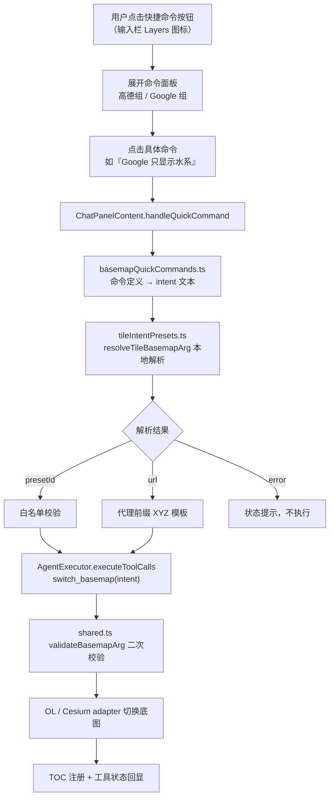

# 2026-11-27 Agent 底图切片预设快捷命令

> **日期**：2026-11-27 10:10
> **任务等级**：L2 常规开发
> **状态**：✅ 已完成（验证结果见第四、五节）
> **关联版本**：V3.7.20 / V3.7.21（建议词失败修复）

---

## 一、问题分析

### 核心症状

用户需要一个「Agent 预设快捷命令」，用于一键配置高德/Google 相关的地图切片（单要素底图）并自动切换 URL。当前聊天面板只有 5 个通用建议词 chips（定位/换底图/搜索/天气/风水），没有针对高德/Google 切片配置的预设入口；用户每次都要手打「只显示水系」「高德不要道路」这类语义描述。

### 根本原因

「自动切换 URL」的底层能力已完整存在，缺的只是可点击入口：

1. `tileIntentPresets.ts` 有 18 条高德/Google 语义规则，`resolveTileBasemapArg(intent, proxyBase)` 可把自然语言解析为 `presetId` 或带代理前缀的精确 URL；
2. `switch_basemap(intent=用户原话)` 工具链已把解析结果接入 OL/Cesium 双引擎与 TOC 注册；
3. 但聊天面板无任何入口把这些规则暴露为「一键命令」，用户必须记忆并手打语义描述。

### 受影响模块

| 模块 | 影响 |
|---|---|
| `ChatInputBar.vue/.ts` | 输入栏无快捷命令按钮，需在发送钮旁增加入口 |
| `ChatMessageList.vue/.ts` | 空状态 suggestions 仅有 5 条通用词，未覆盖切片配置 |
| 新增 `basemapQuickCommands.ts` | 预设命令定义（分组、显示名、intent 文本），纯数据 + 纯函数 |
| `ChatPanelContent.ts` | 需新增"本地执行预设命令"路径（不经过 LLM） |
| i18n `zh-CN/en-US/search-shell.ts` | 新增命令分组标题与提示文案 |

### 候选方案对比

| 方案 | 做法 | 优点 | 缺点 | 结论 |
|---|---|---|---|---|
| A. 点击后填入输入框 | 复用现有 `suggest` 模式，把 intent 文本填进 textarea，用户再点发送 | 改动最小，用户可编辑 | 仍需一次 LLM 调用（首轮延迟），且多一次点击 | 拒绝 |
| B. 点击后直接发送给 LLM | 复用 `handleSuggest` → `dispatchSend`，发 intent 文本让模型调工具 | 复用现有链路 | 必须经过 LLM 首轮，与上一轮「降延迟」目标冲突；模型可能误判参数 | 拒绝 |
| C. 本地解析 + 直接执行（选定） | 点击命令 → `resolveTileBasemapArg` 本地解析 → `AgentExecutor.executeToolCalls([switch_basemap])`，零 LLM 调用 | 秒级切换；规则表是 SSOT，参数精确无臆造；复用 TOC 注册与结果回显 | 需要新增一条不经过 LLM 的执行入口 | 采用 |

### 数据流与文件交互



### 安全边界

1. **规则表是唯一事实来源**：快捷命令只携带 intent 文本，不硬编码 presetId/URL；解析仍走 `tileIntentPresets.ts` 的打分与 provider 锁定，避免「高德只显示湖泊」被误判成 Google 水系。
2. **不绕过校验**：本地解析结果仍作为 `switch_basemap(intent=...)` 参数进入 `validateBasemapArg`，双引擎 adapter 与 TOC 注册零改动。
3. **零 LLM 调用**：命令执行不进入 `dispatchSend`，不产生模型 token；历史记录只写一条用户可见的命令回执，不污染对话上下文。
4. **工具集无关**：不依赖 `agentToolRouter` 是否选中 `switch_basemap`，快捷命令路径独立可用。

---

## 二、实施计划

1. 新增 `basemapQuickCommands.ts`：定义 2 组（高德 / Google）约 10 条预设命令，每条含 displayName + intent 文本；导出 `BASEMAP_QUICK_GROUPS` 与 `isBasemapQuickIntent`。
2. `ChatInputBar.vue/.ts`：发送钮旁增加 Layers 图标按钮，点击展开命令面板（popover），支持点击外部关闭；emit `quick-command`。
3. `ChatPanelContent.ts`：实现 `handleQuickCommand`，本地解析 + 直接执行 + 状态提示 + 命令回执消息。
4. i18n 新增分组标题与提示文案。
5. 同步结构树、版本号、CHANGELOG、日志；运行类型检查与门禁。

---

## 三、目标

| 指标 | 预期 |
|---|---|
| 切换一次切片配置的 LLM 调用数 | 0（原 1+） |
| 切换响应 | 秒级（本地解析 + 单次工具执行） |
| 高德/Google 常用切片配置覆盖 | ≥ 10 项 |
| 后端协议 / 规则表 / 执行链 | 零改动 |

---

## 四、实施与验证结果

### 修改内容

1. 新增 `basemapQuickCommands.ts`：`BASEMAP_QUICK_GROUPS`（高德 7 + Google 11）、`ALL_BASEMAP_QUICK_COMMANDS`、`isBasemapQuickIntent`；intent 全部取规则表 `userPhrases` 原文。
2. `ChatInputBar.vue/.ts`：发送钮旁新增 Layers3 按钮与弹出面板，点击外部自动关闭；新增 `quick-command` emit；移动端 `pointer: coarse` 命中区 40px。
3. `ChatPanelContent.ts/.vue`：新增 `handleQuickCommand`——本地 `resolveTileBasemapArg` 解析 → `executeToolsAndUpdateUI([switch_basemap(intent)])`，复用 TOC 注册/工具状态回显/地图上下文快照；回执消息不写入 LLM 历史。
4. i18n `zh-CN/en-US/search-shell.ts`：新增 `chat.quickCommandsTitle`、`quickGroups`、`quickCommands`（18 条）、`quickCommandDone/Failed`。
5. 同步结构树、README 三处版本号、CHANGELOG。

### 规则命中验证

对 18 条快捷命令逐条模拟 `resolveTileIntentByText` 的 provider 锁定 + 打分逻辑：

| 结果 | 数量 |
|---|---:|
| 精确命中预期规则 | **18 / 18** |
| 跨 provider 误判 | 0 |
| 未命中（分数 < 6） | 0 |

典型：`高德不要道路` → `amap_clean_no_roads`(64)；`Google 水系` → `google_water`(93)；`Google 土地利用` → `google_landuse`(133)；`高德地图` → `amap_full_vector`(13)。

### Agent 已执行

- `npm run typecheck`（vue-tsc --noEmit）：✅ 通过，0 错误
- 规则命中脚本：18/18 通过（临时脚本已删除）
- 门禁：`CheckStructureTree.py` / `CheckConfigRegistry.py`（结果见交接块）
- Git 写操作：零

### 待用户实机验证

1. 打开聊天面板，点击输入栏左侧图层图标，确认面板展开、分高德/Google 两组共 18 项。
2. 点击「Google · 只显示水系」，确认底图秒级切换（无"思考中"等待），地图变为水系单要素。
3. 点击「高德 · 简洁无道路（WGS 纠偏）」，确认纠偏代理生效、无 GCJ-02 偏移。
4. 连续点击多个命令，确认 TOC 图层树同步更新、无重复堆叠。
5. 触屏设备上确认按钮命中区 ≥40px、面板可滚动。

### 遗留与风险

- `Google` 组的 `apistyle` 类命令（水系/土地利用/路网/高速/POI/行政界/注记）属非稳定服务参数，上游可能变更；规则表已标注 caveat，若失效需更新 `tileIntentPresets.ts`。
- 快捷命令回执写入对话消息列表但不进 LLM 历史；用户「重新生成」上一条时不会重放该命令，需重新点击。
- 面板为输入栏内弹出层，窄屏（<360px）下 18 项需滚动，已设 `max-height: min(52vh, 420px)`。

---

## 五、建议词失败修复（V3.7.21）

### 核心症状

用户实机截图反馈：点击聊天面板默认建议词「切换到谷歌代理卫星底图」失败，报「切换到底图：未知预设 — 未识别的瓦片语义；请提供明确的 presetId 或标准 XYZ url，不要自行拼接参数。」随后模型总结为「switch_basemap 执行失败」。

### 根本原因

「谷歌代理卫星」语义此前**只登记在 `chatIntentFallback.ts` 的 `BASEMAP_MAPPING_ENTRIES`**（`谷歌代理 / 代理卫星 / 谷歌卫星 → google_Backend_Proxy_preset`），该表仅在 LLM **未返回工具调用**时作正则兜底。本次 LLM 正常返回了 `switch_basemap(intent='切换到谷歌代理卫星底图')`，请求进入 `tileIntentPresets.ts` 规则表——而 18 条规则中没有任何一条覆盖「代理卫星」，provider 锁定下 `google_satellite` 的 userPhrases（Google 卫星 / 谷歌卫星 / 谷歌纯卫星）也都不在原字符串中（原串是「谷歌代理卫星」，中间多「代理」二字），故 `bestScore=0` → 返回未识别错误。

这是 V3.7.15 建规则表时的遗漏：新增了规则表通道，却没有把既有建议词语义同步登记进去，形成「兜底表认识、主路径不认识」的断裂。

### 修复

在 `tileIntentPresets.ts` 的 Google 组、`google_satellite` 规则之前补登记：

```ts
id: 'google_backend_proxy_satellite',
userPhrases: ['谷歌代理卫星底图', '谷歌代理卫星', 'Google 代理卫星',
              '谷歌代理影像', '切换到谷歌代理卫星', '代理卫星底图'],
provider: 'google',
presetId: 'google_Backend_Proxy_preset',
confidence: 'high',
```

`google_Backend_Proxy_preset` 已存在于 `basemapPresets.ts` 且经 `AGENT_BASEMAP_PRESET_IDS` 全量派生进白名单，无需新增预设。

### 验证结果

| 用例 | 命中规则 | 得分 |
|---|---|---:|
| 切换到谷歌代理卫星底图（截图原话） | `google_backend_proxy_satellite` | 229 |
| 谷歌代理卫星 | `google_backend_proxy_satellite` | 48 |
| Google 卫星 | `google_satellite` | 93 |
| 只显示水系 | `google_water` | 25 |
| 高德不要道路 | `amap_clean_no_roads` | 64 |
| Google 土地利用 | `google_landuse` | 133 |

- 规则数 18 → 19；新用例失败 0，既有语义零漂移。
- V3.7.20 的 18 条快捷命令回归：18/18 仍命中预期分组，0 回归。
- `npm run typecheck`：✅ 0 错误。

### 待用户实机验证

重新点击建议词「切换到谷歌代理卫星底图」，确认底图正常切换、不再报「未知预设」。

## 变更文件清单

- `ChatInputBar.vue/.ts`
- `ChatMessageList.vue/.ts`
- `ChatPanelContent.ts/.vue`
- `zh-CN/en-US/search-shell.ts`
