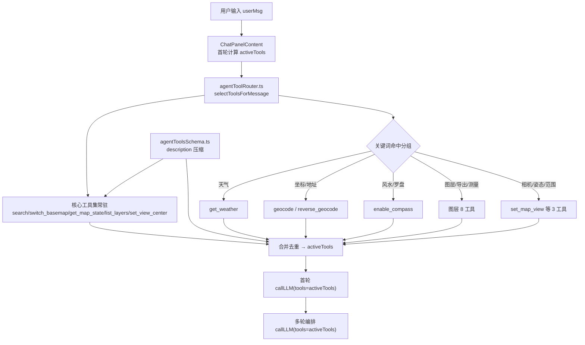

# 2026-11-27 Agent 工具载荷瘦身与按意图分发

> **日期**：2026-11-27 10:05
> **任务等级**：L2 常规开发
> **状态**：进行中
> **关联版本**：V3.7.19

---

## 一、问题分析

### 核心症状

用户反馈「提示词太长，首轮响应慢」，期望「只给 Agent 必要的开头提示词，让它自己按需调用相关功能，而不是一次性把所有提示词都写进去」。

### 根本原因

V3.7.17 已把 System Prompt 从 9,779 字符压缩到 962 字符，但**真正的 token 大头未被处理**：

| 载荷项 | 实测字符数 | 实测 UTF-8 字节 | 占比 |
|---|---:|---:|---:|
| System Prompt | 962 | 1,840 | 9.8% |
| `AGENT_TOOLS`（20 个工具完整 JSON Schema） | **8,817** | **11,915** | **90.2%** |
| 合计（不含上下文与历史） | 9,779 | 13,755 | 100% |

`ChatPanelContent.ts` 首轮与每一次工具编排轮次均传入完整 `AGENT_TOOLS`（两处 `tools: AGENT_TOOLS`）。无论用户问「你好」还是「删除图层」，20 个工具的完整 description、参数说明、enum、default 都全量发送。这是首轮延迟的结构性原因，与 V3.7.17 的 System Prompt 瘦身无关。

### 受影响模块

| 模块 | 影响 |
|---|---|
| `agentToolsSchema.ts` | 20 个工具 description 冗长；无意图筛选入口 |
| `ChatPanelContent.ts` | 首轮与多轮编排两处硬编码全量 `AGENT_TOOLS` |
| 新增 `agentToolRouter.ts` | 负责本地关键词评分、工具分组选择（纯函数、零副作用） |
| `detectGISIntent` | 已有正则兜底仅产出单个工具调用，不参与工具集筛选 |

### 候选方案对比

| 方案 | 做法 | 优点 | 缺点 | 结论 |
|---|---|---|---|---|
| A. 只压缩 description 文案 | 逐条缩短中文说明 | 零行为风险 | 工具仍 20 个全发，token 降幅有限（约 30%） | 部分采用 |
| B. 把工具说明塞进 System Prompt | 删掉 tools 参数 | System Prompt 变长 | 失去 Function Calling 结构化能力，见 V3.7.16 教训 | 拒绝 |
| C. 服务端按会话下发工具子集 | 后端保存工具集状态 | 前端更简单 | 改动后端协议、多通道（三通道）全需同步，L3 范围 | 拒绝 |
| D. 本地按意图分发（选定） | 新增 `selectToolsForMessage()`，核心工具常驻 + 命中分组追加；首轮与后续轮复用同一工具集 | 首轮 token 降幅最大；不改后端协议与工具数量；纯本地零延迟 | 关键词未命中时退化为仅核心工具集，需保证核心集覆盖高频场景 | 采用 |

### 数据流与文件交互

### 安全边界

1. **工具总数不变**：20 个工具全部保留在 `AGENT_TOOLS`，仅分发子集；`TOOL_REGISTRY` 与执行链零改动。
2. **核心集覆盖高频**：5 个核心工具覆盖定位、换底图、读状态、列图层、移动中心，保证无明确意图时仍可完成绝大多数请求。
3. **关键词宽进**：图层分组关键词包含「图层/显示/隐藏/透明度/导出/下载/删除/测量/单独/缩放」，宁可多发也不错发。
4. **多轮复用首轮工具集**：编排过程中不再重新筛选，避免中途工具集变化导致模型引用不存在的工具。
5. **空消息兜底**：重新生成等 `userMsg` 为空场景发送全量工具。

---

## 二、实施计划

1. `agentToolsSchema.ts`：压缩 20 个工具的 description（保留关键约束语义，删除可推断的解释与重复示例）。
2. 新增 `agentToolRouter.ts`：定义工具分组、`CORE_TOOLS`、`selectToolsForMessage()`（纯函数，返回工具子集）。
3. `ChatPanelContent.ts`：首轮计算 `activeTools`，替换两处 `tools: AGENT_TOOLS`。
4. 同步结构树、版本号、CHANGELOG；运行门禁与类型检查。

---

## 三、目标

| 指标 | 优化前 | 目标 |
|---|---:|---:|
| 首轮工具 schema 字符（典型「你好」） | 8,817 | ≤ 2,500 |
| 首轮工具 schema 字符（典型「删除图层」） | 8,817 | ≤ 4,000 |
| 工具总数 | 20 | 20 |
| System Prompt 字符 | 962 | 962（不变） |
| 后端协议 / 工具执行链 | — | 零改动 |

---

## 四、实施与验证结果

### 修改内容

1. `agentToolsSchema.ts`：压缩 8 处冗长 description（换底图 URL、天气 type、双向地理编码、风水罗盘及其半径、导出 mode/limit），保留全部硬约束语义（如「指定地点先 search_and_zoom」「禁止拼接 ltype/apistyle」「仅 downloaded=true 才算生成」）。全量工具 schema 8,817 → 8,603 字符。
2. 新增 `agentToolRouter.ts`：`selectToolsForMessage(userMsg)` 纯函数，核心 4 工具常驻，6 组关键词宽进匹配，输出保持 `AGENT_TOOLS` 声明顺序；空消息返回全量兜底。
3. `ChatPanelContent.ts`：首轮计算一次 `activeTools`，替换首轮与多轮编排两处 `tools: AGENT_TOOLS` 为复用同一集合。
4. 同步 `frontend-structure.md` 结构树、README 三处版本号、`CHANGELOG.md`。

### 实测对比（工具 schema 序列化字符数）

| 场景 | 优化前 | 优化后 | 降幅 |
|---|---:|---:|---:|
| 全量（20 工具） | 8,817 | 8,603 | 2.4% |
| 闲聊「你好」 | 8,817 | **2,095** | **76%** |
| 天气「查询北京的天气」 | 8,817 | 2,506 | 71% |
| 风水「分析峰下村的风水」 | 8,817 | 2,637 | 69% |
| 地理编码「北京在哪儿坐标多少」 | 8,817 | 2,935 | 66% |
| 视图「切换到3D视图」 | 8,817 | 4,193 | 51% |
| 图层「删除那个图层」 | 8,817 | 4,132 | 52% |
| 导出「导出这个图层」 | 8,817 | 4,712 | 45% |

### Agent 已执行

- `npm run typecheck`（vue-tsc --noEmit）：✅ 通过，0 错误
- 工具集冒烟：8 类典型消息，工具选择符合预期，命中组整组加入
- 门禁脚本：`CheckStructureTree.py` ✅ 756/756（漏登记 0 / 幽灵 0）；`CheckConfigRegistry.py` ✅ B1–B4 / F1–F3 全绿
- 平台红线自查：后端 / deploy / `.github` 无命中；前端 8 个文件命中均为已知假阳性 `maxRayDistance`（体积云 raymarch 参数，见 Force_command §11.2）；生产基线 `BASELINE-CLEAN`
- Git 写操作：零（未 commit / push / stash / reset）

### 待用户实机验证

1. 打开聊天面板输入「你好」，观察首字返回是否明显更快。
2. 输入「导出这个图层」，确认仍能走 `list_layers` → `export_layer_geojson` 多轮闭环（工具集含 12 个，覆盖完整链路）。
3. 输入「分析峰下村的风水」，确认 `search_and_zoom` → `enable_compass` 仍正常。
4. 复杂多轮任务（跨 5+ 工具）不因工具子集而缺工具。

### 遗留与风险

- 关键词未命中时仅返回核心 4 工具；若用户用极隐晦表述请求小众能力（如「把这个干掉」删除图层），模型看不到 `remove_layer`，会如实说明无法操作。此类请求可点击「重新生成」或改用明确表述。
- 工具子集在首轮固定，多轮中用户追加的新意图不在原集合内（如先问天气再要求删除图层，同一条消息内），需重新发消息。
- 新增工具若未在 `agentToolRouter.ts` 登记，会走「未登记工具一律常驻」兜底分支，能力不丢但无法享受按需分发；建议新增工具时顺手归类。

## 变更文件清单

- 本任务以逻辑改动为主，具体文件见正文「修改内容」段。
