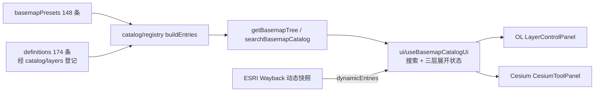

# 底图目录 catalog 骨架与双引擎目录 UI 批次（补记）

> **⚠️ 本日志为补记（retroactive）**：本批工作于 2026-11-27 会话完成但**未按 §6 创建日志**，
> 由 V3.7.20 暂存区 Code Review 修复会话（[2026-11-28-staged-review-fixes](../2026-11-28/2026-11-28-staged-review-fixes.md)）
> 于 2026-11-28 补记。按 §0 优先级 4，历史不合规写法不构成新代码的理由——本补记不豁免当初的流程违规，
> 仅补全追溯链。部分会话细节（具体执行时间、会话内决策过程）已不可考，以 ⚠️ 未验证 标注。

- **日期与时间**：2026-11-27（执行日）；2026-11-28 11:00（补记）
- **任务等级**：L3（跨模块架构批次：新增目录查询层 + 双引擎 UI 重构 + 50 条新增预设）
- **本次版本**：无独立版本号——本批改动随 V3.7.16 批次一并提交（origin/main `809239cca`），CHANGELOG V3.7.16 条目补记说明
- **任务来源**：`Docs/TODO/2026-11-27-basemap-catalog-requirements.md`（需求整理）+ 方案文档 `Docs/Architecture/basemap-catalog-redesign.md`（本次批次产出并入仓）

## 问题分析

**核心症状**：148 条预设平铺下拉难以查找；分类元数据（category/provider/coord）散落无 SSOT；
ESRI Wayback 动态快照与历史影像有专用 UI 分支；组合底图（AMAP 256 ltype / Google 组合）特判散在 UI composable。

**根本原因**：底图目录缺少引擎无关的查询视图层，UI 各自实现分组/过滤/搜索。

**受影响模块**：`common/basemap/`（新增 catalog/ + ui/ + comboBasemaps）、OL `LayerControlPanel`、
Cesium `CesiumToolPanel`、`basemapPresets.ts`、`useCesiumLayers`、`layerUtils`、`publicRuntime`。

## 修改内容（按文件归属本批）

**新增**：
- `frontend/src/domains/common/basemap/catalog/`（6 文件）：types / taxonomy / registry / layers / compat / index——引擎无关目录查询层（树构建 / 搜索 / 面包屑 / 兼容出口）
- `frontend/src/domains/common/basemap/comboBasemaps.ts`——组合底图辅助（V3.7.20 已裁剪为 isComboBasemapId）
- `frontend/src/domains/common/basemap/ui/useBasemapCatalogUi.ts`——OL/Cesium 共用「搜索 + 三层展开」UI 状态
- `frontend/scripts/check-basemap-catalog.mjs`——148 预设数量/首尾/组合计数门禁
- `frontend/scripts/build-with-base.mjs`——跨平台 VITE_BASE_URL 构建包装（Windows cmd 不支持内联环境变量）
- `Docs/Architecture/basemap-catalog-redesign.md`——本批方案文档（后经 V3.7.19 按实际代码重写并补 5 张 Mermaid）
- `Docs/TODO/2026-11-27-basemap-catalog-requirements.md`——需求整理

**修改**：
- `frontend/src/domains/common/basemap/basemapPresets.ts`——末尾追加 50 条预设（20 AMAP 256 ltype + 30 Google 组合，编号 99–148，旧 `?l=1..98` 契约不动）
- `frontend/src/domains/ol/layer/components/LayerControlPanel.vue/.ts` + `composables/useBasemapCatalog.ts`——下拉改为「常驻搜索 + 六大类 → 服务商 → 坐标系 → 编号条目」；Wayback 动态快照并入 historical 分类
- `frontend/src/domains/cesium/components/CesiumToolPanel.vue/.ts` + `CesiumContainer.vue/.ts`——同一目录树接入（本会话最终形态见 V3.7.20 修复日志）
- `frontend/src/domains/cesium/composables/layers/useCesiumLayers.ts`——组合条目从平铺网格剔除
- `frontend/src/domains/cesium/composables/layers/layerUtils.ts`——`buildUnifiedBasemapOptions` 注入 catalog 元数据（description/category/provider/coord）
- `frontend/package.json`——`check:basemap-catalog` / `check:layer-definitions` 脚本注册；build 脚本改走 build-with-base.mjs
- `frontend/src/config/publicRuntime.ts`——新增 `wgs2gcjProxyUrl`（V3.7.20 已删，死导出）

**随批入库、未在原日志登记**：
- `.github/traffic.json`——GitHub 流量统计自动化产物（数据更新至 2026-11-24）
- `.gitignore`——新增 `frontend/dist-webgis-dev`（与 build:webgis-dev 输出目录配套）

## ⚠️ 补记期间发现的未记录内容变化（V3.7.20 零散修补已完成语义级审计）

对照 V3.7.15（c936c1d64）旧 group 定义做基线核查 + 语义级审计（114 条共同 id 逐条求值新旧
OL/Cesium 最终 URL 与全部加载参数）后定性：

- **真实渲染回归 3 条（已由 V3.7.20 修复）**：`vector_amap`（order 90，本批新挂 `scl=2` 未配
  `tilePixelRatio`）、`vector_amap_clean_hd`（92）/ `vector_amap_clean_roads`（93，V3.7.15 有
  `tilePixelRatio: 2` 本批丢失）——512px 瓦片按 256px 网格渲染错档，已补回。
- **待确认意图 2 条（未回退）**：order 90/91 上游模板挂 `ltype=9`（推测与 AMAP 256 ltype 统一化相关，
  无日志记载），见 `Docs/TODO/bugfix-optimization-plan.md`。
- **物化等价 10 条**：Sentinel 年度影像在 V3.7.15 由 `basemapCore.buildS2CloudlessDef(year)` 生成器
  产生（V3.7.16 日志称其「死代码」系工作区视角误判），本批物化为字面量定义，URL 方案吻合。
- **真新增 50 条**：AMAP 256 ltype ×20 + Google 组合 ×30；删除 0 条；其余共同 id 加载语义零变化
  （审计盲区仅 5 条静态不可求值项，其 url 字段均无变化）。

## 修改原因

统一目录查询层让 OL/Cesium 共享同一棵分类树与搜索语义；编号契约（追加式 50 条预设）与
`?l` 序号不受影响；新增底图只需登记定义元数据。

## 影响范围

底图目录 UI（双引擎）、预设数量（98→148）、catalog 查询层、构建脚本（Windows 兼容）。
不影响：后端、`?l=1..98` 契约、部署面。

## 解决方案

## 性能指标

不适用（本批为结构/UI 批次）。registry 每次调用重建条目的开销问题已在 V3.7.20 以版本缓存解决。

## 测试方案

### Agent 已执行（补记会话实测）

- `node scripts/check-basemap-catalog.mjs`：**通过**（148 presets，AMAP 20 / Google 30 计数与首尾 id 锁定）
- `CheckStructureTree.py`：**通过**（本批文件均已登记）
- `CheckDomainDeps.py`：**通过**（common 零引擎依赖）
- 详见 [2026-11-28-staged-review-fixes](../2026-11-28/2026-11-28-staged-review-fixes.md) 门禁表

### 待用户实机验证

1. OL 下拉：搜索「建筑」「99」「Google」命中并可直接切换；六大类展开正常。
2. Cesium 面板：同一目录树可切换编号 99–148 组合底图；官方影像服务分组可选。
3. `?l=99` 与 `?l=148` 直达对应预设；`?l=1` 行为与 V3.7.15 一致。

## 遗留与风险

- **既有图源 URL 内容变化未逐条审计**（见上 ⚠️ 节，已记入 bugfix-optimization-plan）。
- 目录树 UI 新增控件最初缺 `pointer: coarse` 触屏档（V3.7.20 补 OL 侧；Cesium 侧见 V3.7.20 遗留）。
- 目录 UI 文案为硬编码中文（如「输入 URL」「没有匹配的底图」），未接 i18n——与面板既有中文文案并存，待统一。
- `traffic.json` / `.gitignore` 随批入库且当时无日志登记（本补记已收录）。

## 变更文件清单

见「修改内容」节；本补记本身不改任何前端代码。
