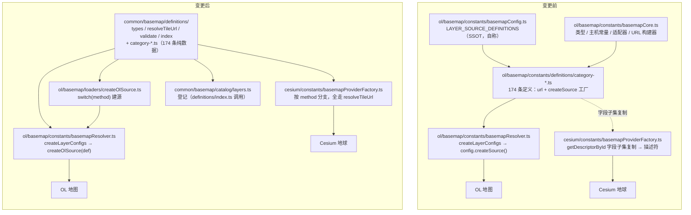

# 瓦片底图定义重构 · 层定义驱动，OL/Cesium 共享（L3）

- **日期与时间**：2026-11-27 23:42 – 2026-11-28 02:07（CST；阶段一分析始于 11-27 23:42，执行于 11-28 00:53 恢复后推进；日志文件按任务要求落 2026-11-27 目录）
- **任务等级**：L3（架构级重构）
- **任务来源**：用户已明确批准方案（方案文档 `~/workspace/tile-basemap-refactor-plan.md`，工作区文件，未入仓），父 agent 下达实施任务，立即执行。
- **分支**：`muse/dev-basemap-refactor`（全新克隆 `~/workspace/webgis-refactor-work`，基线 `origin/main` `bcf0eaa64de703ab5d0aae4dd63c157aeffe4c21`；工作树只改，不 commit/push/merge，由父 agent 推送与提 PR）
- **本次版本**：V3.7.16

## 问题分析

### 核心症状

- 174 条图源定义散落在 OL 域（`ol/basemap/constants/basemapConfig.ts` + 6 个 `category-*.ts` 分片），每条定义把 `url` 与 `createSource` 工厂各写一次：URL 拼两次（字面量模板与工厂内 XYZ url 各一份），易漂移；且定义直接 import OL，common 层与引擎耦合。
- Cesium 侧另有一套字段子集复制的描述符派生（`getDescriptorById` 只复制部分字段），两引擎对同一图源的理解可能不一致。
- 旧聚合点 `basemapConfig.ts` 是 OL 域的“唯一真相源”，但它本身依赖 OL；`catalog/layers.ts` 的登记动作也挂在它身上。

### 根本原因

- 定义层没有与引擎无关的单一事实源：URL、纠偏/代理包装、source 构建三件事写在同一个带 `createSource` 的对象里，且纠偏/代理是用 `gcj2wgsProxyUrl(...)` 等函数调用直接包在 url 字段上的，语义（纠偏方式、代理模式）无法被静态读取。
- OL 与 Cesium 各自从定义里“取一部分字段自己拼”，没有共享的 URL 解析函数。

### 受影响模块

- OL 加载链：`basemapResolver.ts`（`createLayerConfigs`，唯一 OL 入口）及其 6 处消费方（`useBasemapLayerBootstrap`、`useBasemapStateManagement`、`useBasemapSwipe`、`MapDownloader`、`useLayerContextMenuActions`、`useMapBasemapInstances`）——只用 `config.createSource()`，接口不变。
- Cesium 链：`cesium/constants/basemapProviderFactory.ts`、`common/basemap/catalogProjection.ts`（`getDescriptorById`）。
- 目录链：`common/basemap/catalog/layers.ts`（登记方）、`ol/composables/useRuntimeMapTokenPool.ts`（`resolveRuntimeTokenPoolKey`）。
- 门禁脚本：`frontend/scripts/check-layer-definitions.mjs`（旧路径 + 要求 url 为字面量/代理包装）。

### 候选方案对比

| 方案 | 结论 |
|---|---|
| A. 定义层只搬字段，URL 解析函数放 OL/Cesium 各一份 | 否决：两引擎对同一图源的 URL 理解仍可能漂移，重蹈覆辙 |
| B. 定义层 + 共享纯函数 `resolveTileUrl`（本次选定） | 定义只存原始 URL + `method`/`correction`/`proxy` 声明；两引擎全走同一纯函数拼 URL |
| C. WMTS 改走标准 WMTS source（拉 Capabilities） | 否决：同步工厂无法拉 Capabilities，手写 tileGrid 属猜测；旧工厂的 wmts 分支实际走 XYZ（GetTile 模板），保持 XYZ 形态只搬不改 |

### 选定方案与理由

- 选 B：common 层零引擎依赖（`CheckDomainDeps` 验证 common→ol/cesium 为 0），`resolveTileUrl` 是纯函数且不读 `publicRuntime`（代理基址与模式由调用方 ctx 传入），两引擎 URL 逐字节一致可由脚本断言。
- WMTS 按 C 否决：与方案 §4 的“WMTS→WMTS”要求有偏差，属有意偏差，见遗留。

## 修改内容

### 1. 新建 common 定义层（`frontend/src/domains/common/basemap/definitions/`）

- `types.ts`：`TileLayerDefinition`（方案 §2 类型 + 新增 `skipHighResTile?: boolean`——9 条 label 定义跳过高清瓦片，但 order 49 `label_arcgis_polar_arc_ref` 是 label 却不跳过，无法从 category 推导，故必须保留为字段）+ `LayerCategory`/`LayerGroup`（自 basemapCore 移入）+ `TileLoadMethod`/`CoordCorrection`/`ProxyMode`/`TileLayerContext`。复用 `../catalog/types` 的 `BasemapCategory`/`BasemapProvider`/`BasemapCoord`。
- `resolveTileUrl.ts`：纯函数。占位符无条件替换（空值→空串，与旧 OL `buildTiandituUrl` 行为一致）；`correction != 'none'` 强制走代理（`/proxy/{gcj2wgs|wgs2gcj|bd2wgs|wgs2bd}/{rawUrl}`）；`proxy: 'proxy'` 时只剥离 `https://` 前缀、保留 `http://`（ships66 order 171 参数自带 `http://`，tile-proxy 路由契约是 `/proxy/{target_url:path}`，架构文档明确船舶网特意走 `/proxy/http://g3.ships66.com/...`）；`auto`/`direct` 返回原始 URL（回退由引擎侧处理）。
- `validate.ts`：`validateTileLayerDefinitions` 返回 `{errors, warnings}`；错误含 id/order 重复、order 未覆盖 1..N、必填字段、method/correction/proxy 非法、correction+direct 冲突、wms/wmts 缺参数、nonStandardAdapter 非 xyz、engines 非法；`url:'None'` 仅警告。
- `index.ts`：聚合 `TILE_LAYER_DEFINITIONS`（按 order 排序）；加载时校验（警告 `console.warn`、错误抛错）；`getTileLayerDefinitionById` / `getDescriptorById`（返回定义本身，全量透传）/ `getAllTileLayerIds` / `resolveRuntimeTokenPoolKey`；向 `catalog/layers` 登记（method→serviceType 唯一映射点：mvt→`'vector-tile'`）。
- 6 个 `category-{service,imagery,terrain,electronic,historical,vector}.ts`：由迁移脚本从旧文件生成。计数：correction 33（gcj2wgs 26 + wgs2gcj 6 + bd2wgs 1）、proxy 3、MFF 12、MVT 3、skipHighResTile 9。

### 2. 迁移 174 条定义

- 迁移脚本 `~/workspace/tmp-basemap-refactor/migrate_defs.py`（读旧文件用 `git show HEAD:...` 只读；解析脚本 `parse_defs.py` 与 `old_defs.json` 在同一目录）。规则：删 `createSource`（恒为末属性）；`serviceType`→`method`（vector-tile→mvt）；代理包装 url 解包为原始 URL + correction/proxy；`adapters` 字段删除，MFF 得 `nonStandardAdapter: 'maps-for-free-<layer>'` + `engines:['ol']`；MVT 得 `engines:['ol']`；9 条 withSkipHighResTile 得 `skipHighResTile: true`。
- WMS/WMTS 的 `wms:`/`wmts:` 参数只存在于旧 `createConfiguredServiceSource` 内部，脚本提升为顶层字段（orders 37/38/39）。
- 仅存于 `createSource` 的 XYZ 选项提升为顶层字段：`maxZoom`（orders 15/16，值 20）、`tilePixelRatio`（order 23，值 2）。若顶层已有同名字段，脚本断言与 createSource 传入值一致（orders 96/170 通过；order 5 `label_minedata` 字段 18 而旧 createSource 未传——加载器统一以字段为准，属有意归一，见遗留）。
- 阶段一核实结论（均经实际代码/脚本核对）：定义总数 174（方案称 177 已过时），orders 1–174 唯一无缺口；serviceType 分布 xyz 166 / vector-tile 3 / wmts 2 / wms 1 / osm 1 / custom 1；url 形态字面量 138、gcj2wgsProxyUrl 26、wgs2gcjProxyUrl 6、tileProxyUrl 3、bd2wgsProxyUrl 1；字面量 url 与 createSource 内 XYZ url 逐条比对零不匹配，代理包装参数零不匹配。
- Sentinel 的 order 已是 27–36（方案称“全是 0”已过时：`buildS2CloudlessDef` 生成器在 basemapCore 是死代码，历史文件是字面量定义），无需补 order；`l` 契约由 `ALL_BASEMAP_PRESETS`（148 个预设，未动）驱动，order 不变则编号不变。
- 天地图/奥维 7 条定义：url 模板与 `buildTiandituUrl`/`buildOvitalUrl` 拼出的 OL URL 在 `t{s}→t0` + 占位符替换后逐字节相等（脚本验证）。OL 的 `renderXYZTemplate` 不展开 `{s}`（在 `node_modules/ol/tileurlfunction.js` + `uri.js` 实测），故 OL 加载器必须把 `t{s}` 钉为 `t0`；Cesium 侧保留 `{s}`（其 `normalizeSubdomainRange` 会展开）。
- MVT 在 Cesium：工厂明确返回 null（vector-tile 分支）+ `vector_tianditu_mvt` 有栅格降级映射；MFF（12 条）同样返回 null → 15 条标 `engines:['ol']`（架构文档 `Docs/Architecture/basemap-source-system.md` §12 亦确认“MFF 不支持 Cesium、PBF 仅 OL 可用”）。
- 代理配置已存在，无需新增：`TILE_PROXY_BASE_URL` / `TILE_PROXY_MODE` / `TILE_REQUEST_TIMEOUT_MS` / `gcj2wgsProxyUrl` / `bd2wgsProxyUrl` / `wgs2gcjProxyUrl` / `tileProxyUrl` 均已在 `frontend/src/config/publicRuntime.ts`；`deploy/.env.example` + `backend/config/catalog.py` 不用动。

### 3. OL 切换

- 新建 `frontend/src/domains/ol/basemap/loaders/nonStandardAdapters.ts`：`NON_STANDARD_XYZ_ADAPTERS` 自 basemapCore 移入。
- 新建 `frontend/src/domains/ol/basemap/loaders/createOlSource.ts`：`createOlSource(definition, ctx)` + `withSkipHighResTile`（自 basemapCore 移入）。分支与旧 createSource 逐一等价：xyz 无适配器 → `prioritizeTileSourceRequest(new XYZ({url, maxZoom, tilePixelRatio}))`；xyz 有 nonStandardAdapter → `createXYZSourceFromUrl(url, {adapters})`（不套 prioritize，与旧一致）；wmts/wms → `createConfiguredServiceSource`（wms→TileWMS，wmts GetTile 模板→XYZ，与旧一致）；mvt → `createVectorTileSourceFromUrl` + `styleUrl`（不套 prioritize）；osm → `prioritizeTileSourceRequest(new OSM())`；custom → customUrl 为空返回 null，否则 `createXYZSourceFromUrl(customUrl, {adapters})`。`resolveOlTileUrl` 先走 `resolveTileUrl` 再把 `t{s}.tianditu.gov.cn` 钉为 `t0`。
- `frontend/src/domains/ol/basemap/constants/basemapResolver.ts` 已重写：自 common 定义层 import，`createLayerConfigs` 改为 `createSource: () => createOlSource(definition, context)`，继续向 catalogProjection 发布投影（时序不变）。

### 4. Cesium 切换

- `frontend/src/domains/cesium/constants/basemapProviderFactory.ts`：改按 `method` 分支；URL 一律走 `resolveTileUrl`（新增 `resolveDescriptorTileUrl` 包装，传入 `TILE_PROXY_BASE_URL`/`TILE_PROXY_MODE`）；删旧 `resolveContextPlaceholders`；`buildMffCesiumUrl`、vector-tile→mvt 判空、WMS/WMTS/OSM/custom 分支、`vector_tianditu_mvt` 降级映射、`wrapProviderWithFetchFallback` 均保持原行为（仅 openstreetmap.org 的 URL 才包 fetch fallback，与旧一致）。
- `frontend/src/domains/common/basemap/catalogProjection.ts`：`BasemapTileSourceDescriptor` 改为 `TileLayerDefinition` 别名（描述符 = 定义本身），头注释更新（SSOT 已迁 common）。

### 5. 收尾

- `frontend/src/domains/ol/composables/useRuntimeMapTokenPool.ts`：`resolveRuntimeTokenPoolKey` import 改为 `@common/basemap/definitions`；注释同步。
- `frontend/src/domains/ol/basemap/constants/index.ts`：barrel 重写，导出新类型/聚合/`getDescriptorById`/`resolveTileUrl`/预设；删除旧名（`LayerSourceDefinition`、`TileSourceDescriptor`、`getAllDescriptorIds`、`TILE_HOSTS`、`buildTiandituUrl`、`UserEditableTileLayerConfig` 等；全仓核查无其他引用方）。
- 删除（plain `rm`，非 git 命令）：`frontend/src/domains/ol/basemap/constants/basemapConfig.ts`、`basemapCore.ts`、旧 `definitions/category-*.ts`（6 个）。
- `frontend/src/domains/common/basemap/catalog/layers.ts`：头注释同步——登记方由“OL 的 basemapConfig”改为“common/basemap/definitions（index.ts）”（重构直接后果，非顺带改动）。
- `frontend/scripts/check-layer-definitions.mjs` 已重写：新路径 `src/domains/common/basemap/definitions`、174 条、order 1..174、method/correction/proxy 取值、correction+direct 冲突、wms/wmts 参数、零引擎依赖禁词（用 `createSource:` / `serviceType:` 属性形态匹配，文件头注释提及旧名不算违规）、preset stack 解析；`'None'` 计入警告且数量 >2 时失败。
- 新增 `frontend/scripts/check-basemap-migration.mjs`：旧定义取自 `git show HEAD`，新定义取自工作树，`resolveTileUrl` 用 Node 类型剥离直接 import 真实 TS 模块（Node v24.22.1；esbuild 未安装，不走打包）；逐条比对元数据/method/correction/proxy/OL URL/Cesium URL/wms/wmts/styleUrl/maxZoom/tilePixelRatio/skipHighResTile/nonStandardAdapter/engines/needsContext；含 7 个抽查项。
- `package-lock.json` 曾被 `npm install` 改动（134 行 diff），已用 `git show HEAD:...` 重定向恢复（0 行 diff，未用 git 写命令）。
- `frontend/public/ShareData/manifest.json` 在 `npm run build` 期间被改写（文件大小登记刷新：磁盘实测 KML 大小与改写后一致，基线登记值已过期；`vite.config.ts:92` 在构建时调用 `generate-sharedata-manifest.mjs` 刷新清单，属构建副作用），已用 `git show HEAD:...` 重定向恢复为基线内容，未纳入本次变更。

### 6. 文档与版本（V3.7.16）

- `Docs/Guide/frontend-structure.md`：新增 `common/basemap/definitions/`（10 文件，含功能注释）与 `ol/basemap/loaders/`（2 文件）；删除 `basemapConfig.ts`/`basemapCore.ts` 与旧 `definitions/group-1..4.ts` 条目；补登记基线已漏登记的 `common/basemap/catalog/`（6 文件）、`comboBasemaps.ts`、`common/basemap/ui/useBasemapCatalogUi.ts`（纯文档同步，使门禁变绿）。
- 根 README 三处：项目简介行改为 V3.7.16；版本演进表首行新增 V3.7.16、删除最旧一行（V3.7.13，恒定 3 行）；页脚改为 `V3.7.16 · 开发中 · 最后更新 2026-11-28`。
- `Docs/Guide/CHANGELOG.md` 顶部追加 V3.7.16 完整条目（含方案链接与本日志链接）。
- `Docs/TODO/bugfix-optimization-plan.md`：在“顺带发现登记”节记入两个已知既有问题（url `'None'` 占位 orders 94/95；coord 语义不一致）。
- 本日志。

## 修改原因

- 定义与引擎解耦：图源定义是纯数据，应由 OL/Cesium 共享；旧形态把 OL 工厂写进定义，Cesium 不得不另行派生描述符，两处事实源必然漂移。
- URL 只写一次：`url` 字段与 `createSource` 内的 XYZ url 重复，纠偏/代理包装藏在函数调用里，无法静态审计；改为原始 URL + 声明式 `method`/`correction`/`proxy`，`resolveTileUrl` 是唯一拼 URL 的地方。
- `l` 序号契约与 148 预设 stack 不动：重构只换定义存放位置与 source 构建方式，不改用户可见的图层编号与预设结构。

## 影响范围

- 前端底图系统全部：174 条定义的来源、OL source 构建、Cesium provider 构建、目录登记、运行时 token 池 key 解析。
- 不影响：后端（零改动）、预设 stack 与目录三级分类、URL 参数 `l` 的 1-based 序号契约、任何 UI（本次不新增 UI，未动按钮/面板）、部署/密钥文件。
- 行为变化（有意归一，共 1 处）：order 5 `label_minedata` 的 `maxZoom: 18` 旧时只作字段存在、旧 OL `createSource` 未传入 XYZ；本次加载器统一以字段为准，OL 与 Cesium 均 cap 在 18。其余 173 条的 OL/Cesium URL 与 source 参数与旧行为逐条等价（脚本断言，见测试方案）。

## 解决方案

数据流向（变更后）：定义（原始 URL + method/correction/proxy 声明）→ `resolveTileUrl(definition, ctx)`（占位符替换 + 纠偏/代理拼 URL，纯函数）→ OL `createOlSource` / Cesium `basemapProviderFactory` 各自按 method 建源；`l` 参数 → `ALL_BASEMAP_PRESETS`（148 预设）→ preset.stack → 定义 id → `getDescriptorById`（定义本身）→ 引擎加载。目录登记：`definitions/index.ts` 在模块加载时调 `catalog/layers.registerLayerDefinitions`。

关键实现决策：

- `resolveTileUrl` 不读 `publicRuntime`：代理基址与模式由调用方 ctx 传入，定义层保持纯函数、零配置依赖。
- WMTS 保持 XYZ 形态：旧工厂 wmts 分支实际走 XYZ（GetTile 模板），`createWmtsSourceStrict` 对 GetTile 模板同样返回 XYZ；同步工厂无法拉 Capabilities，手写 tileGrid 属猜测——只搬不改，与方案 §4 有偏差（见遗留）。
- OL 天地图 `t{s}` 钉为 `t0`：OL `renderXYZTemplate` 不展开 `{s}`（实测 `node_modules/ol/tileurlfunction.js` + `uri.js`）；Cesium 保留 `{s}`。
- MFF/MVT 标 `engines:['ol']`：Cesium 工厂对两者返回 null，行为保持不变。
- `check-basemap-migration.mjs` 用 Node 类型剥离直接 import 真实 TS 模块做等价比对，不走打包（esbuild 未安装）。

## 性能指标

未实测。本次为纯结构重构：运行时新增一次 `resolveTileUrl` 纯函数调用（字符串替换 + 前缀判断，无 I/O），定义聚合在模块加载时做一次校验（174 条）；瓦片请求路径、代理模式、超时配置均未改动。构建耗时 59.5s（rolldown + terser，含 chunk > 300 kB 既有警告，与重构无关）。

## 测试方案

### Agent 已执行

- **迁移等价校验** `node scripts/check-basemap-migration.mjs`（frontend 目录）：**通过**——174 条定义逐条等价（元数据/method/correction/proxy/OL URL/Cesium URL/wms/wmts/styleUrl/maxZoom/tilePixelRatio/skipHighResTile/nonStandardAdapter/engines/needsContext）；7 项抽查全 OK：天地图影像（xyz/WGS84）、高德电子（xyz/gcj2wgs）、百度（bd2wgs）、WMS（order 37）、WMTS（order 38）、MVT、Sentinel 2020。
  - 校验脚本曾抓到真实迁移缺口：orders 15/16 的 `maxZoom`、order 23 的 `tilePixelRatio` 只存在于 `createSource` 的 XYZ 选项里、随删除而丢失；迁移脚本已修（提升为顶层字段），重跑后全绿。另修校验脚本两处期望错误（`csWms` 取了带 `wms:` 前缀的 `[0]`；tileProxyUrl 的 url 应带协议）。
  - 迁移脚本另有一处已修复 bug：插入派生字段的正则要求 `method: '...',\n` 带换行，但截断 `createSource` 后 `method:` 行常为块末尾、无换行，导致大量定义的 correction/proxy/engines/skipHighResTile 静默未插入；已改为 lambda 替换（锚点不要求 `\n`）。
- **定义校验** `node scripts/check-layer-definitions.mjs`：**通过**——174 definitions，orders 1..174，stacks resolve；WARN 2 条 url `'None'` 占位（已知既有问题）。
- **预设校验** `node scripts/check-basemap-catalog.mjs`：**通过**（148 presets）。
- **类型检查** `npx vue-tsc --noEmit`（frontend 目录）：**0 错误**（exit 0；`npm install` 605 packages 后跑过，迁移文件重写后又重跑一次，仍 0 错误）。
- **构建** `npm run build`：**通过**（59.5s；仅 chunk > 300 kB 既有警告）。
- **结构树** `python3 Scripts/CheckStructureTree.py`（仓库根目录）：**通过**——文档条目 767 · 磁盘文件 767 · 漏登记 0 · 幽灵条目 0（基线为 11 漏登记 + 4 幽灵条目：6 个 `category-*.ts` + `comboBasemaps.ts`、`layers.ts`、`registry.ts`、`taxonomy.ts`、`useBasemapCatalogUi.ts` 漏登记；`group-1..4.ts` 幽灵）。
- **配置登记** `python3 Scripts/CheckConfigRegistry.py`：**全部通过**（catalog 139 key · 前端使用 VITE_ 11 个）。
- **分域依赖** `python3 Scripts/CheckDomainDeps.py frontend/src`：**通过**——common→ol 0、common→cesium 0、cesium→ol 0、ol→cesium 0，总计 0 违规（common 层零引擎依赖得证）。
- **§11.2 红线自查**：红线 1–8 命中全部为已知假阳性 `maxRayDistance`（体积云 raymarch 参数，`cesium/modules/cloud/*` + 语言包，均为本次未动文件，共 38 处，逐条核对属误报）；红线 9 生产基线检查无命中（`BASELINE-OK`）。
- **后端测试**：本次不改后端，未跑（任务指令）；`git status` 确认后端零改动。

### 待用户实机验证

1. 合并 PR 并部署后，打开 webgis.negiao.cn：切换天地图影像、高德电子（gcj2wgs 纠偏）、百度、Sentinel 2020 历史影像各一次，瓦片正常加载、无白屏（与重构前逐项对照）。
2. 打开一例 WMS（order 37 广东基本农田）与一例 WMTS（order 38 湖南基本农田），确认图层正常出图（仍走 XYZ GetTile 形态，与旧行为一致）。
3. 打开一例 MVT（`vector_tianditu_mvt`），确认 OL 下矢量瓦片正常；切换到 Cesium，确认该图层按既有降级映射出栅格（MVT 本身在 Cesium 不可用是旧行为）。
4. 地址栏 `?l=1` 与 `?l=174`（及任一中间序号）逐一对照：图层编号与重构前一致（`l` 契约未变）。
5. 3D/2D 切换一次，确认底图不丢失（与本次重构无关的既有问题若复现，属旧 bug，不归本次）。
6. 打开浏览器控制台：不应出现定义加载校验错误（`'None'` 占位 2 条仅为 warn）。

## 变更文件清单

**新增**：

- `frontend/src/domains/common/basemap/definitions/types.ts`——`TileLayerDefinition` 等类型
- `frontend/src/domains/common/basemap/definitions/resolveTileUrl.ts`——纯函数拼 URL
- `frontend/src/domains/common/basemap/definitions/validate.ts`——定义校验
- `frontend/src/domains/common/basemap/definitions/index.ts`——聚合 + `getDescriptorById` / `resolveRuntimeTokenPoolKey` + 向 catalog/layers 登记
- `frontend/src/domains/common/basemap/definitions/category-service.ts`——服务类定义（2 条）
- `frontend/src/domains/common/basemap/definitions/category-imagery.ts`——影像类定义（25 条）
- `frontend/src/domains/common/basemap/definitions/category-terrain.ts`——地形类定义（37 条）
- `frontend/src/domains/common/basemap/definitions/category-electronic.ts`——电子类定义（97 条）
- `frontend/src/domains/common/basemap/definitions/category-historical.ts`——历史类定义（11 条）
- `frontend/src/domains/common/basemap/definitions/category-vector.ts`——矢量类定义（2 条）
- `frontend/src/domains/ol/basemap/loaders/createOlSource.ts`——OL 瓦片源工厂
- `frontend/src/domains/ol/basemap/loaders/nonStandardAdapters.ts`——非标准 XYZ 适配器表
- `frontend/scripts/check-basemap-migration.mjs`——迁移等价校验脚本（旧定义取自基线、新定义取自工作树）

**修改**：

- `frontend/src/domains/ol/basemap/constants/basemapResolver.ts`——改为 `createOlSource` 薄调用
- `frontend/src/domains/ol/basemap/constants/index.ts`——barrel 重写（新类型/聚合/预设）
- `frontend/src/domains/cesium/constants/basemapProviderFactory.ts`——按 method 分支，全走 `resolveTileUrl`
- `frontend/src/domains/common/basemap/catalogProjection.ts`——描述符改为 `TileLayerDefinition` 别名
- `frontend/src/domains/ol/composables/useRuntimeMapTokenPool.ts`——`resolveRuntimeTokenPoolKey` import 改道
- `frontend/src/domains/common/basemap/catalog/layers.ts`——头注释：登记方改为 definitions/index.ts
- `frontend/scripts/check-layer-definitions.mjs`——同步新路径与新字段规则
- `Docs/Guide/frontend-structure.md`——新增 definitions/ 与 loaders/，补登记 catalog/ 等 11 个基线漏登记文件，删旧条目
- `Docs/Guide/CHANGELOG.md`、`README.md`——V3.7.16 版本号（README 演进表恒定 3 行，删最旧 V3.7.13 行）
- `Docs/TODO/bugfix-optimization-plan.md`——记入两个已知既有问题
- `Docs/LLM_record/26-11/2026-11-27/2026-11-27-basemap-definition-refactor.md`——本日志

**删除**：

- `frontend/src/domains/ol/basemap/constants/basemapConfig.ts`
- `frontend/src/domains/ol/basemap/constants/basemapCore.ts`
- `frontend/src/domains/ol/basemap/constants/definitions/category-{service,imagery,terrain,electronic,historical,vector}.ts`（6 个）

**未动**：`~/workspace/webgis-src`（禁区）、后端全部文件、部署/密钥文件、`package-lock.json`（`npm install` 改动已恢复）、`frontend/public/ShareData/manifest.json`（构建副作用改动已恢复为基线）。

## 遗留与风险

- **url `'None'` 占位条目（既有问题，只记录不改）**：orders 94/95（`vector_amap_clean_wgs` / `vector_amap_roads_wgs`）的 url 与旧 createSource 均为字面量 `'None'`，无法加载瓦片；迁移时原样保留。已记入 `Docs/TODO/bugfix-optimization-plan.md`“顺带发现登记”节。删除需同步处理 `l` 序号契约（orders 连续，删除会移位）。
- **coord 语义不一致（既有问题，只记录不改）**：`coord` 实际描述纠偏后输出坐标系，与类型注释“coord=源坐标系”不符——gcj2wgs 26 条中 2 条 `coord=GCJ02`、24 条 `coord=WGS84`；wgs2gcj 6 条 `coord=GCJ02`；bd2wgs 1 条 `coord=WGS84`。已记入 TODO 同节；统一语义需另立任务。
- **WMTS 仍走 XYZ 形态（有意偏差）**：与方案 §4 的“WMTS→WMTS”要求不同。旧工厂 wmts 分支实际走 XYZ（GetTile 模板），同步工厂无法拉 Capabilities、手写 tileGrid 属猜测；本次只搬不改，orders 38/39 行为与旧一致。若未来要真 WMTS，需异步 Capabilities 方案，另立任务。
- **天地图定义未声明 `needsContext`（既有缺失，保持原样）**：仅 2 条奥维定义声明 `needsContext`，天地图定义未声明（`resolveRuntimeTokenPoolKey` 对天地图返回 null）；迁移保持原样。
- **order 5 `label_minedata` maxZoom 归一（有意行为变化）**：字段 18 旧时未传入 OL XYZ；本次加载器统一以字段为准，OL 与 Cesium 均 cap 在 18。属本次唯一行为变化点，实机验证时留意该图层最大缩放。
- **V3.7.16 版本号复用**：V3.7.16 曾作为 V3.7.15 整合批的内部迭代号（V3.7.16 ~ V3.7.30）被宣告废弃；本次按任务指令复用为正式版本号。此后 V3.7.16 唯一指代本条重构；CHANGELOG 已写明复用说明。若父 agent 另有编号安排，以父 agent 为准。
- **`Docs/Guide/handover.md` 第 84 行“加底图源经 basemapConfig.ts”已过时**：不在任务指定文档清单内，未改，记入此处。
- **性能未实测**：构建 59.5s、首屏与瓦片加载时延均未实测（属结构重构，运行时只多一次纯函数调用）；待用户实机验证时一并观察。
- **实机验证未做**：Agent 只做了代码级验证（脚本断言 + 类型检查 + 构建 + 门禁）；线上行为（瓦片实载、纠偏实效、3D 切换）须用户按「测试方案·待用户实机验证」逐项确认。
- **Devin 安全注记未决（与本次无关，沿用）**：2026-11-27 01:46Z Devin 指出内网请求无 HF 边缘时自报 XFF 可控速率限制 IP——决策待定（V3.7.16 修 vs 接受风险），本次未动该处。
