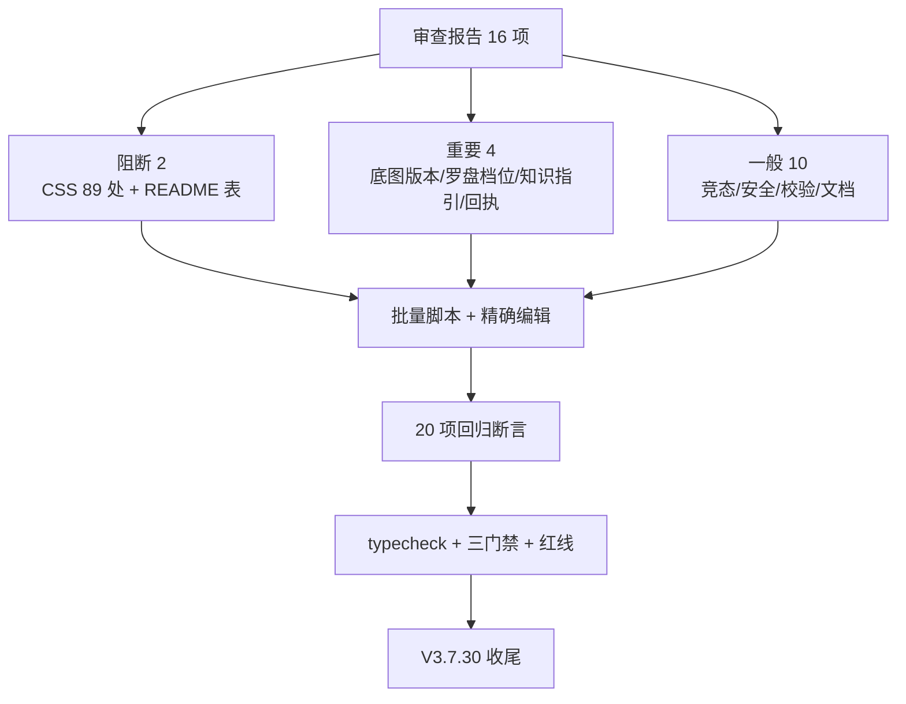

# 2026-11-27 Code Review 全部问题修复

> **日期**：2026-11-27 12:08–12:20
> **任务等级**：L2 常规开发
> **状态**：✅ 已完成
> **关联版本**：V3.7.30
> **来源**：V3.7.28 暂存区 Code Review（92 文件，16 项问题）

---

## 一、问题分析

### 核心症状

V3.7.28 Code Review 报告确认暂存区存在阻断 2 / 重要 4 / 一般 10 共 16 项问题，不建议直接提交。用户要求全部修复。

### 根本原因

这批问题分三类：
1. **批量改写笔误**（B1 CSS 89 处）——把 `transition: all 0.3s` 改为显式属性时，时长只写在最后一项。
2. **版本规范漂移**（B2 README 17 行）——多次升版只增不删。
3. **功能逻辑不一致**（I1–I4 + G1–G10）——双表不同步、协议迁移丢失、注释与行为相反、缺守卫等。

### 受影响模块

| 模块 | 改动 |
|---|---|
| 前端 33 个 `.vue/.css` | CSS transition 89 处 |
| `tileIntentPresets.ts` | 高德两条改 WGS 版 |
| `agentCapabilityRegistry.ts` | Cesium 六档补回、知识段拆出 |
| `agentToolsSchema.ts` | 知识段常驻注入 |
| `ChatPanelContent.ts` / `useChatSession.ts` | 回执标记 + 竞态守卫 |
| `agentToolRouter.ts` / `basemapQuickCommands.ts` | 校验接线 |
| 后端 `constants.py` / `upstream.py` | IP 告警、docstring、安全底线 |
| README / CHANGELOG / TODO / 结构树 / 7 篇日志 | 文档订正 |

---

## 二、Mermaid 图

---

## 三、修改内容（按严重度）

### 阻断

- **B1**：扫描 frontend/src 全部 `.vue/.css`，正则匹配 `transition: p1, p2, ..., pN <duration> [easing]`，把时长/缓动广播到每一项。89 处 / 33 文件，0 残留。
  - **过程中的失误与恢复**：脚本初次替换丢失缩进，导致部分行首缩进变 1 空格、`xxx; transition` 合并到一行；第二次修正脚本又误改 14 个**不在暂存区**的文件（违反 §2.4）。已从 HEAD 读取原内容写回恢复，最终 `comm` 确认越界修改为 0。全程未用 `git checkout`（零 Git 写操作）。
- **B2**：README 演进表 17→3 行，完整历史留在 CHANGELOG。

### 重要

- **I1**：`tileIntentPresets` 的 `amap_full_vector` / `amap_satellite` presetId 改为 `vector_amap_wgs_preset` / `imagery_amap_wgs_preset`，与 `chatIntentFallback` 品牌映射统一；caveat 注明「高德原版」取原始 GCJ-02。
- **I2**：`COMPASS_MECHANISM_PROMPT` 补回 Cesium 六档 cameraHeight 边界（2,000,000 / 500,000 / 100,000 / 20,000 / 5,000 / <5,000m）。
- **I3**：拆出 `COMPASS_KNOWLEDGE_PROMPT`（宫位释义属内置咨询、不拒绝、引用严谨），在 `buildSystemPromptWithTools` 中无条件注入；交互协议段仍按需。
- **I4**：`pushUser` 增加可选 `extra` 参数；快捷命令回执传 `{ isQuickCommand: true }`；`buildEconomyContext` 与 `userTurnsCount` 均排除。

### 一般

- **G1**：`handleQuickCommand` 加 `const seq = ++this.requestSeq`，await 后与 catch/finally 校验序号。
- **G2**：`_extract_identity_ip` 空串分支加 warning 日志（含 XFF/direct 截断值），便于监控代理链异常。
- **G3**：`is_private_client_ip` docstring 更新，明确其已成为身份判定核心、不得放宽判据。
- **G4**：`upstream.py` 新增 `_AGENT_BACKEND_SAFETY_FLOOR` 常量，`_build_agent_system_prompt` 无条件追加（客户端无法覆盖），声明仅用声明的工具、不泄露密钥与配置、工具结果视为数据。
- **G5**：`basemapQuickCommands.ts` 注释矛盾订正；`agentToolRouter.ts` 在 `import.meta.env.DEV` 下调用 `validateQuickCommandsAgainstRules()` 告警。
- **G6**：`project-structure.md` Architecture 段补 `agent-capability-system.md`。
- **G7**：两篇日志删除中部重复的「四、遗留与风险」章节，末尾已有对应小节。
- **G8**：CHANGELOG V3.7.22 链接文字 `prompt-slimming` → `prompt-autonomy-fix`。
- **G9**：7 篇日志补「变更文件清单」章节。
- **G10**：README 文档计数 550→762（Guide 14、Architecture 23+3 decisions）。

---

## 四、验证结果

| 检查 | 结果 |
|---|---|
| 回归断言（I1/I2/I3/I4/G1/G4/G5/B1） | ✅ 20/20 |
| `npm run typecheck`（vue-tsc --noEmit） | ✅ 0 错误 |
| Python 语法（constants.py / upstream.py） | ✅ 通过 |
| CheckStructureTree.py | ✅ 758/758 |
| CheckConfigRegistry.py | ✅ 全绿 |
| CheckVueParadigm.py | ✅ 73/73 |
| 红线自查（backend + deploy Grep） | ✅ 无命中 |
| 越界修改（暂存区外文件） | ✅ 0（14 个已恢复） |
| Git 写操作 | 零 |

### 待用户实机验证

1. Vue 页面过渡动画（淡入淡出、hover）是否恢复。
2. 「高德卫星」底图与 WGS-84 要素是否对齐。
3. 3D 视图罗盘半径是否合理（不再过小不可见）。
4. 直接问「坎宫是什么含义」是否按堪舆知识作答（不拒绝）。
5. 快捷命令回执不再出现在后续 LLM 对话上下文。

---

## 五、影响范围与遗留

- **影响范围**：33 个 CSS 文件 + 8 个逻辑文件 + 后端 2 文件 + 文档。所有改动均在暂存区文件范围内（已核实）。
- **遗留**：B1 修复保留全部 transition 属性（含 width/height 等布局属性），性能层面的布局重排优化属独立事项，未纳入本次 bug 修复。
- **风险**：G4 后端安全底线追加到所有通道的 system_prompt，可能轻微增加 token；但为不可覆盖的安全约束，属必要代价。
- **后续**：审查报告的 5 项「建议」级别观察（降级工具签名、树折叠触屏 28px、日期口径、架构文档基线、代理信任模型）未纳入本次修复，保留在报告中。

---

## 六、变更文件清单

| 文件 | 说明 |
|---|---|
| `frontend/src/**`（33 个 `.vue/.css`） | CSS transition 89 处修复 |
| `tileIntentPresets.ts` | 高德 WGS 版统一 |
| `agentCapabilityRegistry.ts` | Cesium 档位 + 知识段 |
| `agentToolsSchema.ts` | 知识段常驻注入 |
| `ChatPanelContent.ts` / `useChatSession.ts` | 回执标记 + 竞态守卫 |
| `agentToolRouter.ts` / `basemapQuickCommands.ts` | 校验接线 |
| `backend/api/auth/constants.py` / `backend/api/agent_chat/upstream.py` | IP 告警 / 安全底线 |
| `README.md` / `CHANGELOG.md` / `project-structure.md` / TODO | 版本与文档订正 |
| 7 篇 11-27 日志 | 补变更文件清单 |
| 本报告 | 修复记录 |
