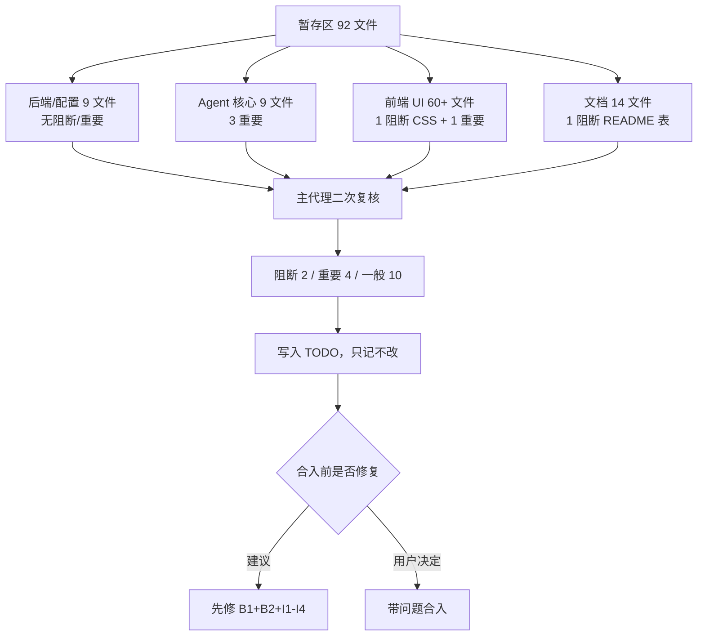

# 2026-11-27 暂存区全量 Code Review

> **日期**：2026-11-27 11:50
> **任务等级**：L2 常规开发（Code Review）
> **状态**：✅ 已完成（报告输出，问题只记不改）
> **指定版本**：V3.7.15（用户明确指定；与仓库当前 V3.7.29 的冲突见第六节）
> **审查范围**：暂存区 92 个文件（100% 覆盖，无未暂存改动）

---

## 一、审查方法

用 4 个并行审查分组覆盖全部暂存文件：

| 分组 | 文件数 | 重点 |
|---|---:|---|
| 后端与配置 | 9 | 正确性、身份安全、红线、配置登记、测试 |
| Agent 核心逻辑 | 9 | 11 个版本迭代的一致性、SSOT、类型、机制保留 |
| 前端 UI | 60+ | 正确性、移动端基线、Vue 范式、i18n、XSS |
| 文档与版本 | 14 | 版本一致性、日志规范、SSOT、结构树 |

每组用 `git diff --cached` 读完整暂存改动，必要时读上下文源码。**所有阻断/重要问题均经主代理二次复核实际代码**，剔除误报。

---

## 二、问题总览

| 严重度 | 数量 | 处置 |
|---|---:|---|
| 阻断 | 2 | 写入 TODO，建议合入前修复 |
| 重要 | 4 | 写入 TODO，建议修复 |
| 一般 | 10 | 写入 TODO，择机处理 |
| 建议 | 5 | 本报告记录 |

**结论：暂存区当前状态不建议直接提交**——存在 CSS 全局动效失效（阻断）与底图版本反转（重要）等真实回归。

---

## 三、阻断问题（必须修复）

### B1. CSS `transition` 简写语法错误，约 89 处动效失效

**位置**：`frontend/src` 下 89 处 `.vue` / `.css`，代表：
- `app/HomeView.vue:593`
- `cesium/modules/player-controller/NavGuideHUD.vue:282`
- `common/user/components/FloatingAccountPanel.vue:819`
- `common/compass/components/PalaceExplanationPanel.vue:155`
- `ol/components/AdministrativeDivisionPanel.vue:302`

**问题**：写成 `transition: background, border-radius, color, height, width 0.15s;`。CSS 规范中时长只作用于紧邻的最后一项，前面属性 duration 为默认 `0s`——即**无过渡效果**。同批次中部分文件写法正确（每项独立带时长），证明是笔误。

**影响**：Vue `<Transition>` 淡入淡出失效（opacity 瞬间跳变）、大量 hover/按压动效消失。改动初衷是性能优化，实际是全局动效退化。

**修复**：改为每项独立带时长，或用 `transition-property` / `transition-duration` 分离写法。同时剔除 `height/width/padding/gap` 等布局属性（修正时长后会触发布局重排，与性能初衷相悖）。

### B2. README 版本演进表 17 行，违反「恒定 3 行」硬规范

**位置**：`README.md:622-638`

**问题**：Force_command §5 要求「新增一行、删除最旧一行、恒定 3 行」。本次 diff 一次性插入 V3.7.15–V3.7.29 共 15 行，只删了 V3.7.12 一行，现存 17 行（V3.7.29→V3.7.13）。

**影响**：README 与 CHANGELOG 大量重复，SSOT 被破坏；§5 明确「缺一即视为未完成」。

**修复**：演进表只保留最新 3 条，其余历史已在 CHANGELOG，无需复制。

---

## 四、重要问题（建议修复）

### I1. 高德底图默认版本反转（GCJ-02 / WGS-84）

**位置**：`tileIntentPresets.ts:38-43,108-112` vs `chatIntentFallback.ts:19-23,41-46`

**问题**：规则表把「高德地图」「高德卫星」映射为 GCJ-02 原始版（`vector_amap_preset` / `imagery_amap_preset`），品牌映射字典映射为 WGS 纠偏版（`vector_amap_wgs_preset` / `imagery_amap_wgs_preset`）。V3.7.27 改「规则表优先」后，LLM 工具调用、正则兜底、快捷命令全部得到原始版，与旧版行为相反。

**影响**：底图瓦片与 WGS-84 中心坐标及叠加要素错位；同一句话在 V3.7.26 与 V3.7.27 结果不同。这正是 V3.7.21 类"双表不同步"，只是从"解析失败"变成"解析成功但版本错误"。

**修复**：规则表这两条改为 WGS 纠偏版（符合既有「代理优先」决策），并在校验函数中加 presetId 交叉断言。

### I2. 罗盘 Cesium 半径六档映射丢失

**位置**：`agentCapabilityRegistry.ts:126`

**问题**：V3.7.23 特意恢复的 Cesium `cameraHeight` 六档边界（`≥2,000,000m→2000km` 等）被压成「按 cameraHeight 同量级换算」，OL 七档完整保留。而 `agentToolsSchema.ts:437` 注释称「原文逐字保留」，与事实不符。

**影响**：3D 视图下模型缺明确档位，可能估算过小半径导致罗盘不可见——恰是 V3.7.23 修过的回归。

**修复**：补回六档阈值，或至少保留 `2000000/500000/100000/20000/5000` 五个边界。

### I3. 宫位知识问答指引随工具集按需注入而丢失

**位置**：`agentCapabilityRegistry.ts:119,132` + `agentToolRouter.ts:67`

**问题**：`COMPASS_MECHANISM_PROMPT` 同时承载交互协议与"宫位释义属内置咨询、不拒绝、引用严谨"指引，注入条件绑定「工具集含 enable_compass」。但 compass 触发词只有风水/罗盘/卦/堪舆等，用户直接问「坎宫是什么含义」「二十四山怎么排」不命中——整段知识指引不注入。

**影响**：纯知识问答失去指引，回退到 V3.7.23 修复前的"拒绝回答宫位咨询"行为。

**修复**：拆出 `COMPASS_KNOWLEDGE_PROMPT` 常驻注入，或扩充触发词覆盖宫位/山向/干支。

### I4. 快捷命令回执污染 LLM 历史（注释与行为相反）

**位置**：`ChatPanelContent.ts:867-869` + `useChatSession.ts:329-336`

**问题**：注释写「不作为 LLM 历史」，但 `pushUser(label)` 无标记，`buildEconomyContext` 只过滤 `isToolStatus`，该 user 消息会进 history；`userTurnsCount` 也按其计数，提前触发历史裁剪。

**影响**：LLM 误以为用户曾自然语言要求切底图；会话轮次虚高导致过早裁剪。

**修复**：给回执打 `isQuickCommand` 标记，在两个过滤点一并排除。

---

## 五、一般问题（10 项，摘要）

| # | 问题 | 位置 |
|---|---|---|
| G1 | `handleQuickCommand` 缺 requestSeq/AbortController，停止生成时异步竞态 | `ChatPanelContent.ts:853-899` |
| G2 | 身份 IP 为空时静默共用配额桶（全私网 XFF 边界） | `auth/constants.py:204-234` |
| G3 | `is_private_client_ip` docstring 与新增安全用途脱节 | `auth/constants.py:144-161` |
| G4 | 客户端完全控制系统提示词，后端安全规则可能被整体替换 | `routes.py:214-220,848-854` |
| G5 | 规则一致性校验 `validateQuickCommandsAgainstRules()` 无调用方，注释自相矛盾 | `basemapQuickCommands.ts:11-13,88-100` |
| G6 | 新增架构文档未登记到 `project-structure.md`（唯一权威树） | `Docs/Guide/project-structure.md:94-119` |
| G7 | 两篇日志章节编号重复（两个「四、」） | `markdown-emphasis-fix.md:91,98`、`prompt-autonomy-fix.md:87,94` |
| G8 | CHANGELOG V3.7.22 链接文字 `prompt-slimming` 指向 `prompt-autonomy-fix.md` | `CHANGELOG.md:49` |
| G9 | 7 篇日志缺 §6 必含的「变更文件清单」章节 | `Docs/LLM_record/26-11/2026-11-27/*.md` |
| G10 | README 文档计数严重失准（称 550 篇，实测 761 篇） | `README.md:150` |

另有建议 5 项：降级 prompt 缺最小工具签名清单、树折叠按钮触屏纵向 28px、V3.7.18 日期口径、架构文档基线标注过时（V3.7.27 vs 已含 V3.7.29 修复）、身份 IP 信任模型需部署文档固化。

---

## 六、版本冲突记录（按要求，不判断对错）

- 用户指定本次 Code Review 版本：**V3.7.15**
- 仓库当前 README 三处版本：**V3.7.29**
- Force_command §5 规定：L2/L3 各自 +1 修订号，同一天多次任务依次递增，**不合并**

**处置**：V3.7.15 作为本次审查日志的关联版本记录；**不修改 README 三处与 CHANGELOG 的 V3.7.29**——那等于回退已发布版本，破坏 11 篇日志与演进表的历史一致性。若用户确有版本归并意图，需另行明确指令。

---

## 七、审查范围与放行条件

**放行建议**：先修 B1（CSS 89 处）与 B2（README 演进表），再修 I1–I4 四项重要问题，然后重跑 typecheck 与门禁。

---

## 八、变更文件清单

| 文件 | 说明 |
|---|---|
| `Docs/LLM_record/26-11/2026-11-27/2026-11-27-staged-code-review.md` | 本报告（新增） |
| `Docs/TODO/bugfix-optimization-plan.md` | 记录全部问题（追加） |

**本任务零代码改动**，仅审查报告与 TODO 记录。

---

## 九、验证与待用户操作

- 审查覆盖：92/92 暂存文件，4 组并行 + 主代理复核阻断/重要项
- 实机验证：本任务为只读审查，未执行；放行前需按「待用户操作」验证
- Git 写操作：零

### 待用户操作

1. 审阅本报告，确认阻断/重要问题的修复优先级。
2. 决策版本冲突（V3.7.15 vs V3.7.29）的最终处置。
3. 若修复问题，须另开任务（Force_command §2.5 禁止 Code Review 顺手改代码）。
