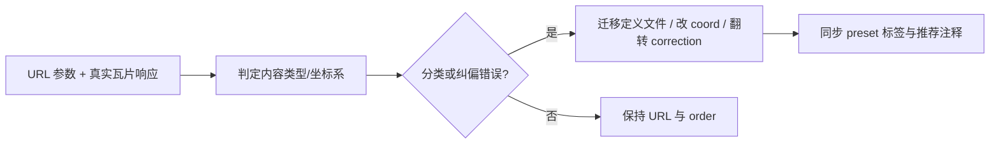

# 2026-11-28 AMAP/Google 瓦片定义实测纠偏（V3.7.31）

- **日期与时间**：2026-11-28 14:04 – 14:13（CST）
- **任务等级**：L2（数据定义 + 分类迁移 + 坐标纠偏方向修正）
- **本次版本**：V3.7.31
- **任务来源**：用户指令：对照 `NEGIAO.github.io/Pages/Note/md/Amap_tiles.md` 与 `Google_tiles.md`，实测请求瓦片确认内容，逐个修正 `common/basemap/definitions` 中分类错误的图层定义属性与文件位置。

## 问题分析

**核心症状**：定义层多处按 id 前缀或旧标签分类，未按 URL 参数与实际响应判定。两篇笔记已给出明确参数映射：`lyrs=m` 标准电子、`lyrs=s` 纯卫星、`lyrs=y` 混合影像、`lyrs=t/p` 地形、`lyrs=h` 纯注记；AMAP 的 `webrd/webst/style/ltype/scl` 组合决定不透明底图、透明叠加层、卫星影像或高清无标注底图。

**实测方法**：北京城区 `z=12, x=3371, y=1551`，逐 URL 请求并解析 HTTP 状态、MIME、图像格式/模式/尺寸、Alpha 分布与主色；Google 直连被当前代理拦截（502/SSL EOF），改用定义中已有的 `gac-geo.googlecnapps.club` 镜像，URL 参数保持一致。

## 实测证据（节选）

| 探测项 | 响应特征 | 判定 |
| :--- | :--- | :--- |
| `wprd style=8`（旧 `amap_label`） | PNG RGBA 256²，64,129 B，60.4% 透明；与 `webst style=8` 字节级一致 | 透明「路网+注记」全叠加层，不是纯注记 |
| `webst style=8&ltype=4` | PNG RGBA 256²，23,214 B，85.5% 透明 | 仅注记/POI，符合 `amap_label` 语义 |
| `webrd style=8&ltype=9` | 256² 无路无字，仅绿地/水系；`scl=2` 返回 512² | Bit0(地貌)+Bit3(建筑)，非完整电子图 |
| `lyrs=m` | PNG P 256²，19,211 B | 标准电子地图（道路+POI+文字） |
| `lyrs=s` / `lyrs=y` | JPEG RGB 256² | 纯卫星 / 混合影像 |
| `lyrs=t` / `lyrs=p` | JPEG RGB 256² | 地形晕渲 / 地形混合 |
| `lyrs=h` | PNG P 256²，57.6% 透明 | 纯注记/边界层 |
| `lyrs=m + apistyle` | 透明率 76.4%（路网+注记）/ 77.7%（路骨架）/ 98.0%（路名）/ 96.0%（水体） | 电子专题叠加层，非影像 |
| `lyrs=p` vs `lyrs=m` 路网边缘配准 | 最佳位移 (0,0) | 国内源同为 GCJ02，WGS 版须 `gcj2wgs` |

## 修改内容

### 1. 分类文件迁移（4 条，order 不变）

| id | order | 原文件/分类 | 新文件/分类 | 属性调整 |
| :--- | ---: | :--- | :--- | :--- |
| `imagery_google_standard` | 18 | imagery / WGS84 | electronic / GCJ02 | `coord` 由 WGS84 改 GCJ02；名「Google标准电子(GCJ)」；URL 未改 |
| `imagery_google_water` | 19 | imagery / WGS84 | electronic / WGS84 | 保留 `gcj2wgs`（源 GCJ02 → WGS84）；名「Google纯水体(WGS)」 |
| `vector_Google_clean` | 150 | electronic / WGS84 | terrain / WGS84 | 保留 `gcj2wgs`；名「Google简洁地形(WGS)」 |
| `google_Backend_Proxy` | 169 | electronic / WGS84 | imagery / WGS84 | 保留 `proxy:'proxy'`；名「Google卫星(后端代理)」 |

### 2. AMAP 内容正名与注记层修正

- `amap_label`（order 6）：URL 从 `wprd02...style=8`（无 `ltype`）改为 `webst01...style=8&ltype=4`，并统一 https；描述补「ltype=4 纯注记」。`coord: WGS84` + `correction: gcj2wgs` + `zBand: 'label'` 保持不变。
- `vector_amap`（order 90）、`vector_amap_wgs`（order 91）：`ltype=9` 实为 Bit0 地貌 + Bit3 建筑，名/描述改为「高德地貌+建筑(512 GCJ) / (WGS)」；URL 除 wgs 版协议头 http→https 外不变，tilePixelRatio/gcj2wgs 保持。

### 3. Google 地形纠偏方向修正（8 条）

`lyrs=t` / `lyrs=p` 与 `lyrs=m` 零位移配准，国内源同为 GCJ02：

- WGS 版（139/141/143/145）补 `correction: 'gcj2wgs'`；
- GCJ 版（140/142/144/146）移除反向的 `correction: 'wgs2gcj'`；
- PB `!1e5` hillshade（147/148）不在此列，保持原方向（无实测反证）。

### 4. 其他属性同步

- `vector_google_combo_labels_gcj/wgs`（123/124）：`lyrs=h` 为透明注记层，补 `zBand: 'label'` 与 `skipHighResTile: true`。
- `basemapPresets.ts` 同步 4 个 preset 标签（谷歌卫星代理 / 高德地貌+建筑(WGS) / 简洁地形 / 地貌+建筑）。
- `category-recommended.ts` 同步 4 条 note 注释。

## 修改原因

目录 UI 直接读取定义中的 `catalogCategory` / `coord` / `description`，preset label 决定条目显示名；两者不一致会误导用户选择。纠偏方向错误会造成 WGS 底图上的图层整体偏移，属于功能性缺陷而非纯文案问题。

## 影响范围

仅底图定义元数据与 4 条定义的归属文件；不改变 `order`、id 与加载管线。URL 仅两处变化：`amap_label` 改为 `webst01...ltype=4`（修正内容），`vector_amap_wgs` 仅 http→https；其余 URL 逐字保留。影响目录树中的分类归属、坐标徽标、proxy 标识、搜索关键词与 preset 显示名。

## 解决方案

## 性能指标

不适用（纯数据定义变更）；目录构建仍按定义版本缓存。

## 测试方案

### Agent 已执行

- 31 组瓦片 URL 实测（AMAP 16 组 + Google 15 组，经可达镜像），记录 HTTP/格式/Alpha/字节数，关键图像逐张目视复核。
- `lyrs=p` 与 `lyrs=m` 路网边缘配准：最佳位移 (0,0)，支撑 GCJ02 同源判定。
- `vue-tsc --noEmit` 最终 **0 错误**；首次运行命中并发会话尚未收敛的 `LandingView.vue` `wide` 属性报错（与本次文件无关），该会话更新后复跑归零。basemap-catalog / layer-definitions / 结构树 / 配置登记 / 分域依赖门禁全绿。
- 定义总数 174、order 1..174 无缺失；4 条迁移 id 全仓唯一。

### 待用户实机验证

1. OL/Cesium 目录：「影像底图」中不再出现 `Google标准电子`，「电子底图」中不再出现 `Google卫星(后端代理)`；地形分类出现「Google简洁地形(WGS)」。
2. 切换 WGS/GCJ 地形对：同一区域路网/水系边缘应与卫星/电子底图对齐，无整体偏移。
3. 「高德注记无偏」叠加在卫星图上仅显示文字/POI，不再带道路线。

## 变更文件清单

- `frontend/src/domains/common/basemap/definitions/category-electronic.ts`——迁入 18/19，`amap_label` 改 ltype=4，90/91 正名，123/124 补 label 带，移出 150/169
- `frontend/src/domains/common/basemap/definitions/category-imagery.ts`——移出 18/19，迁入 169
- `frontend/src/domains/common/basemap/definitions/category-terrain.ts`——迁入 150，139~146 纠偏方向修正
- `frontend/src/domains/common/basemap/definitions/category-recommended.ts`——note 注释同步
- `frontend/src/domains/common/basemap/basemapPresets.ts`——4 个 preset 标签同步
- `README.md` / `Docs/Guide/CHANGELOG.md`——V3.7.31 三处版本号 + 条目
- 本日志

## 遗留与风险

1. Google 直连在当前沙箱代理下不可达，实测使用 `gac-geo.googlecnapps.club` 镜像；镜像返回内容与直连参数语义一致，但服务端样式策略可能随地区/时间变化。
2. PB `!1e4` 与 `!1e5` 在该镜像返回相同字节，无法据此复核笔记中的样式枚举差异；本次未调整 PB hillshade 的纠偏方向。
3. `lyrs=t/p` 的坐标系判定基于路网配准与两篇笔记的一致性推导；若 Google 后续调整国内瓦片策略需重新实测。
