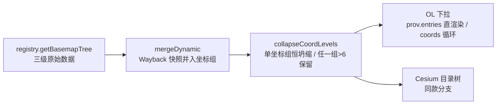

# 2026-11-28 底图目录第三级「坐标系」按需坍缩（V3.7.21）

- **日期与时间**：2026-11-28 11:26 – 11:40（CST）
- **任务等级**：L2（共享 UI 层规则 + 双引擎模板适配，5 文件协同）
- **本次版本**：V3.7.21
- **任务来源**：用户指令——第三级坐标系目录大多数情况冗余（影像底图/Tianditu/ 仅 WGS84 一组、影像底图/AMAP 各组仅 1–2 条，均为两级足够）；只有 电子底图/AMAP 这类「同一坐标大枚举」才需要第三级。

## 问题分析

**核心症状**：统一目录树固定三级（分类 → 服务商 → 坐标系），但真实数据中绝大多数服务商的坐标组极小——第三级只是多一次无意义点击。

**根本原因**：`getBasemapTree()` 按 分类→服务商→坐标系 机械展开，未按组大小决定层级深度。

**受影响模块**：`common/basemap/ui/useBasemapCatalogUi.ts`（OL/Cesium 共享树）、`catalog/types.ts`、OL `LayerControlPanel.vue`、Cesium `CesiumToolPanel.vue/.ts`。

**方案对比**：
| 方案 | 结论 |
|---|---|
| A. registry 数据层直接坍缩 | 否决：`mergeDynamic`（Wayback 动态条目）在 UI 层向坐标组合并，先坍缩会导致动态条目与已上提条目分叉两处 |
| **B. UI 层在 mergeDynamic 之后坍缩（选定）** | 展示语义归 UI 层；动态条目一并参与判定与坍缩；registry 纯数据不动 |

**阈值定档（按真实分布测量，脚本见 Agent 工作区）**：单一坐标组恒坍缩（层级零信息量）；多坐标组仅当**任一组条目数 > 6** 保留第三级——实测保留者仅 电子底图/AMAP（WGS84:13 + GCJ02:13）与 电子底图/Google（10+8），影像底图/AMAP（1+1）、影像底图/Google（5+2）、地形底图/Google（6+5）等全部坍缩两级，符合用户「两级够用大部分」的预期。

## 修改内容

1. `catalog/types.ts`：`BasemapProviderNode` 新增可选 `entries?: BasemapCatalogEntry[]`（坍缩形态的承载字段）。
2. `ui/useBasemapCatalogUi.ts`：新增 `collapseCoordLevels`（阈值常量 `COORD_GROUP_KEEP_THRESHOLD = 6`），`catalogTree` computed 改为 `collapseCoordLevels(mergeDynamic(getBasemapTree(), readDynamic()))`；坍缩后条目按 COORD_ORDER 顺序 flatMap 上提。
3. `ol/layer/components/LayerControlPanel.vue`：服务商层新增 `prov.entries` 直渲染分支（`template v-else` 包裹原坐标组循环）。
4. `cesium/components/CesiumToolPanel.vue`：同上分支适配（`option-grid` 卡片直渲染）。
5. `cesium/components/CesiumToolPanel.ts`：`catalogCategoryCount` 计入 `prov.entries`（坍缩后计数不丢失）。

## 修改原因

消除冗余第三级点击；搜索面包屑仍显示完整 分类/服务商/坐标系 信息，条目 tooltip 含坐标，信息无损。

## 影响范围

双引擎底图目录树展示层。不影响：搜索、预设编号契约、registry 数据形态、加载链路。

## 解决方案

## 性能指标

不适用（纯展示层重构，每次 computed 求值多一次 O(树) 遍历，微秒级）。

## 测试方案

### Agent 已执行

- 一次性冒烟脚本（Node 类型剥离 + ts-ext-resolve hook，Agent 工作区不入仓）：坍缩后仅 电子/AMAP、电子/Google 保留第三级，其余全部两级；**条目守恒校验 168 ↔ 168 PASS**。
- `node scripts/check-layer-definitions.mjs` / `check-basemap-catalog.mjs`：**通过**。
- `CheckStructureTree` / `CheckConfigRegistry` / `CheckDomainDeps`：**全绿**。
- `vue-tsc --noEmit`：**0 错误**（含第三方 zBand 会话改动的合并状态）。
- §11.2 红线扫描：仅既有假阳性。

### 待用户实机验证

1. OL 下拉与 Cesium 目录树：影像底图/ESRI、影像底图/AMAP 等展开后**直接出条目**（无坐标级行）；电子底图/AMAP 展开仍有 WGS84/GCJ02 两组。
2. 搜索（如「卫星」「山体阴影」）结果与面包屑正常；条目点击切换正常。
3. 分类标题条目计数（Cesium）与实际展开条目数一致。
4. 触屏真机抽查一级点击次数减少（原三级 3 击 → 现 2 击）。

## 变更文件清单

- `frontend/src/domains/common/basemap/catalog/types.ts`——BasemapProviderNode.entries 可选字段
- `frontend/src/domains/common/basemap/ui/useBasemapCatalogUi.ts`——collapseCoordLevels + catalogTree 接线
- `frontend/src/domains/ol/layer/components/LayerControlPanel.vue`——prov.entries 直渲染分支
- `frontend/src/domains/cesium/components/CesiumToolPanel.vue`——同款分支适配
- `frontend/src/domains/cesium/components/CesiumToolPanel.ts`——catalogCategoryCount 计入 prov.entries
- `README.md` / `Docs/Guide/CHANGELOG.md`——V3.7.21 三处版本号 + 条目
- 本日志

## 遗留与风险

- 阈值 6 为按当前 148 预设分布定的档位（唯一魔法数，集中在一处常量）；后续新增大枚举服务商时无需改代码，分布变化若使某服务商跨过阈值即自动保留/坍缩。
- 动态 Wayback 快照目录若未来单坐标组超过阈值且多坐标组，会自动回到三级形态（规则自适应，无需改码）。
- 本任务与第三方 `zBand` schema 重构会话（definitions 域）同树并行，二者改动文件不相交，合并态门禁全绿。
