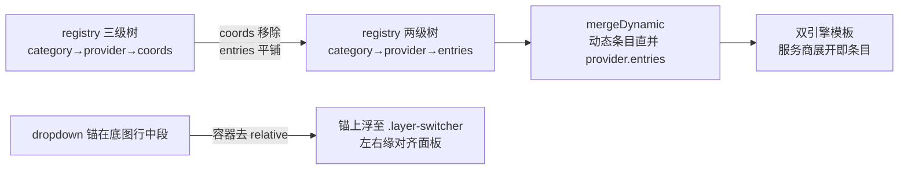

# 2026-11-28 底图目录彻底两级化 + 下拉与面板对齐 + 移动端适配（V3.7.23）

- **日期与时间**：2026-11-28 11:50 – 12:05（CST）
- **任务等级**：L2（数据层 + 共享 UI 层 + 双引擎模板，多文件）
- **本次版本**：V3.7.23
- **任务来源**：用户指令：① 三级目录全部删除（条目后的 `entry-coord-tag` 坐标徽标已清晰承载坐标信息）；② `custom-select-dropdown` 左侧对齐 `<LayerControlPanel>`（整个绿色面板）左缘、右缘不超其右缘；③ 适配移动端。

## 问题分析

**核心症状 1**：V3.7.21 的阈值坍缩保留了两条三级路径（电子/AMAP、电子/Google），但条目级坐标徽标（`entry-coord-tag`）落地后，第三级分组彻底失去存在价值。

**核心症状 2**：dropdown 锚在 `.custom-select-container`（底图行中段，`position: relative`）上，无法与整个面板对齐；V3.7.22 的「仅右锚」只是把溢出方向改成向左，宽度仍由内容决定。

**根本原因**：树形数据层仍是三级（registry 产出 coords 结构）；dropdown 的定位锚是容器而非面板。

**受影响模块**：`catalog/{registry,types}.ts`、`common/basemap/ui/useBasemapCatalogUi.ts`、OL `LayerControlPanel.vue/.ts`、Cesium `CesiumToolPanel.vue/.ts`。

## 修改内容

1. **第三级整体删除（数据层两级化）**：
   - `registry.getBasemapTree()`：provider 节点直接产出 `entries`（按 `COORD_ORDER` WGS84→GCJ02→… 平铺，保持既有展示顺序），不再产出 `coords`；
   - `catalog/types.ts`：删除 `BasemapCoordNode`；`BasemapProviderNode.coords` 移除、`entries` 转必填；
   - `useBasemapCatalogUi.ts`：删除 `collapseCoordLevels` 与 `COORD_GROUP_KEEP_THRESHOLD`（V3.7.21 阈值机制完成历史使命）；`mergeDynamic` 直并 `provider.entries`；删除 `openCoords`/`isCoordOpen`/`toggleCoord`；计数函数简化；
   - 双引擎模板：坐标组循环整段移除，服务商展开即条目平铺；`.ts` 声明同步；死 CSS（`.combo-coord-toggle`、`.catalog-coord-group` 相关）清除。
2. **dropdown 与面板对齐**：`.custom-select-container` 去掉 `position: relative`（容器内无其他绝对定位子元素）——dropdown 定位锚上浮到 `.layer-switcher` 整个面板，`left:0; right:0; width:auto` 实现左贴面板左缘、右不超面板右缘，`top: calc(100% + 5px)` 使其出现在面板下方 5px；DOM 未移动，外部点击判定（`closest('.custom-select-container')`）继续有效。
3. **移动端适配**：小屏（窄窗/粗指针档）追加 `max-height: min(450px, 62vh)` 与 `entry-coord-tag` 字号放大；触屏目标 40px 档（V3.7.20 已建）沿用；`max-width: calc(100vw - 16px)` 极窄屏护栏保留。

## 修改原因

条目级坐标徽标已承载坐标信息，第三级分组是纯冗余；dropdown 宽度由内容决定不可控，对齐面板后宽度确定、观感统一。

## 影响范围

底图目录树（双引擎）数据形态与展示、OL 下拉定位。不影响：搜索、编号契约、加载链路、`entry-coord-tag` 徽标。

## 解决方案

## 性能指标

不适用（结构简化，遍历层数减少）。

## 测试方案

### Agent 已执行

- 一次性冒烟脚本（Node 类型剥离 + resolve hook）：7 分类两级树，`provider.coords` 残留 0 ✅；组内 COORD_ORDER 顺序破坏 0 ✅；搜索「卫星」命中 4 ✅；平铺总数 167 自洽（recommended 19 条——见遗留 2）。
- `vue-tsc --noEmit`：**0 错误**。
- `check-layer-definitions` / `check-basemap-catalog` / `CheckStructureTree` / `CheckConfigRegistry` / `CheckDomainDeps`：**全绿**。
- §11.2 红线扫描：仅既有假阳性。

### 待用户实机验证

1. OL 下拉：任何服务商展开**直接出条目**（无坐标级行），条目右侧坐标徽标清晰；电子底图/AMAP 的 WGS/GCJ 混排顺序合理（WGS 组在前）。
2. dropdown 宽度与整个绿色面板左右缘对齐；出现在面板下方；窄窗/移动端不溢出、行高 ≥40px。
3. Cesium 目录树同款两级形态与徽标；分类计数正确。
4. 下拉内部点击（搜索/翻行）不误关；点击面板外关闭正常。

## 变更文件清单

- `frontend/src/domains/common/basemap/catalog/registry.ts`——getBasemapTree 两级化（entries 平铺）
- `frontend/src/domains/common/basemap/catalog/types.ts`——删除 BasemapCoordNode、ProviderNode 收敛
- `frontend/src/domains/common/basemap/ui/useBasemapCatalogUi.ts`——删坍缩层/坐标状态，mergeDynamic 适配
- `frontend/src/domains/ol/layer/components/LayerControlPanel.vue`——删坐标循环、容器去 relative、小屏档
- `frontend/src/domains/ol/layer/components/LayerControlPanel.ts`——坐标状态声明清除
- `frontend/src/domains/cesium/components/CesiumToolPanel.vue`——删坐标循环
- `frontend/src/domains/cesium/components/CesiumToolPanel.ts`——坐标状态声明清除
- `README.md` / `Docs/Guide/CHANGELOG.md`——V3.7.23 三处版本号 + 条目
- 本日志

## 遗留与风险

- **V3.7.21 的阈值坍缩机制被本任务整体移除**（其日志描述的 `COORD_GROUP_KEEP_THRESHOLD` 不复存在，两级形态由数据层直接保证）——V3.7.21 日志按 SSOT 原则不回改，以本日志为准。
- **并行会话改动了 recommended 归类优先级**（11:51 registry 编辑）：#18 `arcgis_imagery_preset`（ESRI Wayback 静态兜底）现仅出现在「历史影像」组，不再进「常用推荐」（recommended 20→19 条）——属其会话有意调整（CATEGORY_OVERRIDES 优先于推荐位），非数据丢失；如需恢复「推荐位优先」需调整 buildEntries 判定顺序。
- 目录样式任务（序号阶梯等）由并行会话进行中，本任务与其文件改动已共存且门禁全绿。

## 零散修补（2026-11-28 12:10，L1）

- **常用推荐底图条目补坐标徽标**：推荐分类走独立模板分支（先于 `entry-coord-tag` 徽标出现），漏加了坐标标识——OL 与 Cesium 两引擎的 recommended 分支各补 ``（L1，2 文件各 1 行）。`vue-tsc` 0 错误。
