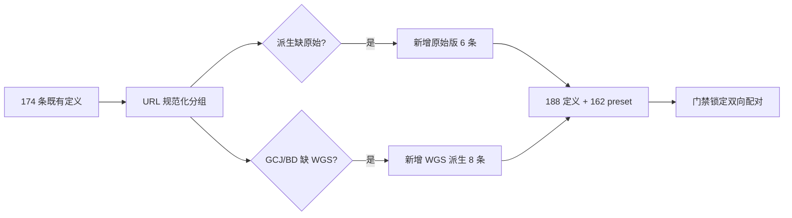

# 2026-11-28 补齐纠偏/代理图层的原始版矩阵（V3.7.33）

- **日期与时间**：2026-11-28 14:22 – 14:30（CST）
- **任务等级**：L2（定义补全 + 门禁强化 + 文档计数同步）
- **本次版本**：V3.7.33（同日 V3.7.32 为并发落地页会话，版本顺延）
- **任务来源**：用户指令：尽量罗列全面；经过代理或纠偏的图层必须同时给出未代理/未纠偏的原始图层；百度等只有 WGS 派生版而缺 BD09 原始版的缺口要补齐；类似缺席项全部补上。

## 问题分析

**核心症状**：目录长期只列出经过 `correction` 或 `proxy` 的派生版，原始版缺席。用户举例：百度只有 `vector_baidu_wgs`（`bd2wgs`），没有原始 BD09 电子底图。此类缺口导致用户无法在同一坐标系下对比原始与纠偏结果，也无法选择直连链路。

**审计方法**：对 174 条定义按规范化 URL 分组（忽略协议与 `hl` 语言参数，保留 `scl`、`ltype`、`apistyle` 等真正区分内容的参数），执行两组检查：
1. 每条 `correction != none` 或 `proxy == 'proxy'` 的派生版，必须有同 URL 的 `correction == none && proxy != 'proxy'` 原始版；
2. 每条 GCJ02/BD09 原始版，必须有同 URL 的 `gcj2wgs` / `bd2wgs` 派生版。

**审计结果**：派生缺原始 6 条；GCJ/BD 原始缺 WGS 派生 8 条；合计 14 条新增。Google 卫星代理版与 OSM 代理版的原始版已存在，不重复添加；`lyrs=h` 注记层、PB hillshade 等已有双向配对。

## 修改内容

### 1. 新增 14 条定义（order 175..188，不改既有 order/URL）

| order | id | 类型 | 源坐标系 | 说明 |
| ---: | :--- | :--- | :--- | :--- |
| 175 | `label_minedata_gcj` | 原始版 | GCJ02 | MineMap 注记，配 `label_minedata` |
| 176 | `amap_label_gcj` | 原始版 | GCJ02 | 高德 `ltype=4` 纯注记，配 `amap_label` |
| 177 | `vector_amap_gcj` | 原始版 | GCJ02 | 高德 `ltype=9& scl=1`，配 `vector_amap_wgs` |
| 178 | `vector_amap_roads_gcj` | 原始版 | GCJ02 | 高德 `ltype=2` 纯道路，配 `vector_amap_roads_wgs` |
| 179 | `vector_baidu` | 原始版 | BD09 | **百度原始电子底图**，配 `vector_baidu_wgs` |
| 180 | `ships66_direct` | 原始版（直连） | WGS84 | 船舶网，配 `proxy:'proxy'` 的 `ships66` |
| 181 | `vector_amap_hd_wgs` | WGS 派生 | GCJ02→WGS84 | 高德 `ltype=9&scl=2` 512px |
| 182 | `vector_amap_clean_hd_wgs` | WGS 派生 | GCJ02→WGS84 | 高德 `ltype=1&scl=2` 512px |
| 183 | `vector_amap_clean_roads_wgs` | WGS 派生 | GCJ02→WGS84 | 高德 `ltype=3&scl=2` 512px |
| 184 | `label_tuxin_wgs` | WGS 派生 | GCJ02→WGS84 | 图新注记 |
| 185 | `vector_tuxin_wgs` | WGS 派生 | GCJ02→WGS84 | 图新矢量 |
| 186 | `imagery_tuxin_wgs` | WGS 派生 | GCJ02→WGS84 | 图新影像 |
| 187 | `vector_geoq_hydro_wgs` | WGS 派生 | GCJ02→WGS84 | GeoQ 水系 |
| 188 | `imagery_google_standard_wgs` | WGS 派生 | GCJ02→WGS84 | Google 标准电子（`lyrs=m`） |

### 2. Preset 与门禁

- `basemapPresets.ts` 末尾追加 14 个 preset（编号 149..162），既有 1..148 编号与 URL `l` 映射逐字不变。
- `check-layer-definitions.mjs`：
  - 数量断言 174→188，order 覆盖 1..188；
  - 新增 URL 规范化函数（补首参数缺 `?` 的历史 Google URL、忽略协议与 `hl`、`URLSearchParams` 排序）；
  - 新增双向配对门禁（派生↔原始、GCJ/BD↔WGS）。
- `check-basemap-catalog.mjs`：预设数 148→162，末项断言改为 `imagery_google_standard_wgs_preset`。
- 计数同步：`Docs/Architecture/basemap-catalog-redesign.md`、`Docs/Guide/handover.md`、`Docs/Guide/frontend-structure.md` 更新为 188 定义 / 162 预设。

## 修改原因

纠偏/代理与原始版是同一数据源的两种使用方式：前者用于与 WGS84 主视图对齐，后者用于保持源坐标系与直连链路。缺任一侧都会让目录不完整，并迫使用户手工拼接 URL。新增定义不改变既有定义，纯增量，风险可控。

## 影响范围

底图目录新增 14 个条目（编号 149..162）与 14 条图层定义；不影响既有 1..148 编号、加载管线、URL 参数契约。纠偏走既有 VPS 代理链路，新增 `proxy` 版仅 `ships66_direct`（实际为直连）与既有 `ships66` 形成对照。

## 解决方案

## 性能指标

不适用（纯数据增量）；目录构建仍按定义版本缓存，新增条目不影响既有查询路径。

## 测试方案

### Agent 已执行

- 审计脚本（临时）：174 条定义 / 148 preset，输出 6+8 条缺口，逐条人工复核 URL 与 correction 语义。
- `check-layer-definitions`：OK 188 条，order 1..188，双向配对门禁通过。
- `check-basemap-catalog`：OK 162 presets，20 AMAP + 30 Google combos，20 recommended。
- `vue-tsc` 与其余门禁结果见最终回复。

### 待用户实机验证

1. 目录底部新编号 149..162 可见；百度分类下同时出现「百度地图(BD09)」与「百度地图(WGS)」。
2. 「船舶网」与「船舶网(直连)」均可加载，后者不走代理。
3. 高德 512px 三个 WGS 版本与既有 GCJ 版本内容一致、仅坐标系偏移不同。

## 变更文件清单

- `frontend/src/domains/common/basemap/definitions/category-electronic.ts`——新增 order 175/176/177/178/179/180/181/182/183/184/185/187/188（13 条）
- `frontend/src/domains/common/basemap/definitions/category-imagery.ts`——新增 order 186（1 条）
- `frontend/src/domains/common/basemap/basemapPresets.ts`——新增 14 个 preset（149..162）
- `frontend/scripts/check-layer-definitions.mjs`——数量/order 断言 + 双向配对门禁
- `frontend/scripts/check-basemap-catalog.mjs`——数量/末项断言
- `Docs/Architecture/basemap-catalog-redesign.md` / `Docs/Guide/handover.md` / `Docs/Guide/frontend-structure.md`——计数同步
- `README.md` / `Docs/Guide/CHANGELOG.md`——V3.7.33 版本更新
- 本日志

## 遗留与风险

1. `imagery_google_water` 的原始版由 `vector_google_combo_water_gcj` 承担（仅 `hl` 参数差异），未新增重复定义；门禁 URL 规范化忽略 `hl` 后判定通过。
2. Google `lyrs=s` 的 GCJ 派生版已由 `vector_google_combo_satellite_gcj` 覆盖，未为 `imagery_gac` / `google_Backend_Proxy` 重复添加。
3. ESRI/OSM 等全球 WGS 源不强制补 GCJ 版本（无国内 GCJ 偏移语义），避免制造错误图层。
4. 新增 BD09 原始版 `vector_baidu` 与 `vector_baidu_wgs` 使用同一百度原始 URL，纠偏仅由 VPS 代理完成，定义层不硬编码代理前缀（沿用既有契约）。
