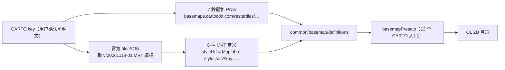

# 2026-11-28 CARTO Basemaps 全量接入（7 栅格 + 6 矢量）

- **日期与时间**：2026-11-28 17:11 – 17:20（CST）
- **任务等级**：L2（新增/更新底图定义与预设；不改加载器架构）
- **本次版本**：V3.7.25（V3.7.24 已被并发会话占用，按 §5 顺延）
- **任务来源**：用户提供 CARTO Basemaps key（`cb1_…`，已确认可明文写入 URL），要求按官方文档接入全部可获得的影像/电子/矢量底图。
- **规范裁决**：Force_command §3 例外允许底图源 URL 与 token 同文件声明；用户明确确认 key 可明文，故不引入运行时 token 池或环境变量。

## 问题分析

**核心症状**：项目原有 5 条 CARTO 栅格定义未带 key，且缺 2 种官方栅格变体；完全没有 CARTO 矢量瓦片。CARTO 官方当前提供 **7 种栅格 PNG**（voyager / voyager_nolabels / voyager_labels_under / light_all / light_nolabels / dark_all / dark_nolabels）与 **6 种 MapLibre 矢量样式**（voyager / voyager-nolabels / positron / positron-nolabels / dark-matter / dark-matter-nolabels）。

**根本原因**：CARTO 新版 Basemaps 要求 `?key=` 才能去除水印并计入账户用量；OL 的 `VectorTileSource` 需要直接 MVT 模板，官方 tileJSON 只能用于取模板。

**受影响模块**：`common/basemap/definitions/category-electronic.ts`、`category-vector.ts`、`basemapPresets.ts`、README/架构文档/结构树。

## 修改内容

1. 5 条既有 CARTO 栅格定义补 `?key=cb1_…` 并对齐官方样式路径；新增 `vector_carto_voyager_nolabels` / `vector_carto_voyager_labels_under` 两条，凑齐官方 7 种栅格变体。
2. 新增 6 条 CARTO 矢量定义，样式分别为 Voyager / Voyager 无注记 / Positron / Positron 无注记 / Dark Matter / Dark Matter 无注记，`engines:['ol']`，`maxZoom:15`，`styleUrl` 指向官方 `?key=` 样式 JSON。
3. 修正矢量瓦片 URL：由原先不可用的 `.../vector/carto.streets/v2/tiles.json?...`（OL 不接受非模板 URL）改为 tileJSON 中实测可用的版本化模板 `https://tiles.basemaps.cartocdn.com/v/20261118-01/vectortiles/carto.streets/v2/{z}/{x}/{y}.mvt?key=…&style=…`。
4. `basemapPresets.ts` 新增 2 条栅格 + 6 条矢量预设，共覆盖 13 个 CARTO 入口。
5. order 连续重编号 1..203；定义数 196→203、预设数 177→182；README、架构文档、frontend-structure、handover 同步。

## 修改原因

官方 URL 契约要求 `?key=`；全量样式可提升底图资源覆盖度。key 明文方案遵循用户确认与项目既有 MapTiler 定义惯例，避免增加运行时配置面。

## 影响范围

底图定义与预设、OL 矢量样式消费链（未改代码）、文档计数与版本。Cesium 侧继续不加载 MVT（`engines:['ol']`）。

## 解决方案

方案对比：① 运行时 token 池——安全但需改后端/前端配置链，超出本任务；② 环境变量——Vite 构建期明文注入，仍进入产物，无实质增益；③ 定义层硬编码——与 MapTiler 既有做法一致，用户确认可明文。**选定 ③**。

## 性能指标

未实测（接入与 URL 可用性验证，不涉及性能调优）。

## 测试方案

### Agent 已执行

- 实测 7 个栅格样例瓦片（z2/x2/y1）：均 `200 image/png`，body 7–11 KB。
- 实测 6 个官方 MapLibre style JSON：均 `200 application/json`。
- 实测官方 tileJSON：200；解析得到 MVT 模板 `v/20261118-01/.../{z}/{x}/{y}.mvt`；样例瓦片 `200 application/x-protobuf`（126,573 B）。
- 实测无键的旧 `vector/carto.streets/v2/{z}/{x}/{y}.mvt`：404，确认必须换用版本化模板。
- `vue-tsc --noEmit`：0 错误；`check:layer-definitions` OK（203，order 1..203）；`check:basemap-catalog` OK（182 presets，20 AMAP + 26 Google combos，21 recommended）。

### 待用户实机验证

1. OL 2D 底图目录出现 13 个 CARTO 入口，栅格无「API key required」水印。
2. 6 个矢量入口加载后样式正确（有/无注记、Voyager/Positron/Dark Matter），缩放至 z15 仍可用。
3. 计量在 CARTO dashboard 正常累加；key 到期/撤销后需在定义层统一替换。

## 变更文件清单

- `frontend/src/domains/common/basemap/definitions/category-electronic.ts`——7 种 CARTO 栅格定义（带 key）
- `frontend/src/domains/common/basemap/definitions/category-vector.ts`——6 种 CARTO MVT 定义（模板 URL + styleUrl）
- `frontend/src/domains/common/basemap/basemapPresets.ts`——13 个 CARTO 预设
- `README.md` / `Docs/Architecture/basemap-source-system.md` / `Docs/Guide/{frontend-structure,handover}.md`——计数同步
- `Docs/Guide/CHANGELOG.md` / 本日志——版本与追溯

## 遗留与风险

1. MVT 模板含官方版本戳 `20261118-01`；CARTO 更新数据版本后需从 tileJSON 重新取模板。
2. key 明文进入前端产物，任何访问者均可见；用户已确认可接受，且应通过 CARTO dashboard 的域名限制控制滥用。
3. 本期只接官方 7 栅格 + 6 矢量；GitHub 仓库额外列出的 `*_only_labels` 变体未接（官网当前未列为可选样式）。
