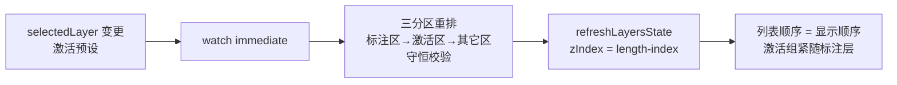

# 2026-11-28 图层管理面板优化：标题/搜索 UI + 面板对齐 + 激活置顶策略（V3.7.29）

- **日期与时间**：2026-11-28 12:47 – 13:00（CST）
- **任务等级**：L2（排序策略 + 双文件 UI 改造）
- **本次版本**：V3.7.29
- **任务来源**：用户指令三点：① `layer-list` 顶部标题与搜索 UI 优化；② 面板对齐 `<LayerControlPanel>` 左右缘；③ 激活图层置顶显示（方便查 URL 与控制顺序），策略需保证新激活图层与现有图层不冲突、列表顺序即显示顺序、标注图层在上其它在下。

## 问题分析

**核心症状 1（标题/搜索）**：标题本身是搜索开关（点文字开搜索），无独立搜索入口；打开后不自动聚焦；标题被替换导致面板上下文丢失。
**核心症状 2（对齐）**：`.layer-manager-panel` 由管理按钮矩形锚定（`rect.right - PANEL_WIDTH`），与整个开关器面板（`.layer-switcher`，含搜索框）左右缘无关，观感错位。
**核心症状 3（置顶）**：激活新底图只改 visible，`layerList` 顺序不变——新激活图层可能深埋列表（174 项按定义序），右键查 URL 要翻很久；且列表顺序即栈序（`refreshLayersState` 按 `length - indexOf` 施加 zIndex），乱插会破坏标注层在上的语义。

**排序模型（侦察结论）**：`layerList` = 全部 174 条定义的状态行（MapContainer 构造，顺序=定义序）；列表顺序即栈序（index 0 = 栈顶）；拖拽/置顶/置底均走 `update-order → handleLayerOrderUpdate → splice + refreshLayersState`；configs 带 `zBand`（'label' = 注记层，zBand 重构会话落地）；激活 = `selectedLayer`（预设 id）→ `resolvePresetLayerIds` 展开栈 → `switchLayerById` 切可见性。

**策略（三分区重排，V3.7.29 实测后修正两处）**：激活时把列表重排为——
1. **标注区**：`zBand === 'label'` 图层恒居栈顶（保持相对顺序）——**激活栈内的注记层也归此区**（与激活区互斥，否则双重归属触发守恒失败、重排被静默放弃）；
2. **激活区**：本次激活预设栈的**非标注层**，且**按栈序反转**放入——`resolvePresetLayerIds` 的栈序是「底图在前、注记在后（注记渲染在最上）」，而列表先位 = 更高 z，若按栈原顺序写入，底图会压住同栈注记（初版实测顺序相反即此原因）；
3. **其它区**：剩余图层（保持原有相对顺序）。
只移动激活栈、其它图层相对次序不动 → 不冲突；重排后 `refreshLayersState`（`refreshLayerInstances` 重跑 `allocateBasemapZIndex` 双带编号：标注带 150+ 恒高于底图带 0~99，带内列表先位 = 更高 z）→ 列表顺序恒等于显示顺序；分区守恒校验（长度不符放弃重排）防御异常。

**受影响模块**：`MapContainer.ts`（reorder + watch）、`LayerControlPanel.ts/.vue`（锚定 + 头部 UI）。

## 修改内容

1. **激活置顶**（`MapContainer.ts`）：`watch(selectedLayer, immediate)` → `reorderLayerListForActivation(resolvePresetLayerIds(val))`——三分区重排（标注区互斥 + 激活栈序反转）+ 守恒校验 + `bootstrapApi.refreshLayersState()` 刷新 zIndex；`zBandOfLayer` 从 LAYER_CONFIGS 读取 zBand。
2. **面板对齐**（`LayerControlPanel.ts`）：`updateLayerManagerAnchor` 锚定宿主从管理按钮上浮到 `.layer-switcher`（`closest` 查找，失败回退按钮），左缘贴面板左缘、`width` 同步面板实测宽度（anchor/style 增加 width 字段，右缘即面板右缘）；`PANEL_WIDTH` 常量随之移除（宽度取自宿主实测）；CSS `max-width: calc(100vw - 16px)` 窄屏护栏。
3. **标题/搜索 UI**（`LayerControlPanel.vue/.ts`）：标题回归纯文本（非按钮）；新增独立圆形搜索图标钮（hover 淡底）；打开搜索自动聚焦输入框（`layerSearchInputRef` + nextTick focus）；ESC 关闭沿用。

## 修改原因

见核心症状——可发现性（激活即置顶）、对齐确定性（宽度实测）、交互完整性（搜索入口/聚焦）。

## 影响范围

图层管理面板（OL）的定位/宽度/头部交互与列表排序时机。不影响：Cesium 侧、拖拽排序协议（update-order 载荷不变）、编号契约、激活切换链路本身。

## 解决方案

## 性能指标

不适用（一次 O(n) 数组分区 + 既有 zIndex 刷新路径）。

## 测试方案

### Agent 已执行

- `vue-tsc --noEmit`：**0 错误**（含并行会话同树改动）。
- `check-layer-definitions` / `check-basemap-catalog` / 结构树（769/769）/ 配置登记 / 分域依赖：**全绿**。
- 侦察期确认：列表顺序即栈序（`resolveLayerPresentation` zIndex = length-index）、激活链路与 update-order 协议未改动。

### 待用户实机验证

1. 切换任一底图 → 打开管理面板：激活栈图层位于标注层之下、其它图层之上；右键激活图层即可查 URL。
2. 面板左右缘与绿色面板（LayerControlPanel）精确对齐；窄窗不溢出。
3. 标题行：搜索为独立图标钮，点击后输入框自动聚焦，ESC 关闭；标题常驻。
4. 拖拽排序仍正常；切换底图后顺序按新策略重排（用户手动拖拽结果会被下次激活重排——策略使然）。

## 变更文件清单

- `frontend/src/domains/ol/components/MapContainer.ts`——激活置顶策略（watch + 三分区重排）
- `frontend/src/domains/ol/layer/components/LayerControlPanel.ts`——面板对齐锚定 + 宽度同步 + 搜索聚焦
- `frontend/src/domains/ol/layer/components/LayerControlPanel.vue`——头部结构（标题/图标钮/聚焦 ref）+ 面板宽度护栏
- `README.md` / `Docs/Guide/CHANGELOG.md`——V3.7.29 三处版本号 + 条目
- 本日志

## 遗留与风险

1. **用户手动拖拽的顺序会被下次激活重排**（激活置顶策略使然）——若需「尊重手动排序」的记忆策略需持久化，属后续增强。
2. `switchLayerById` 期间 layers 的 zIndex 重算依赖 `refreshLayersState`（经 bootstrapApi 延迟桥）——启动首帧（immediate）时 bootstrapApi 尚为 null，跳过一次刷新；启动默认栈的 zIndex 由 bootstrap 自身初始化覆盖，无可见影响。
3. 面板宽度取自 `.layer-switcher` 实测——移动端其宽度收窄时面板同步收窄；如需移动端保底最小宽可另调。

## 零散修补（2026-11-28 13:05，L1）

- **下拉搜索栏「一点就收起」交互 bug 修复**（用户截图报告）：`.custom-select-container` 上挂着 `@click="toggleSelectDropdown"`，点击搜索输入框的事件冒泡到容器被误判为开关下拉 → 面板瞬间收起、来不及输入。修复：搜索栏整块 `@click.stop` + `@mousedown.stop`（`LayerControlPanel.vue`，2 行）。`vue-tsc` 0 错误。
