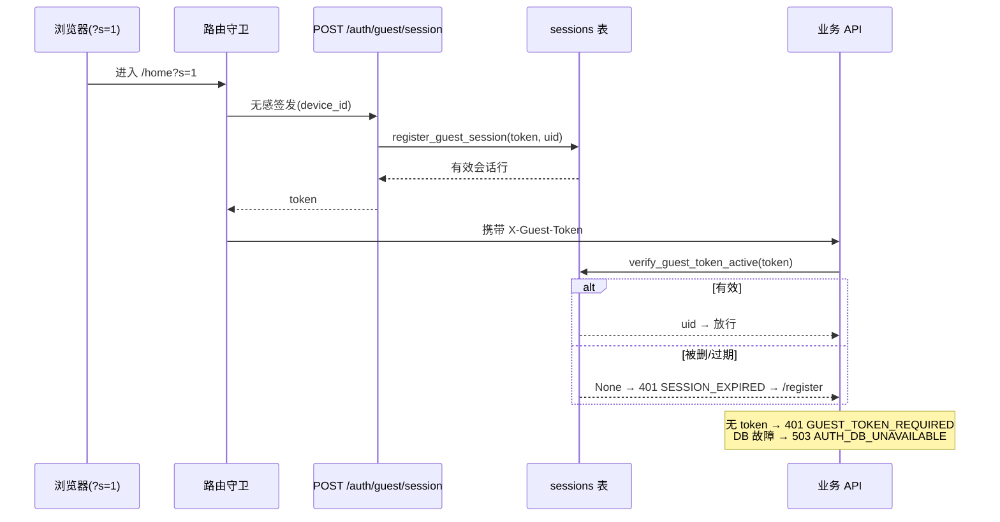

# 2026-11-28 废除无 token 匿名通道（V3.7.18）

- **日期与时间**：2026-11-28 10:17
- **任务等级**：L3（鉴权架构变更，用户明确指令「不允许无 token 的任何登录」，依 Force_command §0 优先级 1 视为批准）
- **本次版本**：V3.7.18

## 问题分析

**核心症状**：`dependencies.py:_build_temporary_guest_session_async()` 在无任何 token 时按 `H(身份IP|UA)` 派生 `token=""` 的内存临时游客身份，放行 `require_api_access_or_guest` 系端点。该身份不写 `sessions`，管理员看不到也删不掉。

**用户明确要求**：匿名访问只允许 `?s=1` 一种情况；该场景仍须签发真实 token、前端无感完成；不允许无 token 的任何登录；有 token 必须在 sessions 表维护；sessions 是唯一权威真值。

**影响面核查**：落地页 `LandingView.vue/.ts` 零 API 调用；路由守卫对非 `s=1` 未登录用户本就重定向 `/register`；`/auth/me` 的 60s 体检仅在持有 token 时发起。因此「无 token 一律 401」不误伤正常浏览。

**受影响模块**：`backend/api/auth/dependencies.py`、`backend/api/auth/guest_token.py`、`frontend/src/api/backend/client.ts`、`frontend/src/router/index.ts`、相关测试。

## 修改内容

1. `dependencies.py`：
   - `_build_temporary_guest_session_async()`：无 token 抛 401 `GUEST_TOKEN_REQUIRED`；有 token 但 sessions 无行/过期抛 401 `SESSION_EXPIRED`；返回的 session 改由 `_get_session_sync()` 从 sessions 读取并保留真实 token。
   - `_authenticate_login_or_guest()`：DB 故障分支由「降级匿名」改为 503 `AUTH_DB_UNAVAILABLE`。
   - 移除 `temporary_credential` / `guest_tmp_` 内存虚构凭据。
2. `guest_token.py`：`verify_guest_token_active()` 的 DB 异常由 fail-open 改 fail-closed。
3. `frontend/src/api/backend/client.ts`：401 `GUEST_TOKEN_REQUIRED` 纳入游客身份缺失类（不跳 register、不清会话）。
4. `frontend/src/router/index.ts`：`s=1` 签发失败由「继续放行」改为重定向 `/register`。
5. `tests/test_guest_identity.py`：新增「无 token 拒绝」「DB 故障 503」用例，改原 DB 故障断言。

## 修改原因

用户要求 sessions 表作为唯一权威会话真值，管理员可随时删行撤销 token 强制下线；无 token 匿名派生桶绕过该能力。

## 影响范围

所有 `require_api_access_or_guest` 系端点（天气/搜索/AI/统计等）在无 token 时由「放行匿名身份」改为 401。`POST /auth/guest/session`（签发端点）本身不依赖鉴权，不受影响。V3.7.17 的镜像表子集约束继续成立。

## 解决方案

| 方案 | 结论 |
|---|---|
| A 后端无 token 自动签发 | 否决：任意脚本可铸造身份、绕过限频 |
| **B 无 token 401 + s=1 前端无感签发（选定）** | 身份铸造入口唯一，session 表成为唯一真值 |
| C 派生桶补写 sessions | 否决：仍无 token、仍可任意铸造 |

## Mermaid 图

## 性能指标

未实测：无 token 请求少一次 UID 派生与内存会话构造，略降；有效 token 请求多一次 `_get_session_sync()`（既有路径），无新增开销。

## 测试方案

### Agent 已执行

- 全量 `pytest tests/`：**193 passed / 1 failed**；失败项 `test_webhook_helpers.py::test_shutdown_webhook_watches_noop_when_idle` 为既有裸 async 测试缺 pytest-asyncio 标记的 env 问题，与本次无关。
- `vue-tsc --noEmit`：0 错误。
- 门禁：`CheckStructureTree` / `CheckConfigRegistry` 见交接块。

### 待用户实机验证

1. 直接 curl 任意游客端点（不带 token）→ 401 `GUEST_TOKEN_REQUIRED`。
2. `?s=1` 首次进入 → 前端自动签发、正常浏览；签发通道关闭（未在 HF 配 `GUEST_TOKEN_SECRET`）→ 跳 `/register`。
3. 管理员删 sessions 中游客行 → 该游客下次请求 401 → 跳 `/register`。
4. 在线人数与在线表口径不变。

## 变更文件清单

- `backend/api/auth/dependencies.py`：无 token 拒绝、DB 故障 503、session 取自 sessions 并保留真实 token。
- `backend/api/auth/guest_token.py`：游客 token 校验 fail-closed。
- `frontend/src/api/backend/client.ts`：401 分类新增 GUEST_TOKEN_REQUIRED。
- `frontend/src/router/index.ts`：s=1 签发失败重定向 register。
- `backend/tests/test_guest_identity.py`：新增/调整 3 项用例。
- `Docs/TODO/2026-11-28-no-anonymous-token-plan.md`、`Docs/TODO/README.md`：方案与索引。
- `README.md`、`Docs/Guide/CHANGELOG.md`：V3.7.18 版本记录。
- 本日志。

## 遗留与风险

- `EMERGENCY_GUEST_MODE`（`VITE_EMERGENCY_GUEST_MODE=1`）是可绕过 s=1 限制的应急开关，仍会在非 s=1 场景调用 `injectGuestTokenForShareMode()` 签发 token。它签发的 token 仍写 sessions（符合「有 token 必须来自 sessions」），但严格来说突破了「只允许 s=1」——建议后续评估是否移除该开关（未纳入本次范围）。
- `verify_guest_token_active()` fail-closed 后，DB 瞬时故障可能导致游客请求失败；认证层已以 503 + 前端重试语义兜底。
