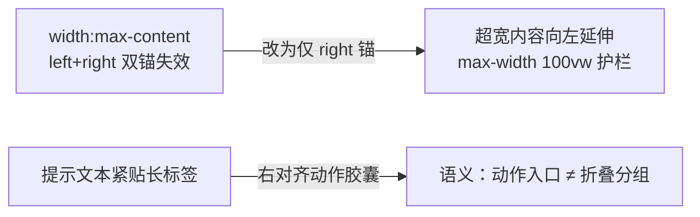

# 2026-11-28 OL 底图下拉溢出修复 + 服务入口行重设计（V3.7.22）

- **日期与时间**：2026-11-28 11:45 – 11:55（CST）
- **任务等级**：L2（Bug 修复 + UI 重设计，双引擎镜像）
- **本次版本**：V3.7.22
- **任务来源**：用户指令（附截图）：① `custom-select-dropdown` 最右侧可能因内容填充溢出屏幕；② 「WMS/WMTS/MVT/XYZ 输入 URL」行实为自定义 URL 输入的触发器，需单独重新设计（提示文本紧贴长英文标签，观感差）。

## 问题分析

**核心症状 1（溢出）**：`.custom-select-dropdown` 原为 `left: 0; right: 0; width: max-content;` 三者并存——对绝对定位元素，显式 `width` 使 `right` 锚失效（过度约束时 LTR 下 left 优先），超宽内容（长标签 + 序号阶梯缩进 + 导轨）自左锚**向右**延伸；而开关器锚定屏幕右上角（`right: 8px`），-dropdown 左缘即开关器左缘，因此右侧直接越出视口。

**核心症状 2（触发行）**：service 分类行不是折叠分组而是「打开自定义 URL 编辑器」的动作入口，旧形态把动作提示「输入 URL」以裸文本紧贴长英文标签 `WMS/WMTS/MVT/XYZ`，无分隔、无动作感，且整行像普通分组容易被误读。

**受影响模块**：OL `LayerControlPanel.vue`（dropdown 定位 + service 行）；Cesium `CesiumToolPanel.vue`（service 行镜像，面板本体为固定宽度侧栏，无溢出问题）。

## 修改内容

1. **溢出修复**（`LayerControlPanel.vue`）：
   - `.custom-select-dropdown` 改为**仅右锚**（`left: auto; right: 0`）+ `max-width: min(480px, calc(100vw - 24px))`：超宽内容向屏幕内（左）延伸，物理上不可能再溢出右缘；窄屏时由 100vw 护栏兜底。
   - `.catalog-heading` 补收缩省略（min-width:0 + ellipsis），长标签不再撑破宽度上限；`.preset-name` 已有省略（沿用）。
2. **服务入口行重设计**（OL + Cesium 镜像）：
   - 提示文本升级为**右对齐动作胶囊** `catalog-trigger-chip`（「输入 URL →」，圆角胶囊底 + accent 色 + hover 加深），`margin-left: auto` 靠右，与长标签彻底分离；
   - 行为不变：整行点击仍触发 `activateCustomBasemap()`（切到 custom 并聚焦输入框）；
   - Cesium 侧同款镜像（token 用 `--text-secondary`/`--brand-accent` 体系），「仅二维地图」提示保持原样。

## 修改原因

溢出是真实可用性 bug（右侧内容不可达）；触发行语义是「动作」而非「分组」，视觉上必须与折叠行区分。

## 影响范围

OL 底图下拉的定位与宽度策略、双引擎服务入口行观感。不影响：数据层、搜索、编号契约、折叠规则（V3.7.21）。

## 解决方案

## 性能指标

不适用（纯 CSS/模板）。

## 测试方案

### Agent 已执行

- `vue-tsc --noEmit`：**0 错误**（合并第三方会话改动状态）。
- `check-layer-definitions` / `check-basemap-catalog` / 结构树 / 配置登记 / 分域依赖：**全绿**。
- §11.2 红线扫描：仅既有假阳性。

### 待用户实机验证

1. OL 下拉展开全部分类（含电子底图长标签行）：dropdown 右缘不越出屏幕；窄窗口（F12 拉窄）同样成立。
2. 「WMS/WMTS/MVT/XYZ」行：右侧「输入 URL →」胶囊显示，行点击后切到 custom 并聚焦输入框。
3. Cesium 面板同款胶囊观感一致；「仅二维地图」提示不受影响。

## 变更文件清单

- `frontend/src/domains/ol/layer/components/LayerControlPanel.vue`——dropdown 右锚 + 宽度上限 + heading 收缩 + 服务胶囊
- `frontend/src/domains/cesium/components/CesiumToolPanel.vue`——服务胶囊镜像
- `README.md` / `Docs/Guide/CHANGELOG.md`——V3.7.22 三处版本号 + 条目
- 本日志

## 遗留与风险

- `max-width: min(480px, …)` 的 480px 是可读性档位（过宽难扫读）；如需更宽可调。
- 目录样式任务（序号阶梯等）由并行会话进行中，本任务与其文件改动已共存且门禁全绿；若其后续也改 dropdown 定位，以本修复的「右锚 + 上限」语义为准。
