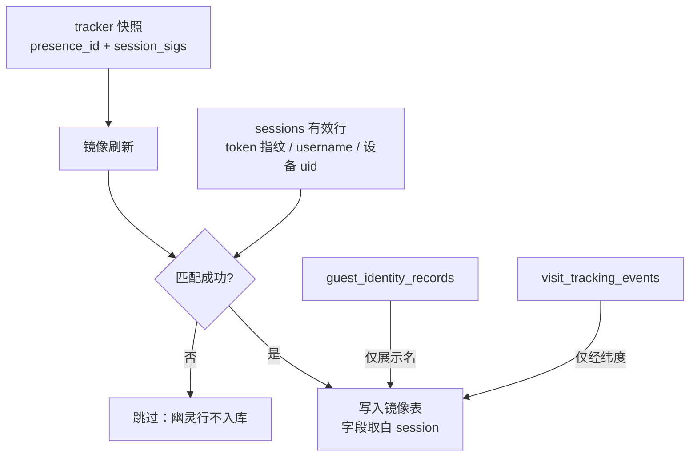

# 2026-11-28 在线镜像表收敛为会话表子集（P1）

- **日期与时间**：2026-11-28 10:01
- **任务等级**：L3（数据库结构变更，用户明确指令修复 P1，依 Force_command §0 优先级 1 视为批准）
- **本次版本**：V3.7.17

## 问题分析

**核心症状**：用户中心管理面板中 `admin_online_presence` 与 `sessions` 对不上。线上只读核实（admin token 指纹 `34c57a87a2722689`）：

- `sessions` 2 行：admin（`09:31:22` 签发，有效期至 `13:31:22`）+ 游客 `guest_2470`（设备 `gd_686fdd…`）。
- `admin_online_presence` 2 行：admin 行与会话逐字段一致；游客行 `g:guest_7d4a7f7ae313eab9` / `guest_2000` / 设备 `gd_338497…`，`first_seen_at=2026-11-16`、`last_seen_at=2026-11-24`，在 `sessions` 中无对应行。
- tracker 调试：`fallback_heartbeat_age_seconds[g:guest_7d4a…]=55`（窗口 150s）、`sse_connections=0`——靠 API 兜底心跳保活。
- 设备派生验证：`sha256("guest|gd_338497…")[:16] = 7d4a7f7ae313eab9`，确认 presence_id 由设备 ID 派生，与 session.guest_uid 无关。

**根本原因**：`_refresh_admin_online_mirror_sync()` 以 tracker 快照为唯一驱动，`_mirror_identity_from_db_sync()` 优先从持久化的 `guest_identity_records` 补全身份，从不校验 `sessions` 中是否存在有效会话。镜像表因此成为「历史身份 + 当前心跳」混合体，不是 `sessions` 的子集。

**`s=1` 核查**：分享模式经 `injectGuestTokenForShareMode()` → `POST /auth/guest/session` → `register_guest_session()` 写 `sessions`（`routes.py:793-813`），属合法会话，修复后仍会正常出现在在线表。

**受影响模块**：`backend/api/statistics.py`、`backend/api/realtime_stats.py`、`backend/api/auth/schema.py`、`backend/tests/test_realtime_stats.py`。

## 修改内容

1. `statistics.py`：
   - 新增 `_session_token_sig()` / `_load_live_session_rows_sync()`（4h 硬截止，与 `auth.session` 同口径）/ `_match_session_for_presence()`（指纹优先 → username → 设备派生 uid → guest_uid）/ `_mirror_identity_from_session_sync()`。
   - 重写 `_refresh_admin_online_mirror_sync()`：无有效会话的 tracker 身份直接跳过，写入字段全部来自 session 行；保留 tracker 的心跳/client/SSE 统计字段。
   - 保留 `_mirror_identity_from_db_sync()` 薄兼容层（含最小 mock 连接的 fetchone 兜底与城市回查），避免旧测试回归。
2. `realtime_stats.py`：`snapshot_details()` 新增 `session_sigs`（兜底心跳与 SSE 连接的 session_sig 集合）。
3. `auth/schema.py`：`admin_online_presence` 新增 `session_token_sig` 列 + `PRAGMA table_info` 幂等迁移 + 索引。
4. `tests/test_realtime_stats.py`：适配新 schema；新增 `test_online_mirror_drops_presence_without_live_session` 幽灵剔除用例；断言镜像 token 指纹。

## 修改原因

用户明确要求「修复 P1」：在线镜像表必须是会话表的子集，字段由 session 迁移；并确认 `s=1` 自动签发同样写入 sessions，不应被误伤。

## 影响范围

管理员在线镜像表（展示层）与 tracker 快照输出。在线人数真值仍由 tracker 决定，鉴权/配额/IP 定位零改动。`s=1` 分享游客走同一会话表，行为保持一致。

## 解决方案

| 方案 | 结论 |
|---|---|
| A 仅删历史回查 | 否决：丢展示字段且不解决幽灵行 |
| **B tracker 候选 + session 指纹双闸（选定）** | 保持在线判定口径不变，镜像表严格收敛为 session 子集 |
| C 改实时 JOIN 视图 | 否决：改动面大、丢 SSE 明细 |

关键取舍：身份真值（role/guest_uid/设备/IP/城市/UA/时间）一律取 session；`guest_identity_records` 只保留展示名 `guest_<id>`，`visit_tracking_events` 只补经纬度；`last_heartbeat_at` 仍来自 tracker，因其是在线状态量而非身份属性。

## Mermaid 图

## 性能指标

未实测：每次刷新（10s 周期）多一次全表扫描 sessions（当前 2 行，有 token/username/guest_uid 索引），预计微秒级。

## 测试方案

### Agent 已执行

- `tests/test_realtime_stats.py` 等 4 个相关文件：**80/80 通过**（含新增幽灵剔除用例）。
- 全量 `pytest tests/`：**192 passed / 1 failed**；失败项 `test_webhook_helpers.py::test_shutdown_webhook_watches_noop_when_idle` 为裸 `async def` 缺 pytest-asyncio 标记的既有环境失败，与本次改动无关。
- 本地真实库副本 `init_auth_tables_sync()`：确认 `session_token_sig` 列已迁移（22 列 → 23 列）。
- `CheckStructureTree.py`：767 文档 / 767 磁盘，漏登记 0、幽灵 0。
- `CheckConfigRegistry.py`：全部通过 ✅。
- 红线自查（§11.2）：本次仅改动 backend 业务代码，未新增任何禁项模式串；未触碰部署面。

### 待用户实机验证

1. 部署后打开管理面板数据库管理，`admin_online_presence` 中 `guest_2000` 幽灵行应在 10 秒内消失（无需手动删行）。
2. admin 在线行字段与 sessions 一致，`session_token_sig` 非空。
3. 用 `?s=1` 分享链接访问后，游客正常出现在在线表且字段与 session 一致。
4. 在线人数口径不变（tracker 真值）。

## 变更文件清单

- `backend/api/statistics.py`：镜像刷新双闸 + session 字段来源 + 兼容层。
- `backend/api/realtime_stats.py`：快照输出 session_sigs。
- `backend/api/auth/schema.py`：镜像表加列与幂等迁移、索引。
- `backend/tests/test_realtime_stats.py`：schema 适配 + 幽灵剔除测试。
- `Docs/TODO/2026-11-28-online-mirror-session-subset-plan.md`：L3 方案文档（含 Mermaid）。
- `Docs/TODO/README.md`：索引新增方案条目。
- `README.md`、`Docs/Guide/CHANGELOG.md`：V3.7.17 版本号与变更记录。
- 本日志。

## 遗留与风险

- 幽灵心跳本身仍在 tracker 内存中（P2 范围：需在标活前校验 session_sig）；本次仅修镜像展示表，在线人数口径未变。若该客户端继续 ping，关闭页面或重启 Space 后彻底清除。
- 全量测试残留 1 项既有 async 环境失败，建议后续补 `@pytest.mark.asyncio`。
- 工作区存在其他任务（V3.7.16 底图重构）的未提交改动，本次未触碰。
