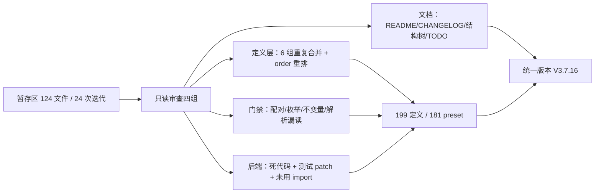

# 2026-11-28 暂存区全量 Code Review 与本批统一 V3.7.16

- **日期与时间**：2026-11-28 15:22 – 15:42（CST）
- **任务等级**：L2（按 Force_command §1；跨模块 bug 修复与文档治理，未新增目录/依赖）
- **本次版本**：V3.7.16
- **任务来源**：用户指令：按 `Docs/Force_command.md` 审查暂存区代码；不准动 Git；多次不规范 commit 整合为统一版本 V3.7.16；修复潜在 bug，更新文档与文件树；给出统一 commit message。
- **规范裁决**：依据 Force_command §0，用户在当前会话明确指定「V3.7.16」临时覆盖 §5 的版本号递增规则；§2.1 Git 写操作禁令未豁免，全程只做只读 Git 查询与工作区文件编辑。

## 问题分析

**核心症状**：暂存区 124 个文件、10,362 行新增 / 2,957 行删除，来自 24 次迭代；README/CHANGELOG 被拆成 V3.7.17–V3.7.39 共 23 个中间版本，与用户要求的单批单版本冲突。代码层面存在：6 组同 URL/同元数据重复定义；配对门禁无法识别重复且缺 `correction→coord` 不变量；迁移脚本硬编码 174；`catalog/index.ts` 依赖间接 import 才完成登记；5 条天地图定义缺 `needsContext`；`statistics.py` 存在 84 行不可达代码；撤销 token 测试 patch 错函数；`dependencies.py` 残留未使用 import/局部变量与过期 docstring。

**根本原因**：并行会话多次增量提交未做批次收敛；定义层从 OL 域迁往 common 域时遗留旧定义；门禁脚本采用宽松 `.some()` 配对与硬编码计数；鉴权重构后清理不彻底。

**受影响模块**：common/basemap 定义与目录、OL/Cesium 加载链、后端鉴权与在线统计、配置登记、README/CHANGELOG/结构树/TODO。

## 修改内容

### 1. 代码与门禁修复

1. 合并 6 组重复定义并保留规范 id：`label_tuxin_wgs→label_tuxin`、`vector_tuxin_wgs→vector_tuxin`、`vector_amap_clean_wgs→vector_amap_256_ltype_1_wgs`、`imagery_google_water→vector_google_combo_water_wgs`、`terrain_google→vector_google_combo_pb_hillshade_wgs`、`vector_Google_clean→vector_google_combo_clean_terrain_no_road_wgs`；preset stack 同步重指，定义数 205→199，order 连续 1..199。
2. `check-layer-definitions.mjs`：新增解析漏读交叉校验、category/provider/coord 枚举校验、`correction→coord` 不变量、同 URL 同 payload 重复定义检测。
3. `check-basemap-migration.mjs`：移除硬编码 174 与过期 order 注释，改为 HEAD 与当前定义数一致才做等价断言，否则显式退出 2。
4. `catalog/index.ts` 增加 `import '../definitions'` 副作用，保证 registry 不依赖 OL 侧加载顺序。
5. 5 条含 `{tiandituTk}` 的定义补 `needsContext: ['tiandituTk']`。
6. `statistics.py` 删除 `_mirror_identity_from_session_sync` 中 `return` 后的不可达旧代码块。
7. `dependencies.py` 删除未使用 import/局部变量，修正 `_extract_guest_token` docstring 为 fail-closed 语义。
8. `test_guest_identity.py` 撤销用例改 patch `verify_guest_token_active_strict`，真实命中 `SESSION_EXPIRED` 分支。
9. 遗留 S1–S4 清零：`.env.example` 中 22 个缺失 `VITE_*` 键补登 `backend/config/catalog.py`；`runtime-map-token-pool.md` / `tile-rectify-system.md` 改指新 SSOT；游客 session 显式输出 `is_temporary=false` / `temporary_credential=""`；`check-basemap-catalog.mjs` 改数量下界 + 首部锚点，取消末项 id 硬编码。配置注释中的红线措辞已中性化；实际域名值未改。

### 2. 版本与文档统一

- README 三处版本统一 V3.7.16；版本演进表收敛回恒定 3 行（V3.7.16/15/14）。
- CHANGELOG 的 24 条中间版本合并为单条 V3.7.16，保留 20 个过程日志链接作为追溯；V3.7.15 及更早历史不动。
- 49 个源码/现行架构/指南/TODO 文件中的 V3.7.17–V3.7.39 注释统一为 V3.7.16；历史日志不改写。
- `Docs/Guide/project-structure.md` 登记 `basemap-catalog-redesign.md`；`frontend-structure.md` 登记 4 个 `frontend/scripts/` 门禁/构建脚本。
- `Docs/TODO/README.md` 补登 `remove-legacy-basemap-category-group-plan.md`；`bugfix-optimization-plan.md` 登记 4 项顺带发现（S1–S4）。
- 本批 6 份 TODO 方案文档的目标/落地版本统一 V3.7.16。

## 修改原因

单批单版本是用户明确要求，也是 Force_command §5 的可追溯性基础；重复定义与宽松门禁会让目录出现等价入口并在后续追加时继续漂移；后端清理项均为审查中可确认的死代码/错误测试目标，修复不扩大功能范围。

## 影响范围

定义层数据（id/order/preset stack）、底图门禁脚本、common 目录 barrel、天地图 token 池映射、后端鉴权与在线统计、版本/结构树/TODO 文档。不影响 URL 参数契约、纠偏算法与双引擎加载语义。

## 解决方案

## 性能指标

未实测（本批为数据一致性、门禁与文档治理）。

## 测试方案

### Agent 已执行

- `vue-tsc --noEmit`：0 错误。
- `check:basemap-catalog`：OK（181 presets，20 AMAP + 30 Google combos，20 recommended）。
- `check:layer-definitions`：OK（199 definitions，order 1..199，stacks resolve，新增门禁通过）。
- `check:basemap-migration`：**NOT RUN**，退出码 2（HEAD 115 条 ≠ 当前 199 条，迁移基线不一致；非通过）。
- 后端 `.venv` 中 `pytest tests/test_guest_identity.py tests/test_realtime_stats.py -q`：69 passed。
- `CheckStructureTree.py --quiet`：769/769；`CheckConfigRegistry.py -q`：全通过；`CheckDomainDeps.py`：四向依赖均 0。
- 平台红线 §11.2：命中项仅 `maxRayDistance`（已知假阳性）与既有 `vpn.negiao.cn` / Cloudflare Worker 文本（既有基础设施，本批未新增代理/VPN/隧道能力）；红线 9 基线 `REDLINE-CLEAN`。
- UI 抽查：3 个主要 Vue 文件均有 `pointer: coarse` 档，无 emoji 图标。
- 全程未执行 `git add` / `commit` / `reset` / `checkout` 等写操作。

### 待用户实机验证

1. 目录树中不再出现 6 组重复底图入口；相关 preset 仍可正常加载。
2. 管理员在线列表无幽灵行；游客 token 撤销后跳重新登录，DB 故障返回 503。
3. 切换底图时不出现「已自动切换至后端代理」toast（自动代理默认关闭）；显式 `always` 与定义级纠偏仍正常。

## 变更文件清单

- `frontend/src/domains/common/basemap/definitions/category-electronic.ts` / `category-imagery.ts` / `category-terrain.ts`——6 组重复合并、order 重排、天地图 needsContext、版本注释归一
- `frontend/src/domains/common/basemap/basemapPresets.ts`——6 处 stack 重指、版本注释归一
- `frontend/src/domains/common/basemap/catalog/index.ts`——显式登记定义
- `frontend/scripts/check-layer-definitions.mjs` / `check-basemap-migration.mjs`——门禁增强与计数动态化
- `backend/api/statistics.py`——删除不可达旧镜像代码
- `backend/api/auth/dependencies.py`——未用 import/局部变量清理、docstring 修正
- `backend/tests/test_guest_identity.py`——撤销用例 patch 目标修正
- `README.md` / `Docs/Guide/CHANGELOG.md`——版本三处、版本表 3 行、单条 V3.7.16
- `Docs/Guide/project-structure.md` / `frontend-structure.md` / `handover.md` / `configuration.md`——结构树与现行文档登记
- `Docs/TODO/README.md` / `bugfix-optimization-plan.md` / 6 份本批方案文档——索引、顺带发现与版本归一
- 49 个源码/文档文件的 V3.7.17–V3.7.39 注释归一（详见工作区 diff）
- 本日志

## 遗留与风险

1. **S1–S4 已清零**：`VITE_*` 全量登记、两篇架构文档 SSOT 改指、游客 payload 形状显式保留、preset 门禁去末项硬编码；`bugfix-optimization-plan.md` 对应项已勾选。
2. `check:basemap-migration` 因 HEAD 基线不一致显式 NOT RUN，不能作为本批通过依据。
3. 平台红线既有 `vpn.negiao.cn` / Cloudflare Worker 文本未在本批新增；若需严格按 §11.1 处置，须用户单独裁定既有基础设施去留（Agent 不擅自删除生产端点）。
