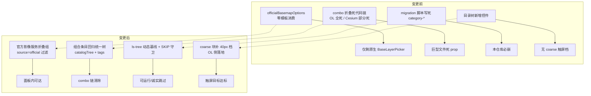

# 2026-11-28 底图批次暂存区 Code Review 修复（V3.7.20）

- **日期与时间**：2026-11-28 10:40 – 11:05（CST）
- **任务等级**：L2（审查修复，多文件）
- **本次版本**：V3.7.20（V3.7.19 已被并行会话「底图架构文档重写」认领，按 §5「后完成者顺延」）
- **审查依据**：本会话对 V3.7.16/17/18 并批暂存区的全量 Code Review（L0，报告见会话输出）
- **并发说明**：修复期间另一并行会话（V3.7.19，架构文档重写）在同一工作树活动，双方分工互补——
  其完成 `CesiumToolPanel.vue` 目录树统一 + 官方服务区块（模板与样式）与全部文档重写；
  本会话完成 `.ts` 死代码清除、官方折叠态、OL 侧全部修复、脚本与门禁修复。两侧改动已交叉核对自洽。

## 问题分析

**核心症状**（Code Review 结论，按优先级）：
1. P1-1 Cesium 面板官方影像服务入口消失（`officialBasemapOptions` 不再被任何模板消费，仅剩原生 BaseLayerPicker），且无日志记录该行为变化。
2. P1-2 catalog 骨架 + 双面板目录 UI 整段工作无日志覆盖（V3.7.16 日志明文「本次不新增 UI」，变更文件清单不含 catalog/UI 文件）。
3. P1-3 V3.7.16 日志遗留项 A4 声称 handover.md:84「已改为新路径并核实」，实际仍是已删除的 `basemapConfig.ts` 旧路径。
4. P1-4 `check-basemap-migration.mjs` 写死 `category-*.ts` 基线文件名，在本仓库（HEAD 为 group-1..4 布局）直接崩溃，日志宣称的等价验证不可复现。
5. P2-1 双面板新增目录树控件（搜索框/关闭钮/三级折叠行）无 `pointer: coarse` 触屏档。
6. P2-2 combo 折叠死代码链（OL 侧确认；Cesium 侧经并行会话协同统一入树）。
7. P2-4 publicRuntime 三个纠偏 helper（gcj2wgs/wgs2gcj/bd2wgs）零调用。
8. P3：registry 每次重建条目、双校验器 correction 口径不一致、url token 占位符与 needsContext 声明无一致性校验。

**根本原因**：catalog/UI 批次与定义层重构批次分属不同会话，前者未走流程；review 修复无既有载体。

**受影响模块**：`ol/layer`、`cesium/components`、`common/basemap/{catalog,definitions,comboBasemaps}`、
`config/publicRuntime`、`frontend/scripts/*`、Docs 多处。

## 修改内容

1. **P1-1 官方影像服务入口恢复**（与并行会话协同）：
   - `CesiumToolPanel.ts`：新增 `openOfficialServices` 折叠态；组合折叠死代码（refs/methods/prop/getter）清除；
     `visibleCatalogTree`（组合剔除层）删除，模板改用 `catalogTree`——组合底图经 catalog tags 回归统一树（与 OL 对齐）。
   - `CesiumToolPanel.vue`（并行会话完成）：目录树下新增「官方影像服务」折叠组（`source === 'official'` 过滤，
     复用 `selectBasemapOption` 与 `option-card` 样式）。
   - `CesiumContainer.ts/.vue`：死 prop 通道拆除（巨型文件净减 3 行）。
2. **P2-2 死代码清除**：
   - `useCesiumLayers.ts`：`comboProviderGroups` computed 及 import 移除（`isComboBasemapId` 过滤保留）。
   - `useBasemapCatalog.ts`：重写——移除 Sentinel 年份分组/历史页签/组合折叠等模板已弃用的全部状态
     （`sentinelBasemapOptions`/`regularBasemapOptions`/`comboProviderGroups`/`sentinelYearGroups`/`esriYearGroups`/
     `historicalProviderTab`/`openHistoryYears`/`toggleHistoryYear`/`isHistoryYearOpen`/`formatHistoryDate`/
     `selectHistoricalProviderTab`/`historicalImageryUpdatedAt` 等）；保留目录树 + Wayback 动态注入 + `currentLayerLabel`。
   - `LayerControlPanel.ts`：对应死声明与 `historicalProviderTab` 赋值清除。
   - `comboBasemaps.ts`：裁剪为 `isComboBasemapId` 单一导出（其余零消费方）。
   - `LayerControlPanel.vue`：`.combo-option` 死 CSS 移除。
3. **P2-1 触屏档**：`LayerControlPanel.vue` 既有 `pointer: coarse` 块内补 `.close-search-btn`（40px）、
   `.catalog-search-input`/`.layer-search-input`（min-height 40px）、`.history-year-toggle`/`.custom-select-option`
   （min-height 40px）。**Cesium 侧触屏档未补**（并行会话正活跃编辑该文件，避免冲突；见遗留）。
4. **P1-4 迁移脚本基线修复**（`check-basemap-migration.mjs`）：
   - 旧基线文件改 `git ls-tree` 动态发现（兼容 group-\*/category-\* 两种布局）；
   - group 布局无 order 字段时按分片聚合位置推导；catalogCategory/provider/coord/description/date 旧缺免比对（新增元数据）；
   - SKIP 守卫：HEAD 无旧分片（迁移已提交）或旧定义数 ≠ 174（本地 HEAD 不含中间会话定义）时显式跳过并说明，
     不再产出误导性失败；权威等价验证以 V3.7.16 日志（重构工作区基线）为准。
5. **P2-4**：`publicRuntime.ts` 删除 `gcj2wgsProxyUrl`/`wgs2gcjProxyUrl`/`bd2wgsProxyUrl` 三个零调用导出；
   纠偏索引契约注释（含 wgs2bd 百度网格语义）迁入 `resolveTileUrl.ts` 的 `CORRECTION_PROXY_SEGMENT`（唯一权威出处）。
6. **P3**：
   - `catalog/layers.ts` 新增登记版本号；`catalog/registry.ts` 按版本缓存 `buildEntries` 结果（搜索每键触发不再重建 148 条），失真注释订正；
   - `check-layer-definitions.mjs`：`VALID_CORRECTIONS` 补 `'none'`，与 validate.ts 口径对齐；
   - `definitions/validate.ts`：新增聚合警告——url 含 `{tiandituTk}`/`{ovitalTdtkey}` 但未声明 `needsContext`
     （token 池容灾无法按层判定；天地图条目属既有缺失，聚合单条防刷屏）。
7. **P1-3**：`Docs/Guide/handover.md:84`「加底图源」行更新为新路径（definitions SSOT + resolveTileUrl + 双引擎加载器）；
   V3.7.16 日志遗留项 A4 声明如实勘误（原声明有误）。
8. **P1-2**：补记日志 `2026-11-27-basemap-catalog-ui-batch-retro.md`（catalog/UI 批次全文件清单、
   未记录的既有图源 URL 内容变化发现、traffic.json/.gitignore 随批说明）。

## 修改原因

修复暂存区 Code Review 确认的合规缺口与缺陷：行为变化必须有记录、日志声明必须真实、
门禁脚本必须可运行、新增 UI 必须满足移动端基线、死代码不进主干。

## 影响范围

前端底图链路（OL/Cesium 面板、catalog 查询层、publicRuntime、校验脚本）与 Docs（handover、日志、README、CHANGELOG、TODO）。
不影响：后端、预设编号契约、部署面。

## 解决方案

## 性能指标

registry `buildEntries` 由每次调用重建改为版本缓存（148 条 × 搜索每键触发 → O(1) 命中）；
未做基准测量（改动量级为微秒级，无用户可感差异）。

## 测试方案

### Agent 已执行

- `npx vue-tsc --noEmit`：**0 错误**（全部修复后复跑）。
- `node scripts/check-basemap-catalog.mjs`：**通过**（148 presets）。
- `node scripts/check-layer-definitions.mjs`：**通过**（174 definitions，'None' 0 条，'none' 口径对齐）。
- `node scripts/check-basemap-migration.mjs`：**SKIP（诚实跳过）**——本地 HEAD 旧定义 115 条 ≠ 基线 174 条，
  显式说明并指向 V3.7.16 日志的权威验证（原状态为直接崩溃）。
- `python Scripts/CheckStructureTree.py`：**通过**（767/767）。
- `python Scripts/CheckConfigRegistry.py`：**通过**（139 key）。
- `python Scripts/CheckDomainDeps.py frontend/src`：**通过**（0 违规）。
- 残留符号扫描：combo/历史影像死符号全仓 0 残留（grep 实测）。
- §11.2 红线自查（frontend + .github）：仅已知假阳性 `maxRayDistance`。

### 待用户实机验证

1. Cesium 工具面板：底图节出现「官方影像服务」折叠组，选中任一官方服务底图正常切换（与原生 BaseLayerPicker 一致）。
2. Cesium/OL 目录树：编号 99–148 组合底图在树内可选（电子/影像分类下）；搜索「高德256」命中。
3. OL 图层面板触屏（真机或 F12 设备模式 pointer:coarse）：搜索框、关闭钮、折叠行可点击目标 ≥40px。
4. 控制台：出现一条聚合警告「N 条定义 url 含 {tiandituTk} 但未声明 needsContext」（预期，非错误）；
   无 `[basemap-definitions]` 校验错误。

## 变更文件清单

**本会话修改**：
- `frontend/src/domains/cesium/components/CesiumToolPanel.ts`——官方折叠态 + combo/visibleCatalogTree 死代码清除
- `frontend/src/domains/cesium/components/CesiumContainer.ts`——死 prop 通道拆除
- `frontend/src/domains/cesium/composables/layers/useCesiumLayers.ts`——combo computed 移除
- `frontend/src/domains/common/basemap/comboBasemaps.ts`——裁剪为 isComboBasemapId
- `frontend/src/domains/common/basemap/catalog/layers.ts`——登记版本号
- `frontend/src/domains/common/basemap/catalog/registry.ts`——版本缓存 + 注释订正
- `frontend/src/domains/common/basemap/definitions/validate.ts`——needsContext 聚合警告
- `frontend/src/domains/common/basemap/definitions/resolveTileUrl.ts`——纠偏索引契约注释迁入
- `frontend/src/config/publicRuntime.ts`——三个死导出删除
- `frontend/src/domains/ol/layer/composables/useBasemapCatalog.ts`——重写（死状态清除）
- `frontend/src/domains/ol/layer/components/LayerControlPanel.ts`——死声明清除
- `frontend/src/domains/ol/layer/components/LayerControlPanel.vue`——coarse 触屏档 + 死 CSS 移除
- `frontend/scripts/check-basemap-migration.mjs`——动态基线发现 + SKIP 守卫
- `frontend/scripts/check-layer-definitions.mjs`——VALID_CORRECTIONS 补 none
- `Docs/Guide/handover.md`——:84 加底图源行更新
- `Docs/LLM_record/26-11/2026-11-27/2026-11-27-basemap-definition-refactor.md`——A4 勘误
- `README.md`——V3.7.20 三处 + 版本表收敛恒定 3 行
- `Docs/Guide/CHANGELOG.md`——V3.7.20 条目
- `Docs/TODO/bugfix-optimization-plan.md`——本批 Code Review 修复登记 + 新顺带发现
- `Docs/Guide/frontend-structure.md`——comboBasemaps 功能注释同步

**本会话新增**：
- `Docs/LLM_record/26-11/2026-11-28/2026-11-28-staged-review-fixes.md`——本日志
- `Docs/LLM_record/26-11/2026-11-27/2026-11-27-basemap-catalog-ui-batch-retro.md`——catalog/UI 批次补记（P1-2）

**并行会话（V3.7.19）完成、本日志仅登记归属**：
- `frontend/src/domains/cesium/components/CesiumToolPanel.vue`——目录树统一（catalogTree）+ 官方服务区块 + 组合区块移除
- `Docs/Architecture/basemap-catalog-redesign.md`——按实际代码重写 + 5 张 Mermaid
- `Docs/LLM_record/26-11/2026-11-28/2026-11-28-basemap-architecture-doc-refresh.md`——其日志

## 遗留与风险

- **Cesium 面板触屏档未补**：并行会话仍在活跃编辑 `CesiumToolPanel.vue`，为避免冲突本会话未动该文件；
  其 `.option-card`/`.section-toggle`/`.close-search-btn` 仍无 `pointer: coarse` 档，待其落定后按 OL 侧同款规则补齐
  （已记入 bugfix-optimization-plan）。
- **V3.7.15 → 本批的既有图源 URL 内容变化未逐条审计**：抽样证实 `vector_amap_wgs` 等存在未记录的上游模板变化
  （+`ltype=9&scl=1`），已记入 bugfix-optimization-plan 与补记日志，建议独立任务做全量清单核对。
- **并行会话日志口径**：V3.7.19 日志自述「零代码改动」，但其会话实际改动了 `CesiumToolPanel.vue`；
  本日志已如实登记归属，其日志未修订（避免跨会话互改）。
- 迁移等价脚本现为「有真基线才断言」模式：未来若需复验，须在含 174 条旧定义的基线提交上运行。
- 前端展示层目录树文案为硬编码中文（i18n 债，随批既有，未扩大处理）。

## 零散修补（2026-11-28 11:15 – 11:25，L1；任务：用户指令「修复遗留的内容」）

承接上文遗留节三项，全部闭环：

1. **Cesium 面板触屏档补齐**（并行会话落定后）：`CesiumToolPanel.vue` 文件尾新增
   `@media (max-width: 700px), (pointer: coarse)` 块（close-search-btn 40×40、catalog-search-input
   min-height 40px、section-toggle/option-card 触屏 40px，判据与 OL 侧同款）。单文件 11 行，L1。
2. **V3.7.15 → 本批图源差异语义级审计**（一次性脚本，置于 Agent 工作区不入仓）：
   - 方法：对 114 条共同 id 逐条求值新旧 OL/Cesium 最终 URL（`resolveTileUrl` 真函数 vs 旧
     createSource/url 求值）+ 全部加载参数比对；V3.7.15 的 Sentinel 10 条由
     `basemapCore.buildS2CloudlessDef` 生成器产生（脚本不可见），单独核对为**物化等价**。
   - **发现真实渲染回归 3 条并已修复**：`category-electronic.ts` 中 order 90 `vector_amap`
     （本批新挂 `scl=2` 未配 `tilePixelRatio`）、order 92 `vector_amap_clean_hd` / order 93
     `vector_amap_clean_roads`（V3.7.15 的 `tilePixelRatio: 2` 在本批丢失）——512px 瓦片按
     256px 网格渲染错档；已补 `tilePixelRatio: 2`（OL 侧行为恢复；Cesium 侧本就不消费该参数）。
   - **待用户确认意图 2 条（未回退）**：order 90/91 上游模板挂 `ltype=9`（推测与 AMAP 256 ltype
     统一化相关，无日志记载）——已登记 TODO，需确认是有意（补记录）还是误改（回退）。
   - 其余 112 条共同 id 加载语义零变化；新增 60 条定性为真新增 50（amap_256 ×20 + google_combo ×30）
     + Sentinel 物化 ×10；删除 0 条。结果已同步补记日志 ⚠️ 节与 TODO 计划。
3. **V3.7.19 日志口径勘误**：其日志影响范围/变更文件清单补登记 `CesiumToolPanel.vue` 改动
   （原「仅文档、零代码改动」不实），CHANGELOG V3.7.19 验证行同步订正。

**零散修补门禁**：`check-layer-definitions` ✅（174 条）· `check-basemap-catalog` ✅ ·
`vue-tsc` ✅（0 错误，覆盖 tilePixelRatio 修复与 coarse CSS）· 红线扫描仅既有假阳性 ✅。
另注：审计进行期间检测到第三方会话对 definitions 做 `zBand` schema 重构（category/group → zBand），
其改动不属本会话范围，未触碰；本会话 3 处 `tilePixelRatio` 修复与其文件改动已共存并通过门禁。
