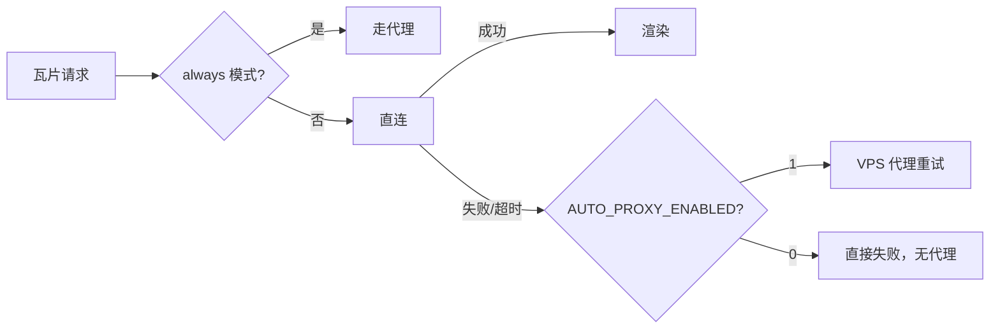

# 2026-11-28 关闭网络波动触发的自动代理（V3.7.39）

- **日期与时间**：2026-11-28 15:18 – 15:22（CST）
- **任务等级**：L2（运行时配置 + 双引擎链路门控）
- **本次版本**：V3.7.39（V3.7.38 已被并发会话占用）
- **任务来源**：用户指令：把 VPS 检测超时自动代理的逻辑增加开关并关闭；瓦片系统定义已完整，网络波动容易误触发后台自动代理。

## 问题分析

OL `tileLifecycle.ts` 与 Cesium `basemapProviderFactory.ts` 在 `VITE_TILE_PROXY_MODE=fallback` 下，直连超时/失败后会自动重试 `TILE_PROXY_BASE_URL`（`https://vpn.negiao.cn`）的 `/proxy/{URL}`。当前瓦片定义层已完整声明 `correction` 与 `proxy:'proxy'`，隐式兜底已无必要，且网络抖动会误触发，造成非预期代理请求与提示。

## 修改内容

### 1. 新配置

`frontend/src/config/publicRuntime.ts` 新增：

```
VITE_TILE_AUTO_PROXY_ENABLED  1=开启 / 0=关闭，缺省 0
export const TILE_AUTO_PROXY_ENABLED: boolean = ... === '1';
```

### 2. 双引擎门控

| 文件 | 分支 | 行为 |
| :--- | :--- | :--- |
| `ol/tile-source/tileLifecycle.ts` | `fetchTileAsBlobUrl()` fallback 段 | 直连失败后，仅当开关开启才走 VPS 代理；OSM 德国镜像仍先尝试 |
| `cesium/constants/basemapProviderFactory.ts` | `wrapProviderWithFetchFallback()` fallback 段 | 同上；OSM 德国镜像仍保留 |

**不受影响**：
- `VITE_TILE_PROXY_MODE=always`：显式全量代理继续生效；
- 定义层 `correction` / `proxy:'proxy'`：属于源定义契约，继续按 SSOT 走 VPS；
- OSM 德国社区镜像：不是 VPS 代理，保留；
- `buildRequestProxyUrl()`（点查 JSON 等非瓦片请求）：不在本次范围内。

### 3. 配置与文档

- `deploy/.env`、`deploy/.env.example`、`frontend/README.md`、`Docs/Guide/configuration.md`（两处）补 `VITE_TILE_AUTO_PROXY_ENABLED=0`。
- `Docs/Architecture/basemap-source-system.md` 代理模式表补独立开关说明。
- README / CHANGELOG V3.7.39；本日志。

## 修改原因

消除网络波动导致的隐式代理切换，让代理行为完全由「显式模式」与「定义声明」驱动，符合当前定义层已完整的现状。

## 影响范围

仅 fallback 自动代理链路；不删代码、不改 URL 契约。默认关闭后，直连失败的瓦片直接报错/空白，不再自动重试 VPS；需要恢复旧行为时设 `VITE_TILE_AUTO_PROXY_ENABLED=1` 即可。

## 解决方案



## 测试方案

- Agent：`vue-tsc` 0 错误；basemap-catalog / layer-definitions / 结构树 / 配置登记 / 跨域依赖全绿。
- 用户：制造短暂网络抖动或访问直连失败的第三方瓦片，确认不再出现「已自动切换至后端代理」toast 与 `/proxy/` 请求；将开关设为 `1` 后旧行为恢复。

## 变更文件清单

- `frontend/src/config/publicRuntime.ts`——新开关常量与注释
- `frontend/src/domains/ol/tile-source/tileLifecycle.ts`——fallback 分支门控
- `frontend/src/domains/cesium/constants/basemapProviderFactory.ts`——fallback 分支门控
- `deploy/.env` / `deploy/.env.example` / `frontend/README.md` / `Docs/Guide/configuration.md`——默认值
- `Docs/Architecture/basemap-source-system.md`——代理模式说明
- `README.md` / `Docs/Guide/CHANGELOG.md`——V3.7.39
- 本日志
