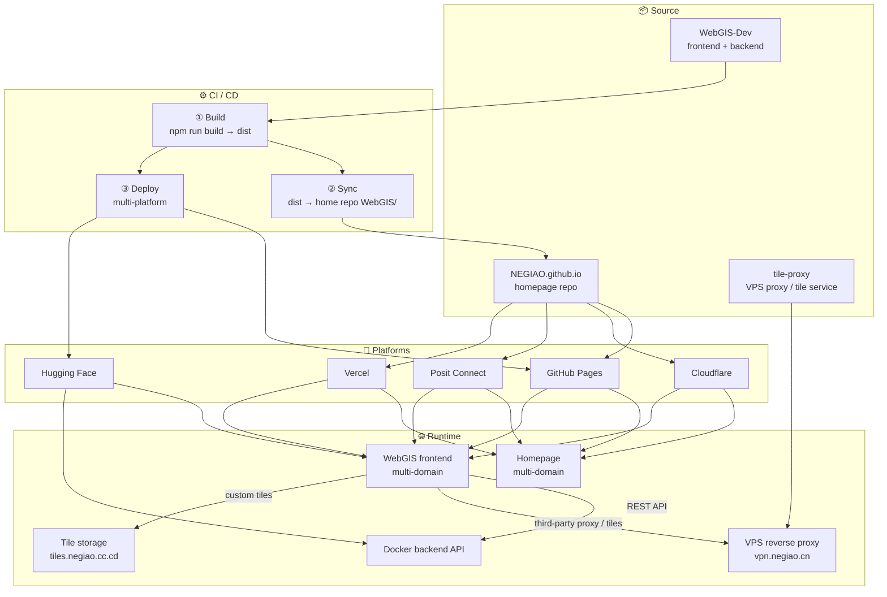

<p align="center">
  <a href="../README.md">🇨🇳 中文</a> | <a href="./README_EN.md">🇬🇧 English</a>
</p>

<h1 align="center">NEGIAO's WebGIS</h1>

<p align="center">
  <em>Professional Full-Stack WebGIS Platform · Vue 3 + OpenLayers + Cesium + FastAPI</em>
</p>

<p align="center">
  <a href="https://vuejs.org/"></a>
  <a href="https://vite.dev/"></a>
  <a href="https://openlayers.org/"></a>
  <a href="https://cesium.com/"></a>
  <a href="https://fastapi.tiangolo.com/"></a>
  <a href="https://rapier.rs/"></a>
  <a href="https://pages.github.com/"></a>
  <a href="https://www.docker.com/"></a>
  <a href="https://huggingface.co/"></a>
  <a href="#-license"></a>
</p>

<p align="center">
  🚀 <strong>Live Demo</strong>: <a href="https://webgis.negiao.cn">NEGIAO's WebGIS-Dev — Click to Explore</a>
</p>

<p align="center">
  
  
  
  
  <a href="https://github.com/NEGIAO/WebGIS-Dev/stargazers"></a>
  <a href="https://github.com/NEGIAO/WebGIS-Dev/forks"></a>
</p>

---

## 🌟 Core Features Preview

<div align="center">

| **🗺️ Basemap Swipe Comparison** | **🧭 Fengshui Compass** |
| :---: | :---: |
| <a href="https://github.com/user-attachments/assets/c8cb6f16-04e0-4b9a-983f-22538e0bd65a"></a> | <a href="https://github.com/user-attachments/assets/acbb5a56-bff7-44c3-848b-dbe178c52301"></a> |
| **📐 2D Data Management** | **☁️ 3D Roaming & Cloudscape** |
| <a href="https://github.com/user-attachments/assets/91322c8a-bff5-4fcc-b0d4-fdf3924970ff"></a> | <a href="https://github.com/user-attachments/assets/7bedba67-d965-4640-ac32-f5d75630e434"></a> |
| **🤖 AI Assistant Interaction** | **🌊 Dynamic Flood Analysis** |
| <a href="https://github.com/user-attachments/assets/2dbbb794-ef3e-4d7a-b16b-4f381053fec3"></a> | <a href="https://github.com/user-attachments/assets/e26761db-8f91-4f05-90f2-106b28223ab5"></a> |

</div>

---

## 📑 Table of Contents

- [🌟 Core Features Preview](#-core-features-preview)
- [📑 Table of Contents](#-table-of-contents)
- [🎯 Project Overview](#-project-overview)
  - [Scale at a Glance](#scale-at-a-glance)
  - [Capabilities · Map Core](#capabilities--map-core)
  - [Capabilities · 3D & Analysis](#capabilities--3d--analysis)
  - [Capabilities · Data & Collaboration](#capabilities--data--collaboration)
  - [Capabilities · Accounts & Operations](#capabilities--accounts--operations)
- [🧰 Module Map](#-module-map)
- [🛠️ Tech Stack](#️-tech-stack)
- [⚠️ Building Data Scraping — Compliance Notice](#️-building-data-scraping--compliance-notice)
- [🚀 Quick Start](#-quick-start)
  - [Prerequisites](#prerequisites)
  - [Configuration (Dual env File Architecture, Read This First)](#configuration-dual-env-file-architecture-read-this-first)
  - [One-Click Launch (Recommended)](#one-click-launch-recommended)
  - [Manual Launch (Advanced Users)](#manual-launch-advanced-users)
  - [Local Development Image](#local-development-image)
- [📁 Project Structure](#-project-structure)
- [🏗️ System Architecture](#️-system-architecture)
  - [Layered Architecture Overview](#layered-architecture-overview)
  - [Backend API Surface](#backend-api-surface)
  - [Domain Mapping](#domain-mapping)
- [🧭 Documentation Navigation](#-documentation-navigation)
- [🚧 Known Limitations & Current Status](#-known-limitations--current-status)
- [Star History](#star-history)
- [📜 Version History](#-version-history)
- [📄 License](#-license)
- [👤 Author & Hosting](#-author--hosting)

---

## 🎯 Project Overview

**NEGIAO's WebGIS** is a full-featured, cleanly architected full-stack WebGIS platform. The frontend is hosted on GitHub Pages (production domain `webgis.negiao.cn`), the backend runs in Docker on Hugging Face Spaces, and the two communicate through RESTful APIs with support for independent scaling.

> 📚 This README keeps only the core overview and navigation. Full documentation is modularized under [`Docs/Guide/`](Guide/).
>
> 📐 Architecture docs live in [`Docs/Architecture/`](Architecture/), using Mermaid flowcharts / sequence diagrams / state diagrams to describe module relationships, data flow, and file interactions of each subsystem — for technical handover and design review.
>
> 🤖 Working on this repo with an AI agent? Read [`Docs/Force_command.md`](Force_command.md) first — the mandatory agent policy with red lines and quality gates.
>
> Want a quick orientation? Try [DeepWiki — ask an LLM about this project](https://deepwiki.com/NEGIAO/WebGIS-Dev) [](https://deepwiki.com/NEGIAO/WebGIS-Dev)

### Scale at a Glance

| Dimension | Measured scale |
|---|---|
| Frontend | 511 source files / ~185k lines (`.vue` / `.js` / `.ts`), 70 Vue SFCs |
| Backend | 70 Python files / ~21.5k lines, 15 REST router groups |
| Docs | 548 Markdown files under `Docs/` (13 in `Guide/`, 21 in `Architecture/`, plus per-session records in `LLM_record/`) |
| i18n | `zh-CN` / `en-US`, 2000+ lines each, 27 namespaces |
| CI | 4 workflows (`deploy` / `pre-check` / `codeql` / `traffic-counter`); `deploy` contains 5 jobs |

### Capabilities · Map Core

| Area | Description |
|------|------|
| 🗺️ 2D/3D dual engine | OpenLayers 10.5 + Cesium 1.132, one-click switch, bidirectional view sync, shareable URL state |
| 🌐 Rich basemaps | **90 presets / 96 layer definitions**: Tianditu, Amap, Tencent, ESRI (incl. Wayback historical imagery), Sentinel-2 Cloudless, Ovi and more; circuit-breaker fallback, GCJ-02/BD-09 rectification, custom XYZ |
| 🧭 Layer management (TOC) | Drag-and-drop ordering, inline rename, visibility/opacity/style, stacking order, coordinate conversion (WGS-84 ⇄ GCJ-02), per-layer export (CSV/TXT/GeoJSON/KML), 2D → 3D import |
| 📊 Attribute table | View-extent filtering, field visibility, full-field search, CSV export, feature locate & delete |
| ✏️ Drawing & measurement | 9 draw types (point / line / polygon / rectangle / ellipse / circle / arrow / wind arrow / military arrow), distance & area measurement, cross-layer vertex editing |
| 🔍 Place search | Three providers: Tianditu / Amap / Nominatim, POI ID, paging, origin-destination picking |
| 🗂️ Administrative divisions | Drill-down tree, boundary loading, shares coordinate conversion and export with the layer system |
| 🎞️ Historical imagery | ESRI Wayback catalog (backend SQLite cache + frontend version browsing) |
| 🌓 Swipe comparison | Any two basemaps, horizontal or vertical slider |

### Capabilities · 3D & Analysis

| Area | Description |
|------|------|
| 📥 Multi-format import | GeoJSON / JSON / KML / KMZ / SHP (zip or loose parts) / CZML / GLB / GLTF / 3D Tiles (zip) / GeoTIFF / CSV / GPX; dual 2D/3D pipelines, ZIP grouping, `.prj` projection detection, retryable inline errors |
| 🏢 Building footprint scraping | **Tencent Maps / Amap / Tianditu** vector tiles: Tencent and Amap scrape building footprints and heights at CE level, Tianditu supports **full parsing of 12 layer types**; one decoding/assembly pipeline behind all three, so lifting the layer filter extends full parsing to Tencent and Amap; cross-tile identity merge, auto-registered into TOC |
| 📐 Spatial analysis | **8 operations**: buffer, overlay, Voronoi, hotspot aggregation, fishnet (square/hexagon), convex hull, multi-ring buffer, simplify (exact computation with Shapely) |
| 🔬 3D analysis | Height-limit analysis, viewshed analysis (`cesium/modules/analysis`) |
| ✨ 3D effects | Volumetric cloud ray marching, Bruneton atmosphere, BSM cloud shadows, wind particles, fluid flood simulation, shallow-water overlay, post-processing (HBAO / tilt-shift / fog) |
| 🛩️ Planar route planning | Survey-area drawing, boustrophedon / five-direction oblique capture, AGL terrain following, DJI KMZ import/export |
| 🚶 Player roaming | Migrated from `hh-hang/cesium-player-controller` and kept in sync with upstream (0.2.1): Rapier physics, local-frame rebasing, ground snapping, first/third person |
| 🛣️ Route planning | Tianditu driving / transit pipelines, place picking and route rendering |
| 🎬 First-person flight | `route-fly`: first-person flight along a planned route with speed/view control |

### Capabilities · Data & Collaboration

| Area | Description |
|------|------|
| 🤖 AI assistant | LLM integration with **three access modes** (admin default key / personal key / backend proxy); function-calling tools (camera, zoom, basemap switch…) plus OL/Cesium command adapters for multi-step map operations |
| 🧭 Fengshui compass | Compass overlay, site-seeking, bearing display |
| 🌤️ Weather board | Live weather and charts via public sources behind a backend proxy |
| 🗞️ News aggregation | Multi-platform trending lists, direct + proxy racing, silent refresh with local cache fallback |
| 📢 Announcements | Admin-published notices, dismissible persistent bar |
| 🎨 Theming | Design-token driven themes (green / blue …), dark/light and mobile adaptations |

### Capabilities · Accounts & Operations

| Area | Description |
|------|------|
| 🔐 Accounts | Email sign-up/sign-in, Google / GitHub OAuth with binding, **three roles** (`guest` / `registered` / `admin`), guest sequence `guest_no`, session auth, dual AI quotas |
| 🛡️ Admin console | Runtime config (map tokens, basemaps, agent params, announcements), API key management, visit statistics, online-user debugging |
| 📈 Stats & monitoring | Visit logs, UV/PV, real-time presence (heartbeat + offline), SSE log streaming, `/statistics/*` dashboards |
| 🧰 Utilities | Screen effects (fluid smoke / gravity / dimension collapse / quantum wave / black hole / ring blast), distance & area, coordinate picking, view sharing, quick locations |

---

## 🧰 Module Map

Modules by engine domain, for fast code navigation:

**Cesium tool panel (`cesium/composables/toolModules/`)**

`Scene navigation` · `Atmosphere·Lighting·Sky` · `Volumetric cloud` · `Wind field` · `Fluid flood` · `Shallow water` · `Player roaming` · `Planar route` · `Route flight` · `3D analysis (height limit / viewshed)`

**OpenLayers tools (`ol/`)**

`drawing` · `spatial-analysis` · `routing` · `search` · `basemap` · `tile-source` · `DistrictManager` · `url-state` · `startup`

**Shared domain (`common/`)**

`shell (SidePanel / TopBar / announcement / global loading)` · `layer-tree` · `data-import` · `chat (agent / tool registry / command bus)` · `compass` · `weather` · `user` · `command-bus` · `map-view` · `data-protocol` · `ui`

**Side panel tabs**: `Info` / `Toolbox` / `Driving` / `Transit` / `Compass` / `Building scraping` / `Weather` / `News` / `AI assistant` — lazy-loaded on first use, kept mounted afterwards to preserve state.

---

## 🛠️ Tech Stack

| Layer | Choice |
|---|---|
| Frontend | Vue 3.5 (Composition API) + Vite 6.2 + Pinia 2.3 + Vue Router 4.6 |
| 2D map | OpenLayers 10.5 |
| 3D map | Cesium 1.132 (`@cesium/engine`) + Three.js 0.185 (effect helpers) |
| Physics | `@dimforge/rapier3d-compat` 0.14 (roaming rigid bodies and collision) |
| Backend | FastAPI ≥0.100 (Python 3.12), Shapely ≥2.0, SQLite caching, SSE log streams |
| Deployment | GitHub Pages / Cloudflare Pages / Posit Connect / Vercel (frontend); Hugging Face Docker (backend) |
| Quality | ESLint, `vue/compiler-sfc` compile check, `tsc --noEmit`, structure-tree & config-registry self-checks, CodeQL |

---

## ⚠️ Building Data Scraping — Compliance Notice

### Data Sources

All three sources are publicly accessible vector tile services, operated by commercial platforms and a government agency:

| UI label | Real source | Coverage in this project |
|---|---|---|
| Tencent | **Tencent Maps** (Tencent Location Service) | **Only** building-level (CE) fetch & parsing |
| Amap | **Amap** (Amap Open Platform) | **Only** building-level (CE) fetch & parsing |
| Tianditu | **Tianditu** (National Platform for Common Geospatial Information Services) | **Full parsing**, 12 selectable layers |

Tencent, Amap and Tianditu share the same tile-decoding and geometry-assembly pipeline; only layer filtering and credential policy differ.
**The frontend implements building-level (CE) scraping for Tencent and Amap, and full parsing for Tianditu only.**
Lifting the layer filter on the same parser extends full parsing to Tencent and Amap — one of the reasons this project is open source.

> The UI labels were previously anonymized as "Building-1 / Building-2 / Vector tiles" for compliance reasons; they now show the real sources. Historical logs keep the original anonymization rationale.

- Use the building-scraping capability only where you hold official authorization;
- Bypassing permissions, circumventing access controls, cracking, or any other unauthorized technique is strictly prohibited;
- Bulk collection, offline database creation, redistribution, or unauthorized commercial use is strictly prohibited;
- You must comply with the data source's terms of service, local laws, and platform policies;
- The project ships range/rate controls and a frontend compliance prompt, but the ultimate responsibility remains yours.

---

## 🚀 Quick Start

### Prerequisites

| Dependency | Requirement | Notes |
|------|------|------|
| **Node.js** | **20 LTS or newer** (20.x / 22.x recommended) | Vite 6 needs Node 18+; this project is validated on 20 LTS. No `engines` field is declared |
| npm | 10+ | Ships with Node 20 |
| Docker Desktop | Only for full-stack local runs | Running the frontend alone (`npm run dev`) does **not** need Docker |
| Python | 3.12 (pinned in the image as `python:3.12-slim`) | The backend runs via Docker only; bare `uvicorn` is unsupported |
| LocalDev.bat | Windows one-click script | Detects the dependencies above |

### Configuration (Dual env File Architecture, Read This First)

| File | Git status | Purpose | Read at | `APP_ENV` |
|------|----------|------|----------|-----------|
| **`deploy/.env`** | **tracked** | Deployment (production baseline) | `npm run build` + production deploy | `production` |
| **`deploy/.env.local`** | **tracked** | Local development (overrides `.env`) | `npm run dev` + local backend | `development` |
| `deploy/.env.example` | tracked | Full key catalog (no real values) | — | — |

**Three-tier secret layering** (L1 / L2 / L3):

| Tier | Where | What |
|----|--------|--------|
| **L1** | `deploy/.env` / `.env.local` (non-sensitive) | URLs, ports, frontend `VITE_*`, public endpoints and timeouts |
| **L2** | Admin console + database | Map tokens, Agent/LLM keys and params, basemaps, announcements (change often, effective at runtime) |
| **L3** | Hugging Face **Secrets** | Strictly secret: `SUPER_USER`, OAuth secrets, SMTP password, Supabase keys, monitoring tokens |

```bash
# Repository root: .env (deployment) and .env.local (local development)
# Both are committed (L1 holds no secrets)
# Local dev: Vite reads .env.local, backend reads .env.local (production values overridden with localhost)
# Production build: Vite reads only .env (selectiveEnvPlugin chooses by mode)
```

> Proxy note: the backend runs on Hugging Face, whose policy **forbids mounting any `/proxy/*` or `/tiles/*` relay**. Tile proxying and third-party reverse proxying are served by a standalone VPS service (`vpn.negiao.cn`, repo `tile-proxy`); the frontend builds `${base}/proxy/<host>/<path>` from `VITE_TILE_PROXY_BASE_URL`.

### One-Click Launch (Recommended)

```bash
# Windows: double-click LocalDev.bat, which automatically:
# 1. Detects dependencies (Node.js / Docker / docker compose)
# 2. Local dev: frontend Vite reads .env.local, backend load.py reads .env.local (localhost overrides)
# 3. Smart Docker image state detection (first build / hot reload / Dockerfile change prompt)
# 4. Starts the frontend dev server → http://localhost:5173
# 5. Opens the browser
```

> `LocalDev.bat` is pure ASCII for GBK/UTF-8 compatibility; colored Chinese output comes from `Write-Color.ps1` in the same directory.

**Endpoints**: frontend http://localhost:5173 · backend API docs http://localhost:7860/docs

> **Default local admin**: `admin` / `123456`. Only effective when `SUPER_USER` is unset and `APP_ENV` is `development` / `dev` / `local` / `test` (`load.py` → `get_admin_password()`). In production you must configure `SUPER_USER` via HF Secrets, otherwise admin login is disabled outright.

### Manual Launch (Advanced Users)

<details>
<summary><strong>Frontend dev server</strong></summary>

```bash
cd frontend
npm install
npm run dev
# → http://localhost:5173
```

</details>

<details>
<summary><strong>Full stack, single container (recommended)</strong></summary>

```bash
# nginx (static frontend + /api reverse proxy) + FastAPI in one container, port 7860
docker compose -f deploy/docker-compose.yml up -d --build

# Subsequent runs
docker compose -f deploy/docker-compose.yml up -d
# → http://localhost:7860/docs
```

> Env files are centralized under `deploy/` (`.env` / `.env.local`); running `uvicorn` directly is no longer supported.

</details>

<details>
<summary><strong>Dual-track production deployment</strong></summary>

```bash
# Static frontend track: handled by GitHub Actions (Pages / home repo / HF Static), nothing local
# Full-stack track: on push to main, CI assembles {Dockerfile, deploy/, backend/, frontend/}
#                   and pushes to the Hugging Face Space, which runs npm ci + vite build + uv sync

# Local equivalent: build the single-container image (nginx + FastAPI, port 7860)
docker build -t negiao/webgis -f deploy/Dockerfile .
docker run -p 7860:7860 negiao/webgis
```

</details>

### Local Development Image

```bash
docker pull negiao/webgis_dev:V3.5
```

> ⚠️ That image was built on **2026-08-03** for frontend **V3.5.10**, so it lags the current code (V3.6.31). It shares its source with `deploy/docker-compose.yml` (built from `deploy/Dockerfile`); run `--build` locally if you need parity with the source.

## 📁 Project Structure

Directory trees are maintained under [`Docs/Guide/`](Guide/):

- [Root-level overview + Docs tree](Guide/project-structure.md)
- [Full frontend tree `frontend/src/`](Guide/frontend-structure.md)
- [Full backend tree `backend/`](Guide/backend-structure.md)

---

## 🏗️ System Architecture

> Full architecture docs are modularized under [`Docs/Architecture/`](Architecture/):
> [System overview](Architecture/system-architecture.md) · [CI/CD pipeline](Architecture/cicd-pipeline.md) · [Deployment & domain mapping](Architecture/deployment-relationship.md)

### Layered Architecture Overview



### Backend API Surface

15 router groups, all under `/api/*` (Hugging Face forbids `/proxy/*` and `/tiles/*`):

| Module | Prefix | Contents |
|---|---|---|
| Auth | `/api/auth` | Email sign-up/sign-in, OAuth callback, session, guest login (`guest_no`), quotas |
| Spatial analysis | `/api/v1/spatial` | Single endpoint dispatching the 8 operations |
| Location | `/api/v1` | Reverse geocoding, IP geolocation |
| AI chat | `/api/agent` | Sessions, messages, default model/key allocation |
| AI admin | `/api/admin/agent` | Model and quota management |
| External proxy | `/api/proxy` | Four whitelisted groups only: `amap/*`, `search/nominatim`, `geo/epsg`, `ipapi/country` |
| Historical imagery | `/api/historical-imagery` | ESRI Wayback layer catalog |
| Statistics | `/api/statistics/*`, `/api/log-visit` | Visit logs, dashboards, realtime stats, messages, users, visit events |
| Realtime | `/api/statistics` | SSE stream, heartbeat, presence (ping / offline), tickets |
| Announcements | `/api/announcement/*` | Current announcement, dismissal records |
| Admin | `/api/admin` | Runtime config, download TTL, dashboards |
| API management | `/api/admin`, `/api/admin/api-keys` | Third-party key pools and allocation |
| Runtime config | `/api/runtime-config` | Public runtime config for the frontend (incl. `features` flags) |
| Monitoring | `/api/monitor/*` | Health, log stream (SSE) |
| Webhook | `/api` | HF Hub and similar callbacks |

### Domain Mapping

**Homepage:**

| Domain | Platform | CDN | Reachable from CN |
|------|------|-----|----------|
| `negiao.github.io` | GitHub Pages default | ❌ | ⚠️ unstable |
| `negiao.cloud-ip.cc` | GitHub Pages + custom domain | ✅ configurable | ✅ |
| `negiao.cc.cd` | Cloudflare Pages | ✅ Cloudflare | ❌ blocked |
| `negiao.pages.dev` | Cloudflare Pages default | ✅ Cloudflare | ✅ |
| `negiao-pages.share.connect.posit.cloud` | Posit Connect | ❌ | ✅ |
| `negiao.vercel.app` | Vercel | ❌ | ❌ |

**WebGIS frontend:**

| Domain | Platform | Source |
|------|------|------|
| `webgis.negiao.cn` | **Primary (paid)** | CNAME → GitHub Pages |
| `negiao.github.io/WebGIS-Dev` | GitHub Pages | WebGIS-Dev repo root |
| `negiao.github.io/WebGIS` | GitHub Pages | Homepage repo subdirectory |
| `negiao.cloud-ip.cc/WebGIS-Dev` | GitHub Pages + custom domain | auto redirect |
| `webgis.negiao.cc.cd` | Cloudflare Pages | private domain mount |
| `webgis-dev.pages.dev` | Cloudflare Pages default | auto-assigned |
| `negiao-webgis.share.connect.posit.cloud` | Posit Connect | triggered by homepage repo |
| `negiao-web.static.hf.space` | Hugging Face Static | direct push |

**Backend, proxy and storage:**

| Component | Domain | Platform |
|------|------|------|
| Backend API | `negiao-webgis.hf.space` | Hugging Face Docker |
| Reverse proxy / tile proxy | `vpn.negiao.cn` | VPS (standalone repo `tile-proxy`) |
| Tile storage | `tiles.negiao.cc.cd` | Cloudflare R2 |

> Full domain list, deployment source matrix, and platform capability comparison: [deployment-relationship.md](Architecture/deployment-relationship.md)

## 🧭 Documentation Navigation

### Development Docs (`Docs/Guide/`)

| Document | Contents |
|------|------|
| [Handover](Guide/handover.md) | Must-read for maintainers: doc map, architecture tours, code coordinates, gates and pitfalls |
| [Dev conventions](Guide/dev-conventions.md) | Mandatory rules, layering boundaries, coordinate-system conventions, pre-commit checks |
| [Dev & contribution guide](Guide/dev-guide.md) | Standard flows for new pages/APIs, frontend-backend communication, code style |
| [Project structure](Guide/project-structure.md) | Full directory tree and module responsibilities |
| [Frontend structure](Guide/frontend-structure.md) / [Backend structure](Guide/backend-structure.md) | File-level trees |
| [Configuration](Guide/configuration.md) | Three-tier config (deploy .env / Admin+DB / HF Secrets) |
| [Configuration architecture plan](Guide/configuration-architecture-plan.md) | Staged consolidation roadmap |
| [OAuth deployment](Guide/oauth-deployment.md) | Google/GitHub login end to end |
| [Tech stack & FAQ](Guide/faq.md) | Stacks, references, FAQ, TODO |
| [ESRI Wayback layers](Guide/ESRI_Wayback_Layers_List.md) | Historical imagery version catalog |
| [Compass type notes](Guide/compass-types-note.md) | Compass geometry and type definitions |
| [CHANGELOG](Guide/CHANGELOG.md) | Full version history |

### Architecture Docs (`Docs/Architecture/`)

**System-level**

| Document | One-liner |
|------|-----------|
| [System architecture](Architecture/system-architecture.md) | Five layers: source → CI/CD → deployment → runtime → user |
| [CI/CD pipeline](Architecture/cicd-pipeline.md) | Five-job pipeline: Build → Sync → Multi-Deploy |
| [Deployment & domains](Architecture/deployment-relationship.md) | Domain list, deployment matrix, platform comparison |
| [Three-tier configuration](Architecture/configuration-three-tier.md) | L1/L2/L3 end to end |

**Feature-level**

| Feature | Document |
|------|------|
| 2D/3D dual engine | [`ol-cesium-dual-engine.md`](Architecture/ol-cesium-dual-engine.md) |
| Basemap source system | [`basemap-source-system.md`](Architecture/basemap-source-system.md) |
| Basemap single-source-of-truth refactor | [`2026-08-02-basemap-ssot-refactor.md`](Architecture/2026-08-02-basemap-ssot-refactor.md) |
| Unified basemap selection | [`2026-08-20-unified-basemap-selection.md`](Architecture/2026-08-20-unified-basemap-selection.md) |
| Multi-format data import | [`multi-format-data-import.md`](Architecture/multi-format-data-import.md) |
| Spatial analysis backend | [`spatial-analysis-backend.md`](Architecture/spatial-analysis-backend.md) |
| Route planning | [`route-planning.md`](Architecture/route-planning.md) |
| 3D effects | [`cesium-3d-effects.md`](Architecture/cesium-3d-effects.md) |
| Flood simulation | [`cesium-fluid-flood-simulation.md`](Architecture/cesium-fluid-flood-simulation.md) |
| Planar route | [`cesium-planar-route.md`](Architecture/cesium-planar-route.md) |
| Clamp-to-ground strategy | [`2026-08-22-clamp-to-ground-strategy.md`](Architecture/2026-08-22-clamp-to-ground-strategy.md) |
| Cesium unified layer management | [`cesium-unified-layer-management.md`](Architecture/cesium-unified-layer-management.md) |
| Utility tools | [`utility-tools.md`](Architecture/utility-tools.md) |
| Accounts & AI quota | [`account-system-ai-quota.md`](Architecture/account-system-ai-quota.md) |
| Runtime map-token pool | [`runtime-map-token-pool.md`](Architecture/runtime-map-token-pool.md) |
| Building import plan | [`tencent-building-import-plan.md`](Architecture/tencent-building-import-plan.md) |
| Tile rectification (historical; moved out) | [`tile-rectify-system.md`](Architecture/tile-rectify-system.md) |

**Other**: `Docs/Force_command.md` (agent policy) · `Docs/TODO/` (20+ proposals) · `Docs/LLM_record/` (per-session records) · `Docs/Demo/` (standalone effect demos) · `Docs/Refactor.md`

---

## 🚧 Known Limitations & Current Status

Listed plainly so the README does not overpromise:

| Item | Status | Notes |
|---|---|---|
| **Online basemap export (GeoTIFF)** | ⚠️ **frontend kept, backend removed** | `MapDownloader.vue` calls `/api/download/*`, removed in V3.6.5; HF returns 404. See `Docs/TODO/plan-download-*` |
| **Tile rectification (BD-09/GCJ-02 resampling)** | ⚠️ **moved out of this repo** | Now a standalone service; `tile-rectify-system.md` is a historical design doc |
| **News platform `cls`** | ⚠️ upstream returns 504 | That tab renders empty; the other 21 platforms work |
| **Direct access to news / tiles from CN** | ⚠️ intermittently unreachable | The `vpn.negiao.cn` proxy is the de-facto main channel |
| **`frontend/package.json` version** | ⚠️ unmaintained | Still `2.0.0`; the real version lives in README / CHANGELOG |
| **Unit tests** | ❌ none yet | Gates are ESLint + SFC compile + `tsc --noEmit` + structure/config self-checks |
| **`engines` field** | ❌ undeclared | Node version is convention (20 LTS) only |

---

## Star History

<a href="https://www.star-history.com/?repos=NEGIAO%2FWebGIS-Dev&type=timeline&legend=top-left">
 <picture>
   <source media="(prefers-color-scheme: dark)" srcset="https://api.star-history.com/chart?repos=NEGIAO/WebGIS-Dev&type=timeline&theme=dark&legend=top-left&sealed_token=B5ReoH7FL9EMbjs7rJJ3APlIoYZwGKo3g2gC_4_0LxIrQ--e5uhUrYXR7UEBcnb3CU48BAX9--IyzI-TxTszy8HrMJ3oVSVvfowMjrMOxY8n477EUd4_Ip6F8EMaHsKX6H5b1JjudmBoRUn3HxJ1R6zxt3lO1CKGidFnlqFb2W_TXYy_sTk3AS3rn8v8" />
   <source media="(prefers-color-scheme: light)" srcset="https://api.star-history.com/chart?repos=NEGIAO/WebGIS-Dev&type=timeline&legend=top-left&sealed_token=B5ReoH7FL9EMbjs7rJJ3APlIoYZwGKo3g2gC_4_0LxIrQ--e5uhUrYXR7UEBcnb3CU48BAX9--IyzI-TxTszy8HrMJ3oVSVvfowMjrMOxY8n477EUd4_Ip6F8EMaHsKX6H5b1JjudmBoRUn3HxJ1R6zxt3lO1CKGidFnlqFb2W_TXYy_sTk3AS3rn8v8" />
   
 </picture>
</a>

## 📜 Version History

> Full history in [`CHANGELOG.md`](Guide/CHANGELOG.md); only recent releases are summarized here.

| Version | Date | Summary |
|------|------|------|
| **V3.6.31** | 2026-10-29 | **Arbitrary projected CRS on import (manual declaration + corrected inference + no silent fallback + post-import redeclare).** A "Source CRS" selector in the upload area (auto / WGS 84 / CGCS2000 / Web Mercator / CGCS2000 3-degree zones / UTM zones 43-53 / custom EPSG or `+proj=`) feeds both 2D and 3D pipelines and outranks `.prj`, KML `srsName` and GeoJSON `crs`. Magnitude inference rewritten into three disjoint bands (degrees / unzoned planar → ambiguous / Mercator), so planar data is no longer silently read as Web Mercator; a SHP without `.prj` that looks planar now fails with an actionable error instead of guessing. `crsPresets.ts` generates CGCS2000 3/6-degree zone and 120 UTM definitions locally (offline-capable, verified against epsg.io). 3D reprojects before `GeoJsonDataSource.load` and strips the `crs` member, with backend fallback for arbitrary EPSG. Per-feature degradation counts dropped features. Layers can be **re-declared after import** from the retained pre-reprojection geometry — in 2D for every vector type, in 3D for GeoJSON. Also restores real data-source attribution (Tencent / Amap / Tianditu) and fixes SHP sidecar grouping (NFC + case normalisation). |
| **V3.6.30** | 2026-10-28 | **51.la site-wide visitor metrics + dependency and badge calibration.** New `visitorStats.ts` pure-function layer (8 s timeout, silent failure, stateless) surfaces third-party UV/PV in the landing footer and account overview; consumes the Worker's new `updatedAt` and labels "data updated at" in three places, documenting the 5-minute edge-cache lag. README badges and tech-stack table recalibrated against `package-lock.json` (Vite 8.3 / OpenLayers 10.11 / Cesium 1.146 / Rapier 0.21 / Pinia 4.1 / Vue Router 5.4 / Three 0.186) plus the Vite 8 Node engine requirement; badge layout regrouped. |
| **V3.6.29** | 2026-10-27 | **Auth-page decoration rebuilt (dual-track three-ring + wireframe globe + meteors) + build-warning cleanup.** `AuthDecorBackground` carries eight decoration layers, with the ring-pattern injection extracted into `useRingPatternStyle` shared by landing and auth pages; `AuthGlobeStage` fakes a sphere from three `rx`-decreasing rotating ellipses plus two latitude lines on opposite slow swings, conic sweep light, differential orbits and nine meteors. Build warnings cleared by fixing `:deep` inside a non-scoped block, making `CesiumContainer` a static import and switching `envFile` to `envDir`; solid-ring rotation invisibility swept by switching middle/core rings to `dashed`/`dotted`. |

Earlier versions (V3.6.28 and before): [full CHANGELOG →](Guide/CHANGELOG.md).

---

## 📄 License

[MIT License](../LICENSE) — free to use, modify, and distribute.

> **Notification**: if you run or deploy this project (or a derivative) in any public setting — a website, server, paper, exhibition, etc. — a short note to yaonaigao@gmail.com or a GitHub issue is appreciated.

---

## 👤 Author & Hosting

<div align="center">

**NEGIAO** — [GitHub](https://github.com/NEGIAO) · [Homepage](https://www.negiao.cn) · [DeepWiki analysis](https://deepwiki.com/NEGIAO/WebGIS-Dev)

| Source | Frontend | Backend |
|:------:|:--------:|:-------:|
| [GitHub](https://github.com/NEGIAO/WebGIS-Dev) | [webgis.negiao.cn](https://webgis.negiao.cn) (primary, GitHub Pages) | [Hugging Face](https://NEGIAO-WebGIS.hf.space) |

<sub>V3.6.31 · in development · README synced 2026-10-29</sub>

</div>
