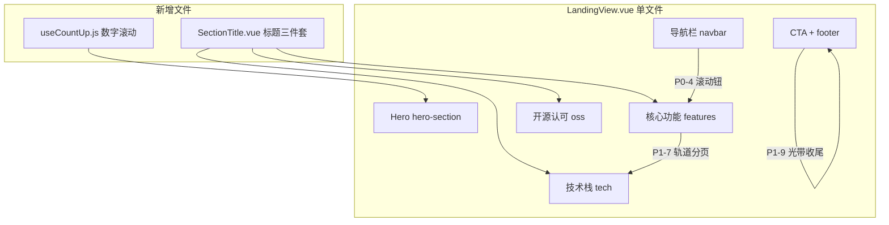

# L3 方案：南师大 14 条借鉴清单全量落地 LandingView

> **任务等级**：L3 架构级（跨模板/样式/脚本/i18n + 新增 2 文件，须批准后施工）
> **现状基线**：V3.6.21（2026-10-17）· LandingView.vue 约 2930 行单文件
> **已有雏形 5 条**：数字滚动（HERO_STATS+IO）/ 三栏入场（features-reveal+IO）/ scrollspy（anchorObserver）/ 背景解耦（hero-bg 独立层）/ 光晕（sun/rings/blob）
> **用户决策**：全量实施 14 条（含已有 5 条重构升级）
>
> **⚠️ 2026-10-17 归并补记**：同日多批次暂存已归并统一记档为 **V3.6.20**（原拟的 V3.6.21 版本号未独立发布）。本方案的大部分条目已随归并落地（SectionTitle 三件套 / 数字滚动内联实现 / 三环轨道纹样 / 技术栈三层卡 / 移动端全屏菜单 / 轨道导航 / 页脚光带 / 滚动条定制等，见 CHANGELOG V3.6.20 第九节）；计划中的独立 `useCountUp.js` 文件改为 LandingView 内联实现（rollStatsToFinal）。本文档保留为方案存档，「待批准」各节已失效。

## 一、目标与非目标

- 目标：LandingView 视觉质感对齐南师大手法（标题三件套/轨道分页/背景解耦/云海收尾），零新增依赖（不用 Swiper/WOW/countUp 库，全部用 IO + CSS 实现）
- 非目标：不动 Hero 双引擎逻辑、不动 GitHub Worker 数据链、不动路由/鉴权、不抽 MapContainer 式大重构

## 二、总体设计（Mermaid）

数据流：SectionTitle 纯展示（props: eyebrow/title/desc/moreLabel/align/watermark）；useCountUp 接管 HERO_STATS 三个数字（70+/8/AI 除外静态）；其余 12 条为纯 CSS/模板增量。

## 三、分批交付（3 批，每批独立可验收）

### 第一批 P0（4 条，约 200 行）
1. **标题三件套**：新增 `frontend/src/app/components/SectionTitle.vue`（props + 水印 SVG 光晕 + 右上 more 箭头漂移），features/tech/oss 三节 `section-head` 替换为该组件；i18n 补 `moreLabel` 中英各 1 键
2. **数字徽**：新增 `frontend/src/app/composables/useCountUp.js`（IO 触发 + rAF 缓动 + reduced-motion 降级），HERO_STATS 套徽形（大数字+小横线+i18n 标签），已有数字滚动逻辑迁移进该文件
3. **Ken Burns 首屏底**：hero-bg 加一层静态底图 div（`images/preview.webp` 复用，`scale(1.15→1.02/6s`），Cesium/首屏就绪后淡出；纯 CSS transition，无 JS 依赖
4. **鼠标滚动钮**：Hero 底部 scroll-hint 升级 72px 圆环 + `conic-gradient` 进度弧（复用现有 scroll 进度），Lucide ChevronDown 内芯，点击 scrollIntoView 到 features

### 第二批 P1（5 条，约 250 行）
5. **导航封边**：navbar 顶部 3px 品牌渐变线（primary→gold），滚动后阴影（复用现有 scroll 监听）
6. **卡片 mask**：特性卡 hover 加底部渐变 + 图片 scale(1.08)，沿用 --brand-primary-rgb 令牌
7. **轨道分页器**：OSS 趋势图/用例轮播圆点做 120px 半圆轨道变体（只用一处，选 OSS 区）
8. **背景解耦层**：features/tech/oss 各加 `.section-bg` 绝对层（径向光斑+网格纹），内容包 inner；换肤只动 bg 层
9. **页脚光带**：footer 顶加双层慢速漂移光带（keyframes translateX(-50%) 循环，品牌绿透明度），纯 CSS

### 第三批 P2（5 条，约 200 行）
10. **全屏菜单覆层**：≤768px 汉堡改全屏深绿覆层 + 大字锚点（复用 NAV_ANCHORS），translateY(-100%→0) 0.35s
11. **for/nav 双联画廊**：用例区大图+缩略图联动（Vue 原生，不引 Swiper，用按钮切换 + thumbs 高亮）
12. **入场动效纪律**：统一各节 fadeInUp 0.8s + 三栏错峰 delay（已有 features-reveal 扩展到 tech/oss），once:true
13. **友链弹层**：页脚链接组 hover 上弹白卡 + 小三角（v-show + transition），二维码走 pop-codes 逻辑
14. **水印底纹**：各节标题底纹 SVG（opacity:.06 居中），与 SectionTitle watermark 合并交付

## 四、文件清单

- 新增 2：`frontend/src/app/components/SectionTitle.vue`、`frontend/src/app/composables/useCountUp.js`
- 修改 2：`frontend/src/app/LandingView.vue`（模板/样式/script）、`frontend/src/locales/core.js`（约 6 键中英）
- 同步 3：`Docs/Guide/frontend-structure.md`（新增 2 文件登记）、README 三处、CHANGELOG
- 日志 1：`Docs/LLM_record/26-10/2026-10-17/2026-10-17-landing-njnu-14-items.md`

## 五、风险与回滚

- 单文件 2930→约 3600 行，增量可控；每批独立 commit 可单独回滚
- reduced-motion / 无 IO 环境全部降级常显（沿用现有守卫模式）
- 图片复用 preview.webp（已在暂存区），无需新资源

## 六、待你批准

- [ ] 范围：全量 14 条分 3 批，同意即按第一批先行
- [ ] 版本策略：每批 +1 修订号（V3.6.22/23/24），还是三批合并 +1（V3.6.22）？
- [ ] SectionTitle 位置：`src/app/components/`（落地页私有）还是 `src/domains/common/`（公共）？
