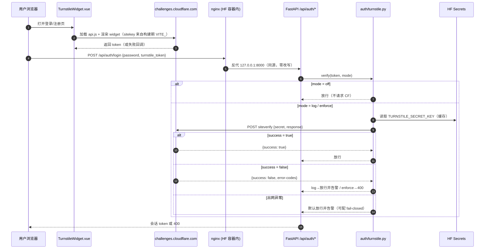

# 登录人机校验（Cloudflare Turnstile）接入方案 · L3

> 起草：2026-10-31 ｜ 状态：**待批准，未实施**
> 前一案例：`vpn.negiao.cn` 已于 2026-10-31 上线 Turnstile（nginx + FastCGI，单人管理后台）。
> **本仓库风险模型与该站完全不同，方案不可照搬**，差异见 §2。

---

## 0. 一句话结论

技术上可行，且**比在 vpn 站更值得做**——本站 `POST /api/auth/login` 目前**没有任何失败次数节流**，`send-code` 只按邮箱限频、不按 IP。

但**不能**用 vpn 那样的全站 fail-closed：本站是公开站点、登录是全站唯一入口、HF Space 出网与国内可达性都未验证。链路抖一下就会把所有人锁在门外。**建议分三档（off / log / enforce）上线，先用 log 观察再收紧。**

---

## 1. 攻击面实况（逐项读码确认，非推测）

| 入口 | 现状 | 风险 |
|---|---|---|
| `POST /api/auth/login`（`routes.py:696`） | 游客分支 `hmac.compare_digest` 比对**前端公开的** `VITE_GUEST_PASSWORD`；管理员分支比对 `SUPER_USER`（单口令）；注册用户比对 PBKDF2 哈希。**全库 grep 无登录失败计数 / 锁定 / 退避** | 管理员单口令可被**无限次在线爆破**；任意注册邮箱同样可无限次试探 |
| `POST /api/auth/send-code`（`routes.py:428`） | `rate_limit_check(email)`（`verification.py:78`）：30 秒/次、单邮箱 10 次/天 | **限频维度是邮箱，不是 IP** → 轮换邮箱即可绕过，直接烧阿里云 SMTP 发送量、向第三方邮箱轰炸 |
| `POST /api/auth/register`（`routes.py:564`） | 依赖邮箱验证码（=需要先付发送成本） | 有成本门槛，但可脚本化批量走通 |
| `POST /api/auth/reset-password`（`routes.py:1146`） | 依赖 `reset_password` 验证码 | 受 send-code 的邮箱级限频间接保护 |
| 游客快捷登录（`RegisterView.vue:868`） | 口令来自 `VITE_GUEST_PASSWORD`，构建期就进了前端产物 | **无保密价值**，加人机校验只增加摩擦、不增加安全 |

**结论**：Turnstile 的高价值落点是 **`login`（非游客）/ `register` / `send-code`**；游客分支应豁免。

---

## 2. 与 vpn.negiao.cn 的差异（这些差异决定了设计）

| 维度 | vpn.negiao.cn | 本站（WebGIS-Dev） |
|---|---|---|
| 站点性质 | 单人管理入口，外界只有一处登录框 | 公开 WebGIS 平台，主要用户是游客/普通注册用户 |
| 锁死代价 | 自己进不去，可 SSH 修 | **全站无人能登录**（登录是唯一入口） |
| 部署形态 | nginx + FastCGI（9001），多服务同机 | HF Space 单容器：nginx 托管前端 + 反代 `/api` 到本机 uvicorn（同源） |
| 服务端出网到 CF | 已实测通（HTTP 415 说明链路正常） | **未验证**。旁证：`deploy/.env.example` 明确记载「HF Space 封锁 587」→ 端口级限制真实存在 |
| 国内可达性 | 同 | 用户主要在国内；`challenges.cloudflare.com` 稳定性未知。本机实测 `api.js` 返回 302 但 `remote_ip=127.0.0.1`（走了本地代理），**不能作为直连证据** |
| 密钥落点 | `/etc/negiao/turnstile.env`（600 root） | HF Secrets（L3，`deploy/.env.example` 留空） |

---

## 3. 候选方案对比

| 方案 | 说明 | 判定 |
|---|---|---|
| A. 仅前端渲染，后端不校验 | 改 3 行就能"看起来有验证码" | ❌ 无效：直接 `curl` 打 `/api/auth/login` 即绕过 |
| B. 全站 fail-closed（照搬 vpn） | 无 token / 校验失败 / 出网异常一律拒绝 | ❌ 否决：锁死风险 > 收益（见 §2） |
| C. 分档模式 + 仅高价值入口强制 | `off / log / enforce`，enforce 下只拦 login(非游客)/register/send-code | ✅ **选定** |
| D. 自建图形验证码 | 无第三方依赖，HF 出网无风险 | 🔶 备选：自研易被 OCR，需维护字体/存储/过期，收益不确定 |
| E. 只补登录失败节流，不加人机校验 | 成本最低，直接掐住爆破与邮件轰炸的一部分 | 🔶 建议**与 C 并行**（独立 L2，见 §6） |

**选 C 的理由**：它把「要不要拦」变成一个运维开关而不是一次性赌注。默认 `off` 等于上线零行为变化；`log` 档可以在真实流量里量出「有多少人取不到 token」，再决定是否收紧——这正好化解 §2 里两条未验证项。

---

## 4. 方案细节（C）

### 4.1 三档模式

`TURNSTILE_MODE = off | log | enforce`（L1，默认 `off`）

| 档位 | 前端是否渲染组件 | 后端行为 |
|---|---|---|
| `off` | 不渲染 | 完全不校验，等同现状 |
| `log` | 渲染 | 有 token 就校验并**记录结果**；校验失败/缺失**只告警不拦截** |
| `enforce` | 渲染 | 缺失或无效 → 400；传输异常按 §4.3 |

### 4.2 生效入口

| 接口 | 是否校验 | 说明 |
|---|---|---|
| `POST /api/auth/login` | ✅（**排除游客**） | 判据：`credential` 归一化后等于游客用户名。游客口令本就公开，拦它没有安全收益，只有 UX 损失 |
| `POST /api/auth/register` | ✅ | 阻断脚本批量注册 |
| `POST /api/auth/send-code` | ✅ | **最高价值**：直接压住 SMTP 成本与邮件轰炸（当前按邮箱限频，可被轮换绕过） |
| `POST /api/auth/reset-password` | ❌ | 必须先拿到验证码，已被 send-code 前置拦截 |
| OAuth 起跳 / 回调 | ❌ | 由第三方域完成人机判断，无爆破面 |
| 游客快捷登录 | ❌ | 同上，口令公开 |

### 4.3 失败语义

| 情形 | `off` | `log` | `enforce` |
|---|---|---|---|
| 无 token | 放行 | 放行 + WARNING | **拒绝** 400「请先完成人机校验」 |
| CF 返回 `success=false` | 放行 | 放行 + WARNING（记 `error-codes`） | **拒绝** 400「人机校验失败，请重试」 |
| 出网异常（DNS/超时/5xx） | 放行 | 放行 + WARNING | **放行** + WARNING（默认 fail-open），置 `TURNSTILE_FAIL_CLOSED=1` 可翻转为拒绝 |

**为什么 enforce 下出网异常默认放行**：Cloudflare 挂了或 HF 出网被限时，fail-closed 等于本站登录功能整体下线。Turnstile 在这里防的是「机器刷」而不是「高危越权」，可用性优先更合理。**显式可配**，不是隐藏降级。

### 4.4 配置与密钥（三层架构）

| Key | 层 | 落点 | 说明 |
|---|---|---|---|
| `TURNSTILE_SECRET_KEY` | **L3** | HF Secrets（`deploy/.env.example` 留空） | 绝不入库、不入前端、不落日志 |
| `TURNSTILE_SITE_KEY` | L1 | `deploy/.env` + `.env.example` | 公开值，与 `VITE_GOOGLE_OAUTH_CLIENT_ID` 同级处理 |
| `VITE_TURNSTILE_SITE_KEY` | L1 | 同上 | 构建期注入前端（`publicRuntime.ts` 单一入口派生） |
| `TURNSTILE_MODE` | L1 | 同上，默认 `off` | off/log/enforce |
| `TURNSTILE_FAIL_CLOSED` | L1 | 同上，默认 `false` | 出网异常是否拒绝 |
| `TURNSTILE_VERIFY_URL` | L1 | 同上，默认 CF 官方 siteverify | 便于指向代理/自建校验 |
| `TURNSTILE_TIMEOUT_SECONDS` | L1 | 同上，默认 `8` | 校验超时 |

登记顺序严格按 §3：**`deploy/.env.example` + `backend/config/catalog.py` → 再写读取代码 → 跑 `Scripts/CheckConfigRegistry.py`**。

**发布顺序（关键）**：
1. 先让**带 sitekey 的前端**上线，同时 `TURNSTILE_MODE=log`；
2. 观察日志里 token 获取成功率；
3. 再切 `enforce`。
这样彻底消除「后端要 token、前端产不出」的错配窗口。

### 4.5 前端改动

| 文件 | 改动 |
|---|---|
| `frontend/src/domains/common/user/composables/useTurnstile.ts` | **新建（.ts）**：加载 `api.js`（单例、超时、失败回调）、`render` / `reset` / `remove`、返回 token |
| `frontend/src/domains/common/user/components/TurnstileWidget.vue` | **新建**：显式渲染（`v-if` 挂载后 `nextTick`）、跟随明暗主题、卸载 `remove()`、失败时置空 token |
| `frontend/src/app/RegisterView.vue` | 只加 `<TurnstileWidget>` 标签与 `turnstile_token` 透传（**该文件 2625 行，按 §3 禁止在此堆业务逻辑**） |
| `frontend/src/config/publicRuntime.ts` | 新增 `TURNSTILE_SITE_KEY` 派生常量（唯一 `import.meta.env` 入口） |
| `frontend/src/api/backend/auth.js` | `apiAuthLogin` / `apiAuthRegister` / `apiAuthSendCode` 透传 `turnstile_token`，不改签名语义 |

**无 sitekey 时的行为**：组件不渲染、token 传空串 → `off`/`log` 档正常放行，不会白屏也不会卡死。

### 4.6 后端改动

| 文件 | 改动 |
|---|---|
| `backend/api/auth/turnstile.py` | **新建**：配置读取、`verify()`、错误码归类、日志（不含 secret）、三档语义。单一职责 |
| `backend/api/auth/routes.py` | `login` / `register` / `send_code` 三处调用校验 helper；游客分支豁免 |
| `backend/config/load.py` | `BackendSettings` 增 5 个字段（secret 走 L3） |
| `backend/config/public.py` | `features.turnstile`（布尔，供前端/排障判断后端是否已启用；**不回显 secret，也不下发 sitekey**） |
| `backend/api/auth/models.py` | 三个请求体加可选 `turnstile_token: str = ""` |

**不改**：token 生成、会话、配额、OAuth、验证码存储逻辑。

---

## 5. 平台红线合规对照（§11，逐条）

| 条款 | 是否触碰 | 说明 |
|---|---|---|
| 11.1.1 代理/VPN/隧道 | ❌ 否 | 无 |
| 11.1.2 远程桌面 | ❌ 否 | 无 |
| 11.1.3 浏览器自动化 | ❌ 否 | 无 Playwright/Selenium 等 |
| **11.1.4 验证码/机器人检测对抗** | ❌ 否 | 该条禁的是**绕过**（滑块自动过、打码、指纹伪装）。本方案是**引入**校验来降低爆破与邮件轰炸，方向相反 |
| 11.1.5 反向 SSH | ❌ 否 | 无 |
| **11.1.6 运行时下载执行** | ❌ 否 | 该条针对后端容器启动时拉二进制/`pip`/`apt`。Turnstile 的 `api.js` 由**浏览器**加载，与既有 Google One Tap（`accounts.google.com/gsi/client`）同类；容器内无新增运行时安装 |
| 11.1.7 AI 非受控权限 | ❌ 否 | 无 |
| 11.1.8 防休眠 | ❌ 否 | 无心跳/定时访问 |
| 11.1.9 开放代理基线 | ❌ 否 | 三项生产基线不动 |

实施完成后必须跑 §11.2 四条命令全绿。注意：`cloudflared` 那条正则**不会**命中 `challenges.cloudflare.com`（前者是隧道二进制名）。

> ⚠️ 若你对「HF 是否允许第三方风控脚本」有疑虑，建议先问 HF 支持再实施。本方案整体可回退：`TURNSTILE_MODE=off` + 重启即回到现状，前端多一个不渲染的组件而已。

---

## 6. 顺带发现（不在本次范围，按 §2.5 记入 TODO）

**登录无失败次数节流**。这是比"没有验证码"更直接的缺口：管理员单口令可被无限次尝试。

- 建议独立 L2：`login` 加 **IP + 账号双维度**失败计数与指数退避（如 5 次后 30s、10 次后 5min），与 Turnstile 互补——
  - Turnstile 挡「脚本无脑刷」，节流挡「已拿到的 token 反复试口令」；
  - 二者叠加才是完整防护，单靠任一项都有缺口。
- 已记入 `Docs/TODO/bugfix-optimization-plan.md`（实施阶段追加）。

---

## 7. 数据流

---

## 8. 实施步骤与验收

| 阶段 | 内容 | 完成判据 |
|---|---|---|
| S1 | 配置登记：`catalog.py` + `deploy/.env.example` + `deploy/.env`（site key/mode） | `CheckConfigRegistry.py` 通过 |
| S2 | 后端：新建 `auth/turnstile.py`、`load.py` 字段、三处接线、`public.py` 特征位 | `uv run python -c "import app"` 通过；本地 curl 三态可复现 |
| S3 | 前端：`useTurnstile.ts` + `TurnstileWidget.vue` + `RegisterView` 接线 + `publicRuntime` | `tsc --noEmit` 无新增报错 |
| S4 | 门禁：`CheckStructureTree.py`、`CheckConfigRegistry.py`、`npm run build` | 全绿 |
| S5 | 部署 log 档（HF 加 Secret + 变量） | 日志出现 `turnstile` 记录且无人报错 |
| S6 | 观察后切 `enforce` | 见下方验收表 |

**验收（enforce 档，全部要在真实环境跑）**

| 用例 | 期望 |
|---|---|
| 前端正常登录 | 成功 |
| `curl` 直打 `/api/auth/login` 不带 token | **400**（这条是方案有效性的核心反例，必须验） |
| 带伪造 token | 400 |
| 游客快捷登录 | 成功（豁免生效） |
| `send-code` 不带 token | 400 |
| 断网/CF 不可达（改 `TURNSTILE_VERIFY_URL` 指向黑洞） | 默认 200 放行 + WARNING 日志；`TURNSTILE_FAIL_CLOSED=1` 时 400 |

**回滚**：`TURNSTILE_MODE=off`（HF 变量）→ 重启 Space。前端无需回退。

---

## 9. 需你决策

| 编号 | 决策 | 建议 |
|---|---|---|
| D1 | 新建**专用 widget**，还是复用 vpn 那个 | **新建**。理由：① vpn 的 widget 若配了 hostname 白名单会拒绝本站；② 两站统计/告警可分开；③ 出问题互不影响 |
| D2 | widget 的 Hostname Management 需含 `webgis.negiao.cn`（本地开发加 `localhost`）；HF 同源构建时还需 `<space>.hf.space` | 请到 CF 后台核对后告知实际列表 ⚠️ 未验证 |
| D3 | 上线档位 | **log 观察 → enforce**（不直接 enforce） |
| D4 | 出网异常策略 | **fail-open**（默认） |

---

## 10. 遗留与风险

| 风险 | 影响 | 处置 |
|---|---|---|
| HF Space 出网到 `challenges.cloudflare.com` **未验证** | enforce 下若不通，会走到 fail-open 分支 → 等于没防住（但不锁站） | S5 用 `log` 档实测日志确认；必要时改用 `TURNSTILE_VERIFY_URL` 指向 VPS 中转 |
| 国内直连 `challenges.cloudflare.com` 稳定性未知 | 脚本被墙/被拦截插件挡 → 该部分用户在 enforce 下**无法登录** | 用 `log` 档统计失败率再定档；保留 `off` 回退 |
| 第三方脚本 = 新增外部依赖 | 页面多一次跨域加载 | 仅登录/注册页加载，不进首屏 |
| sitekey（构建期）与 secret（运行期）分处两地，存在错配窗口 | 极端情况下短暂锁登录 | 用「先 log 后 enforce」的顺序消除 |
| 本机连通性测试走了本地代理（`remote_ip=127.0.0.1`） | 不能据此判断国内直连 | 需你在**关掉代理**的网络上复测一次，或直接看 S5 的真实日志 |

---

## 11. 复核补遗（2026-10-31 12:10 追加，可独立删除）

> 本段由另一轮独立复核追加，只补 §4.3 / §4.2 未覆盖的**实施陷阱**与一处**事实订正**，不改动原文结论。

### 11.1 `invalid-input-secret` 必须单独处理 —— 否则密钥配错等于全站不可登录

§4.3 把「CF 返回 `success=false`」统一归入拒绝。但 `error-codes` 里有两类性质完全不同的失败：

| `error-codes` | 性质 | 正确处理 |
|---|---|---|
| `invalid-input-response` / `timeout-or-duplicate` / `missing-input-response` | 客户端问题 | enforce 下拒绝 |
| `invalid-input-secret` / `missing-input-secret` | **服务端配置错误** | **按出网异常同档放行 + ERROR 告警** |

原因：secret 配错时，**所有用户**的 token 都会判失败，enforce 下即全站登录下线，且没有任何用户能自救。建议该分支与「出网异常」同档，但**不受 `TURNSTILE_FAIL_CLOSED` 翻转**（它不该被当成可用性开关的一部分）。

### 11.2 `/login` 的插入位置：必须在「账号节流」之前（若该节流落地）

当前 HEAD 中 `/login` **没有**账号失败节流（见 §11.6），因此这一条目前无冲突，校验插在 `if not password` 校验之后即可。

但若后续按 `Docs/TODO` 中的方向补上账号维度节流（`_check_login_lock` 一类的失败计数 + 退避），则校验**必须放在节流之前**。原因：放在之后，机器人可用无效 token 反复触发同一账号的失败计数，**借此锁死任意账号**（拒绝服务）——验证码反而成了攻击面。

> 这是一条「先记下来、避免未来踩坑」的约束，不是当前代码的问题。

### 11.3 `/send-code` 应插在 SMTP 配置检查**之前**

`routes.py:428` 现有顺序为「参数校验 → `check_smtp_configured()` → 邮箱占用检查 → 限频 → 发信」。校验若放在 SMTP 检查之后：被刷时日志会被「邮件服务未配置」噪声淹没，且向机器人泄露服务配置状态。

### 11.4 `remoteip` 建议首批**不传**

后端在 HF Space 反向代理之后，`_extract_client_ip(request)` 可能取到代理 IP。Turnstile 的 `remoteip` 为可选参数，传错反而可能导致校验失败。首批不传，待确认代理头可信后再加。

### 11.5 token 一次性，提交失败必须 `reset()`

token 约 300 秒有效且**只能用一次**。前端在提交失败（400 / 网络错误）后必须 `reset()`，否则用户重试必然再次失败，表现为「一直提示人机校验失败」。§4.5 已列 `reset` 能力，但未写明「失败即重置」这一调用时机。

### 11.6 事实订正（撤回）：登录失败节流当前**不存在**于 HEAD

本节初稿曾依据工作区的未提交改动（`backend/api/auth/login_throttle.py` + `routes.py:732-743` 的 `_check_login_lock`）判定「登录节流已存在」，并据此建议下调 §1 的风险描述。

**该判断现已撤回**：那批后端改动在 2026-10-31 12:10 前后已被回退，当前 HEAD（提交 `057535e2`）中：

- `backend/api/auth/login_throttle.py` 不存在
- `backend/api/auth/routes.py` 无 `_check_login_lock` / `_record_login_failure`
- `backend/config/catalog.py` 无 `LOGIN_THROTTLE_*` 条目（`grep -c` 结果为 0）

**结论：§1 关于「`/login` 无失败计数 / 锁定 / 退避」的判断对当前代码成立，无需下调。** 原文风险描述保持有效，Turnstile 在 `/login` 的价值仍包含「账号维度无限爆破」这一面。

> 说明：本仓库在 12:00~12:10 期间存在并行会话改动，工作区状态曾多次变化。若后续该节流能力重新落地，本节结论需重新核对 `routes.py` 的实际行号后再更新。
