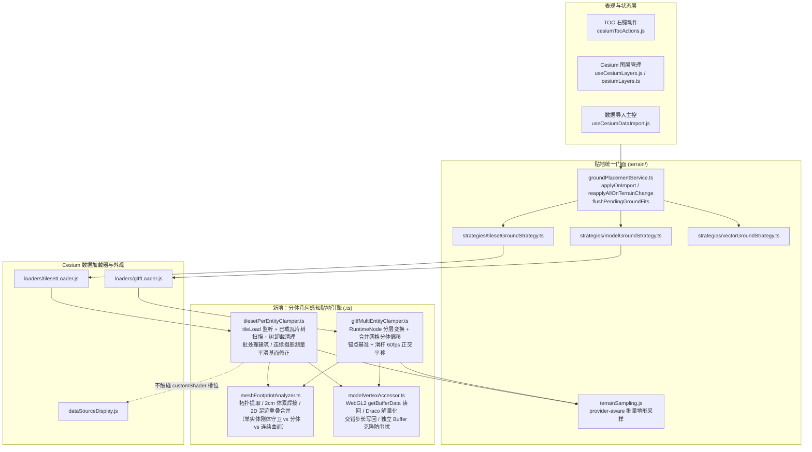
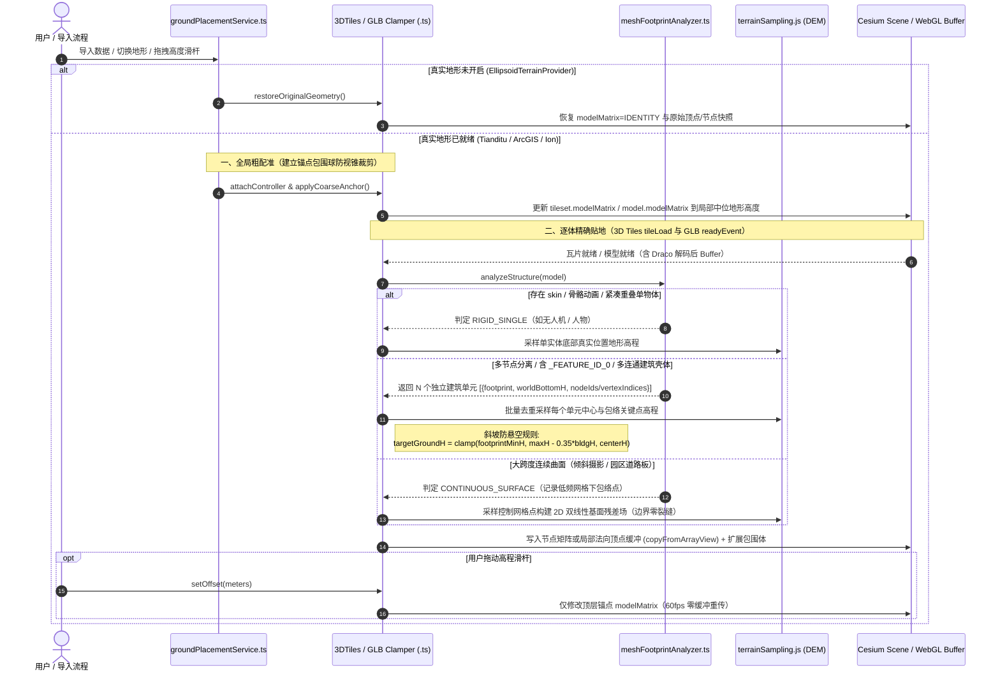

# L3 架构改造方案：3D Tiles 与多模型 GLB 逐体按真实地形高程贴地引擎

> 状态：🟡 待批准
> 日期：2026-11-08
> 任务等级：L3（架构级，方案先行，未批准前禁止修改业务源码）
> 版本基线：V3.6.42
> 前序关联：[`2026-10-25-tileset-large-area-terrain-fit-plan.md`](2026-10-25-tileset-large-area-terrain-fit-plan.md)（P0 分位数加权与 P1 视野局部贴合已于 V3.6.26 落地；原 P2「多 tileset 切片」由本方案升级为**逐建筑单体 / 逐子模型空间贴地引擎**）

---

## 一、核心痛点与完整事件逻辑链条

### 1.1 用户反馈症状
开启真实地形高程（天地图地形 / ArcGIS World Terrain / 自定义 Ion 地形）后，加载以下两类包含大量独立建筑物的数据时，所有子建筑只能跟随同一块统一高程平面（或指定单一高程），无法依据各自所在的真实地面高程逐栋贴地：
1. **3D Tiles 数据集**（白膜建筑群、城市建筑高度瓦片如 `city/tileset.json`、`baimo/tileset.json`、本地 ZIP/目录瓦片、倾斜摄影）：低洼处建筑悬空，山坡/高地处建筑半截或整栋埋入地形。
2. **单文件包含多个模型的 GLB/GLTF**（如整片校园/园区打包进单个 `.glb`，典型如示例「广西大学校区」`base.glb`）：原点处勉强贴地，远离原点的建筑随地形起伏整片悬空或钻地。

### 1.2 事件逻辑链条与根本原因（源码实证）

```
开启地形 (Tianditu / ArcGIS)
   ├── 3D Tiles 链路 (tilesetLoader.js -> fitTilesetToTerrain)
   │     ├── collectTilesetBaseSamples(): 最多采样 256 个叶子包围盒中心点
   │     ├── estimateTerrainOffset(): 按加权 p75 分位数算出 **单一标量 offset**
   │     ├── tileset.modelMatrix = buildVerticalTranslation(center, offset)
   │     └── 实测样本 city/tileset.json:
   │           • 所有几何落在 381 个 16_*.b3dm 叶子节点内
   │           • 单瓦片跨度 ~571m × 566m，nodes=1, meshes=1，BATCH_LENGTH 高达 298（_BATCHID）
   │           • 原生坐标为局部切平面，边缘受地球曲率下沉达 -7.2m（尚不含山地地形起伏）
   │           ▶ 后果：单一刚性平移在数学上必然产生约等于「地形高差 span」的埋入 + 悬空
   │
   └── 多模型 GLB 链路 (gltfLoader.js -> loadGltfWithCoords -> Cesium Entity ModelGraphics)
         ├── 创建单一 Cesium.Entity + heightReference (CLAMP_TO_GROUND / RELATIVE_TO_GROUND)
         ├── Cesium 引擎内核验证 (@cesium/engine/Source/Scene/Model/Model.js:2524-2585):
         │     updateClamping() 仅读取 model.modelMatrix[12..14] **唯一一个原点 (lng, lat)** 采样高程
         └── 后果：同一 .glb 内的 N 栋建筑全部刚性绑在原点高程面上，无法各自贴地
```

### 1.3 排查同步发现的 5 处贴地管线结构性缺陷

| # | 位置 | 缺陷描述 | 影响 |
|---|---|---|---|
| 1 | `groundPlacementService.ts:162` vs `useCesiumDataImport.js:100` | `reapplyAllOnTerrainChange` 首行 `if (!isTerrainReady) return { skipped: true }` 直接短路，导致从真实地形**切回椭球地形**时，永远无法触发各策略的「还原原始位姿」（使 `tilesetLoader.js:743` 的椭球分支成为死代码） | 关掉地形后模型仍停在山顶悬空 |
| 2 | `groundPlacementService.ts:192` vs `useCesiumDataImport.js:60` | `flushPendingGroundFits` 无人调用；且 `ensureTerrainRefitWatcher()` 仅在首次调用 `loaderCtx()` 时挂载 | 若先加载 Ion 3D Tiles 再开/关地形，或待补做队列积压，贴地不生效 |
| 3 | `gltfLoader.js:164-170, 220-270` | `extractGlbEmbeddedCoords` 将 `CESIUM_RTC` / `nodes[0].matrix` 转换得到的是 **WGS84 椭球高**（`cartographic.height`），却直接作为 `height > 0` 传给 `RELATIVE_TO_GROUND` | 椭球高 + 地形高被**双倍叠加** |
| 4 | `useCesiumLayers.js:506-538, 1481-1517` & `tilesetLoader.js:1357` | 自定义 Ion 3D Tiles 与 `customIonHeightOffset` 独立维护另一套 `originMatrix` 刚性平移，绕过 `fitTilesetToTerrain`；`loadSampleBaimoTileset` 传了错误的本地 `./tileset/baimo/tileset.json`；`tilesetGroundStrategy.ts:24,39` 仅读 `record.entity` 漏掉 `record.tileset`（I3S） | Ion/I3S/武汉白膜贴地不一致或失效 |
| 5 | `useCesiumDataImport.js:179-186, 265-266` & `cesiumLayers.ts:223-229` & `tilesetGroundStrategy.ts:45-50` | 手动坐标导入 GLTF 缺 `position`/`modelBaseHeight`；重定位后未同步 `modelHeightOffset`/Store；Store 同步忽略 `gltf` 初值；`tileset` reset 未刷新响应式列表 | TOC 卡片高程滑杆数值与实际位姿脱节 |

---

## 二、多数据形态拆解与核心工程约束

真实业务场景下，用户输入并非单一拓扑，必须按结构准确区分、避免「拆碎单体设备/无人机/人物骨骼」或「扯裂倾斜摄影连续表面」：

| 数据家族 | 细分结构 | 判定特征 | 正确贴地语义 | 禁忌行为 |
|---|---|---|---|---|
| **3D Tiles 批量单体建筑** | 白膜/建筑群 `.b3dm`/`.glb`（如 `city`、`baimo`） | 存在 `_BATCHID` / `_FEATURE_ID_0` 属性，或无 batchId 但网格拓扑呈多个水平分离独立壳体 | **以每栋建筑为刚体单元**：取每栋底座中心 + 足迹周边高程，沿该建筑点位真实 WGS84 法向精确平移，建筑屋顶/立面**零剪切、零倾斜** | 不得按单顶点高度直接下拉（斜坡建筑屋顶会被拉成斜坡） |
| **3D Tiles 离散 LOD / 单体雕塑** | 如 `TilesetWithDiscreteLOD`（Dragon） | 无多个分离足迹，单一紧致包围体 | 单体整体基准贴地 + 防止 `parent` 变换重复叠加 | 不得拆分零件部件 |
| **3D Tiles 倾斜摄影 / 连续地形面** | 如 Ion `5115505`（河南大学）、`354759` | 单一高密度连续连通曲面（无 `_FEATURE_ID_0`，水平跨度大且内置高程起伏） | 仅修正瓦片网格地面下包络与场景地形的**基准面/大地水准面低频差值**（平滑 2D 双线性场），**相邻瓦片边界无接缝** | 不得压平内置地形，不得整片单瓦片刚性阶梯跳变造成接缝裂缝 |
| **GLB/GLTF 多节点场景** | 多栋建筑分别作为 glTF `nodes` | 多根节点/子节点，且子部件水平投影相互分离（或仅同栋屋顶/墙体垂向重叠） | **按 2D 足迹投影聚类为独立建筑单元**：同栋「墙体+屋顶+附属设备」合并为一个刚体单元，修改单元根 `ModelRuntimeNode.transform` | 不得破坏跨节点复用同一 mesh GPU 缓冲（Instanced mesh），不得把同栋屋顶拆落 |
| **GLB/GLTF 单网格打包多建筑** | 如「广西大学校区」`base.glb` 或 GIS 导出合批白膜 | `nodes` 少但单 `primitive` 内包含多个空间分离建筑（或附带园区道路底板） | **拓扑索引 + 2cm 空间体素焊接 Union-Find** 提取连通建筑壳体 + 2D 足迹嵌套合并，按建筑单元刚性修改 `POSITION` 缓冲（并妥善处理 Draco 量化） | 不得用固定原点单一高度夹持 |
| **GLB/GLTF 单个物理实体** | `drone.glb`、`UAL1_Standard.glb` 等设备/载具/角色 | 含 `skins`/骨骼动画，或整包水平跨度小 / 各子部件水平投影高度重叠 | 强制保留为**单一完整刚体**，仅对齐最低包围盒点贴合地形（消除原点在中心导致的「半截入土」） | **严禁**把无人机旋翼/角色四肢拆成不同高程 |

---

## 三、Cesium 1.146 内核验证与候选方案对比

在设计前已直接源码核验 `frontend/node_modules/@cesium/engine/Source/` 相关阶段：

| 内核模块 | 源码位置（已核验） | 工程硬约束结论 |
|---|---|---|
| `Model3DTileContent.update` | `Scene/Model/Model3DTileContent.js:251-252` | **每帧强行覆写** `model.modelMatrix = tile.computedTransform` 与 `model.customShader = tileset.customShader`，**不可**在每片瓦片独立挂不同的 `customShader` 实例，否则逐帧重编译销毁绘制命令 |
| `CustomShaderPipelineStage` & `FeatureIdPipelineStage` | `Scene/Model/CustomShaderPipelineStage.js` | `vsInput.featureIds.featureId_0` **无默认兜底**；全 tileset 共用一份 `CustomShader` 时，一旦混入无 `_BATCHID` 的瓦片（粗 LOD / 倾斜摄影）直接报 GLSL 编译失败 |
| `Cesium3DTileset.tileLoad` | `Scene/Cesium3DTileset.js:2994-2999` | `tile.process()` 触发 `tile.contentReady === true` 后即派发 `tileLoad(tile)`，此时 `tile.content._model._sceneGraph` 与 WebGL `Buffer` 已就绪 |
| `Cesium3DTile.updateTransform` | `Scene/Cesium3DTile.js:2071-2136` | 修改父瓦片 `.transform` 会级联影响子瓦片 `computedTransform`；同时必须同步更新/扩展 `tile._boundingVolume` 避免视锥剔除丢失 |
| `Buffer.prototype.getBufferData` / `copyFromArrayView` | `Renderer/Buffer.js:279-296, 372-444` | WebGL2 下支持同步读写任意 Vertex/Index GPU `Buffer`（已包含 Draco 解码与交错格式数据），原地更新只需 `bufferSubData`，**地形切换与滑杆拖拽均不重建 VAO/Shader** |
| `Model.prototype` Clamping & `ModelNode` | `Scene/Model/Model.js:2524-2876`、`ModelNode.js`、`ModelRuntimeNode.js` | 1.146 可在 `Model.fromGltfAsync` 上通过 `runtimeNode.transform`（并置 `userAnimated = true; model._userAnimationDirty = true`）独立驱动节点变换，且不与 `Entity heightReference` 互抢控制权 |

### 候选方案对比矩阵

| 对比维度 | 方案 A：仅逐瓦片 `tile.transform` | 方案 B：纯 GPU `CustomShader` 地形纹理采样 | 方案 C：预处理拦截二进制/重下载改写 | **方案 D（选定）：混合分体几何感知贴地引擎** |
|---|---|---|---|---|
| 解决 3D Tiles 瓦片内多栋独立贴地（`city` 单瓦片含 298 栋） | ❌ 单瓦片内建筑仍平齐、跨 570m 高差依旧埋入/悬空 | ⚠️ 需额外属性给每栋基准坐标，否则建筑被地形斜率拉斜 | ⚠️ 对 3D Tiles 流式/Ion/Draco 支持弱，地形切换需重解析全包 | ✅ **按 `_FEATURE_ID_0` 或连通域逐栋刚性沿当地椭球法向贴地** |
| 解决单文件多模型 GLB（`base.glb` / 多节点 / 合批网） | ❌ 无能为力（Entity 只采原点 1 点） | ❌ 同 `Entity.heightReference` 与透明/着色冲突且无拾取修正 | ⚠️ 不兼容远程 Draco GLB 且不能保留双实例独立 `ResourceCache` | ✅ **Node 层位姿 + 合批几何连通域双层级自动分派** |
| 护航单一设备 / 骨骼角色不拆碎 | N/A | ⚠️ 易误伤部件 | ⚠️ 需整套识别 | ✅ **内置 `skin`/动画/XZ 重叠刚体守卫** |
| `scene.pick` / 阴影 / 碰撞 / 包围球视锥裁剪 | ✅ 原生准确 | ❌ **全部错位**（GPU 偏移与 CPU 包围盒/拾取脱节） | ✅ 原生准确 | ✅ **真实修改节点矩阵与顶点坐标 + 同步更新包围体** |
| 材质合成（`baimo` / `gradient` / `pureWhite` / 透明） | ✅ 兼容 | ❌ **严重冲突**（`CustomShader` 槽位互斥，`32-bit float` 世界坐标精度抖动） | ✅ 兼容 | ✅ **完全正交，材质管线零侵入、随地形变化不退化** |
| 地形切换响应速度（开启 / 关回椭球 / 切地形源） | ⚠️ 重算 `modelMatrix` | ✅ 仅换纹理 | ❌ 需重新拉流改写 | ✅ **只读缓存原始偏移，按增量做 `O(N)` `copyFromArrayView`（无重下载/无误差累积）** |
| 高度滑杆流畅度 | ✅ `modelMatrix` 60fps | ✅ uniform 60fps | ⚠️ 重计算 | ✅ **锚定偏移由顶点/节点承担，滑杆平移直接作用于 `modelMatrix`（60fps 零缓冲重传）** |

---

## 四、选定架构设计（方案 D）与 Mermaid 流程/架构图

### 4.1 架构总览（模块化分层）



### 4.2 双场景贴地执行时序（3D Tiles 流式加载 & Multi-Model GLB）



### 4.3 核心数学与工程细节规约

1. **地球曲率 + 模型局部变换的严格法向投影矩阵（无倾斜、无漂移）**
   对于任意原始局部顶点 $\mathbf{p}_0 \in \mathbb{R}^3$，其所处节点的当前图元到世界矩阵为：
   $$M_{\text{prim}\to\text{world}} = M_{\text{anchor}} \cdot M_{\text{axis}} \cdot M_{\text{nodeToRoot}} \cdot M_{\text{node}}$$
   - 取建筑单元 $k$ 的世界坐标中心 $C_k$ 及该位置真实地球椭球面法向 $\hat{\mathbf{u}}_k = \text{geodeticSurfaceNormal}(C_k)$。
   - 计算该单元**自身最低顶点投影的真实 WGS84 椭球高** $h_{\text{bottom},k}$（将局部最底世界点经 `Cartographic.fromCartesian` 求出），由此**天然消除局部切平面在大范围数据集下的地球曲率下沉误差**（如 `city` 边缘 $-7.2\text{ m}$）！
   - 目标接地高度增量 $\Delta h_k = h_{\text{target},k} - h_{\text{bottom},k}$；通过逆线性矩阵将 $\hat{\mathbf{u}}_k$ 映射回顶点局部坐标系 $\mathbf{d}_{\text{local},k} = M_{3\times 3}^{-1}\hat{\mathbf{u}}_k$，施加：
     $$\mathbf{p}_{\text{clamped}} = \mathbf{p}_0 + \Delta h_k \cdot \mathbf{d}_{\text{local},k}$$
   - **幂等无累积漂移机制**：每个 primitive 仅在首次修改前快照不可变原始坐标 `origPos`（Float32）与簇归属索引；后续切换任何地形只基于 `origPos` 重新投影，绝不叠加前一次偏移。

2. **地形斜坡上的建筑「防悬空 + 防整栋埋入」策略**
   - 对每栋建筑的局部世界 AABB 取 5 点（中心 + 西南/东南/东北/西北角或底面四角收缩 15% 内环），与中心点合并后一次批量请求 `sampleTerrainMostDetailed`（相同瓦片内做地理网格哈希去重，单瓦片仅触发 1~2 次异步批采样）。
   - 目标高程取值准则（优先消除视觉最刺眼的悬空，同时护航低矮平房不被整栋深埋）：
     $$h_{\text{target},k} = \max\Big(\min_{i \in \text{corners}} H_i,\ \max_{i \in \text{corners}} H_i - \text{clampRatio} \cdot H_{\text{bldg},k}\Big)$$
     其中默认 $\text{clampRatio} = 0.45$（对于 20m 以上建筑直接贴合最低角点实现零悬空；对于 3m 矮棚在陡坡上最多嵌半高防消失）。

3. **倾斜摄影 / 大跨度连续地面的无接缝平滑贴合**
   - 若单组件无 `_FEATURE_ID_0` 且水平跨度 $> 180\text{ m}$：
     - **平坦园区地面/道路板**（内部垂直极差 $< 4\text{ m}$）：构建局部 $8\times 8$ ~ $16\times 16$ 地形采样网格，逐顶点做双线性插值贴地。
     - **倾斜摄影真实三维曲面**（内置起伏 $\ge 4\text{ m}$，如 Ion 5115505 / 354759）：将瓦片划分成 $5\times 5$ 网格，取每个格网内低分位（`p10`）顶点代表内置地面高度 $h_{\text{mesh}}(c)$，与同位置 Cesium 地形 $H_{\text{terrain}}(c)$ 求残差 $d(c) = H_{\text{terrain}}(c) - h_{\text{mesh}}(c)$，生成**世界经纬度绑定**的双线性平滑残差插值场（或数据集级共享控制点网格），相邻瓦片共享边界采样值从而**数学上零裂缝**。

4. **视锥剔除与 GPU 缓冲特殊格式兼容守卫**
   - **视锥剔除防消失**：顶点或节点发生垂向位移 $[minDelta, maxDelta]$ 后，实时同步更新 `tile._boundingVolume`（`TileBoundingRegion` 扩增 `minimumHeight/maximumHeight`，`TileOrientedBoundingBox` 沿垂轴拓展 `halfAxes`，`TileBoundingSphere` 扩半径）与 `model._sceneGraph._boundingSphere` + `model._initialRadius`。
   - **Draco / 量化与交错顶点**：检测到 `attribute.quantization` 时先于 CPU 解量化并转为常规非共享 `Float32` `Buffer` + 触发一次 `model.resetDrawCommands()`；交错顶点仅修改 `[byteOffset + i*stride .. +12)` 的 3 个 `float`，法向/UV/纹理完整保留；GLB 侧首次写入前克隆独立 GPU `Buffer`，彻底隔离 `ResourceCache` 多实例串扰。
   - **GLTF 坐标系语义修正**：区分 `heightSemantics: 'ellipsoidal' | 'agl'`，`extractGlbEmbeddedCoords` 解析 `CESIUM_RTC` 或根节点 `matrix` 时按地理真实位置放置，严禁再把海拔传给 `RELATIVE_TO_GROUND`。
   - **大瓦片分帧预算与并发 Epoch 防竞态**：`terrainProviderChanged` 或反复开关地形递增 `clampEpoch`；异步地形采样返回前校验瓦片未销毁且 epoch 未过期；连续 `tileLoad` 批处理每帧不超过预算时间，防止快速漫游掉帧。

---

## 五、改造文件清单（均在批准后实施）

### 5.1 新增模块（按 `Force_command.md` §2.11 全部使用 TypeScript）

| 文件路径（均位于 `frontend/src/domains/cesium/composables/terrain/` 下） | 职责 |
|---|---|
| `clamping/meshFootprintAnalyzer.ts` | 几何结构识别：`_FEATURE_ID_0` 读取、三角形拓扑 + 2cm 空间焊接 Union-Find、2D XZ 足迹嵌套合并、单刚体/建筑簇/连续曲面分类 |
| `clamping/modelVertexAccessor.ts` | WebGL2 `getBufferData`/`copyFromArrayView` 封装、Draco 量化展开、交错步长局部法向位移、独立 `Buffer` 生命周期与快照缓存 |
| `clamping/tilesetPerEntityClamper.ts` | 3D Tiles 逐建筑贴地控制器：已载瓦片扫描 + `tileLoad`/`tileUnload` 订阅 + 包围体动态扩容 + 滑杆正交相对偏移 + 地形切换重配准 |
| `clamping/gltfMultiEntityClamper.ts` | 单文件 GLB 贴地控制器：`Model.fromGltfAsync` 运行时管理、Multi-Node 矩阵层夹持 + 单网合批顶点夹持、单实体刚体（无人机/人物）护航 |

### 5.2 修改既有模块

| 文件 | 改动说明 |
|---|---|
| `composables/terrain/groundPlacementService.ts` | 修复 `reapplyAllOnTerrainChange` 对「切回椭球地形」的短路截断；传入 `hasRealTerrain` 语义并确保 `flushPendingGroundFits` 闭环被调用 |
| `composables/terrain/strategies/tilesetGroundStrategy.ts` | 接入 `tilesetPerEntityClamper` 编排；兼容 `record.tileset`（I3S）与 `record.entity`；`reset` 时恢复原始几何与滑杆状态并同步列表 |
| `composables/terrain/strategies/modelGroundStrategy.ts` | 适配全新 `gltfMultiEntityClamper` 与经典刚体 `ModelGraphics` 双路径 |
| `composables/dataImport/loaders/tilesetLoader.js` | 在 `fitTilesetToTerrain`/`refitTilesetToTerrain` 接管逐瓦片分体贴地；保留 `tileset.modelMatrix` 仅作数据集粗锚定 + 用户相对高度平移；修复 `loadSampleBaimoTileset` 错误的 `rootJsonUrl` |
| `composables/dataImport/loaders/gltfLoader.js` | 本地/远程多建筑 GLB 接入 `Model.fromGltfAsync` + `gltfMultiEntityClamper`；修复 `extractGlbEmbeddedCoords` 椭球高双倍叠加（`heightSemantics: 'ellipsoidal'`）及根节点遍历 |
| `composables/dataImport/useCesiumDataImport.js` | 补齐 `ensureTerrainRefitWatcher` + `flushPendingGroundFits` 联动；补齐 `loadGltfWithUserCoords` 与 `confirmGltfReposition` 记录字段与 `setTilesetHeight` 相对地形高度平滑联动；卸载/清空时回收夹持器资源 |
| `composables/dataImport/dataSourceDisplay.js` | 确认对 `Model` 原生图元与 `Entity` 形态 `gltf` 的显隐、透明度与 `flyToEntity` 双向兼容 |
| `composables/layers/useCesiumLayers.js` | 将 `loadCustomIon3DTiles` 与 `customIonHeightOffset` 纳入统一的 `tilesetLoader`/`groundPlacementService` 贴地管控链路，消除两套并行 `originMatrix` |
| `stores/cesiumLayers.ts` | `syncFromImport` 对齐 `gltf` 的 `modelHeightOffset` / `modelBaseHeight` 初值与重置态回写 |

### 5.3 收尾同期维护文档（随实施完成同步）
- `Docs/Guide/frontend-structure.md`、`Docs/Architecture/multi-format-data-import.md`、`Docs/Guide/CHANGELOG.md`、根 `README.md`、`Docs/LLM_record/26-11/2026-11-08/...md`、`Docs/TODO/README.md`（完成后迁入 `archive/`）。

---

## 六、验收标准（DoD）与测试矩阵

### 6.1 自动门禁（Agent 实施后必须全绿）
1. `npx tsc --noEmit`（零新增类型错误）
2. 定向 ESLint（改动文件零报错）
3. `npx vite build`（构建通过）
4. `python Scripts/CheckStructureTree.py`（前后端结构树零漂移）
5. `python Scripts/CheckConfigRegistry.py`（配置表校验通过）
6. 平台红线扫描（`Force_command.md` §11.2 全绿）

### 6.2 实机三维验证清单（实施后交用户复验）
1. **3D Tiles 白膜分批数据集**（`city`、`baimo`）：开启天地图/ArcGIS 真实地形后加载，山坡、谷底与平坦处**每栋建筑均严格落在各自地表位置**，建筑立面保持垂直无剪切倾斜，切换地形源或平移漫游流式加载新瓦片均即时逐栋贴地；关闭真实地形（切回椭球面）与「恢复原始高程」均能无损归位。
2. **多模型 GLB**（样例「广西大学校区」`base.glb` 及本地多节点/单网合批 `.glb`）：整片校区每栋楼根据所处地势凹凸各自贴合地表，不再整片统一悬浮或下沉；高程滑杆 60fps 流畅整体升降且保持各栋相对地形贴合。
3. **单物体刚体护航**：`drone.glb`、带骨骼/动画模型（`UAL1_Standard.glb`）、`TilesetWithDiscreteLOD` 加载后整体贴合地表、**部件完全不解体**。
4. **倾斜摄影 3D Tiles**（Ion 5115505 / 354759）：瓦片之间**无高低接缝裂缝**，路面与建筑一体贴合地形基准。
5. **交互链路闭环**：TOC 显隐、透明度、材质模式（`baimo` / `gradient` / `pureWhite` / `none`）、模型鼠标 `pick`、位置重定位与图层删除清空均正常工作且无 WebGL 资源泄漏。

---

> ✋ **按 `Force_command.md` §1 & §3 规定，本方案现处于「🟡 待批准」阶段。请确认方案方向或提出调整意见，获得你的明确批准后，我将立即把状态切换为「🔵 实施中」并开始编写代码。**
