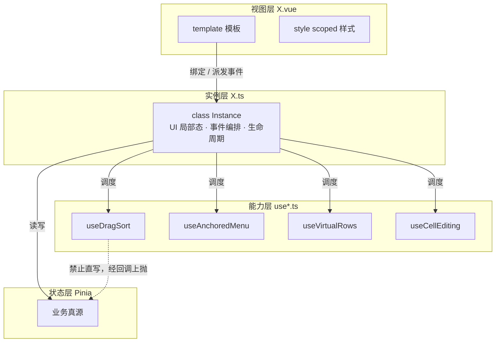
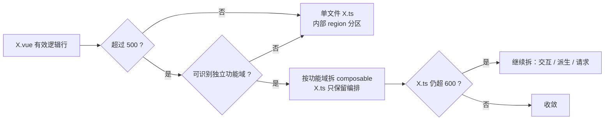

# Vue 组件工程化重构分析与执行方案

> 文档状态：**✅ 已全部完成（72/72 含脚本组件 100% 完成 `<script src="./X.ts">` 分离 + 10 个超长业务 `.ts` 按功能域拆分 `< 700` 行，样式全部保留在 `.vue` 内）**
> 创建日期：2026-11-13（2026-11-14 全部收官并修正样式内聚规范）
> 任务等级：**L3 架构级**
> 适用范围：`frontend/src/**/*.vue`（73 个，其中 72 个含脚本组件 + 1 个无脚本纯视图组件 `AuthGlobeStage.vue`）及其同名逻辑层、`domains/**/composables/`
> 关联文档：[Force_command.md](../Force_command.md) · [dev-conventions.md](../Guide/dev-conventions.md) · [Refactor.md](../Refactor.md) · [bugfix-optimization-plan.md](bugfix-optimization-plan.md) P3-1
> 执行日志：[2026-11-13-vue-component-paradigm-refactor.md](../LLM_record/26-11/2026-11-13/2026-11-13-vue-component-paradigm-refactor.md) · [2026-11-14-vue-component-refactor-complete.md](../LLM_record/26-11/2026-11-14/2026-11-14-vue-component-refactor-complete.md)

## 执行状态（2026-11-14 最终收口）

> **⚠️ 核心架构原则修正（2026-11-14）**：
> **`X.vue` 组件只剥离 `<script>` 代码到同名 `X.ts` 文件，绝不剥离 `<style>` 代码为外部 `.scss` 代理文件！**
> - **`X.vue`（视图与样式层）**：完整承担 DOM 模板（`<template>`）与组件样式（内联 `<style scoped>`）的组织，仅保留单行 `<script lang="ts" src="./X.ts"></script>` 引用；
> - **`X.ts`（逻辑实例层）**：承担组件状态、生命周期、事件处理与 Composable 调度。
> - 若将 `<script>` 与 `<style>` 同时剥离，`.vue` 将退化为纯 HTML 片段，失去 Vue 单文件组件承载视图与样式组织的意义。前期外置的 `.scss` 文件与 `ExtractVueStyles.py` 已全部清理并将样式完整还原回对应 `.vue` 组件内，同时在 `CheckVueParadigm.py` 中新增门禁规则禁止 `<style src="...">` 外置代理。

| 阶段 | 状态 | 说明 |
|---|:---:|---|
| Phase 0 基线与规范冻结 | ✅ **完成** | P3-1 行数重算、`dev-conventions.md` 补 `X.ts` 层、模板 `Docs/Guide/vue-component-template.md` |
| Phase 1 双试点 | ✅ **完成** | `AdminControlPanel`、`LayerControlPanel` 率先完成 `X.vue` + `X.ts` 分离 |
| Phase 1.5 全量组件脚本剥离（72/72） | ✅ **完成** | 全仓 72 个含脚本 `.vue` 组件 100% 完成 `<script lang="ts" src="./X.ts"></script>` + `export class Instance` 范式化（仅 `AuthGlobeStage.vue` 为无脚本纯视图组件） |
| Phase 2 公共 composable | ✅ **完成** | 8 类全部落 `domains/common/composables/` 且**每类均有真实消费方** |
| Phase 3 巨型容器、实例层与业务 TS 按功能域拆分 | ✅ **完成** | 全量 72 个组件 `.ts` 实例层及 10 个超 700 行业务 `.ts` 模块（`useCesiumDrawMeasure`、`fluidRuntime`、`firstPersonFlyController`、`useCesiumLayers`、`useHomeLayerAndMapRouting`、`useMapState`、`tilesetTerrainFit`、`playerController`、`planarRouteController`、`tilesetLoader`）全部按功能域拆分为专用子模块/Composable，全仓业务 `.ts` 100% 控制在 `< 700` 行 |
| Phase 4 样式内聚还原（废弃样式外置） | ✅ **完成** | 纠正原方案将 `<style>` 剥离为 `.scss` 的设计偏差，将全部外置 `.scss` 还原回对应 `.vue` 内联 `<style>`，删除 `styles/*.scss` 与 `ExtractVueStyles.py` |
| Phase 5 收口与门禁 | ✅ **完成** | ESLint 领域单向依赖门禁、范式完整性校验脚本（72/72 通过，禁 `<style src>`）、结构树同步（733 文件 0 偏差）、跨域依赖 23→0、`vue-tsc --noEmit` 0 错误 |

**跨域依赖清零**：`Docs/Refactor.md §3` 的四条禁令实测从 **23 处降为 0 处**。
可执行审计：`python Scripts/CheckDomainDeps.py frontend/src`，并由 ESLint `no-restricted-imports` 按域 glob 长期守住。

**已完成范式化组件（全量 72/72 含脚本组件 100% 完成）**：
全仓 73 个 `.vue` 组件中，除纯静态无脚本组件 `AuthGlobeStage.vue` 外，其余 **72 个组件全部完成 `<script lang="ts" src="./X.ts"></script>` + `export class Instance` 剥离**，且全部通过 `python Scripts/CheckVueParadigm.py frontend/src` 校验。

---

## 0. 结论摘要

**核心结论：本项目的主要维护成本不在「单文件太长」，而在「同类逻辑被重复实现了多遍」。** 单纯把 `.vue` 的 `<script setup>` 剪进同名 `.ts`，能解决文件职责混杂，但不会减少重复代码，也不会缩小最大文件的体量——因为 44% 的代码是样式。

三条主证据：

1. **体量结构失衡**：73 个组件共 73,947 行，其中样式 32,352 行（**44%**）、脚本 25,944 行（35%）、模板 13,547 行（18%）。`LandingView.vue` 5,639 行里有 **3,881 行是样式（69%）**。范式化后它仍是 3,900 行的文件。
2. **逻辑密度高但集中在少数文件**：有效逻辑行 > 300 的有 21 个，> 150 的有 36 个。真正需要范式化的是这 36 个，不是全部 73 个；11 个组件脚本不足 50 行，强制范式化是负收益。
3. **重复逻辑至少 8 类**：拖拽排序、面板拖拽与边界夹取、右键菜单视口定位、单元格就地编辑、虚拟滚动、触摸长按、请求竞态令牌、定时器托管——分散在 `LayerControlPanel` / `AttributeTable` / `AdminControlPanel` / `HomeView` 等处，各写各的。

**建议路径：三轨并行、分批推进**——① 视图层范式化（`X.vue` + `X.ts`）；② 把 8 类重复逻辑抽成 `composables/`；③ 样式外置。先做 2 个试点验证工具链与收益，再进巨型文件。**不采用全量一次性改写**，与 P3-1「不集中大爆改」原则一致。

---

## 1. 实测基线

> 全部数据由脚本遍历 `frontend/src/` 实测得出，非估算。度量口径：按 `<template>` / `<script>` / `<style>` 标签逐行归属统计。

### 1.1 全局体量

| 指标 | 数值 | 占比 |
|---|---:|---:|
| 组件总数 | 73 | — |
| 总行数 | 73,947 | 100% |
| 模板行数 | 13,547 | 18% |
| 脚本行数 | 25,944 | 35% |
| 样式行数 | 32,352 | **44%** |

### 1.2 规模分布

| 总行数区间 | 组件数 | 代表 |
|---|---:|---|
| > 2,500 | 9 | `LandingView` 5,639 / `CesiumContainer` 3,226 / `MapContainer` 2,942 |
| 1,000 – 2,500 | 16 | `TOCPanel` 2,518 / `AttributeTable` 2,516 / `LayerControlPanel` 2,090 |
| 300 – 1,000 | 38 | `RoutePlannerPanel` 1,332 / `MapDownloader` 1,607 |
| < 300 | 10 | `App.vue` 87 / `SectionTitle` 174 |

### 1.3 逻辑密度（按有效逻辑行，剔除空行与纯注释）

| 阈值 | 组件数 | 说明 |
|---|---:|---|
| 有效逻辑行 > 300 | 21 | **优先范式化集合** |
| 有效逻辑行 > 150 | 36 | **适用范式化集合** |
| 脚本原始行 > 500 | 16 | 与上一行口径不同，含注释与空行 |

Top 10（按有效逻辑行）：

| 组件 | 总行 | 有效逻辑行 | ref | computed | watch | 函数 | emit | store |
|---|---:|---:|---:|---:|---:|---:|---:|---:|
| `cesium/components/CesiumContainer.vue` | 3,226 | **1,707** | 13 | 10 | 9 | 33 | 4 | 3 |
| `ol/components/MapContainer.vue` | 2,942 | **1,552** | 18 | 0 | 7 | 21 | 14 | 5 |
| `app/HomeView.vue` | 2,866 | **1,448** | 34 | 2 | 1 | 112 | 0 | 7 |
| `app/RegisterView.vue` | 2,714 | 793 | 32 | 1 | 2 | 30 | 0 | 1 |
| `cesium/CesiumAdvancedEffects.vue` | 1,023 | 760 | 6 | 1 | 1 | 28 | 0 | 0 |
| `common/user/FloatingAccountPanel.vue` | 1,818 | 733 | 24 | 20 | 5 | 36 | 2 | 3 |
| `common/user/AdminControlPanel.vue` | 2,515 | 728 | 35 | 6 | 5 | 41 | 0 | 0 |
| `cesium/fluid-simulation/FluidSimulationPanel.vue` | 1,033 | 695 | 13 | 4 | 4 | 40 | 2 | 0 |
| `app/LandingView.vue` | 5,639 | 667 | 19 | 12 | 0 | 33 | 0 | 1 |
| `ol/layer/LayerControlPanel.vue` | 2,090 | 665 | 29 | 9 | 3 | 45 | 11 | 0 |

### 1.4 写法与编译宏分布

| 项 | 数量 | 迁移含义 |
|---|---:|---|
| `<script setup>`（纯 JS） | 66 | 需整体转为 TS |
| `<script setup lang="ts">` | 6 | 可复用现有类型 |
| 无 `<script>` 块 | 1 | `AuthGlobeStage.vue`，已是理想视图层 |
| `defineComponent` 用法 | **0** | 新范式在本项目**零先例** |
| `defineProps({...})` 对象式 | 48 | **可直接映射为 `propDefine`**，近乎 1:1 |
| `defineProps<T>()` 类型式 | 5 | 需手工改写成 `PropType`；其中 2 个用 `withDefaults` |
| `defineEmits([...])` 数组式 | 48 | 直接映射 |
| `defineEmits<T>()` 类型式 | 1 | 需改写 |
| `defineExpose` | 7 | **需转为 Instance public 字段**，父组件 `ref.value.xxx` 必须逐一验证 |
| `defineModel` / `defineSlots` | 0 / 0 | 无迁移负担 |
| 顶层 `await` | **0** | **无 Suspense 阻塞**，是重要利好 |

### 1.5 工具链基线

| 检查 | 结果 |
|---|---|
| `npx tsc --noEmit` | **通过，0 错误**（可作为后续「不引入新错误」的对照基线） |
| 自动化测试框架 | **无**（`package.json` 无 test 脚本，无 vitest/jest） |
| 类型检查覆盖范围 | `tsconfig.include` 仅 `src/**/*.ts` + `*.vue`，但 `tsc` **不解析 `.vue` 内部**；模板与组件脚本实际未被类型检查覆盖 |

> ⚠️ **关键风险前提**：项目零自动化测试，重构的行为等价性只能靠人工回归。这直接决定了必须「小批量、可回退、每批单独日志」。

---

## 2. 问题诊断

### P0-1 巨型文件：9 个超 2,500 行，且问题构成不同

| 文件 | 总行 | 样式 | 脚本 | 真实矛盾 |
|---|---:|---:|---:|---|
| `LandingView.vue` | 5,639 | **3,881** | 893 | **样式主导**，范式化无效 |
| `CesiumContainer.vue` | 3,226 | 694 | 2,318 | 脚本主导，需拆分编排 |
| `MapContainer.vue` | 2,942 | 761 | 2,035 | 脚本主导，需外移 composable |
| `HomeView.vue` | 2,866 | 489 | 2,072 | 编排层，需拆面板调度 |
| `RegisterView.vue` | 2,714 | 1,047 | 976 | 四段表单可组件化 |
| `CesiumToolPanel.vue` | 2,703 | 1,424 | 429 | **样式 + 模板主导**，脚本仅 429 行 |
| `TOCPanel.vue` | 2,518 | 1,426 | 474 | 同上 |
| `AttributeTable.vue` | 2,516 | 1,103 | 822 | 脚本 + 模板双高 |
| `AdminControlPanel.vue` | 2,515 | 874 | 869 | 脚本主导，表格逻辑密集 |

**结论**：这 9 个文件不能用同一套手段处理。`LandingView` / `CesiumToolPanel` / `TOCPanel` 的主要体量在样式与模板，**范式化只解决 35% 的问题**，必须配合样式外置与子组件拆分。

### P0-2 同类逻辑重复实现（维护成本的主因）

| 能力 | 重复位置（实测） | 现状 |
|---|---|---|
| 拖拽排序 | `LayerControlPanel`（`draggingIndex`/`touchDragActive`）、`AdminControlPanel`（`isDragging`/`dragStartX`/`scrollStartLeft`） | 两套独立实现 |
| 面板拖拽与边界夹取 | `AttributeTable`（`startDrag`/`startResize`/`RESIZE_CURSORS`/`clampRect`）、`HomeView`（`handlePanelResize`/`sidePanelRatio`） | 已有 `ResizeHandle.vue`，但仅 `HomeView` 使用，`AttributeTable` 未复用 |
| 右键菜单视口定位 | `LayerControlPanel`（`anchorResizeObserver`/`availableRight`/`canOpenRight`/`contextMenuStyle`） | 单点实现，无抽象 |
| 单元格就地编辑 | `AttributeTable`（`editingCell`/`startCellEdit`/`commitCellEdit`）、`AdminControlPanel`（`editingRowKey`/`editingCell`/`editingCellValue`） | 两套独立实现 |
| 虚拟滚动 | `AttributeTable`（`virtualRows`/`startIndex`/`endIndex`/`OVERSCAN`） | 单点实现 |
| 触摸长按 | `LayerControlPanel`（`longPressTimer`/`LONG_PRESS_DURATION`/`LONG_PRESS_DRIFT`） | 单点实现 |
| 请求竞态令牌 | `LayerControlPanel`（`wmsLayersFetchToken`） | 单点实现，无通用工具 |
| 定时器托管与清理 | `HomeView`（`activeWatchdogTimer`）、`AttributeTable`（`searchDebounceTimer`）、`CesiumContainer` | 各自 `onUnmounted` 手写清理 |

> 已核查：`defineResilientAsync.ts` 是「带重试的异步组件工厂」，与上表 8 类**均不重叠**；项目内亦无 `debounce` / `throttle` 通用工具。因此抽取不存在重复建设风险。

### P0-3 跨域依赖违规 7 处（仅 2 个文件，收敛成本低）

违反 `Refactor.md` §3 单向依赖规则：

| 违规方 | 域 | 被依赖 | 建议处置 |
|---|---|---|---|
| `CesiumContainer.vue` | cesium | `@ol/basemap/constants/basemapResolver` | 底图解析跨引擎共享，上移 `domains/common/basemap/` |
| `CesiumContainer.vue` | cesium | `@ol/basemap/constants/basemapConfig` | 同上 |
| `CesiumContainer.vue` | cesium | `@ol/stores/useAttrStore` | 属性表 store 跨引擎，上移 `domains/common/stores/` |
| `TOCPanel.vue` | common | `@cesium-domain/stores/cesiumLayers` | 经 `layer-tree/protocol/` 间接访问 |
| `TOCPanel.vue` | common | `@cesium-domain/stores/cesiumLayerNodeBuilder` | 同上 |
| `TOCPanel.vue` | common | `@ol/layer/style/useStyleEditor` | 抽 `StyleEditorProtocol` 到 common |
| `TOCPanel.vue` | common | `@ol/search/components/AmapAoiInjectDialog.vue` | **common 直接 import ol 的 `.vue`**，最严重；改由事件/插槽注入 |

> 这 7 处不是本次范式化引入的，但范式化会放大其可见性——**建议作为独立小批次先行修复**，避免重构后边界更糊。

### P1-1 文档漂移：P3-1 的行数基线已全面过期

| 文件 | P3-1 记录 | 实测 | 偏差 |
|---|---:|---:|---:|
| `CesiumContainer.vue` | ~915 | 3,226 | **+2,311** |
| `MapContainer.vue` | 2,041 | 2,942 | +901 |
| `HomeView.vue` | 2,011 | 2,866 | +855 |
| `RegisterView.vue` | 2,198 | 2,714 | +516 |
| `CesiumToolPanel.vue` | 2,686 | 2,703 | +17 |
| `TOCPanel.vue` | 2,499 | 2,518 | +19 |

**影响**：按 P3-1「CesiumContainer 目标 ~500 行」推进，实际要从 3,226 行砍到 500 行，工作量被低估约 4 倍。本方案建议**先修正 P3-1 基线**，再排期。

### P1-2 JS/TS 存量缺口

66 个组件为纯 JS `<script setup>`，与 Force_command §2.11「新增逻辑默认 TS」不冲突（存量不强制改写），但与本轮范式化直接相关：**迁移时必然转 TS**，等于一次性补齐 66 个组件的类型化。

### P1-3 `props` / `emits` 双写风险

`<script src>` 模式下无法使用 `defineProps` / `defineEmits` 宏，必须走运行时声明 + `ExtractPropTypes`。`emits` 需维护两处（类型别名 + 运行时数组），漏改**不报错、只静默失效**。这是范式本身的固有代价，需在规范中写明检查点。

### P2-1 缺少统一组件骨架

当前 73 个组件无一致结构，新组件靠模仿既有文件。范式化落地后应同步补一份可复制的模板与 ESLint 约束，否则半年后再次发散。

---

## 3. 目标架构

### 3.1 四层职责模型

| 层 | 文件形态 | 职责 | 状态归属 | 约束 |
|---|---|---|---|---|
| **视图层** | `X.vue` | `template` + `style` + 单行 `<script lang="ts" src="./X.ts">` | 无 | 不写任何逻辑，不 import 业务模块 |
| **实例层** | `X.ts` | 组件私有编排：生命周期、事件、对 store 的调用、对 composable 的调度 | UI 局部态（展开/输入中/拖拽中） | 目标 500–600 行，软上限 |
| **能力层** | `use*.ts` | 跨组件复用逻辑，按功能域命名 | 过程态，用完即弃 | 不直接写 store |
| **状态层** | `stores/*.ts` | 业务数据唯一真源（Pinia） | 业务态 | 不依赖 OL / Cesium 类 |



### 3.2 状态归属判定规则

范式化最常见的失败是「逻辑搬进了类，状态仍耦合」。统一判据：

| 判定问题 | 归属 |
|---|---|
| 跨组件 / 跨路由存活？ | **Pinia store** |
| 仅本组件生命周期内有效？ | **Instance 字段** |
| 是某个交互的中间过程（拖拽坐标、长按计时）？ | **composable 内部 ref**，随调用方销毁 |
| 需要被父组件通过 `ref` 调用？ | **Instance public 方法**（替代 `defineExpose`） |

> 明确反对：把业务数据塞进 `Instance` 字段。那只是把 `<script setup>` 换了个容器，没有解决耦合。

### 3.3 目录落位

**同名同级**，落位沿用既有 domain 路径（不新建 `src/views/`，遵守 Force_command §0.5「引擎域是第一分层维度」）：

```text
frontend/src/domains/<域>/<功能>/components/
├── XxxPanel.vue        # 视图层：template + style + 单行 script src
├── XxxPanel.ts         # 实例层：class Instance + defineComponent 桥接
└── ...

frontend/src/domains/common/composables/
├── useDragSort.ts          # 拖拽排序（鼠标 + 触摸）
├── usePanelDragResize.ts   # 面板拖拽 / 缩放 / 视口夹取
├── useAnchoredMenu.ts      # 锚点弹层视口定位
├── useCellEditing.ts       # 单元格就地编辑
├── useVirtualRows.ts       # 虚拟滚动窗口计算
├── useLongPress.ts         # 触摸长按
├── useRequestToken.ts      # 请求竞态令牌
└── useTimerRegistry.ts     # 定时器统一托管与清理
```

> `domains/common/composables/` 目前**不存在**（现有 composables 分布在 15 个目录、共 136 个文件）。新建该目录属于 L3 目录决策，需在批准时一并确认。

### 3.4 规范缺口（需同步修订）

`dev-conventions.md`「分层边界」表目前只定义 `components` / `composables` / `stores` / `utils` / `services` 五层，**没有 `X.ts` 实例层的位置**。若不补，新范式在规范上无归属，后续会话会反复质疑「这个 `X.ts` 算什么层」。

建议补一行：

| 层 | 职责 | 禁止 |
|---|---|---|
| `X.ts`（组件实例层） | 单组件私有编排，UI 局部态 | 承载跨组件复用逻辑（应下沉 composables）、直接实现业务规则（应进 store/service） |

---

## 4. 拆分粒度标准

依据本轮确认的规范：**单文件目标 500–600 行，非硬性限制；按功能逻辑拆分，不按行数机械切分。**

| 有效逻辑行 | 处置 | 说明 |
|---|---|---|
| < 500 | 单文件 `X.ts` | 不拆，内部用 `//#region` 分区即可 |
| 500 – 600 | 目标区间 | 可接受，不强制拆 |
| 600 – 900 | **评估** | 若存在 ≥2 个可独立命名的功能域 → 拆 2 个 composable |
| > 900 | **必须拆** | 先列功能域清单，经确认后动手 |

**拆分轴心（按功能逻辑，非按长度）**：

1. **请求与数据获取**——`fetch*` / `load*` / 竞态与重试
2. **状态派生与格式化**——`computed` 簇、单位换算、显示格式化
3. **交互手势与事件**——拖拽、长按、滚轮、快捷键
4. **渲染副作用与引擎调用**——Cesium / OL 对象操作、监听器注册
5. **持久化与 URL 同步**——store 写入、query 参数回写

> 反例（禁止）：把 `handleXxx` 与 `computedXxx` 交替切成两半，只为让每个文件都小于 600 行。那不是按功能拆分，是把内聚逻辑撕开。



---

## 5. 适用范围界定

**不是 73 个全改。** 强制范式化低逻辑组件会净增文件数与间接层。

| 分类 | 数量 | 处置 |
|---|---:|---|
| 有效逻辑行 > 300 | 21 | **第一批优先**，收益最大 |
| 有效逻辑行 150–300 | 15 | 第二批，随功能迭代顺带处理 |
| 有效逻辑行 < 150 | 37 | **不改**，保持 `<script setup>`；仅在有样式膨胀时做样式外置 |

其中 11 个组件脚本不足 50 行（`AuthGlobeStage` 无脚本、`App.vue` 8 行、`PlayerGuidePanel` 8 行、`NavTargetPicker` 15 行等），**明确排除**。

---

## 6. 分批执行路线

> 与 P3-1「只搬不改逻辑、每次一个文件一份日志、不集中大爆改」保持一致。每批独立成任务，独立升版本号、独立日志。

### Phase 0：基线与规范冻结（不改代码）

1. 修正 P3-1 中 6 处过期行数（见 P1-1）；
2. 在 `dev-conventions.md` 补「`X.ts` 实例层」一行，并写明 500–600 行软上限与拆分轴心；
3. 固化组件模板（`X.vue` / `X.ts` 各一份骨架）到 `Docs/Guide/`；
4. 冻结度量脚本口径（有效逻辑行 = 剔除空行与纯注释行），供每批前后对比。

**产出**：本文件获批准 + 规范修订 + 模板骨架。**不产生代码改动。**

### Phase 1：双试点验证（2 个组件）

| 试点 | 理由 | 验证目标 |
|---|---|---|
| `domains/common/user/components/AdminControlPanel.vue` | 外部依赖仅 7 个、无地图引擎耦合、728 有效行、爆炸半径最小 | 验证范式可行性与工具链（`<script src>` 是否被 Vite / ESLint / IDE 正常处理） |
| `domains/ol/layer/components/LayerControlPanel.vue` | 665 有效行，集中了拖拽排序 / 右键定位 / 长按 / 请求令牌 4 类可复用逻辑 | 验证 composable 抽取的真实收益 |

**试点验收**：`npm run build` 通过、`tsc --noEmit` 保持 0 错误、人工回归原功能、脚本行数与样式行数无异常增减。

> 试点不通过则**停止后续所有批次**，回到 Phase 0 修范式，不硬推。

### Phase 2：抽取 8 类公共 composable

顺序按「被复用次数」而非「实现难度」：

1. `usePanelDragResize`（`AttributeTable` + `HomeView`，且已有 `ResizeHandle.vue` 可收敛）
2. `useCellEditing`（`AttributeTable` + `AdminControlPanel`）
3. `useDragSort`（`LayerControlPanel` + `AdminControlPanel`）
4. `useRequestToken`（`LayerControlPanel` 先行，后续 WMS / 历史影像复用）
5. `useAnchoredMenu`（`LayerControlPanel` 先行）
6. `useVirtualRows`（`AttributeTable`）
7. `useLongPress`（`LayerControlPanel` 先行）
8. `useTimerRegistry`（`HomeView` / `AttributeTable` / `CesiumContainer`）

**规则**：每抽一个，必须至少替换 1 处既有实现并回归；只新增不替换等于制造第三套实现。

**落地结果（V3.6.57）**：8 类全部就位，且**每类都有真实消费方**（`useTimerRegistry` 与 `useRequestToken` 在 V3.6.46 落地后曾长期无人引用，本轮一并接入，消除了「第三套实现」隐患）：

| composable | 消费方 | 收敛掉的重复实现 |
|---|---|---|
| `usePanelDragResize` | `AttributeTable` | 面板拖拽 / 八向缩放 / 视口夹取（与 `HomeView` 的 `ResizeHandle` 同源问题） |
| `useCellEditing` | `AttributeTable`、`useAdminTable` | 两套「编辑目标 + 草稿 + 聚焦全选 + 防重入」 |
| `useDragSort` | `LayerControlPanel` | 桌面 HTML5 drag 与触摸手柄拖拽的下标状态机 |
| `useRequestToken` | `LayerControlPanel`（WMS 枚举）、`useAdminTable`（翻页/搜索） | 手写 `seq` 递增与比对 |
| `useAnchoredMenu` | `LayerControlPanel` | 菜单内联样式 + 子菜单左右展开判定 |
| `useVirtualRows` | `AttributeTable` | 定高行虚拟滚动窗口 |
| `useLongPress` | `LayerControlPanel` | 触摸长按计时 / 漂移取消 / 多指取消 |
| `useTimerRegistry` | `AttributeTable` | `searchDebounceTimer` / `hoverFrameId` 的手写清理 |

> 提交语义差异较大的部分（`AttributeTable` 改本地行并 emit vs 后台表格走 API）**没有被强行合并**：
> `useCellEditing` 只收敛状态机，`takeDraft()` 把草稿交回调用方提交。这是刻意的边界取舍——
> 把网络请求塞进通用 composable 会让它变成第二个 store。

### Phase 3：巨型文件分批（每次 1 个文件）

建议顺序与理由：

| 顺序 | 文件 | 有效逻辑行 | 理由 |
|---:|---|---:|---|
| 1 | `MapContainer.vue` | 1,552 | P3-1 已有路线图（`runDeferredStartupTasks` → `activateInteraction` → 属性表同步簇），拆分点明确 |
| 2 | `CesiumContainer.vue` | 1,707 | 路线图同样存在（启动簇 / 大气簇 / 导航簇），但基线偏差最大，需重估 |
| 3 | `HomeView.vue` | 1,448 | 编排层，改动波及 2D/3D 双引擎切换，风险最高，放最后 |
| 4 | `AttributeTable.vue` | 644 | Phase 2 已抽走 3 类逻辑，此时只剩编排 |
| 5 | `LayerControlPanel.vue` | 665 | 同上 |
| 6 | `AdminControlPanel.vue` | 728 | 试点已处理，此处收尾 |

### Phase 4：样式内聚原则（废弃样式外置）

> **修正说明（2026-11-14）**：原方案曾计划将大体积 `<style>` 外置为 `./styles/X.scss`。经架构复盘确认，**`.vue` 组件应当完整承担 DOM 结构（`<template>`）与样式（`<style>`）的组织，只剥离 `<script>` 逻辑到同名 `.ts` 文件**。若把 `<script>` 和 `<style>` 都剥离，`.vue` 就退化成了纯 HTML 模板，失去了 Vue 组件封装视图与样式的意义。因此：
> 1. 所有组件的样式一律保留在 `.vue` 文件内部（`<style scoped>` / `<style>`）；
> 2. 已将前期试验外置的 `.scss` 样式全部内联还原回对应的 `.vue` 组件，并移除 `styles/*.scss` 与 `Scripts/ExtractVueStyles.py`；
> 3. `Scripts/CheckVueParadigm.py` 新增强制校验：禁止 `.vue` 使用 `<style src="...">` 外置样式代理。

### Phase 5：收口

1. ESLint 规则：禁止 `.vue` 内出现 `import` 业务模块（白名单：类型、样式、子组件）；
2. 禁止新建无 `src` 的 `<script setup>` 于已范式化目录（存量不追溯）；
3. 更新 `frontend-structure.md`；
4. 复核跨域依赖已清零。

### 6.6 三个巨型容器与超标实例层的最终收口结果（2026-11-14 全部完成）

原 Phase 3 遗留的三个巨型容器及 6 个 `> 750` 行的 `.ts` 实例层已通过 `vue-tsc --noEmit` 模板类型检查护航全部完成范式化与功能域拆分：

| 组件 / 实例层 | 改造后 `.ts` 行数 | 抽离的 Composable / 纯逻辑模块 |
|---|---:|---|
| `HomeView.ts` | **375** | `useHomeEngineSwitch.ts`、`useHomeLayerAndMapRouting.ts`、`useHomePanels.ts` |
| `CesiumContainer.ts` | **587** | `useCesiumBootstrap.ts`、`useCesiumLayerAdapter.ts`、`useCesiumAtmosphereAndHud.ts`、`useCesiumSceneFacade.ts` |
| `MapContainer.ts` | **604** | `useMapBootstrap.ts`、`useMapDrawingActions.ts`、`useMapContainerActions.ts`、`useMapBasemapPipeline.ts`、`useMapLayerAndRoutePipeline.ts` |
| `RegisterView.ts` | **561** | `useAuthVerificationFlows.ts`、`useGoogleOneTapAuth.ts` |
| `LandingView.ts` | **659** | `useLandingGithubAndVersion.ts` |
| `FluidSimulationPanel.ts` | **637** | `terrainHeightMapSampler.ts` |
| `CesiumAdvancedEffects.ts` | **677** | `useCesiumEffectsChart.ts` |
| `FloatingAccountPanel.ts` | **688** | `useAccountSecurityAndActions.ts` |
| `LayerControlPanel.ts` | **695** | `useLayerCustomWmsAndSearch.ts` |

---

## 7. 风险与代价

| # | 风险 | 等级 | 缓解 |
|---|---:|---|---|
| 1 | **零自动化测试**，行为漂移无法被机器捕获 | 高 | 每批只动 1 个文件；每批列「人工回归清单」；试点先行 |
| 2 | `defineExpose` 迁移（7 处）导致父组件 `ref.value.xxx` 失效 | 中高 | 逐处核对父组件调用点；Instance public 方法名与原名保持一致 |
| 3 | 类型式 `defineProps` 改写（5 处，含 2 处 `withDefaults`） | 中 | 手工映射为 `PropType` + `default`，逐个对照默认值 |
| 4 | `emits` 双写漏改，静默失效 | 中 | 纳入每批 checklist；ESLint 暂无法覆盖，靠人工 |
| 5 | `tsc` 不检查 `.vue` 内部，模板类型错误逃逸 | 中 | 评估引入 `vue-tsc`（新增 devDependency，属 L3 决策） |
| 6 | HMR 粒度变粗，改 `.ts` 整组件重载 | 低 | 接受；开发体验代价 |
| 7 | 失去 `<script setup>` 编译优化，产物略增 | 低 | 接受；量级小 |
| 8 | 66 个 JS 组件转 TS 时暴露存量类型问题 | 中 | 分文件处理，不集中爆改；`strict:false` 基线可容忍 |

**明确不做的三件事**：

1. 不一次性改写全部 73 个组件；
2. 不为「让行数达标」而拆分内聚逻辑；
3. 不在范式化批次里顺手修 bug（记入 `bugfix-optimization-plan.md`）。

---

## 8. 验收与门禁

每批次结束必须全部通过：

```bash
cd frontend && npx tsc --noEmit          # 保持 0 错误
cd frontend && npm run build              # 构建通过
python Scripts/CheckStructureTree.py      # 结构树无漂移
python Scripts/CheckConfigRegistry.py     # 配置登记无缺失
cd frontend && npx eslint src/            # 无新增 error
```

**行为等价判据**（每批自检）：

- 迁出前后**脚本有效逻辑行总数守恒**（偏差 ≤ ±10%，超出须解释）；
- `props` 名称、类型、默认值逐一比对无变化；
- `emits` 事件名与参数个数无变化；
- 父组件对该组件的 `ref` 调用点全部可用；
- 浏览器控制台无新增 warning / error。

---

## 9. 待确认事项

| # | 事项 | 选项 |
|---|---|---|
| 1 | 是否批准本方案进入 Phase 1 | 批准 / 调整后批准 / 暂缓 |
| 2 | 试点对象是否采用 `AdminControlPanel` + `LayerControlPanel` | 同意 / 另指定 |
| 3 | 是否新建 `domains/common/composables/` 作为公共能力层 | 同意 / 改用既有目录 |
| 4 | 是否同步修订 `dev-conventions.md` 补「`X.ts` 实例层」 | 同意 / 暂缓 |
| 5 | 是否引入 `vue-tsc` 覆盖 `.vue` 类型检查 | 引入 / 不引入 |
| 6 | 7 处跨域依赖违规是否作为独立批次先行修复 | 先行 / 随重构顺带 |
| 7 | 样式外置（Phase 4）是否纳入本轮范围 | 纳入 / 单独立项 |

---

## 10. 附：度量口径说明

为避免后续会话口径不一，固定如下定义：

- **总行数**：文件全部物理行；
- **模板 / 脚本 / 样式行数**：按 `<template>` / `<script>` / `<style>` 开闭标签逐行归属，标签行计入所属块；
- **有效逻辑行**：脚本块内剔除空行、`//` 行注释、`/* */` 块注释行后的行数；
- **范式化适用判据**：以**有效逻辑行**为准，不以总行数或文件体积为准。

> 本轮全部数据由脚本实测，可复现；`Docs/TODO/bugfix-optimization-plan.md` P3-1 的旧数据与本文件冲突时，**以本文件为准**，并应按 Phase 0 要求修正 P3-1。
