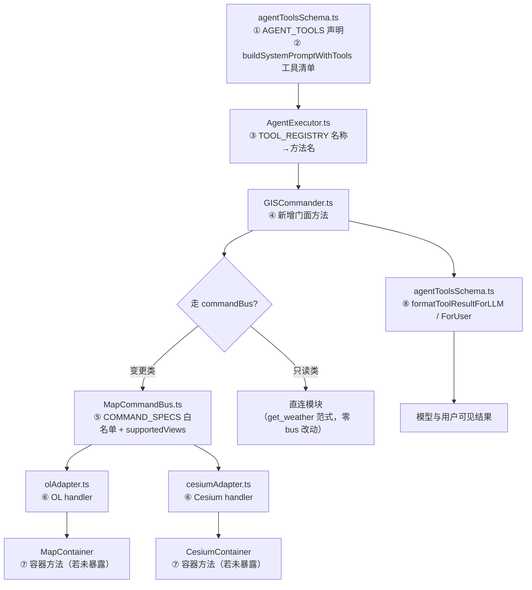

# Agent 工具能力扩展方案（L3）

> **状态**：待用户批准，未开始实施
> **日期**：2026-11-23
> **任务等级**：L3（跨 `chat` / `command-bus` / `ol` / `cesium` 四域，需改动既有公共函数签名）
> **关联**：`Docs/Guide/dev-conventions.md`（分层边界）、`Docs/TODO/proxy-ssrf-hardening-plan.md`（出站安全）

---

## 一、现状与缺口

### 1.1 现有能力面（7 个工具，全部围绕视图与外部查询）

| 工具 | 类型 | 走向 |
|---|---|---|
| `set_map_view` | 变更 | commandBus |
| `set_view_center` | 变更 | commandBus |
| `set_camera_orientation` | 变更 | commandBus（仅 Cesium） |
| `zoom_to_extent` | 变更 | commandBus |
| `search_and_zoom` | 变更 + 外部查询 | GISCommander 内部（geocode → commandBus） |
| `switch_basemap` | 变更 | commandBus |
| `get_weather` | **只读** | **直连模块，不走 bus** |

### 1.2 关键缺口

系统的实际能力远大于此。图层管理、测量结果读取、属性查询、空间分析、行政区定位、图层导出全部已实现，只是没有暴露给 Agent。用户说「把我的图层透明度调低」「当前有哪些图层」「这个图层的要素数是多少」时，模型只能回答做不到。

### 1.3 一个必须先修的结构性问题

图层操作函数**全部返回 `void` 且在找不到目标时静默 `return`**：

| 函数 | 位置 | 问题 |
|---|---|---|
| `setUserLayerVisibility` | `ol/layer/composables/useUserLayerActions.ts:96-105` | 无返回值，id 不存在时静默 no-op |
| `setUserLayerOpacity` | 同上 `:107-117` | 同上 |
| `removeUserLayer` | 同上 `:119-161` | 同上，且不可撤销 |
| `reorderUserLayers` | 同上 `:163-172` | 同上 |
| `zoomToUserLayer` | 同上 `:275-314` | 同上 |
| `setVisible` / `setOpacity`（3D） | `cesium/stores/cesiumLayers.ts:237-278` | 同上，且不支持时只 `console.warn` |

**直接暴露会出问题**：Agent 无法判断成功与否，会把静默失败当成成功回传给模型，用户看到「已帮你调成 30% 透明度」但地图没变。这类「谎报成功」比不提供能力更糟。

---

## 二、架构：新增一个工具要同步的 8 处

**只读工具可省掉 ⑤⑥⑦ 三处**（`get_weather` 已证明该路径可行），这是分批推进的核心杠杆。

---

## 三、分批方案

### 批次 A：只读工具（低风险，建议先做）

改动面：① ② ③ ④ ⑧ + 少量容器方法暴露。**不碰 commandBus，不改任何既有函数签名。**

| 工具 | 能力 | 复用入口 | 备注 |
|---|---|---|---|
| `get_map_state` | 当前引擎、中心、缩放/相机、底图、可视范围、图层数 | `mapContextSnapshot.ts:106` + `useMapState.getCurrentViewState`（`MapContainer:641`）+ `CesiumContainer:178` | 补齐快照缺失的 `layerCount` 与 `extent` |
| `list_layers` | 列出全部图层：id、名称、引擎、类型、可见、透明度、要素数 | `useLayerStore.ts:30/120`、`cesiumLayers.ts:157`、`remoteServices.ts:466` | **必须显式返回 id 命名空间**（3D 带 `cesium:` 前缀），否则后续操作必传错 |
| `get_layer_info` | 单个图层详情（含 bbox、sourceType、可执行动作） | `layerTreeBuilder.ts:359-399` + `getLayerMeta` | — |
| `get_measure_result` | 读取 3D 最近一次测量结果（面积/周长/长度/高程/方位角） | `useDrawMeasureStore.ts:96/98` | 非 Cesium 时返回明确错误码，不返回空对象 |

验收：模型能正确回答「现在有几个图层」「当前缩放级别」「刚才量的面积是多少」，且**不产生任何地图变更**。

### 批次 B：可逆状态变更（中等风险）

改动面：全部 8 处 + **先修 1.3 的返回值问题**。

| 工具 | 能力 | 前置修复 |
|---|---|---|
| `set_layer_visibility` | 显示/隐藏指定图层 | `useUserLayerActions.setUserLayerVisibility` 改为返回 `{success, layerId, visible}`；3D 侧 `cesiumLayers.setVisible` 同样 |
| `set_layer_opacity` | 调整透明度 0–1 | 同上，另需「图层不支持透明度」的结构化错误码 |
| `zoom_to_layer` | 缩放到指定图层范围 | `zoomToUserLayer` / `flyTo` 返回是否命中 |
| `solo_layer` | 只显示该图层 | 需返回「被隐藏的图层清单」，便于模型如实汇报 |

统一约定：
- **id 语义归一**：对外统一传裸 id，adapter 内部按引擎补/去 `cesium:` 前缀；
- **失败必须结构化**：`{success:false, code:'LAYER_NOT_FOUND'|'OPACITY_UNSUPPORTED'|'VIEW_UNSUPPORTED', message}`；
- `COMMAND_SPECS` 显式声明 `supportedViews`，不支持的引擎返回 `COMMAND_UNSUPPORTED_FOR_VIEW` 而不是静默。

### 批次 C：高风险（**建议不纳入本轮**）

| 能力 | 不做的理由 |
|---|---|
| `remove_layer` / `clear_all` | 不可撤销。若要做，必须先返回「将删除的图层名+要素数」预览，由用户在前端二次确认后执行 |
| `import_from_url` / `load_remote_service` | **无 URL 白名单**（`useLayerControlHandlers.ts:298`）。等于给 LLM 一个 SSRF 出口，违反 `proxy-ssrf-hardening-plan.md` 的既定方向 |
| `export_layer_file` | 触发浏览器下载（写文件）。替代方案：暴露 `export_layer_geojson_text`（`useMapContainerActions.ts:160`，纯内存返回），并加要素数上限截断（建议 ≤ 500）防止撑爆上下文 |
| `map_screenshot` | 无通用实现；OL 需 canvas 合成，第三方瓦片跨域会污染 canvas 导致空白 |
| `plan_route` | 消耗天地图 token 配额，且 `api/backend/routing.ts` 是零调用死代码，不可作为能力依据 |

---

## 四、明确不做的事（红线）

1. **不暴露任意 URL 加载**：`loadCustomMap` / `remoteServices` 无域名白名单，交给 LLM 调用即形成 SSRF 通道。
2. **不暴露文件写入与下载**：Agent 不应在用户无感知时触发浏览器下载。
3. **不暴露删除类操作**（本轮）：不可撤销，且当前无确认机制。
4. **不直接调用 `setActiveEngineType`**：它只改标志位，不挂载容器、不写 URL、不等就绪，会造成「能力位说 3D、实际还是 2D」的状态分裂。引擎切换只能走已有的 `set_map_view`（`MapCommandBus.ts:102-150`）。
5. **不把 `useTOCStore` 当图层操作入口**：它只是元数据仓库，`visible` 字段不驱动渲染，真实显隐在 `useUserLayerActions` / `cesiumLayers`。
6. **不承诺 3D 图层排序**：`cesiumLayerNodeBuilder.ts:93-94` 明确 `draggable:false, droppable:false`。

---

## 五、实施顺序与验收

| 阶段 | 内容 | 验收标准 |
|:--:|---|---|
| 0 | 本方案批准 | 用户确认批次范围 |
| 1 | 批次 A（4 个只读工具） | `tsc --noEmit` 通过；实机问「有几个图层」能准确回答；连续 3 轮对话无地图变更 |
| 2 | 底座修复（1.3 的 5 个 `void` 函数 + 3D 静默 warn） | 单元级：对不存在的 id 调用返回 `LAYER_NOT_FOUND`；实机：调透明度后地图确实变化 |
| 3 | 批次 B（4 个可逆工具） | 2D/3D 各验一遍；不支持场景返回结构化 code 而非静默 |
| 4 | 文档与版本 | README 三处 + CHANGELOG + 结构树 + 门禁 + 交接块 |

每阶段独立可交付，阶段间可暂停。

---

## 六、影响面与风险

| 项 | 评估 |
|---|---|
| 改动文件（批次 A） | `agentToolsSchema.ts`、`AgentExecutor.ts`、`GISCommander.ts`、`MapContainer.vue`、`CesiumContainer.vue`（暴露方法）、`mapContextSnapshot.ts` |
| 改动文件（批次 B 追加） | `MapCommandBus.ts`、`olAdapter.ts`、`cesiumAdapter.ts`、`useUserLayerActions.ts`、`cesiumLayers.ts` |
| 工具数量 | 7 → 11（A）→ 15（B） |
| Token 成本 | 每个工具声明约 150–250 token；15 个工具约 3k token，需观察是否挤压对话上下文 |
| 向后兼容 | 只增不改：既有 7 个工具签名与行为不动（批次 B 的内部返回值改造对外不可见） |
| 回滚 | 每批独立 commit，按批次回滚 |
| 主要风险 | ① 模型对新增工具误用（如把 `layerId` 猜成名称）→ 在 schema 里明确要求先调 `list_layers`；② 3D/2D id 前缀混淆 → adapter 内部归一；③ 上下文膨胀 → 图层列表默认只返回前 50 条并提示总数 |

---

## 七、待用户决策

1. **批次范围**：只做 A（只读，最安全）／A + B（含可逆操作）／还要 C 中的某些项？
2. **删除类**：是否需要 `remove_layer`？若需要，是否接受「先预览、用户确认后执行」的两步交互（需额外前端确认弹窗）？
3. **图层导出**：是否要 `export_layer_geojson_text`（纯文本返回，不写文件）？要的话要素上限取多少？
4. **是否需要 `run_spatial_analysis`**：它依赖后端且当前无返回值（只有 `message.error`），改造成本高于其它项，建议单独立项。
