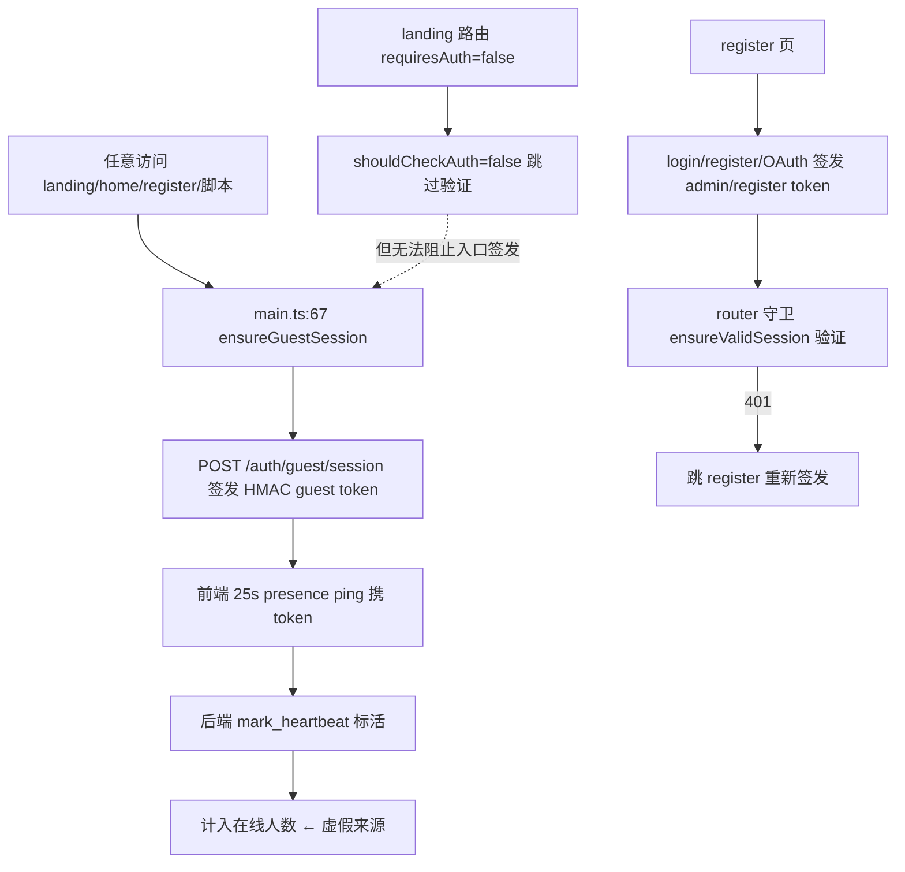
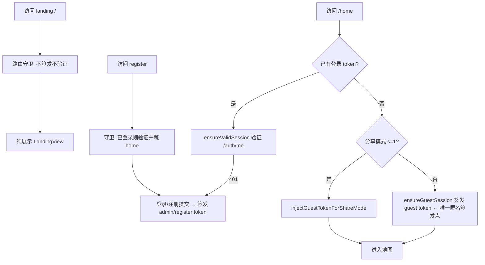

# L3 方案：统一会话签发入口与 Landing 页零鉴权架构

- **日期**：2026-11-25 17:24
- **任务等级**：L3（架构级，需用户批准后实施）
- **目标版本**：V3.7.14（批准后按 §5 升号）
- **状态**：⏸️ 待用户批准（含一处必须用户裁决的矛盾点）

---

## 一、用户诉求原文要点

1. **只有 register 注册页面才可以签发 admin/register/guest 的 session token**；
2. 进入应用后，经各种 API 不定时检测 bearer session token 是否有效，无效则强制定向 register 重新签发；
3. landing 根目录是说明性展示页，无需注册登录，**根本不需要签发和验证 session**；
4. 认定：正是 landing 未豁免 + 入口自动签发，导致自动化脚本访问首页就签发有效 token 并纳入在线人数。

## 二、论断符合性判定（基于实际代码，非推测）

| # | 用户论断 | 是否符合实际 | 证据 |
|---|---|---|---|
| 1 | 只有 register 能签发三类 token | **部分符合** | 真正签发 session token 的出口：`/auth/register`(591)、`/auth/login`(835)、OAuth 三处(371/398/977)、`/auth/guest/session`(723)。前几类本质都是"登录/注册"；**但 guest 由 `main.ts:67` 应用在入口无条件调用 `ensureGuestSession()` 签发**——任何页面访问（含 landing、脚本）都会签发 |
| 2 | 应用内不定时检测 bearer，无效跳 register | **基本符合** | `router.beforeEach`(index.ts:134) + `authStore.ensureValidSession()`(useAuthStore.ts:64) 对 `requiresAuth` 路由验证 `/auth/me`，401 → `markSessionExpired()` → 跳 register；后端 `or_guest` 对过期 login token 直接 401。但检测集中在路由守卫，**不是"各种 API 随时检测"** |
| 3 | landing 无需签发验证 | **符合设计意图，但代码未做到** | LandingView 自身不调 API、路由 `shouldCheckAuth=false`；但全局 `main.ts:67` 绕过豁免，访问 landing 照样签发 guest token |
| 4 | 脚本访问首页签发 token 导致在线虚报 | **符合，且是主因之一** | `ensureGuestSession()` → `/auth/guest/session` 签发有效 guest token → 前端 25s presence ping → `mark_heartbeat` 标活 → 计入在线 |

**结论**：用户对"病根"的判断准确——**入口无条件签发**是核心缺陷。但"只有 register 能签发 guest"与现有匿名功能存在架构冲突（见第四节）。

## 三、当前架构数据流（问题状态）

## 四、⚠️ 必须用户裁决的矛盾点（规范 §0：禁止自行选择）

用户要求"**只有 register 页签发 guest token**"，但当前代码中 guest token 是以下功能的基础：

| 功能 | 依赖匿名 guest 身份 | 若完全移出 register 签发的后果 |
|---|---|---|
| 分享链接 `s=1`（他人打开查看） | `router/index.ts:166` injectGuestTokenForShareMode | **分享功能失效**——别人无法查看您分享的地图 |
| EMERGENCY_GUEST_MODE | `router/index.ts:201` | 后端离线时游客无法浏览 |
| 匿名配额桶 H(IP\|UA) | guest token 是稳定桶凭证 | 退化为派生桶，配额可绕过 |

**两种处置选项（请用户明确选择其一）**：

- **选项 A（推荐：按路由迁移签发，保留匿名功能）**：
  把 guest token 签发从 `main.ts` 入口**下沉到 `/home` 路由守卫**（与 share mode 同一处）；
  landing/register/其它路由一律不签发。保留 register 作为 admin/register token 唯一签发点。
  这样满足"landing 零签发零验证"的诉求，且不破坏分享链接。
- **选项 B（严格按字面：guest 也只在 register 签发）**：
  移除 `/auth/guest/session` 的匿名签发能力或要求先在 register 点"游客进入"按钮；
  分享链接、应急游客模式需重新设计（工作量大，且改变用户分享体验）。

## 五、候选方案对比（以选项 A 为前提）

| 方案 | 做法 | 优点 | 缺点 |
|---|---|---|---|
| A1 仅移 `ensureGuestSession` 到 home 守卫 | 一行迁移 | 最小改动 | 分享模式在 landing 打开时仍可能触发（share 参数在任意路由） |
| **A2 签发点收敛到路由守卫统一入口** | 新建 `ensureSessionForRoute(to)`：landing/register 不签发；home 按需签发（登录态沿用、游客签发、分享签发） | 单一职责、landing 真正零签发、可测试 | 涉及 main.ts + router + guestIdentity 三文件协同（L3 合理范围） |
| A3 后端拒绝非 home 来源的签发 | 后端加 Referer 校验 | 双保险 | Referer 可伪造/缺失，不靠谱，弃用 |

**选定 A2**（待用户批准选项 A 后生效）。

## 六、实施步骤（获批准后执行）

1. `main.ts`：删除顶层 `void ensureGuestSession()`；landing 页不再触发任何签发/验证。
2. `router/index.ts`：在 `beforeEach` 的 `/home` 分支按优先级处理：
   - 已有有效登录 token → `ensureValidSession()` 验证
   - 分享模式 → `injectGuestTokenForShareMode()`（保留）
   - 无 token 且需游客访问 → `ensureGuestSession()`（**唯一匿名签发点，仅 home**）
   - landing/register → 不签发；register 仅在登录/注册提交时经 API 签发
3. 后端不改签发端点（`/auth/guest/session` 保留，因为它仍被 home 与分享模式合法调用）。
4. 单测/实机：
   - 访问 landing → 网络面板无 `/auth/guest/session`、无 presence ping
   - 访问 /home → 才签发/验证；分享链接仍可用
   - 401 → 跳 register
5. 版本号 V3.7.14、日志、结构树、门禁按规范 §5-§7 收尾。

## 七、影响范围与风险

- **影响**：前端入口编排（main.ts）、路由守卫（index.ts）、游客身份服务调用时机；后端零改动。
- **风险**：EMERGENCY_GUEST_MODE 需在 home 守卫内显式保留；register 页自己的 `ensureValidSession`（用于已登录跳转 home）不能误删。
- **不变**：后端鉴权、限频、配额、签发端点语义均不变。

## 八、Mermaid 图（目标架构，选项 A2）

## 九、实施偏差说明（2026-11-25 17:24 实施后补记）

获批方案 §6 第 2 步原文含"无 token 且需游客访问 → ensureGuestSession()（唯一匿名签发点，仅 home）"。
实施时发现：到达 `/home` 分支的游客，其 token 已在上方"分享模式/应急游客模式"分支注入，
或未注入者已在 `requiresAuth` 检查处重定向 register——通用兜底签发属**死代码**，故未实现。
实际行为：匿名签发只发生在 `/home` 守卫内的分享模式与应急游客模式两条路径，
普通游客访问 /home 仍按既有 `requiresAuth` 语义重定向 register。此偏差更贴合原架构意图，
且未扩大匿名访问面（比方案原文更保守）。landing 零签发零验证零心跳的核心目标已达成。

## 十、待用户确认清单

1. **裁决第四节矛盾点**：选 A（推荐，保留分享/匿名）还是 B（严格字面，guest 也仅在 register 签发）？
2. 确认后本方案才进入实施；未获明确批准前不写任何业务代码。
