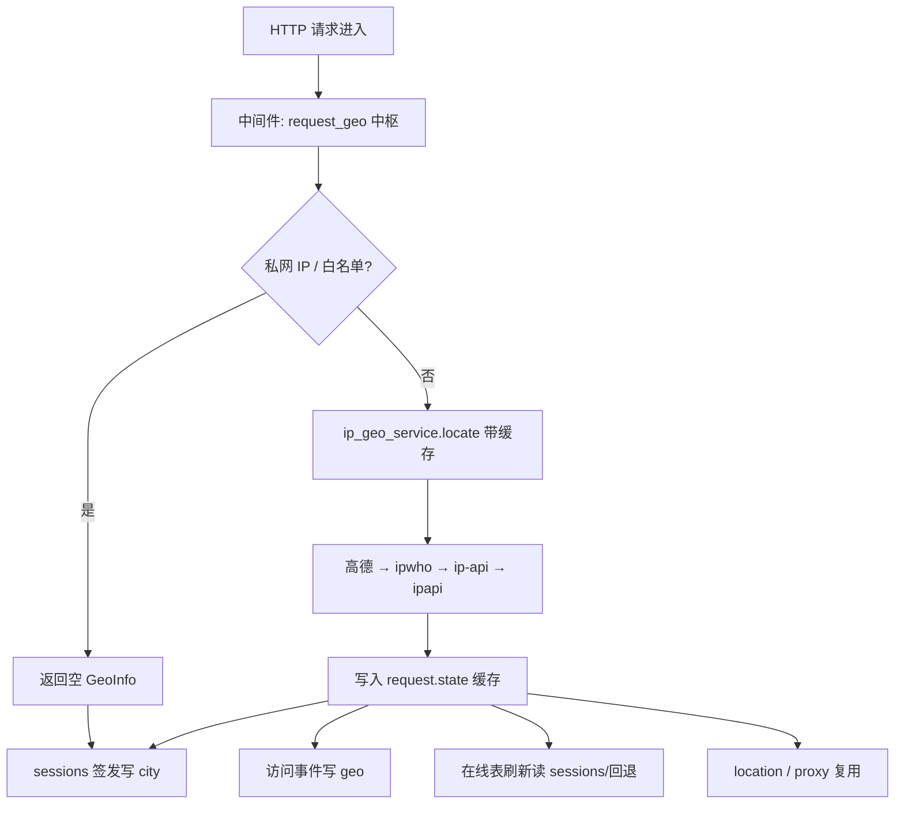

# L3 方案：统一 IP 地理信息中枢 + 入口一次解析多处复用

- **日期**：2026-11-26 10:30
- **任务等级**：L3（数据库结构变更 + 跨模块重构，需用户批准后实施）
- **目标版本**：V3.7.14（批准后按 §5 升号；当前 V3.7.13）
- **状态**：⏸️ 待用户最终确认（用户已给定架构方向：统一中枢、入口解析一次、各处复用）

## 一、用户诉求与方向裁决

1. 已有 IP 的表（sessions、admin_online_presence 等）应持久化解析出的城市。
2. 询问 IP 解析用的什么服务。
3. **架构方向（用户明确）**：增加统一的 IP 解析逻辑中枢，在入口统一解析出信息；
   一个 IP 只解析一次，其它表在维护/新增时从中枢取用，不再各自解析。

## 二、现状核查（实际代码与本地库）

### 2.1 含 IP 的表

| 表 | ip | 地理字段 | 来源 |
|---|---|---|---|
| `sessions` | ✅ | ❌ | — |
| `expired_sessions` | ✅ | ❌ | 归档副本 |
| `admin_online_presence` | ✅ | ✅ ip_city/region/country/lat/lng | 反查 `visit_tracking_events`，无访问事件则空 |
| `guest_identity_records` | ✅ | 仅经纬度 | — |
| `login_attempts` | ✅ | ❌ | — |
| `user_visits`/`visit_tracking`/`visit_tracking_events` | ✅ | ✅ | 各自独立解析写入 |

**问题**：解析逻辑分散在 3 处（`statistics.py:fetch_geolocation`、`location.py:238/345`、`external_proxy.py:714`），
每次都独立调用 `ip_geo_service.locate`，虽有内存缓存但**同一请求内可能多次查缓存**，
且新增表要写城市时又要复制一遍解析调用——正是用户指出的架构缺陷。

### 2.2 IP 解析服务（回答用户问题）

`backend/services/ip_geo.py` 四级降级 + 内存缓存 + 自动跳过私网 IP：
1. **高德 AMAP**（L2 api_keys.amap_key，仅中国 IP，精度最高）
2. **ipwho.is**（免费 HTTPS，覆盖数据中心 IP）
3. **ip-api.com**（免费，仅 HTTP，不稳定）
4. **ipapi.co**（30 次/分钟，最后兜底）

## 三、中枢设计（按用户方向）

### 3.1 新模块 `backend/services/request_geo.py`（或 core 层，实施时定）

统一入口，提供两个能力：
- `async def resolve_request_geo(request) -> GeoInfo`：
  从 request 提取 IP（`_extract_client_ip`，与展示口径一致）→ 私网直接返回空 →
  调用 `ip_geo_service.locate(ip, prefer_amap=True, use_cache=True)` →
  返回 dataclass `{ip, city, region, country, latitude, longitude, source}`。
- 请求内缓存：结果挂到 `request.state._resolved_geo`，同一请求多次调用只解析一次；
  进程级缓存继续由 `ip_geo_service` 既有 `_cache` 承担（同一 IP 跨请求只解析一次）。

### 3.2 入口触发（"入口统一解析"的落点）

在现有 `check_startup_state` HTTP 中间件之后新增一个轻量中间件或在其内挂钩：
- 白名单路径（`/health`、`/docs`、OPTIONS 预检等）跳过；
- 对含 `/api/` 的请求，取 IP 并调用中枢解析，结果写入 `request.state`；
- **不阻断请求**：解析异常静默，仅记录 debug 日志。

### 3.3 各处复用（消费方改造）

| 消费方 | 原逻辑 | 改为 |
|---|---|---|
| `sessions` 签发（`_create_session_sync` / `register_guest_session`） | 无城市 | 从中枢取 city/region/country 落库 |
| `admin_online_presence` 刷新 | 反查 `visit_tracking_events` | 优先读 sessions 新列，回退旧表 |
| `statistics.py::fetch_geolocation` | 自己调 locate | 改为中枢包装（保留函数签名兼容现有调用） |
| `location.py:238/345` | 自己调 locate | 改为中枢（有 request 上下文时） |
| `external_proxy.py:714` | 自己调 locate | 无 request 上下文，保留直调（中枢提供 `resolve_ip(ip)` 无 request 版本） |
| `visit_tracking_events` 写入 | 调用 fetch_geolocation | 自动经中枢，无需改 |

### 3.4 DB 结构变更

- `sessions` / `expired_sessions` 增加 `ip_city`、`ip_region`、`ip_country`（TEXT NOT NULL DEFAULT ''），
  schema 幂等 ALTER；归档搬运函数同步列。
- 其余表已有地理字段，不改结构。

## 四、Mermaid 图

## 五、关键决策点（需用户确认）

1. **中枢落点**：`services/request_geo.py`（服务层，与 ip_geo.py 同目录）vs `core/request_geo.py`（核心工具层）。
   推荐 `services/`，因它依赖 `ip_geo_service`（服务层），避免 core 依赖 services 的反向依赖。
2. **入口触发方式**：
   - **M1 中间件主动解析（推荐）**：真正"入口统一"，但每个 API 请求都会查一次缓存（微秒级），
     私网 IP 直接跳过无外部请求；
   - **M2 懒加载（首次消费时解析）**：零浪费，但严格说不是"入口统一"。
3. **DB 字段范围**：按用户"一个中枢多处复用"方向，推荐只给缺字段的 `sessions`/`expired_sessions` 加列，
   其余表复用已有字段（不重复造字段）。

## 六、影响与风险

- **性能**：进程级缓存避免同一 IP 重复外部请求；请求级缓存避免同请求重复查缓存。
  私网 IP（HF 环境）零外部请求。
- **隐私**：仅城市级，与现有 visit_tracking_events 采集粒度一致。
- **兼容**：在线表采用"新列优先、旧表回退"，历史数据不丢。
- **失败策略**：解析失败静默留空，绝不阻断签发/访问/在线统计。

## 七、待用户确认

请确认：中枢落点（推荐 services）、入口方式（推荐 M1 中间件）、DB 字段范围（推荐仅 sessions+归档）。
确认后进入实施；未获明确批准前不写业务代码。
