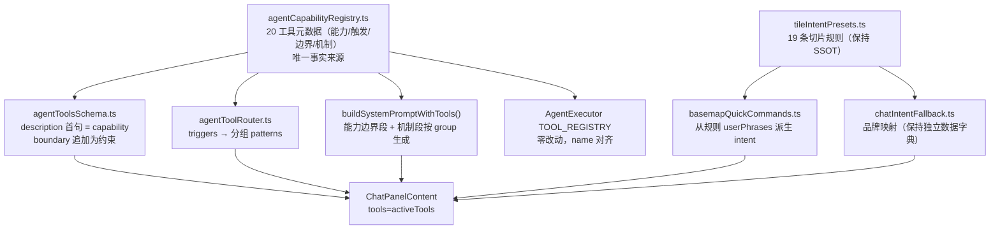

# L3 方案：Agent 能力注册表（借鉴 Skill 渐进披露，不引入 MCP 协议）

> **日期**：2026-11-27 11:10
> **任务等级**：L3 架构级
> **状态**：✅ 已实施完成（2026-11-27 11:20，验证见实施日志）
> **关联版本**：V3.7.27
> **实施日志**：`Docs/LLM_record/26-11/2026-11-27/2026-11-27-agent-capability-registry.md`

---

## 一、问题与目标

### 核心症状（事实基线）

能力定义散落 5 个文件共 1376 行：

| 文件 | 行数 | 持有什么 |
|---|---:|---|
| `agentToolsSchema.ts` | 624 | 20 个工具 schema 的 description + System Prompt 全文 |
| `chatIntentFallback.ts` | 217 | 50+ 条底图品牌映射 + 正则兜底 + 工具显示名 |
| `tileIntentPresets.ts` | 349 | 19 条高德/Google 单要素切片规则 + 解析器 |
| `agentToolRouter.ts` | 109 | 6 组工具分发关键词 + 核心集 |
| `basemapQuickCommands.ts` | 77 | 18 条快捷命令（intent 文本硬编码） |

已发生的直接后果：V3.7.21「谷歌代理卫星」语义在 `tileIntentPresets` 补了规则、`chatIntentFallback` 早有映射，两处不同步导致建议词失败；V3.7.22 为「让 agent 自主」删掉罗盘交互协议导致功能失效。

### 目标

1. **工具层能力元数据单一事实来源**：每个工具的能力描述、触发场景、硬约束、交互机制只写一次。
2. **派生而非复制**：工具 schema description、System Prompt 能力边界段、工具路由关键词由注册表生成。
3. **保留机制、放手决策**：交互协议（罗盘三段式）显式写；场景判断与参数估算交给模型。
4. **不引入 MCP SDK / 不改后端**：工具在浏览器执行，跨进程协议层无用武之地。

---

## 二、范围界定（避免过度设计）

### 纳入注册表

20 个工具的**工具层元数据**：
- `name`：工具名（与 TOOL_REGISTRY key 一致）
- `capability`：能力一句话描述（进 schema description 首句）
- `triggers`：触发场景关键词（进 router 分组 patterns）
- `boundary`：硬约束（删除不可撤销 / 失败如实转述 / 额度耗尽停止）
- `mechanism`：交互机制（仅 `enable_compass` 有三段式，其余为空）

### 不纳入注册表（保持独立）

| 内容 | 理由 |
|---|---|
| `chatIntentFallback` 的 50+ 条底图品牌映射 | 这是**数据字典**（天地图/ESRI/OSM/百度/腾讯全品牌），不是工具元数据；19 条切片规则覆盖不了，强行合并会丢失能力 |
| `tileIntentPresets` 的规则表与解析器 | 已是 SSOT，快捷命令从它派生即可 |
| 工具 `parameters` 的 JSON Schema | 各工具参数结构差异大，留在 `agentToolsSchema.ts` 原样维护 |
| 后端 `upstream.py` | 零改动 |

---

## 三、数据流与文件交互

---

## 四、迁移步骤（分步可回滚）

### 步骤 1：固化回归基线（先校验，后重构）

项目**未安装 vitest/jest**，按 Force_command 不擅自增删依赖。回归基线采用**临时 Node 校验脚本**（放 `node_modules/.cache/`，用完即删，不入库）：
- 工具 schema 序列化字符数断言（≤ 9,000）
- 18 条快捷命令 intent 全部命中 `resolveTileIntentByText` 预期规则
- 8 项罗盘协议关键字串断言（自动回传 / 本轮止步 / 不重复启用 / 半径映射 / 内置咨询不拒绝 / 自主判断保留 等）
- 14 项加粗归一化用例（V3.7.24–26 累积）
- 建议词解析：5 条默认 suggestions 均能被主路径解析

验证脚本在重构**前后各跑一次**，结果写日志对比。

### 步骤 2：建立注册表

新增 `agentCapabilityRegistry.ts`，按第二节字段定义 20 个工具条目。分组沿用现有 6 组 + 核心集，避免路由行为漂移。

### 步骤 3：派生改造

- `agentToolsSchema.ts`：description 首句由 `capability` 注入，`boundary` 追加；`buildSystemPromptWithTools()` 的"能力边界"段由注册表生成。
- `agentToolRouter.ts`：分组 patterns 由注册表 `triggers` 生成，保留宽进策略与未登记工具兜底。
- `basemapQuickCommands.ts`：intent 从 `TILE_INTENT_RULES[i].userPhrases[0]` 派生，消除硬编码文本。
- `chatIntentFallback.ts`：不改品牌映射；仅把 `switch_basemap` 兜底路径改为优先调用 `resolveTileBasemapArg`（已是 SSOT）。

### 步骤 4：提示词按需注入

`buildSystemPromptWithTools(toolNames: Set<string>)`：仅当工具集含 `enable_compass` 时，拼入罗盘三段式机制段（约 600 字符）。其余轮次不发。

### 步骤 5：回归验证 + 收尾

跑全量测试、typecheck、门禁；更新版本/日志/结构树/CHANGELOG。

---

## 五、风险与对策

| 风险 | 对策 |
|---|---|
| 重构中 System Prompt 措辞漂移，重复 V3.7.22/23 | 步骤 1 固化 8 项协议断言，任何改动跑全量回归 |
| 注册表遗漏工具导致能力丢失 | 沿用现有"未登记工具兜底常驻"机制；测试断言 20 工具全覆盖 |
| 快捷命令 intent 派生后文案变化 | 派生取 `userPhrases[0]`（原文），测试断言 18 条命中不变 |
| 提示词按需注入导致某轮缺机制段 | 仅按工具集成员判定，工具集在首轮固定且复用；测试断言含 enable_compass 时机制段必在 |
| 影响今天刚修的加粗 bug | 加粗在 `useMarkdownRenderer.ts`，本方案零触碰；14 项用例作为回归基线 |

---

## 六、完成条件

- [x] 回归基线脚本（临时，重构前后各跑，8/8 全绿且数值零漂移）
- [x] 注册表建立，20 工具全覆盖
- [x] router 从注册表派生触发词；quickCommands 加规则一致性校验
- [x] 罗盘机制段按需注入（931 字符，仅含罗盘工具时发送）
- [x] 全量回归 0 失败，typecheck 0 错误
- [x] 门禁全绿，零 Git 写操作

> 注：项目无 vitest/jest，按 Force_command 不擅自增删依赖，回归基线用临时 Node 脚本（用完即删），
> 数值与断言已写入实施日志。schema description 全文刻意保留原位（措辞敏感，零漂移优先），
> 注册表只承载分组/触发词/机制段——这是对「过度设计」的主动收敛。
