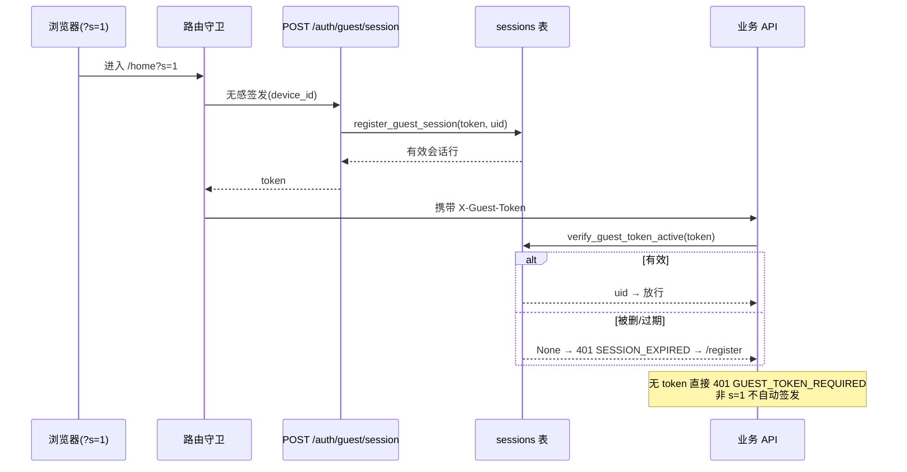

# 废除无 token 匿名通道：所有身份必须持有 sessions 有效 token（L3）

> 状态：🔵 实施中（用户 2026-11-28 明确指令「不允许无 token 的任何登录」，依 Force_command §0 优先级 1 视为批准）
> 任务等级：L3（鉴权架构变更）
> 目标版本：V3.7.16

---

## 一、问题分析

**核心症状**：后端 `dependencies.py:104-140` 的 `_build_temporary_guest_session_async()` 在请求**不带任何 token** 时，仍按 `H(身份IP|UA)` 派生一个 `token=""` 的内存临时游客身份，并放行 `require_api_access_or_guest` 系端点。该身份不写 `sessions`，管理员看不到也删不掉，与「sessions 表是唯一权威、所有在线都必须是有效 session」的目标冲突。

**用户明确要求**：
1. 匿名访问只允许 `?s=1` 分享模式一种情况；
2. `s=1` 仍须签发真实 token，前端无感完成（既有链路：`router/index.ts:163-172` → `injectGuestTokenForShareMode()` → `POST /auth/guest/session` → `register_guest_session()` 写 sessions）；
3. 不允许无 token 的任何登录；有 token 必须在 sessions 表维护；
4. session 表是最权威、唯一的会话真值。

**影响面核查结论**：
- 落地页 `LandingView.vue/.ts` 零 API 调用，不受影响；
- 前端路由守卫对非 `s=1` 未登录用户本就重定向 `/register`（`router/index.ts:198-207`）；
- `/auth/me` 的 60 秒定时体检仅在本地持有 token 时发起（`main.ts:46`）；
- 因此「无 token 一律 401」不会误伤正常浏览流程。

## 二、候选方案

| 方案 | 做法 | 评价 |
|---|---|---|
| A 后端无 token 时自动签发并写 sessions | `_build_temporary_guest_session_async` 内调签发 | **否决**：任意脚本无 token 也能铸造身份，限频可被绕过，违背「只允许 s=1」 |
| **B 无 token 一律结构化 401；s=1 由前端无感签发后携带 token（选定）** | 后端拒绝无 token；前端 `s=1` 路由守卫签发，后续请求带 `X-Guest-Token` | 身份铸造入口唯一且受限于 `s=1` 前端流程 + 后端签发的 (IP,UA) 限频；session 表成为唯一真值 |
| C 保留派生桶但补写 sessions | 派生桶也落表 | 否决：仍无 token、仍可任意铸造 |

## 三、实施步骤

1. **后端 `dependencies.py`**：
   - `_build_temporary_guest_session_async()` 重命名为 `_resolve_guest_token_session_async()`：无 `X-Guest-Token`/Cookie 时抛 401 `GUEST_TOKEN_REQUIRED`（前端据此**自动签发后重试**，不跳 register）；签名有效但 sessions 无行/过期时仍抛 401 `SESSION_EXPIRED`（跳 register）。
   - 保留 DB 临时故障时 `SESSION_EXPIRED` 不误伤的处理（既有 `session_query_failed` 分支不动）。
2. **前端 `client.ts`**：401 `GUEST_TOKEN_REQUIRED` 不跳 register、不清会话；在 `s=1` 场景下由响应拦截器调用 `ensureGuestSession({force:false})` 签发并把原请求重放一次（`@common/user/services/guestIdentity`）。仅在 `s=1` 时自动签发，其它场景只提示。
3. **测试**：
   - `test_guest_identity.py`：无 token 场景断言 401 `GUEST_TOKEN_REQUIRED`；有 token 有效场景断言正常；已撤销 token 断言 `SESSION_EXPIRED`。
   - `test_realtime_stats.py`：适配重命名后的依赖函数。

## 四、Mermaid 图

## 五、验收判据

- 无 token 直接调任意 `require_api_access_or_guest` 端点 → 401 `GUEST_TOKEN_REQUIRED`，不产生任何内存身份、不写库。
- `?s=1` 首次进入 → 前端自动签发、写 sessions、后续 API 正常；签发失败 → 跳 `/register`。
- 管理员删 sessions 中游客行 → 该游客下次请求 401 `SESSION_EXPIRED` → 跳 `/register`。
- 在线表/人数口径不变（仍要求有效 session）。
