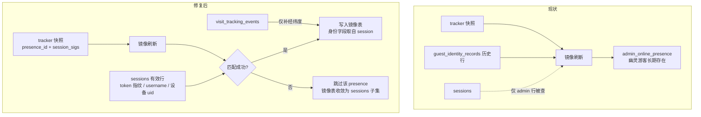

# 管理员在线镜像表 ↔ 会话表子集约束（P1）方案

> 状态：🔵 实施中（用户 2026-11-28 明确指令「给我修复 P1」，依 Force_command §0 优先级 1 视为批准）
> 任务等级：L3（数据库结构变更）
> 目标版本：V3.7.16

---

## 一、问题分析

**核心症状**（2026-11-28 线上实测，admin token `F4n-…ZJw4` 指纹 `34c57a87a2722689`）：

- `sessions` 仅 2 行：admin 会话 + 游客 `guest_2470`（设备 `gd_686fdd…`）。
- `admin_online_presence` 亦 2 行：admin 行与会话一致；游客行却是 `g:guest_7d4a7f7ae313eab9`（展示名 `guest_2000`、设备 `gd_338497…`、`first_seen_at=2026-11-16`、`last_seen_at=2026-11-24`），在 `sessions` 中无任何对应行。
- tracker 调试：`fallback_heartbeat_age_seconds[g:guest_7d4a…] = 55`（窗口 150s）、`sse_connections=0`——该行靠 API 兜底心跳保活，与会话真值无关。

**根本原因**：`_refresh_admin_online_mirror_sync()`（`statistics.py:1245`）以内存 tracker 快照为**唯一驱动**，身份详情由 `_mirror_identity_from_db_sync()` 优先从**持久化的 `guest_identity_records`** 补全，从不校验 `sessions` 中是否存在有效会话。镜像表因此成为「历史身份 + 当前心跳」的混合体，不保证是 `sessions` 的子集。

**为什么 admin 行恰好正确**：`u:admin` 按 `username` 查 `sessions` 命中；游客按 `presence_id` 截出的 uid 查 `guest_identity_records` 命中历史行，两者的字段来源路径不同。

**受影响模块**：`backend/api/statistics.py`（镜像刷新）、`backend/api/realtime_stats.py`（快照需暴露会话指纹）、`backend/api/auth/schema.py`（镜像表加列）、`backend/tests/test_realtime_stats.py`（回归测试）。

## 二、候选方案

| 方案 | 做法 | 评价 |
|---|---|---|
| A 仅删历史回查 | 镜像只查 sessions，查不到就空字段 | 会丢经纬度/昵称，且不解决「幽灵行仍存在」 |
| B tracker 驱动 + 会话指纹反查（**选定**） | 刷新时对 tracker 每个 presence 反查 `sessions` 有效行：先按 `session_sig` 匹配 token 指纹，再按 username / 设备派生 uid / guest_uid 回退；匹配失败则**不写镜像表** | 保持在线判定仍由 tracker 负责（不碰公网在线数口径），镜像表严格收敛为 sessions 子集；字段以 session 行为准 |
| C 镜像表直接改视图 | 每次查询实时 JOIN sessions | 改动面大，且无法保留 SSE/client 明细，否决 |

## 三、实施步骤

1. `schema.py`：镜像表新增 `session_token_sig TEXT NOT NULL DEFAULT ''`，并对存量库做 `PRAGMA table_info` + `ALTER TABLE` 幂等迁移。
2. `realtime_stats.py`：`snapshot_details()` 增加 `session_sigs`（汇总兜底心跳与 SSE 连接的会话指纹）。
3. `statistics.py`：
   - 新增 `_session_rows_sync()` 读取未过期 sessions（含 `created_at + 4h` 硬上限，与 `auth/session.py` 同口径）；
   - 新增 `_match_session_for_presence()`（指纹优先 → username → 设备派生 uid → guest_uid）；
   - `_refresh_admin_online_mirror_sync()` 对无有效会话的 presence **跳过**；字段全部取自命中的 session 行，`guest_identity_records` 不再提供身份字段，经纬度仍从 `visit_tracking_events` 补；
   - `last_heartbeat_at` / `client_ids` / `session_count` / `sse_connections` 仍来自 tracker（在线状态量，非身份属性）。
4. 测试：`test_admin_online_mirror_only_keeps_current_identities` 适配新 schema；新增「无会话幽灵行被剔除」用例。

## 四、Mermaid 图

## 五、验收判据

- 线上刷新后，镜像表每一行都能在 `sessions` 找到未过期会话行；`guest_2000` 幽灵行消失。
- admin / `s=1` 分享游客均正常出现在在线表且字段与会话一致。
- 在线人数口径不变（tracker 仍是真值），本次仅修镜像展示表。
