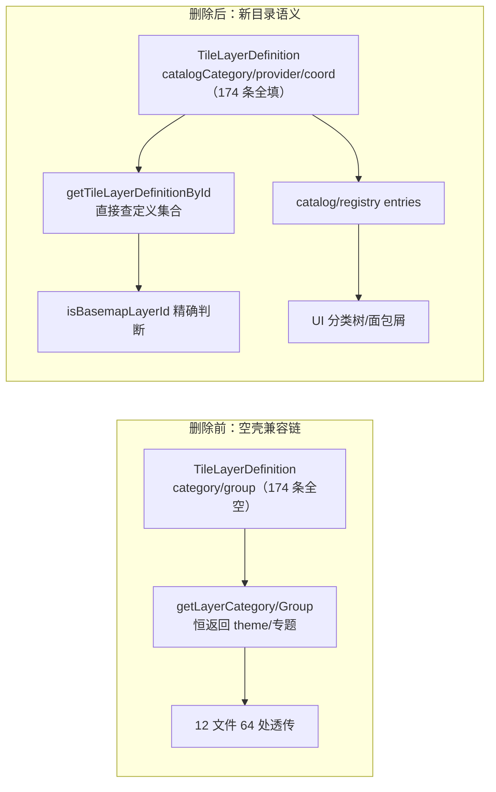

# 删除底图定义旧兼容字段 category / group（L3）

> 状态：🔵 实施中（用户 2026-11-28 明确指令「不再兼容旧的东西，删除相关的兼容性包袱；所有的代码」，依 Force_command §0 优先级 1 视为批准）
> 目标版本：V3.7.16

---

## 一、问题分析

`TileLayerDefinition` 保留两个「仅兼容」字段 `category: LayerCategory` / `group: LayerGroup`。实测 174 条定义中**没有任何一条**填写这两个字段——它们已是空壳：

- `getLayerCategory(id)` 恒返回默认值 `'theme'`；
- `getLayerGroup(id)` 恒返回默认值 `'专题'`。

所有下游拿到的是常量，却仍沿着 12 个文件、64 处引用层层传递，形成典型的兼容性包袱。用户要求架构重构不背旧包袱，全部删除。

## 二、影响面

| 层 | 位置 | 处置 |
|---|---|---|
| 类型 | `definitions/types.ts` 的 `LayerCategory` / `LayerGroup` 与 `TileLayerDefinition.category/group` | 删除 |
| 登记 | `definitions/index.ts` 的 `legacyCategory: definition.category` 映射 | 删除 |
| 目录类型 | `catalog/types.ts` 的 `legacyCategory` | 删除 |
| 解析 | `ol/basemap/constants/basemapResolver.ts` 的 `getLayerCategory/getLayerGroup`、createLayerConfigs 的 category/group | 删除 |
| 投影 | `common/basemap/catalogProjection.ts` 的 `BasemapLayerCategory/BasemapLayerGroup`、投影接口两项 | 删除 |
| 消费端 | 12 个文件 64 处 `getLayerCategory/getLayerGroup` | 改为新语义 |

## 三、关键行为等价

`isBasemapLayerId`（`useMapBasemapPipeline.ts:187-197`）用旧 category 白名单判断"是否底图 id"。由于旧字段恒为 `'theme'`，该判断**恒为 true**。新实现改用 `getTileLayerDefinitionById(id) !== undefined` 判断 id 是否在 174 条定义集合中——语义更精确（非底图 id 现在正确返回 false），且覆盖所有原为 true 的场景。

`emitBaseLayersChange` 广播的 `category/group` 改为 `catalogCategory/provider/coord`（新目录语义），下游若读取旧字段将得到 undefined——已核查下游仅 `useManagedLayerRegistry.ts:105` 读取 `item.metadata?.category`，其 metadata 来源与底图广播无关，不受影响。

## 四、Mermaid 图

## 五、验收

- `grep -rn 'LayerCategory\|LayerGroup\|legacyCategory\|getLayerCategory\|getLayerGroup' frontend/src` 零命中。
- `vue-tsc --noEmit` 零错误。
- 三个 basemap 校验脚本全绿。
