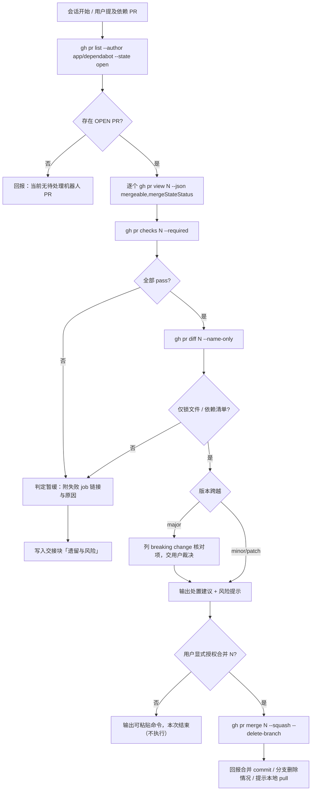

# 方案：在 Force_command.md 中新增「线上机器人 PR 处置」指引

> **任务等级**：L3（依据 `Force_command.md` §10——修改本规范文件属 L3，须先批准方案再施工）
> **提出时间**：2026-11-01 12:20
> **状态**：⏳ 待用户批准
> **目标版本**：V3.6.37

---

## 1. 需求与核心症状

**用户诉求**：为 `Docs/Force_command.md` 增加一节指引，说明如何用**本地 GitHub CLI** 查看并处置**线上机器人开出的依赖版本 PR**。

**当前缺口（核心症状）**：

| 缺口 | 具体表现 | 后果 |
|---|---|---|
| 无处置规程 | 规范全文只有 §2.1「禁止 Git 写操作」，未提及 `gh` | 会话遇到 Dependabot PR 时只能凭临场判断，或干脆不动 |
| 权限边界未定义 | `gh pr merge` 会写远端 `main`，但 §2.1 的禁止清单是枚举式（commit/push/stash/reset/checkout/rebase/改分支），**未显式覆盖 PR 合并** | 存在「按字面不违规、按精神违规」的灰区，Agent 可能自行解释 |
| 判定标准缺失 | 什么算「可以合」没有客观判据 | 容易把 major 破坏性升级当补丁合并 |
| 版本号/日志归属不明 | 合并机器人 PR 是否要升版本、写日志，规范未答 | 要么漏升版本，要么为一次依赖合并写无意义日志 |

**受影响模块**：`Docs/Force_command.md`（主）、`Docs/Guide/dev-conventions.md`（强制规范摘要需同步，§10 明文要求）、根 `README.md`（版本号）、`Docs/Guide/CHANGELOG.md`、`Docs/LLM_record/`。

---

## 2. 现状核查（已实测，非推断）

### 2.1 工具链

| 项 | 实测结果 |
|---|---|
| `gh` 版本 | `2.95.0 (2026-06-17)`，位于 PATH |
| 认证状态 | `✓ Logged in to github.com account NEGIAO (keyring)`，active |
| Token scopes | `gist`, `read:org`, `repo`, `workflow` |
| 远端 | `origin https://github.com/NEGIAO/WebGIS-Dev.git` |
| 当前分支 | `main` |

### 2.2 机器人身份与行为

| 项 | 实测结果 |
|---|---|
| 机器人 | **Dependabot**，`author.login = app/dependabot`，`is_bot = true` |
| 分支命名 | `dependabot/npm_and_yarn/<path>/<pkg>-<ver>`、`dependabot/uv/<path>/<pkg>-<ver>` |
| 是否自行合并 | **否**。`.github/dependabot.yml` 注释已记录 2026-10-25 核查结论：`allow_auto_merge=false`、无 rulesets、无 auto-merge workflow，历史 #33/#34/#35 合并 actor 均为账号本人 |
| 更新策略 | 仅跟 **major**（`ignore` 掉 semver-minor / semver-patch），weekly 检查；**安全更新不受 schedule 约束** |
| 仓库合并策略 | `squashMergeAllowed=true`、`mergeCommitAllowed=true`、`rebaseMergeAllowed=true`、**`deleteBranchOnMerge=false`** |

> `deleteBranchOnMerge=false` 是关键事实：`gh pr merge` 若不加 `--delete-branch`，`dependabot/*` 远端分支会残留。

### 2.3 当前待处理 PR（截至 2026-11-01 12:15）

| PR | 依赖 | 版本 | 变更文件 | 行数 | 检查 | mergeStateStatus |
|---|---|---|---|---|---|---|
| #45 | follow-redirects | 1.16.1 → 1.16.2 | `frontend/package-lock.json` | +3/-3 | 4 项全 pass | `CLEAN` / `MERGEABLE` |
| #46 | certifi | 2026.4.22 → 2026.10.18 | `backend/uv.lock` | +20/-20 | 7 项全 pass | `CLEAN` / `MERGEABLE` |

**#46 需特别提示**：diff 除 certifi 版本外，还把 `uv.lock` 的 `revision = 3` 改为 `revision = 5`，并移除/改写了多处 `python_full_version` marker（如 `click-plugins` 的 `click` 依赖 marker 被删）。这是**生成锁文件的 uv 版本漂移**导致的整份重解析，不是单纯的版本号替换。风险等级高于 #45。

### 2.4 命令可用性验证

| 命令 | 验证结果 |
|---|---|
| `gh pr list --author "app/dependabot" --state open --json number,title` | ✅ 返回 #45/#46 |
| `gh pr view <n> --json mergeable,mergeStateStatus,statusCheckRollup` | ✅ 字段有效 |
| `gh pr checks <n>` / `--watch` / `--fail-fast` / `--required` | ✅ 帮助文本确认存在 |
| `gh pr diff <n> --name-only` | ✅ |
| `gh pr merge <n> --squash --delete-branch` | ✅ 旗标存在 |
| `gh repo view --json squashMergeAllowed,deleteBranchOnMerge` | ✅ |

### 2.5 顺带发现的既有违规（不在本次修复范围，仅报告）

根 `README.md` 版本号三处不一致：

- 第 130 行「项目简介」：`（当前版本 V3.6.36）`
- 第 637 行页脚：`V3.6.36 · 开发中 · 最后更新 2026-10-31`
- 「版本演进」表首行 + `CHANGELOG.md`：**V3.6.37 (2026-11-01)**

即上一会话只更新了 §5 要求的三处中的一处（版本表）与 CHANGELOG。**用户已裁定：本次只记 TODO，不做专项返工**。

> ⚠️ 但需说明一个技术必然性：§5 要求本次任务把三处**全部**更新到 V3.6.37。执行后「项目简介」与页脚会从 3.6.36 直接跳到 V3.6.37，缺口被动闭合。这不是额外返工，而是 §5 的必做项；同时仍按裁定在 `bugfix-optimization-plan.md` 记录该历史缺口以备审计。

---

## 3. 候选方案对比

### 方案 A：只写一段「用 gh 看 PR」的操作说明

- 做法：在 §2 后追加 3–5 行，列出 `gh pr list` / `gh pr view`。
- 优点：改动最小，约 15 行。
- 缺点：**未解决权限灰区**——`gh pr merge` 是否违反 §2.1 仍无定论；无判定标准；下次会话依旧各自解释。**不满足需求**。

### 方案 B：新增独立 §12 + 修订 §2.1 交叉引用 + 同步 dev-conventions 摘要 ✅ 选定

- 做法：
  1. 新增 §12「线上机器人 PR 处置（GitHub CLI）」，含权限矩阵、五步只读核查、合并准入条件、授权与执行、版本/日志归属、禁止事项、常见故障。
  2. 在 §2.1 第 1 条末尾加一句交叉引用，把「PR 合并」显式纳入禁止清单，并指明唯一例外出口。
  3. 在 §1 分级表下加一行注记：机器人 PR 的查看与合并**不计入 L0–L3 代码任务**。
  4. 同步 `dev-conventions.md`「强制规范（摘要）」新增第 14 条（§10 明文要求）。
- 优点：权限边界显式化、判定标准可执行、不破坏 §2.1 的「决策权 100% 归用户」原则（合并仍需逐次授权）。
- 缺点：规范文件增长约 90–110 行；需同步第二份摘要，存在漂移风险（已由 §10 的同步义务覆盖）。

### 方案 C：把规则塞进 §2.1 第 1 条的例外括注

- 优点：零新增章节。
- 缺点：§2.1 是「硬边界禁止清单」，塞入完整流程会破坏该节「一句话一条禁令」的体例；且 §12 这类操作性内容无处安放。**否决**。

---

## 4. 选定方案的规则设计

### 4.1 权限三分（核心）

| 档位 | 动作 | 命令 | 授权要求 |
|---|---|---|---|
| **只读·随时可做** | 列清单、看详情、看检查、看 diff、看仓库策略 | `gh pr list` / `pr view` / `pr checks` / `pr diff` / `gh repo view` / `gh api` **GET** | 无需 |
| **需逐次显式授权** | 合并单一 PR | `gh pr merge <n> --squash --delete-branch` | 用户须说出「合并 #<n>」类明确指令，授权仅对**该单一 PR、该一次**有效 |
| **一律禁止** | 自动合并、切分支、自评审、关闭、评论、编辑、任何 `gh api` 写方法、`--admin` | `pr merge --auto` / `pr checkout` / `pr review` / `pr close` / `pr comment` / `pr edit` / `gh api -X POST\|PATCH\|DELETE` / `pr merge --admin` | 无出口 |

> `gh pr checkout` 被列为禁止，理由是它**切换本地工作区分支**，直接落在 §2.1「改分支」的禁止范围内。

### 4.2 合并准入条件（六条全满足，缺一即暂缓）

1. `mergeable=MERGEABLE` 且 `mergeStateStatus=CLEAN`
2. `gh pr checks <n> --required` 无 fail / pending（非 required 的可选检查失败须单独说明）
3. `gh pr diff <n> --name-only` 结果**仅含**锁文件或依赖清单：`package-lock.json`、`uv.lock`、`package.json`、`pyproject.toml`、`requirements*.txt`
4. 版本跨越已判定：major 须列出 breaking change 核对结论；minor/patch 可直接放行
5. 无配置 key 新增、无文件增删 → 无需跑 `CheckStructureTree.py` / `CheckConfigRegistry.py`（若 PR 触及 `deploy/.env.example` 或 `catalog.py` 则**立即转人工**，不走本节）
6. 用户已就该 PR 明确授权

### 4.3 版本号与日志归属（填补空白）

| 场景 | 版本号 | 日志 |
|---|---|---|
| 仅**查看/判定**机器人 PR | 不动 | 不写 |
| **合并**机器人 PR（无代码适配） | **不动** | 不写独立日志；改动写入会话交接块「改动文件」一栏 |
| 合并后发现需**改代码适配**（如 major 升级致构建失败） | 该适配按 **L2** 处理，+1 修订号 | 按 §6 写完整日志 |

理由：Dependabot PR 的内容不是 Agent 产出的代码，为其升版本会污染版本历史语义；但「Agent 为适配而改的代码」是真实改动，必须走全流程。

### 4.4 处置流程（Mermaid）

**图注**：红色风险分支（暂缓 / 待裁决）不产生任何写操作；唯一写动作位于 `O` 节点，前置条件是 `M` 的显式授权。

---

## 5. 实施步骤（获批后执行）

| # | 文件 | 动作 |
|---|---|---|
| 1 | `Docs/Force_command.md` | 新增 **§12「线上机器人 PR 处置（GitHub CLI）」**，置于 §11 之后、结尾引言之前。含 12.1 定位与适用边界 / 12.2 权限三分矩阵 / 12.3 五步只读核查 / 12.4 合并准入六条件 / 12.5 授权与执行 / 12.6 版本号与日志归属 / 12.7 本节禁止事项 / 12.8 常见故障 |
| 2 | `Docs/Force_command.md` | §2.1 第 1 条末尾追加交叉引用（一句）：PR 合并同样属禁止范围，唯一例外出口见 §12.5 |
| 3 | `Docs/Force_command.md` | §1 分级表下追加一行注记：机器人 PR 的查看与合并不计入 L0–L3 |
| 4 | `Docs/Guide/dev-conventions.md` | 「强制规范（摘要）」新增第 14 条（§10 同步义务） |
| 5 | 根 `README.md` | 版本号三处更新至 **V3.6.37**（项目简介行 / 版本演进表首行新增并删最旧 / 页脚） |
| 6 | `Docs/Guide/CHANGELOG.md` | 顶部追加 V3.6.37 条目 |
| 7 | `Docs/LLM_record/26-11/2026-11-01/2026-11-01-bot-pr-handling-guideline.md` | 按 §6 九章节写全 |
| 8 | `Docs/TODO/bugfix-optimization-plan.md` | 追加「README 版本号历史缺口（V3.6.36→3.6.37）」一条 |
| 9 | `Docs/Guide/project-structure.md` | 若结构树列出 `Docs/TODO/` 明细则同步；否则以 `CheckStructureTree.py` 结果为准 |

**门禁**：`python Scripts/CheckStructureTree.py`、`python Scripts/CheckConfigRegistry.py` 均须通过。
**Git**：全程不执行任何写操作，改动留待用户提交。

---

## 6. 本次不做（边界声明）

- 不改 `.github/dependabot.yml`（属部署面，且当前策略已有充分注释）
- 不改 `.github/workflows/`（§2.3 第 3 条）
- 不合并 #45 / #46（本次只写规范，未获授权）
- 不做 README 版本号专项返工（用户已裁定，仅记 TODO）
- 不引入 `renovate` 或其他机器人

---

## 7. 待批准项

请确认以下三点后我即进入实施：

1. **新增独立 §12**（而非塞入 §2.1 例外括注）—— 见方案 B。
2. **权限三分表**：只读随时可做 / 合并需逐次授权 / 自动合并·切分支·自评审·close·评论一律禁止。
3. **版本号与日志归属**：合并机器人 PR **不升版本、不写独立日志**，仅记入交接块；若因 major 升级需改代码适配，则适配部分按 L2 走全流程。

批准后预计改动 7 个文件（含 1 个新建日志），版本号 V3.6.37 → **V3.6.37**。
