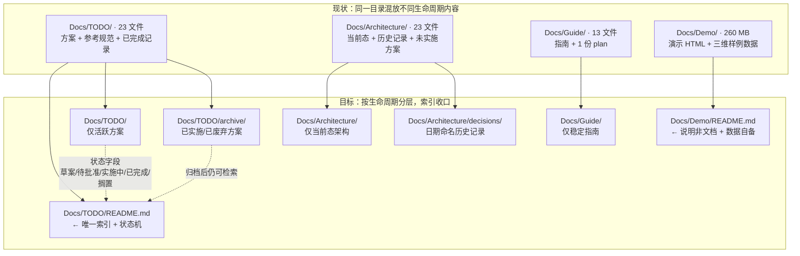

# 方案：项目文件组织治理 + Force_command 精炼（L3）

> **任务等级**：L3 架构级（涉及目录调整、跨文档重构、规范本体修改）
> **提出时间**：2026-11-01 12:35
> **状态**：⏳ 待用户批准
> **目标版本**：V3.6.37
> **依据**：`Force_command.md` §1（L3 定义）、§3 阶段二（方案先行）、§2.9（L3 须含 Mermaid）

---

## 1. 需求拆解

用户提出四个子问题，本文逐条应答：

| # | 子问题 | 本文对应章节 |
|:---:|---|---|
| 1 | 全项目文件组织是否易维护/开发/运维/管理/上手/阅读？ | §3 七维度评估 |
| 2 | 路径组织是否合理？有无需优化或迁移处？ | §4 问题清单 + §5 方案 |
| 3 | `Force_command.md` 是否冗余、不够精炼？其定位是否达成？ | §6 专项分析 |
| 4 | 诸多 md（TODO 等）是否过期需更新？ | §7 状态审计 |

---

## 2. 现状测绘（实测数据，非估计）

### 2.1 顶层结构

```text
WebGIS-Dev/
├── README.md            639 行 / 40 KB     ← 三重职责（见 §6.2）
├── LICENSE / LocalDev.bat / Write-Color.ps1
├── .github/             dependabot.yml + 4 workflows + traffic.json
├── Scripts/             3 个 Python 门禁/工具脚本
├── deploy/              Dockerfile ×2 + docker-compose + nginx.conf + .env ×3
├── backend/             3230 个 .py（api 47 / core 6 / services 3 / config 5 / tests 6）
├── frontend/            src 下 12 个顶层目录，484 个文件集中在 domains/
└── Docs/                1289 个文件（见 2.2）
```

### 2.2 Docs 子目录规模

| 目录 | 文件数 | 行数/体积 | 性质 |
|---|---:|---|---|
| `Docs/Architecture/` | 23 | 5408 行 | 架构文档 + 历史重构记录 + 未实施方案（三类混放） |
| `Docs/Guide/` | 13 | 6211 行 | 指南 + 配置 + 一份 **plan**（`configuration-architecture-plan.md` 426 行） |
| `Docs/LLM_record/` | 528 | — | 维护日志，按 `YY-MM/YYYY-MM-DD/` 归档 |
| `Docs/TODO/` | 24 | ~6400 行 | 方案 + 参考规范 + 已实施记录（三类混放） |
| `Docs/Demo/` | 701 | **260 MB** | 20 个 HTML 演示 + 381 `.b3dm` + 285 `.json` + 13 `.glb` |

### 2.3 代码侧组织（前端）

`frontend/src/` 采用 **domain-first + 别名 barrel**：

```text
src/
├── domains/{cesium,ol,common}/   484 文件 ← 真正的业务主体
├── api/ 21 · app/ 12 · workers/ 2 · locales/ 3
├── stores/index.ts              14 行 barrel，从 domains/*/stores 再导出
├── utils/index.js · constants/index.js   ← 同为 barrel
└── config/publicRuntime.ts      ← VITE_* 唯一入口（符合 §3 配置约定）
```

**评价：这一层设计是健康的。** 域驱动拆分 + barrel 收口，符合 §3「单一职责封装」与 §4 SSOT 精神。

### 2.4 代码侧组织（后端）

`backend/` 分层清晰：`api/`（47 路由文件）· `core/`（6）· `services/`（3）· `config/`（5）· `tests/`（6），入口 `app.py` 486 行。**评价：健康。**

### 2.5 巨型文件清单（代码侧最大风险）

| 文件 | 行数 |
|---|---:|
| `frontend/src/app/LandingView.vue` | **5379** |
| `frontend/src/assets/data/compass-metadata/twentyEightConstellations.ts` | 4323（数据文件，可接受） |
| `frontend/src/domains/cesium/components/CesiumContainer.vue` | 3165 |
| `frontend/src/domains/ol/components/MapContainer.vue` | **2939**（§3 记为「2000+」，实际已到 2939） |
| `frontend/src/app/HomeView.vue` | 2784 |
| `frontend/src/domains/cesium/components/CesiumToolPanel.vue` | 2702 |
| `frontend/src/app/RegisterView.vue` | 2654 |
| `frontend/src/domains/common/layer-tree/components/TOCPanel.vue` | 2517 |

> 该类问题已由 `bugfix-optimization-plan.md` P3-1 跟踪，**本次不动代码**（见 §8）。

### 2.6 Git 体积

`.git` 目录 **700 MB**，`.gitattributes` 无 LFS 规则。仓库历史含多次二进制提交（字体、瓦片、模型），克隆成本高。属独立议题，见 §8 不做范围。

---

## 3. 七维度评估

| 维度 | 评级 | 主要依据 | 关键短板 |
|---|:---:|---|---|
| **开发** | 🟢 良 | 前端域驱动 + barrel 收口；后端五层分离；别名 `@common` `@ol` 降低相对路径噪音 | 巨型单文件削弱并行开发（合并冲突面大） |
| **维护** | 🟡 中 | 有 `dev-conventions.md` 分层边界、有 3 个门禁脚本 | 巨型文件 7 个 >2500 行；规范分散在两处且互相指认 |
| **运维** | 🟢 良 | `deploy/` 4 个部署文件 + 双 Dockerfile + nginx；CI 4 个 workflow 职责单一 | `.git` 700 MB 拉取成本高；无环境清单页 |
| **管理** | 🔴 差 | — | ①`Docs/TODO/` 23 个 md **无索引**；②**13/23 无状态字段**；③4 套命名并存；④`Scripts/` 有孤儿脚本 |
| **上手** | 🟡 中 | `handover.md` 136 行、`README` 快速开始完整 | README 639 行过载；`Force_command` 无项目速览，单文件发给 Agent **无法建立全貌**（详见 §6.1） |
| **阅读** | 🟡 中 | 文档总量充足、Architecture 23 篇覆盖全面 | 当前态/历史/方案三类混放，读者无法判断哪篇是「现行有效」 |
| **组织管理** | 🔴 差 | — | ①`Docs/Demo` 260 MB 非文档内容占用 Docs 语义；②`Guide` 内含 plan；③`§3 与 §4` 自相矛盾（详见 §6.3） |

**总评**：**代码组织健康，文档组织失序。** 问题不在「文件放错文件夹」，而在「同一文件夹混放不同生命周期的内容，且缺乏索引与状态机」。

---

## 4. 问题清单（按可验证证据分级）

| ID | 问题 | 证据 | 影响 |
|---|---|---|---|
| **P-A1** | `Force_command.md` **不含项目全貌** | 全文 399 行，无技术栈/模块图/关键路径，直接进入「任务分级」 | 与其「单文件交付给 Agent 即可了解全貌」的定位**不符**——Agent 拿到后知道规矩，不知道项目是什么 |
| **P-A2** | `§3` 与技术约定文件**自相矛盾** | §4 SSOT 表明确写「技术分层约定 → `dev-conventions.md`｜**本文件不复制**」，但 §3 内含 40 行移动端基线（5 条）+ Cesium 标准契约（4 条）+ OL 对齐 + 验收 | 同一规则两处维护，必然漂移；且违反自身 SSOT 条款 |
| **P-A3** | `§11.2` 自查块**重复自身关键词表** | 33 行的 4 条 `rg` 命令，模式串即 §11.1 的禁项枚举 | 规范增长但信息不增 |
| **P-A4** | `§12`（本次新增）**112 行偏重** | 占全文 28%，其中 12.3 命令清单 22 行、12.8 故障表 12 行属「操作手册」而非「行为约束」 | 稀释规范的可扫读性（自我批评项） |
| **P-B1** | `Docs/TODO/` **无索引、无状态机** | 23 个 md；13 个无「状态」字段；其余状态行与完成标记互相矛盾 | 接手者无法判断哪些还活着，只能逐个读 |
| **P-B2** | TODO **4 套命名并存** | `xxx-plan.md` / `plan-xxx.md` / `YYYY-MM-DD-xxx-plan.md` / `xxx.md` | 排序与检索失效 |
| **P-B3** | TODO 混放**参考规范** | `ol2cesium.md` 2113 行是《双引擎坐标转换实现规范》，非待办 | 规范被当成待办，无人按规范执行 |
| **P-C1** | `Docs/Architecture/` 混放三类 | 当前态 17 篇 + 日期命名历史记录 3 篇 + 未实施方案 2 篇（`tencent-building-import-plan.md`、`2026-10-25-tileset-large-area-terrain-fit-plan.md`） | 读者无法区分「现行架构」与「当时怎么改的」 |
| **P-C2** | `Docs/Guide/` 内含 plan | `configuration-architecture-plan.md` 426 行 | Guide 应放稳定指南，方案属 TODO |
| **P-D1** | `Docs/Demo/` 260 MB 非文档 | 381 `.b3dm` + 285 `.json` + 13 `.glb`；`data/`、`textures/` 已被 `.gitignore` 排除 | Docs 语义污染；但**迁移会断相对路径**（见 §5.4 结论：不迁移） |
| **P-D2** | `Scripts/UpdateReadmeTree.py` **孤儿** | 默认输出 `FileTree.md`，该文件已不存在；README §项目结构 已改为纯链接（§4 SSOT 要求「README 不放树」） | 误用会重新生成被废弃的树，制造 SSOT 冲突 |
| **P-D3** | `Docs/Demo/` 无说明文件 | 21 个被追踪的 HTML/JS 无任何 README | 新人不知其用途，且不知 `data/` 需本地自备 |

---

## 5. 方案

### 5.1 目标结构（Mermaid）



**图注**：迁移方向单一（现状 → 目标），不做跨目录的双向搬运；`T0` 作为唯一索引入口，`T1`/`T2` 的状态由 `T0` 汇总，避免再次出现「无索引」问题。

### 5.2 分项方案

| ID | 处置 | 具体动作 | 风险 |
|---|---|---|---|
| **P-A1** | 新增 | `Force_command.md` 增 **§0.5 项目速览**（~25 行）：一句话定位 / 三端构成 / 技术栈 / 关键目录 / 必读文档 4 链接 | 低（纯增量） |
| **P-A2** | 迁移 | §3 中「移动端基线」5 条、「Cesium 标准契约」4 条、「OL 侧对齐」、「验收」→ 整体迁入 `dev-conventions.md` 新增「场景数据与移动端契约」节；§3 保留流程骨架 + 一行链接 | 中（需同步 §4 SSOT 表与 dev-conventions 摘要措辞） |
| **P-A3** | 压缩 | §11.2 四条 `rg` 合并为一条 `rg -i "<合并模式>" backend/ deploy/ frontend/src/ .github/` + 保留第 4 条基线检查 | 低 |
| **P-A4** | 外移 | §12.3 命令清单 + §12.8 故障对照 → 新建 `Docs/Guide/bot-pr-playbook.md`；§12 保留权限三分 + 准入条件 + 授权流程（~70 行） | 低 |
| **P-B1** | 新增 | 新建 `Docs/TODO/README.md`：状态机定义（草案/待批准/实施中/已完成/搁置/废弃）+ 全量状态表 + 归档规则 | 低 |
| **P-B2** | 不动 | **不改名**。改名会打断 40+ 处跨文档引用（日志、CHANGELOG、结构树），收益低于成本；改由索引表统一呈现 | — |
| **P-B3** | 迁移 | `ol2cesium.md` → `Docs/Architecture/ol-cesium-coordinate-transform-spec.md`（与既有 `ol-cesium-dual-engine.md` 区分：前者是实现规范，后者是架构总览） | 中（需更新引用） |
| **P-C1** | 迁移 | 3 个日期命名重构记录 → `Docs/Architecture/decisions/`；2 个未实施方案 → `Docs/TODO/` | 中（需更新引用） |
| **P-C2** | 迁移 | `configuration-architecture-plan.md` → `Docs/TODO/`（若已实施则直接进 `archive/`，需先核验） | 低 |
| **P-D1** | **不迁移** | 见 §5.4 | — |
| **P-D2** | 迁移 | `Scripts/UpdateReadmeTree.py` → `Scripts/archive/`，并在文件头加废弃说明 | 低 |
| **P-D3** | 新增 | `Docs/Demo/README.md`：说明用途、`data/`+`textures/` 需本地自备、为何不迁移 | 低 |

### 5.3 为何不改 TODO 文件名（P-B2 的反直觉结论）

用户允许迁移，但**改名在此处是负收益**：

1. 23 个文件被 `CHANGELOG.md`、`project-structure.md`、各期日志引用约 40+ 处；
2. 改名后这些历史引用全部失效（历史日志按 §6 不可改写）；
3. 索引表 `Docs/TODO/README.md` 能达到同样的检索效果，且零破坏。

**结论：用索引解决「找不到」，而不是用改名解决「不整齐」。**

### 5.4 为何不迁移 `Docs/Demo/`（260 MB）

1. 20 个 HTML 以**相对路径**引用 `data/`、`textures/`（如 `first_person_fly.html` 加载 `data/*.json`），迁移必断链；
2. `data/` 与 `textures/` 已被 `.gitignore` 排除，**不在仓库内**，迁移对仓库体积零收益；
3. 若迁到根级 `sandbox/`，反而让根目录新增一个非标准目录，与 §4「根级目录树唯一权威」的简洁性冲突。

**结论：就地保留 + 补 `README.md` 声明语义 + 结构树标注「非文档，为演示与样例数据」**。

---

## 6. `Force_command.md` 专项分析

### 6.1 定位达成度：**部分达成**

用户定义其作用为「发给 Agent → 了解全貌 / 边界 / 约束 / 增删改维护 SOP」。逐项核对：

| 应达成的信息 | 现状 | 达成 |
|---|---|:---:|
| 边界（不能做什么） | §2 硬边界 11 条、§11 平台红线 9 类 | ✅ |
| 约束（怎么写） | §2 第 11 条、§3 阶段三（但技术细节越界） | 🟡 |
| SOP（怎么做） | §3 五阶段、§6 日志、§7 DoD、§8 交接块 | ✅ |
| **全貌（项目是什么）** | **完全缺失** | ❌ |

**这是最大的定位缺口**：Agent 读完 399 行，知道所有规矩，但不知道这是个 WebGIS 双引擎平台、不知道 `domains/{cesium,ol,common}` 是什么、不知道前后端如何通信。结果仍要再读 `handover.md` + `README.md` 才能开工，与「单文件交付」的设想相悖。

### 6.2 冗余度量化

| 节 | 行数 | 占比 | 判断 |
|---|---:|---:|---|
| §0 冲突裁决 | 14 | 3.5% | 必要 |
| §1 任务分级 | 16 | 4.0% | 必要 |
| §2 硬边界 | 23 | 5.8% | 必要（但第 9、11 条属技术约定，见 P-A2） |
| **§3 SOP** | **40** | **10.0%** | **含 30 行技术细节，越界** |
| §4 SSOT | 19 | 4.8% | 必要 |
| §5 版本号 | 13 | 3.3% | 必要 |
| §6 日志 | 28 | 7.0% | 必要 |
| §7 DoD | 23 | 5.8% | 必要 |
| §8 交接块 | 31 | 7.8% | 必要（含 commit 模板） |
| §9 违规 | 15 | 3.8% | 必要 |
| §10 自维护 | 6 | 1.5% | 必要 |
| §11 平台红线 | 33 | 8.3% | 必要（§11.2 可压缩 60%） |
| **§12 机器人 PR** | **112** | **28.1%** | **过重，60% 内容属操作手册** |

**可压缩量**：§3 约 30 行 + §11.2 约 20 行 + §12 约 45 行 ≈ **95 行**；同时新增 §0.5 约 25 行。**净减约 70 行，399 → ~330**，且信息量不减（迁出的内容在 Guide 中更易维护）。

> **自我批评**：§12 是本次上一任务新增的，当时以「完整覆盖」为目标，未考虑对规范整体的稀释效应。本节将其 60% 外移，是对上一决策的修正。

### 6.3 内部矛盾（须先裁决）

> **§4 SSOT 表第 9 行**：「技术分层约定 → 唯一权威 `Docs/Guide/dev-conventions.md`｜其他位置一律只放链接」
> **§3 阶段三**：实际内联了 30 行技术约定（移动端基线 / Cesium 契约 / OL 对齐）
>
> 二者冲突。按 §0「发现规范互相矛盾 → 立即停止实施，向用户报告」，本方案采用 **§4 为准**（技术约定归 `dev-conventions.md`），并请用户在 §9 确认。

---

## 7. TODO 状态审计方法（不预设结论）

**已确认的事实**：13/23 文件无状态字段；`✅` 标记语义混乱。

**关键教训（本次实测）**：`2026-10-31-turnstile-auth-hardening-plan.md` 有 4 处 `✅`，但 `grep -ril turnstile frontend/src backend` 返回 **0 个文件** —— 该方案的 `✅` 是**设计决策标记**（「选定 / 排除游客」），不是完成标记。**方案确实未实施**，其状态行「待批准，未实施」是准确的。

**因此禁止**按「`✅` 数量 + 未完成项数量」机械判定归档（会误判）。本方案采用**三重判据**：

| 判据 | 方法 | 权重 |
|---|---|:---:|
| ① 显式状态行 | 文件内「状态：」字段 | 高 |
| ② 代码存在性 | 方案声称新增的文件/函数/配置 key 是否在仓库中存在（`grep` 实测） | **最高** |
| ③ 完成标记 | `✅` / `[x]`（**仅作辅助，须与 ② 交叉验证**） | 低 |

**处置规则**：
- ② 代码全存在 + ① 标已完成 → 迁 `archive/`
- ② 代码全存在 + ① 无状态 → 迁 `archive/`，索引表注明「据代码核验已实施」
- ② 代码部分存在 → 留 TODO，状态改「实施中（部分）」
- ② 代码不存在 → 留 TODO，状态按 ① 原样保留
- ② 无法判定（如纯文档方案）→ 留 TODO，状态标 `⚠️ 待人工确认`

**归档一律「迁移」不「删除」**（§2.4），`archive/` 内文件不改内容，仅在索引表登记。

---

## 8. 本次不做（边界声明）

| 项 | 原因 |
|---|---|
| 不改任何 `.vue` / `.ts` / `.py` 代码 | 用户诉求聚焦文件组织与文档；巨型文件拆分属 P3-1，已有 TODO 跟踪 |
| 不处理 `.git` 700 MB | 需 `git filter-repo` 重写历史，属 Git 写操作（§2.1 绝对禁止），只能由用户执行 |
| 不重命名 TODO 文件 | 见 §5.3 |
| 不迁移 `Docs/Demo/` 数据 | 见 §5.4 |
| 不改 `.github/workflows/`、`dependabot.yml` | 部署面（§2.3 第 3 条） |
| 不改历史日志（`LLM_record/`） | §6 明文「历史目录保持原样不迁移」 |
| 不删除任何文件 | §2.4；`Scripts/UpdateReadmeTree.py` 亦只迁 `archive/` 不删 |

---

## 9. 待批准项（4 个决策点）

### 决策 1：§3 技术细节是否迁出 Force_command？

- **A（推荐）**：迁入 `dev-conventions.md`，§3 只留流程 + 链接。彻底消除 §4 自相矛盾，但 `dev-conventions.md` 会从 93 行增至约 125 行。
- **B**：保持现状，仅把 §4 SSOT 表那行改成「技术约定 → 本文件 §3」，承认 Force_command 兼任技术约定。
- 倾向 A：符合用户「Force_command 应精炼」的诉求，且符合其自身 SSOT 条款。

### 决策 2：`Docs/TODO/` 归档范围

- **A（推荐）**：按 §7 三重判据逐个核验，仅归档「代码核验确认已实施」的，其余保留并在索引标注状态。预计归档 8–12 个，其余留活跃。
- **B**：仅建索引，**一个都不归档**，全部保留在原位，用状态列区分。
- 倾向 A：TODO 目录 23 个文件对新人已是负担，但 B 更保守、零风险。

### 决策 3：`Docs/Architecture/` 是否新建 `decisions/` 子目录？

- **A（推荐）**：新建，收 3 个日期命名重构记录（`2026-08-02-basemap-ssot-refactor` / `2026-08-20-unified-basemap-selection` / `2026-08-22-clamp-to-ground-strategy`）。
- **B**：不新建，仅在 `Architecture/README.md` 里用表格区分「现行」与「历史」。
- 倾向 A：物理分层比表格约定更持久。

### 决策 4：`Docs/Guide/configuration-architecture-plan.md` 去向

- **A（推荐）**：先核验是否已实施 → 已实施进 `TODO/archive/`，未实施进 `TODO/`。
- **B**：留在 Guide 不动，仅在 Guide 索引标注「方案，非指南」。

---

## 10. 实施步骤（获批后）

| # | 文件/动作 | 说明 |
|---|---|---|
| 1 | `Docs/Force_command.md` | 新增 §0.5 项目速览（~25 行） |
| 2 | `Docs/Force_command.md` | §3 技术细节外移，保留流程骨架 |
| 3 | `Docs/Force_command.md` | §11.2 压缩；§12 拆出操作手册 |
| 4 | `Docs/Guide/dev-conventions.md` | 新增「场景数据与移动端契约」节（承接 §3 迁出内容）；调整摘要第 12/13 条指向 |
| 5 | `Docs/Guide/bot-pr-playbook.md` | 新建：12.3 命令清单 + 12.8 故障对照 |
| 6 | `Docs/TODO/README.md` | 新建：状态机 + 全量索引表 |
| 7 | `Docs/TODO/archive/` | 按 §7 判据迁移已实施方案 |
| 8 | `Docs/Architecture/decisions/` | 新建，迁入 3 个日期命名记录 |
| 9 | `Docs/TODO/ol2cesium.md` → `Docs/Architecture/ol-cesium-coordinate-transform-spec.md` | 迁移 |
| 10 | `Docs/Guide/configuration-architecture-plan.md` | 按决策 4 处置 |
| 11 | `Docs/Architecture/tencent-building-import-plan.md`、`2026-10-25-tileset-*.md` | 迁 TODO |
| 12 | `Scripts/archive/UpdateReadmeTree.py` | 迁移 + 文件头加废弃说明 |
| 13 | `Docs/Demo/README.md` | 新建：语义声明 + 数据自备说明 |
| 14 | `Docs/Guide/project-structure.md`、`frontend-structure.md`、`backend-structure.md` | 同步全部路径变更 |
| 15 | 全库引用修复 | `grep` 所有旧路径（README / CHANGELOG / Guide / TODO），逐处改为新路径 |
| 16 | `README.md` 三处 + `CHANGELOG.md` | 版本号 V3.6.37 |
| 17 | `Docs/LLM_record/26-11/2026-11-01/2026-11-01-docs-governance.md` | 按 §6 九章节写日志 |
| 18 | 门禁 | `CheckStructureTree.py` + `CheckConfigRegistry.py` |

**预估改动**：修改 8–10 个文件、新建 3 个、迁移 15–20 个路径。**全程零 Git 写操作**，迁移用文件系统 `mv`，由用户决定何时提交。

---

## 11. 验收标准

1. 单一文件 `Force_command.md` 交付后，Agent 能回答「这是什么项目 / 边界在哪 / 怎么干」三问 —— 由 §0.5 承担第三问的「是什么」。
2. `Docs/TODO/` 打开即见 `README.md` 索引，能一眼看出「哪些还活着」。
3. `Docs/Architecture/` 顶层只剩现行架构，历史记录物理隔离在 `decisions/`。
4. 全库无失效引用：`grep` 旧路径零命中。
5. 两个门禁脚本通过。
6. 行数目标：`Force_command.md` ≤ 340 行（现 399），信息量不减。
