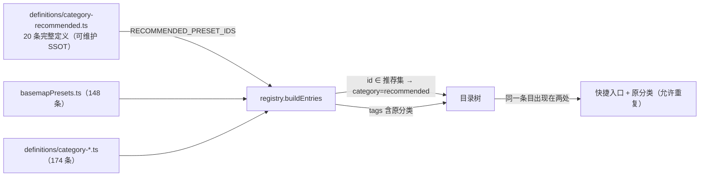

# 精选底图改为显式定义清单（L3）

> 状态：✅ 已完成（V3.7.16 落地；2026-11-28 清理旧机制残留注释）
> 用户指令：2026-11-28「不固定前 20 个 id，增加推荐底图分类，完整定义，自由增删改；允许与其他分类重复」，依 Force_command §0 优先级 1 视为批准
> 落地版本：V3.7.16

## 一、问题分析

当前推荐分类由位置规则决定：`catalog/registry.ts:55` 用 `index < RECOMMENDED_FIRST_N`（=20）判定 preset 是否推荐，并靠 `taxonomy.ts` 的 `CATEGORY_OVERRIDES` 打补丁纠正误判。这套机制：

- 推荐集合与预设顺序强耦合——插入/删除任意预设都会改变推荐结果；
- 推荐名单不可见、不可维护，必须改预设数组顺序才能调整；
- `CATEGORY_OVERRIDES` 是位置规则的补丁，越补越乱。

## 二、目标机制

1. 在 `definitions/` 新增 `category-recommended.ts`，**完整定义** 20 条推荐底图（id/name/stack/provider/coord/description），作为推荐集合 SSOT。用户可自由增删改，与预设顺序解耦。
2. `registry.ts` 改为按 `RECOMMENDED_PRESET_IDS` 判定 `category==='recommended'`，同时把源定义主分类写入 `tags`——推荐条目既是快捷入口，又仍出现在其原始分类中（允许重复）。
3. 废弃 `RECOMMENDED_FIRST_N` 与 `CATEGORY_OVERRIDES`；`PROVIDER_OVERRIDES`/`COORD_OVERRIDES` 保留（与推荐无关）。
4. `check-basemap-catalog.mjs` 增校验：推荐 id 必须在预设中存在、无重复。

## 三、Mermaid 图

## 四、验收

- 目录树「常用推荐」显示 20 条，与 `category-recommended.ts` 定义一致。
- 推荐条目（如 arcgis_imagery_preset）同时出现在「影像底图」分类。
- 增删改推荐清单条目后立即生效，不影响预设编号。
- `vue-tsc` 0 错误、三个 basemap 校验脚本通过。
