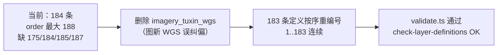

# 修复 order 空洞与图新误纠偏定义（L3）

> 状态：✅ 已完成（V3.7.16 落地；V3.7.16 已被并行会话占用，按 §5 顺延）
> 用户指令：2026-11-28「修复这个 bug」，并在询问中确认「重编号 1..N」+「删除 imagery_tuxin_wgs」
> 落地版本：V3.7.16

## 一、问题分析

**症状**（用户截图）：`[basemap-definitions] 图层定义校验失败：order 缺失: 175 / order 缺失: 184（应覆盖 1..184）`

**核查**：当前 184 条定义，order 最大 188，缺失 **175/184/185/187** 四个编号。用户删除了 4 条定义（含图新误纠偏条目）但未重编号，触发 `validate.ts` 的「order 必须覆盖 1..N」硬校验，应用启动即抛错。

**第二个问题**：`imagery_tuxin_wgs`（order 186）与 `imagery_tuxin`（order 25）URL 完全相同（geovisearth 同一影像服务），但前者带 `correction: 'gcj2wgs'`。图新（geovisearth）节点提供 WGS84 原生瓦片，无需纠偏——前者是错误的重复定义。用户确认删除。

## 二、纠偏声明核实结论

对全部 36 条 `gcj2wgs` 按 URL 域名核查：

| 域名 | 条数 | 源坐标系 | 纠偏是否正确 |
|---|---|---|---|
| `webrd01.is.autonavi.com` / `webst01.is.autonavi.com` | 18 | GCJ-02（高德中国节点） | ✅ 正确 |
| `mt0.google.com` / `www.google.com` | 16 | GCJ-02（Google 中国节点） | ✅ 正确 |
| `rt0.map.gtimg.com` | 1 | GCJ-02（腾讯中国节点） | ✅ 正确 |
| `tiles.geovisearth.com` | 1 | **WGS84（图新原生）** | ❌ 错误 → 删除该条 |

天地图（tianditu）各定义均无 correction，正确。

**重要语义**：`coord` = 纠偏后输出坐标系，`correction` = 引擎要做的变换。因此「name 含 (WGS) + coord=WGS84 + correction=gcj2wgs」是合法的「GCJ 源 → WGS 输出」定义，不是 bug；只有**源本身是 WGS**（图新）时纠偏才错误。

## 三、实施方案

1. 删除 `category-imagery.ts` 中 `imagery_tuxin_wgs`（order 186）整块定义。
2. 全部定义按当前 order 升序**重编号为 1..183**（连续、唯一）。
3. 更新 `@common/basemap/catalog/compat.ts`?——不存在，跳过；`basemapPresets.ts` 的 `stack` 若引用被删 id 需同步（核查后处理）。
4. `check-layer-definitions.mjs` 校验 orders 1..N 连续。

## 四、Mermaid 图

## 五、验收

- 应用启动无 `[basemap-definitions]` 校验失败。
- `npm run check:layer-definitions` OK（183 definitions, orders 1..183）。
- `npm run typecheck` 0 错误。
- 分享链接 `l` 编号由 `basemapPresets.ts` 决定，不受图层 order 重编号影响。
