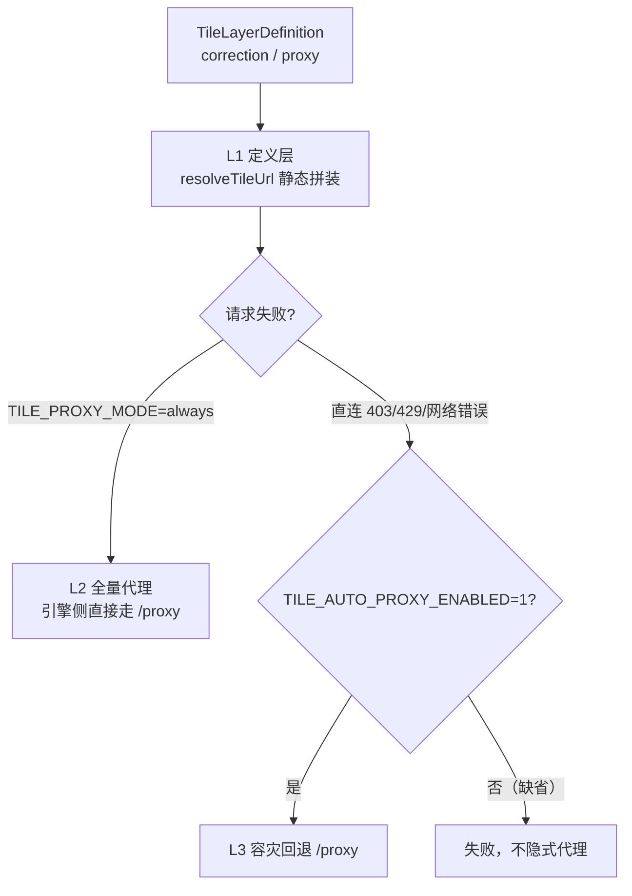

# 暂存区瓦片代理架构审核 + 架构文档更新（L3）

> 状态：🔵 实施中（用户 2026-11-28 明确指令「核查暂存区代码，审核新增底图瓦片代理架构和逻辑；更新架构文档以实际代码为准」）
> 目标版本：V3.7.16

## 一、审核范围与方法

审核 `git diff --cached` 中 124 个文件，聚焦代理相关：`resolveTileUrl.ts`、`publicRuntime.ts`、`createOlSource.ts`、`tileLifecycle.ts`、`basemapProviderFactory.ts`、`imageryProviderBuilders.ts`、`check-*.mjs`。对照 `Docs/Architecture/basemap-catalog-redesign.md` 找偏差。

## 二、审核发现

### 2.1 代理架构实际为三层（文档完全未覆盖）

| 层 | 触发条件 | 实现位置 | 说明 |
|---|---|---|---|
| L1 定义层静态代理 | `correction != 'none'` 或 `proxy:'proxy'` | `resolveTileUrl.ts` | 纯拼装，定义声明；纠偏强制走 `/proxy/{segment}/{url}` |
| L2 显式全量代理 | `TILE_PROXY_MODE=always` | OL `tileLifecycle` / Cesium `wrapProviderWithFetchFallback` | 所有外部瓦片走代理 |
| L3 容灾回退代理 | `TILE_AUTO_PROXY_ENABLED=1`（V3.7.16 新增，**缺省关**） | 同上 | 直连 403/429/网络失败后才回退代理；`always` 不受此开关影响 |

后端另有 `/proxy/{target}`（通用）与 `/proxy/{segment}/{url}`（纠偏）两类路由契约。

### 2.2 代码缺陷（已修复）

**死参数 `tileProxyMode`**：`TileUrlContext`（`resolveTileUrl.ts:33`）声明 `tileProxyMode: string`，但函数体内从未读取；`createOlSource.ts:64` 与 `basemapProviderFactory.ts:395` 仍在传入。三层分工中 L2/L3 由引擎侧直接读全局 `TILE_PROXY_MODE`，定义层不需要这个值。删除该字段与两处传入。

### 2.3 设计差异（如实记录，不强行统一）

- **同源排除不对称**：OL `canProxyTileUrl()` 排除同源 URL、`/proxy/*`、`/tiles/*` 路径；Cesium `buildCesiumTileProxyUrl()` 只排除 `TILE_PROXY_MODE=off`，无同源/路径排除。潜在风险：Cesium 若对同源瓦片做容灾代理会形成自代理环。实践未触发（Cesium 瓦片多为外部域名），列为观察项。
- **OSM 德国镜像**：仅 Cesium 侧有（`wrapProviderWithFetchFallback`），OL 侧无对应机制——因 OL OSM 官方 403 问题由 `prioritizeTileSourceRequest` 的 Referrer 策略规避。

### 2.4 暂存区卫生

`frontend/src/domains/common/basemap/renumber.cjs`（临时编号脚本）被 stage——非交付物，应移出暂存区/删除。

## 三、文档更新内容

`Docs/Architecture/basemap-catalog-redesign.md` 新增独立章节「瓦片代理架构」：三层触发链 Mermaid 图、后端路由契约、双引擎实现差异表、配置开关表；修正 §3.3 要点中「auto 模式回退」表述（现由 `TILE_AUTO_PROXY_ENABLED` 门控，缺省关闭）；§8 增审核记录。

## 四、Mermaid 图

## 五、验收

- `vue-tsc` 0 错误；三个 basemap 校验脚本通过；配置门禁全绿。
- 架构文档与实际代码逐项对齐，含三层代理与开关语义。
- 临时脚本不再位于暂存区/工作区。
